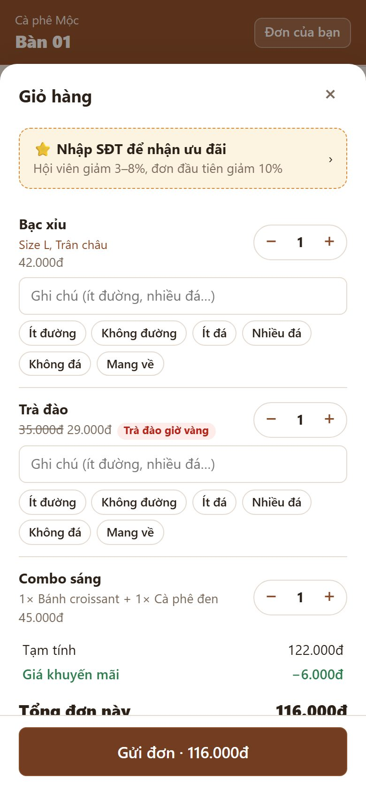
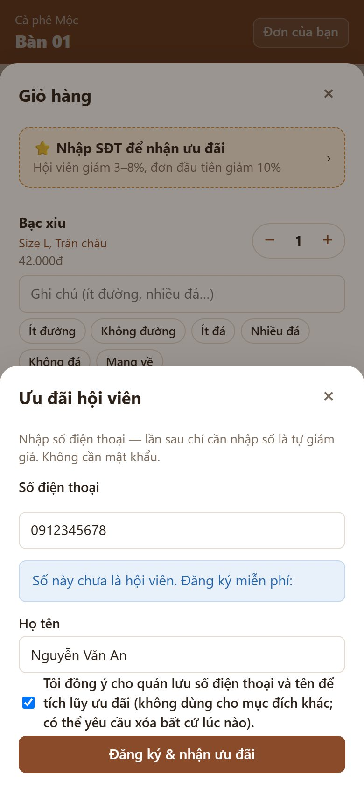
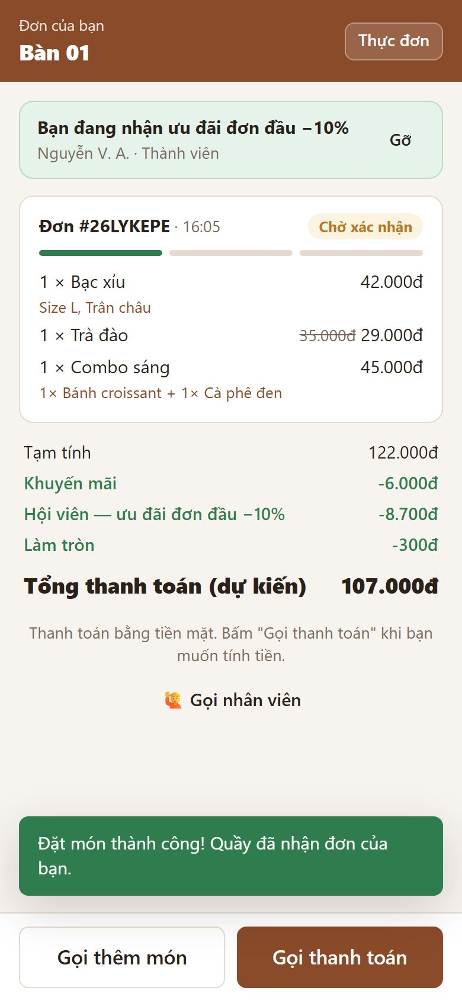
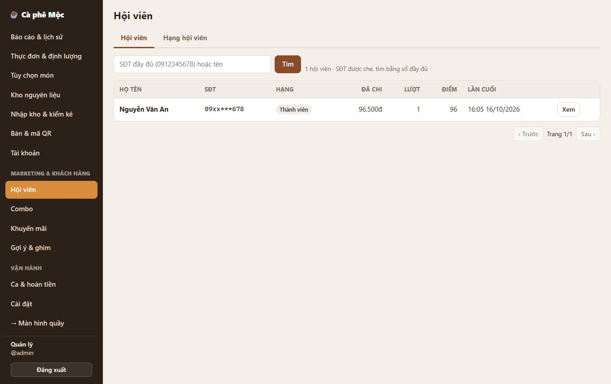
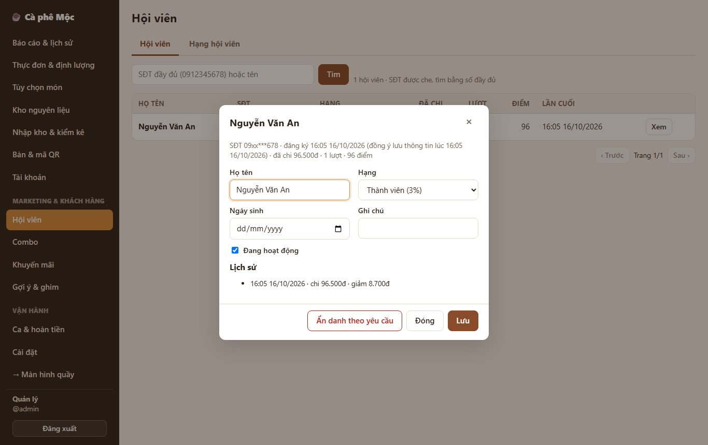
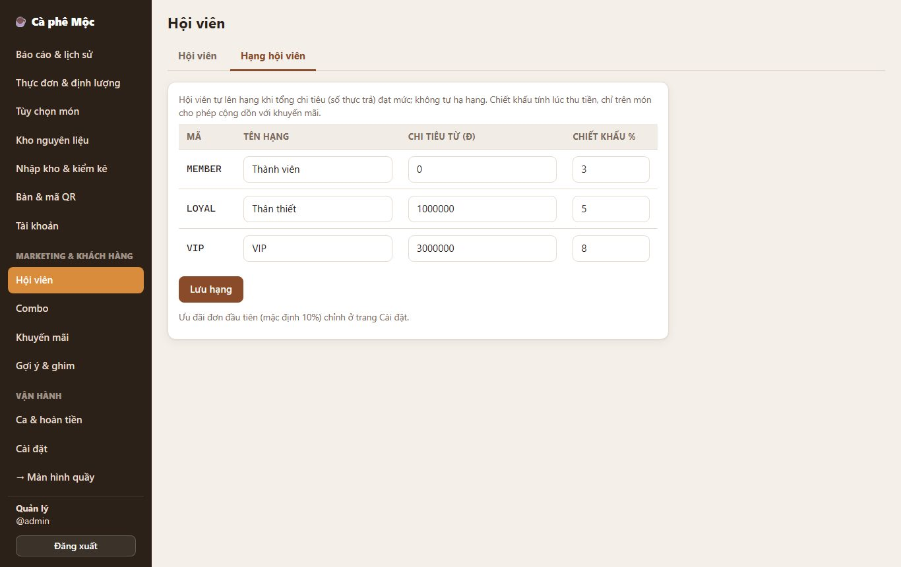

# 1. Hội viên (số điện thoại + họ tên)

> Khách chỉ cần đọc / nhập **số điện thoại** là được giảm giá. Không cần cài app, không cần mật khẩu hay mã OTP. Đăng ký **không bắt buộc**.

**Ai dùng:**

- **Khách:** tự nhập ở giỏ hàng hoặc màn "Đơn của bạn".
- **Quầy:** nhập khi thu tiền / bán mang đi.
- **Quản lý:** xem, sửa, ẩn danh, chỉnh hạng.

## Ưu đãi

| Hạng | Điều kiện (tổng tiền đã chi) | Giảm |
| --- | --- | --- |
| Thành viên | Vừa đăng ký | 3% |
| Thân thiết | Từ 1.000.000đ | 5% |
| VIP | Từ 3.000.000đ | 8% |
| **Đơn đầu tiên** | Lần thanh toán đầu sau khi đăng ký | **10%** (thay cho % hạng nếu lớn hơn) |

- **Lên hạng:** tự lên hạng khi đủ mức; **không tự xuống hạng**.
- **Điểm:** từ 18/10/2026 mỗi **10.000đ** thực trả được 1 điểm, dùng để đổi quà khi thu tiền — xem [21-tích-điểm-tem-voucher-giới-thiệu.md](21-tích-điểm-tem-voucher-giới-thiệu.md). Điểm tích trước đó (1 điểm / 1.000đ) được giữ nguyên.
- **Chỉnh mức:** % và mức chi tiêu sửa ở Quản lý → Hội viên → tab **Hạng hội viên**. % đơn đầu sửa ở **Cài đặt**.

## Khách làm thế nào

1. Mở giỏ hàng (**Xem giỏ · Gửi đơn**) → bấm ô **⭐ Nhập SĐT để nhận ưu đãi**.
2. Nhập số điện thoại → **Tiếp tục**.
   - **Đã là hội viên:** hiện tên che một phần (ví dụ "Nguyễn V. A. · Thành viên · giảm 3%") → bấm **Xác nhận, đây là tôi**.
   - **Chưa là hội viên:** nhập họ tên, **tick ô đồng ý** cho quán lưu số + tên → **Đăng ký & nhận ưu đãi** → báo "Đơn đầu tiên giảm 10%".
3. Ô chuyển màu xanh: **"Bạn đang nhận ưu đãi …"**. Nhập nhầm số thì bấm **Gỡ**.
4. Màn **Đơn của bạn** hiện **Tổng thanh toán (dự kiến)** đã trừ ưu đãi.

## Quầy làm thế nào

- **Thu tiền tại bàn:** mở **Thu tiền** → mục **Hội viên · giảm giá**. Bàn đã có hội viên thì mục tự mở và hiện tên đầy đủ.
  - Khách đọc số → nhập vào ô **SĐT hội viên** → **Tra cứu**.
  - Số chưa đăng ký → nhập họ tên, tick "Khách đồng ý…" → **Đăng ký**.
- **Bán mang đi:** cùng mục **Hội viên · giảm giá** ở cột giỏ bên phải.
- **Số phải thu:** dòng **Hội viên … −x%** hiện ngay trong phần tính tiền; hóa đơn in có dòng hội viên.

## Quản lý làm thế nào

**Quản lý → Hội viên:**

- **Danh sách:** số điện thoại được **che** (`09xx***678`). Muốn tìm thì gõ **số đầy đủ** hoặc một phần **tên**.
- **Xem:**
  - sửa họ tên, hạng, ngày sinh, ghi chú; khóa / mở hội viên;
  - xem **lịch sử** chi tiêu, lên hạng, hoàn tiền.
- **Ẩn danh theo yêu cầu** (khi khách muốn xóa thông tin — Nghị định 13/2023):
  - xóa tên, thay số điện thoại bằng mã không đọc được;
  - lịch sử thanh toán vẫn giữ để đối soát;
  - số đó đăng ký lại được.
- **Tab Hạng hội viên:** sửa tên hạng, mức chi tiêu, % giảm.

## Quy tắc cần nhớ

- **Ưu đãi tính lúc thu tiền**, theo hạng tại thời điểm thu.
- **Món khuyến mãi không cho cộng dồn** thì **không** được giảm thêm phần hội viên. Ví dụ trên ảnh: trà đào đang giờ vàng.
- **Tổng chi tiêu** cộng theo số **thực trả**. Hoàn tiền thì bị trừ lại (không xuống hạng).
- **Khách chỉ thấy tên che;** nhân viên đăng nhập mới thấy tên đầy đủ. Không có ai xem được danh sách số điện thoại đầy đủ.
- **Tra cứu bị giới hạn** 10 lần/phút để tránh dò số (máy quầy không bị giới hạn).

## Hỏi nhanh

| Tình huống | Làm gì |
| --- | --- |
| "Số điện thoại không hợp lệ" | Nhập 10 số bắt đầu bằng 0 (`0912345678`) hoặc `+84…`; dấu cách / chấm không sao |
| "Số điện thoại này đã là hội viên" khi đăng ký | Dùng **Tiếp tục** (tra cứu) thay vì đăng ký lại |
| Khách quên số đã đăng ký | Quản lý tìm theo **tên** ở trang Hội viên |
| Khách muốn xóa thông tin | Quản lý → Hội viên → Xem → **Ẩn danh theo yêu cầu** |
| Gắn nhầm hội viên vào bàn | Bấm **Gỡ** (ở giỏ của khách hoặc trong hộp Thu tiền) trước khi thu tiền |

*Kỹ thuật: [FEATURE-014](../tài-liệu/chức-năng/FEATURE-014.md).*
