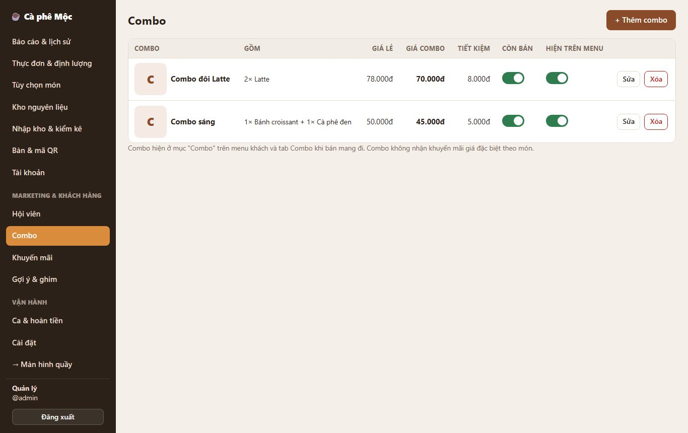
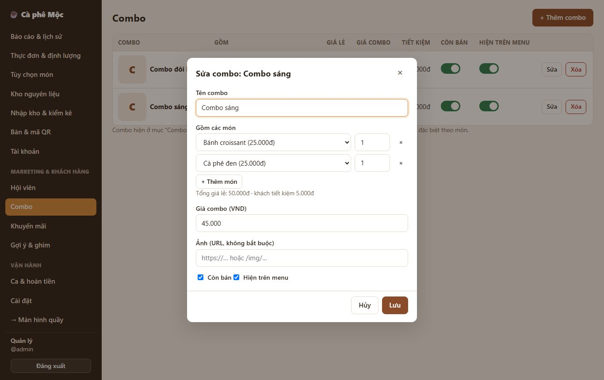
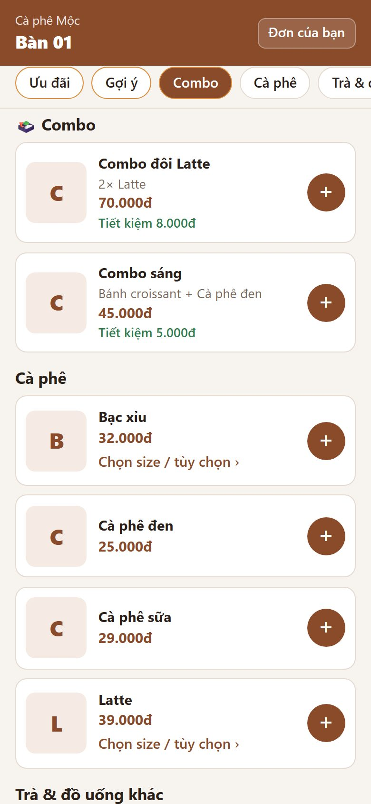
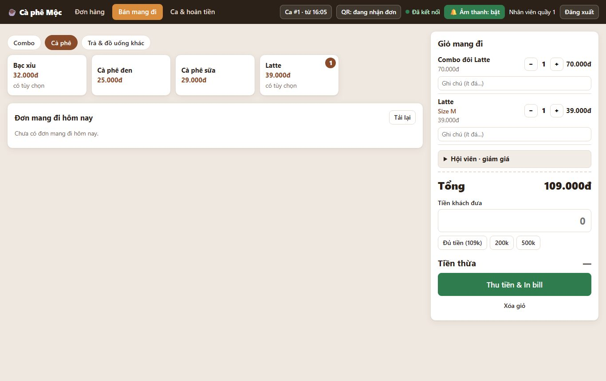

# 2. Combo

> Gộp nhiều món thành một "món" giá rẻ hơn mua lẻ, ví dụ **Combo sáng** = Cà phê đen + Bánh croissant giá 45.000đ (mua lẻ 50.000đ).

**Ai dùng:**

- Quản lý tạo combo.
- Khách gọi combo qua QR.
- Quầy bán combo ở mục Bán mang đi.

## Quản lý tạo combo

1. **Quản lý → Combo → + Thêm combo.**
2. Nhập **tên combo**.
3. Chọn các món + **số lượng** mỗi món (1–10). Bấm **+ Thêm món** để thêm dòng.
4. Nhập **giá combo**. Hệ thống hiện *Tổng giá lẻ* và *khách tiết kiệm bao nhiêu*.
5. Tick **Còn bán** / **Hiện trên menu** → **Lưu**.

Trong danh sách có công tắc **Còn bán**, **Hiện trên menu**, nút **Sửa**, **Xóa**.

## Khách và quầy

- **Menu khách:** có mục **🍱 Combo**, ghi rõ các món bên trong và **"Tiết kiệm x đ"**. Bấm **+** như món thường.
- **Quầy, Bán mang đi:** tab **Combo** đầu tiên.
- **Phiếu pha và hóa đơn:** in dòng combo, bên dưới là từng món bên trong (giá 0đ) để người pha làm đúng.

## Quy tắc cần nhớ

- **Kho trừ theo định lượng của từng món bên trong combo.** Combo không có định lượng riêng.
- **Combo tự hiện "Hết món"** khi một món bên trong bị tắt "Còn bán", bị xóa, hoặc kho không đủ nguyên liệu cho cả combo.
- **Combo không nhận khuyến mãi giá theo món.** Combo vẫn được tính vào khuyến mãi theo đơn và ưu đãi hội viên.
- **Không đặt combo trong combo.**
- **Muốn xóa một món đang nằm trong combo:** phải bỏ món đó khỏi combo (hoặc xóa combo) trước. Hệ thống báo tên combo đang dùng món.
- **Đổi giá lẻ của món:** "Tiết kiệm" tự cập nhật. Đơn đã đặt giữ nguyên giá.

*Kỹ thuật: [FEATURE-015](../tài-liệu/chức-năng/FEATURE-015.md).*
