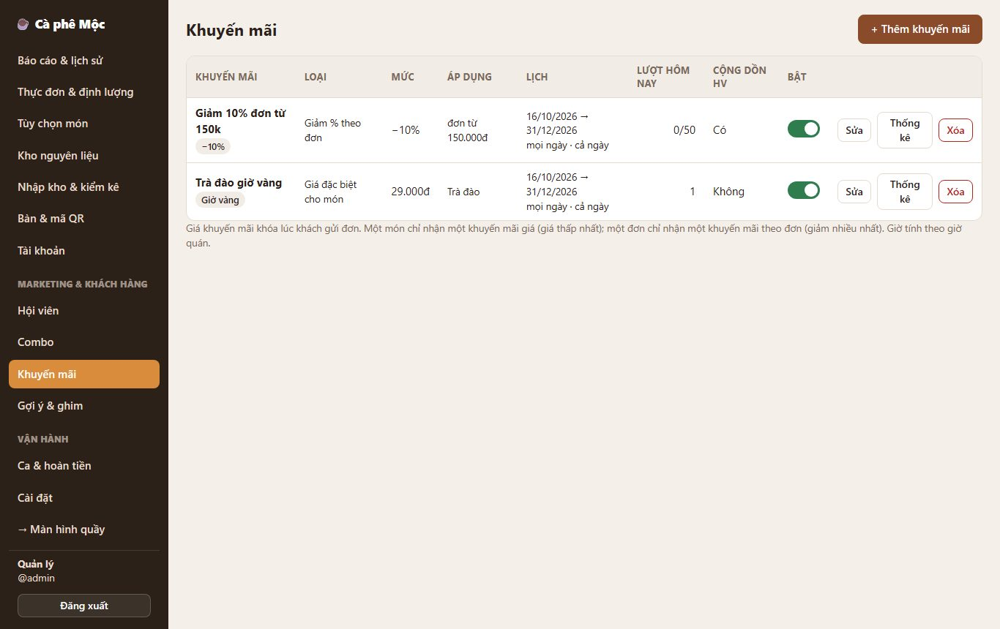
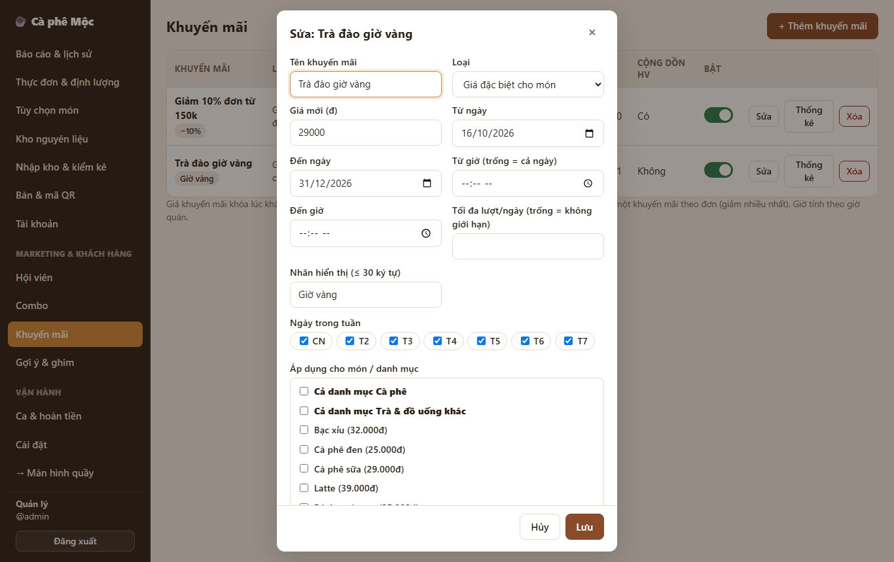
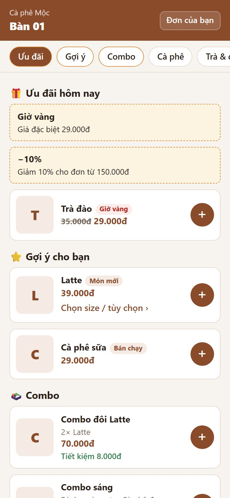

# 3. Khuyến mãi

> Tự động giảm giá theo lịch: **giá đặc biệt cho món** (ví dụ happy hour trà đào 14–17h còn 29.000đ) hoặc **giảm cho đơn lớn** (ví dụ giảm 10% đơn từ 150.000đ).

**Ai dùng:** quản lý tạo; khách và quầy được áp dụng tự động, không cần nhập mã.

## Hai loại khuyến mãi

| Loại | Ví dụ | Chọn áp dụng cho |
| --- | --- | --- |
| **Giá đặc biệt cho món** | Trà đào 35.000 → 29.000 từ 14h–17h | Từng món, hoặc cả danh mục |
| **Giảm % theo đơn** / **Giảm tiền theo đơn** | −10% (hoặc −20.000đ) cho đơn từ 150.000đ | Mọi đơn đạt mức tối thiểu |

## Quản lý tạo khuyến mãi

**Quản lý → Khuyến mãi → + Thêm khuyến mãi**, điền:

- **Tên**, **Loại**, **Mức:** giá mới / % giảm / số tiền giảm. Với loại theo đơn thì thêm **Đơn tối thiểu**.
- **Lịch:**
  - từ ngày – đến ngày;
  - ngày trong tuần (CN, T2…T7);
  - từ giờ – đến giờ (để trống = cả ngày; giờ kết thúc nhỏ hơn giờ bắt đầu, ví dụ 22:00–02:00, nghĩa là qua nửa đêm).
- **Tối đa lượt/ngày:** để trống = không giới hạn. Ví dụ "50 đơn đầu tiên mỗi ngày".
- **Nhãn hiển thị:** chữ nhỏ cạnh món trên menu, ví dụ "Giờ vàng".
- **Cho cộng dồn chiết khấu hội viên:** không tick = món/đơn được khuyến mãi sẽ không được giảm thêm phần hội viên.
- **Áp dụng cho món / danh mục:** chỉ với loại giá đặc biệt.

Trong danh sách:

- công tắc **Bật**;
- nút **Sửa**;
- nút **Thống kê** (số lượt dùng, tổng tiền đã giảm, doanh thu các đơn có khuyến mãi);
- nút **Xóa**: khuyến mãi đã từng dùng thì chỉ bị ẩn, vẫn giữ trong báo cáo.

## Khách thấy gì

- **Đầu menu:** mục **🎁 Ưu đãi hôm nay** (thẻ khuyến mãi đang chạy + các món đang giảm giá).
- **Món đang giảm:** có **giá cũ gạch ngang** và nhãn.
- **Giỏ hàng:** hiện dòng "Giá khuyến mãi" và tên khuyến mãi theo đơn (nếu đạt mức). Tổng là số hệ thống tính.

## Quy tắc cần nhớ

- **Một món chỉ nhận một khuyến mãi giá:** nhiều khuyến mãi cùng món thì lấy **giá thấp nhất**.
- **Một đơn chỉ nhận một khuyến mãi theo đơn:** lấy cái **giảm nhiều nhất**.
- **Giá khuyến mãi được chốt lúc khách gửi đơn.**
  - Gửi lúc 16:59 thì vẫn giá happy hour dù thu tiền lúc 17:30.
  - Tắt / sửa khuyến mãi sau đó không đổi đơn đã gửi.
- **Mức "đơn tối thiểu" xét trên từng lần gửi đơn**, không cộng dồn cả bàn.
- **Khuyến mãi theo đơn tính trên tổng sau khi đã áp giá món khuyến mãi.**
- **Khi hết lượt trong ngày:**
  - khách gửi sau được tính giá thường tự động (không báo lỗi);
  - menu thôi quảng bá khuyến mãi đó;
  - hai khách gửi cùng lúc tranh lượt cuối thì chỉ một người được.
- **Giờ tính theo giờ Việt Nam** của quán.

*Kỹ thuật: [FEATURE-016](../tài-liệu/chức-năng/FEATURE-016.md).*
