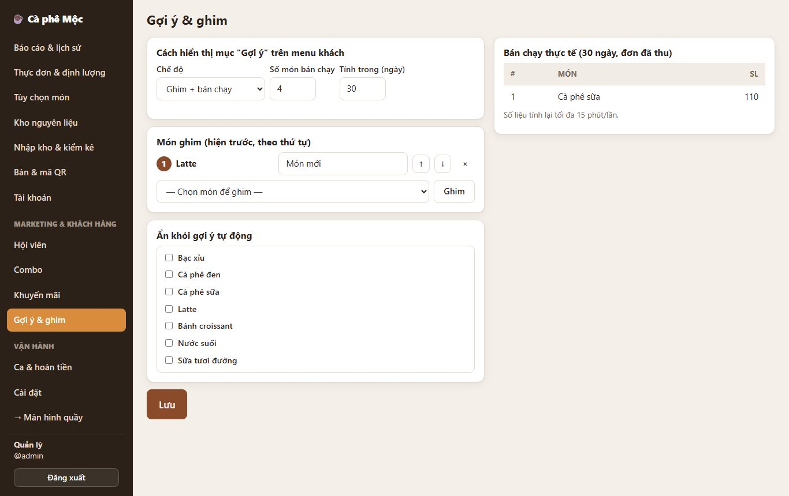

# 4. Gợi ý / bán chạy / ghim món

> Mục **⭐ Gợi ý cho bạn** ở đầu menu khách: món quán muốn đẩy (ghim, kèm nhãn như "Món mới") đứng trước, sau đó là các món **bán chạy nhất** gần đây (nhãn "Bán chạy").

**Ai dùng:** quản lý cài; khách xem.

## Quản lý cài đặt

**Quản lý → Gợi ý & ghim:**

1. **Chế độ:**
   - *Ghim + bán chạy* (mặc định);
   - *Chỉ món ghim*;
   - *Chỉ bán chạy tự động*.
2. **Số món bán chạy** muốn hiện (mặc định 8) và **tính trong bao nhiêu ngày** (mặc định 7).
3. **Món ghim:**
   - chọn món → **Ghim**;
   - gõ **nhãn** (để trống = "Quán gợi ý");
   - dùng **↑ ↓** đổi thứ tự, **×** bỏ ghim.
4. **Ẩn khỏi gợi ý tự động:** tick món không muốn hiện dù bán chạy (ví dụ nước suối).
5. Bấm **Lưu**: menu khách đang mở cập nhật ngay.

Bên phải là bảng **Bán chạy thực tế** (top 20) để tham khảo.

## Khách thấy gì

Mục **⭐ Gợi ý cho bạn** ngay dưới Ưu đãi. Ví dụ: Latte nhãn "Món mới" (ghim), Cà phê sữa nhãn "Bán chạy".

## Quy tắc cần nhớ

- **"Bán chạy"** tính theo **số lượng bán** của các đơn **đã thu tiền**, không tính đơn hủy / hoàn tiền.
- **Combo** tính như một món. Món bên trong combo không cộng thêm.
- **Số liệu bán chạy cập nhật tối đa 15 phút một lần.** Bấm Lưu ở trang Gợi ý thì cập nhật ngay.
- **Món đang hết** hoặc **bị ẩn khỏi gợi ý** không xuất hiện.

*Kỹ thuật: [FEATURE-017](../tài-liệu/chức-năng/FEATURE-017.md).*
