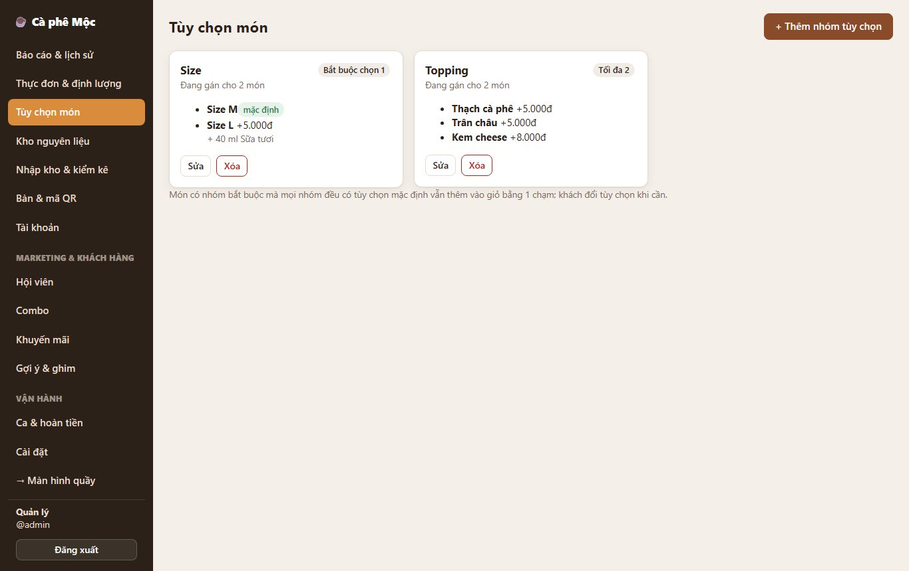
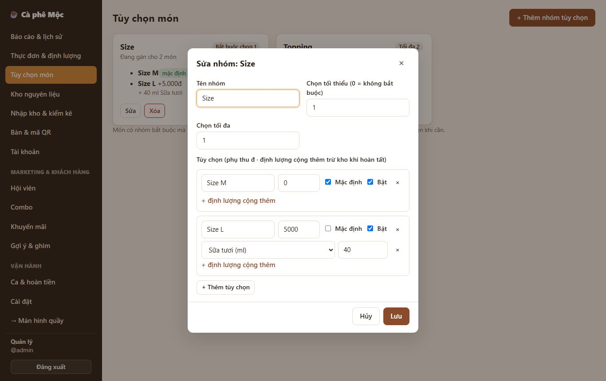
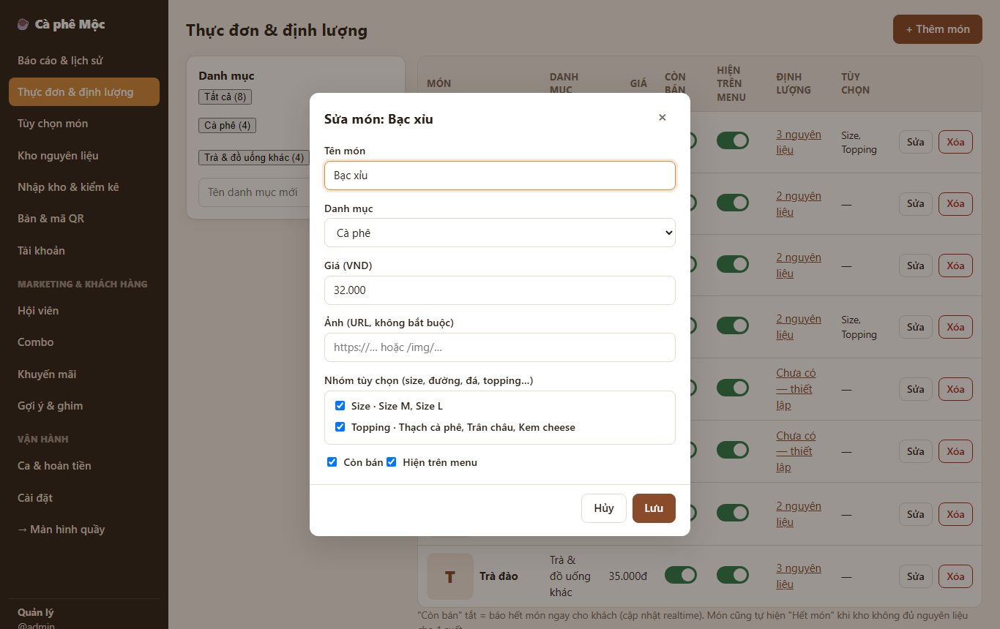
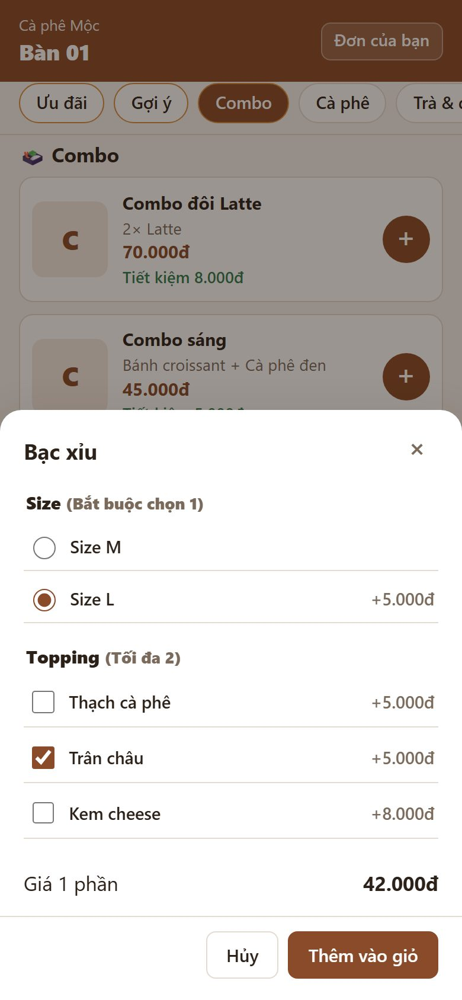
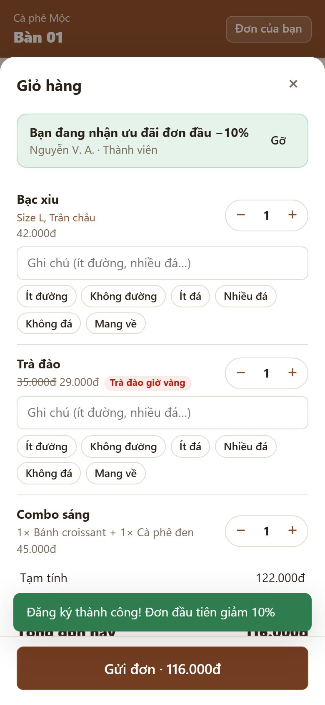
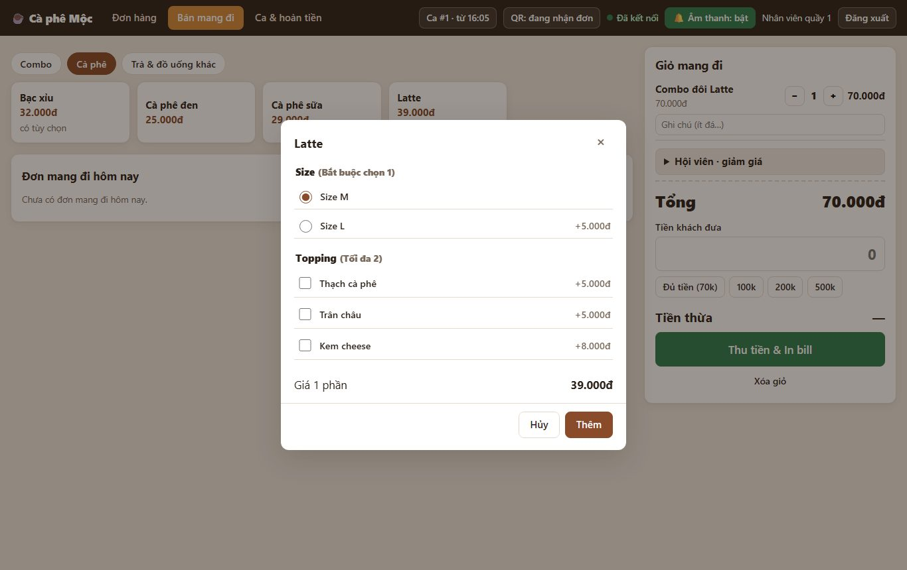

# 5. Tùy chọn món (size, topping…)

> Một món có nhiều lựa chọn: **Size M / L**, **Topping**, **Đá**, **Đường**… Mỗi lựa chọn có thể **thêm tiền** (Size L +5.000đ) và **trừ kho thêm** (Size L thêm 40 ml sữa tươi).

**Ai dùng:** quản lý cài; khách và quầy chọn khi gọi món.

## Quản lý cài đặt

**Bước 1 — Tạo nhóm tùy chọn:** **Quản lý → Tùy chọn món → + Thêm nhóm tùy chọn**

- **Tên nhóm:** Size, Topping, Đá, Đường…
- **Chọn tối thiểu:**
  - 0 = không bắt buộc;
  - 1 = bắt buộc chọn (ví dụ Size).
- **Chọn tối đa:** 1 = chỉ chọn một; 2 = được chọn 2 topping…
- **Từng tùy chọn:**
  - tên, **phụ thu** (đ), **Mặc định**, **Bật**;
  - **+ định lượng cộng thêm** (nguyên liệu + lượng trừ kho thêm).

**Bước 2 — Gán nhóm cho món:** **Quản lý → Thực đơn & định lượng → Sửa món** → tick các nhóm ở mục **Nhóm tùy chọn** → Lưu. Một nhóm (ví dụ "Size") dùng chung cho nhiều món.

## Khách gọi món

- **Bấm "+":** thêm ngay với **lựa chọn mặc định** (ví dụ Size M), nhanh như trước.
- **Muốn chọn khác:** bấm **Chọn size / tùy chọn ›** → chọn → **Thêm vào giỏ**. Bảng chọn hiện giá 1 phần.
- **Trong giỏ:** món ghi rõ "Size L, Trân châu". Cùng món nhưng khác lựa chọn là 2 dòng riêng.

## Quầy

- **Bán mang đi:** chạm món có tùy chọn → bảng chọn hiện ra (mặc định đã chọn sẵn) → **Thêm**. Ô món ghi "có tùy chọn".
- **Thẻ đơn, chi tiết đơn, hóa đơn in:** ghi tùy chọn ngay dưới tên món, để người pha làm đúng.

## Quy tắc cần nhớ

- **Nhóm bắt buộc nên có một tùy chọn Mặc định,** để khách bấm "+" là thêm được ngay. Không có mặc định thì "+" sẽ mở bảng chọn.
- **Kho:** giữ / trừ thêm theo định lượng của tùy chọn đã chọn. Báo cáo giá vốn cũng tính phần này.
- **Sửa phụ thu / tên tùy chọn** không đổi các đơn đã đặt.
- **Xóa tùy chọn / nhóm đã từng bán** → chỉ ẩn đi, lịch sử vẫn đúng.
- **Ghi chú tự do** (ít đá, nhiều đường…) vẫn dùng được như cũ.

*Kỹ thuật: [FEATURE-013](../tài-liệu/chức-năng/FEATURE-013.md).*
