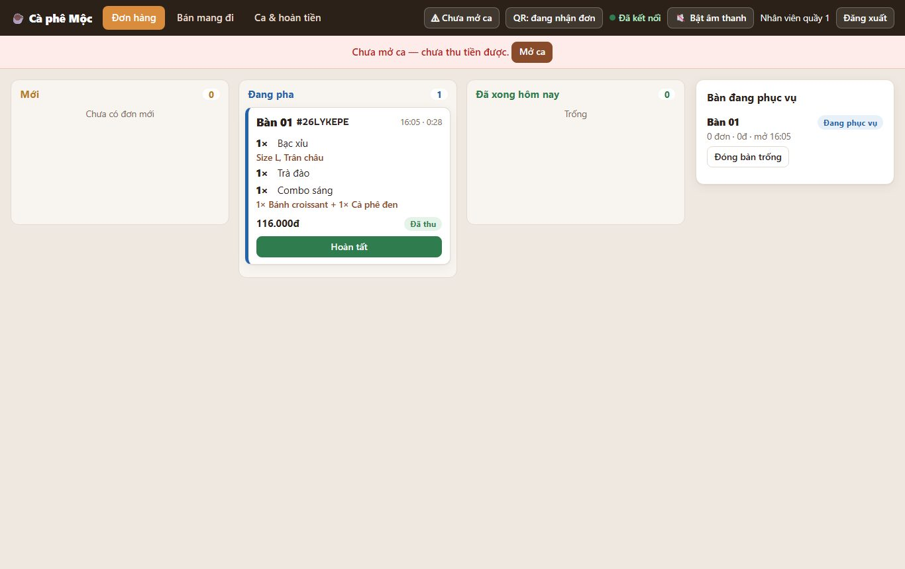
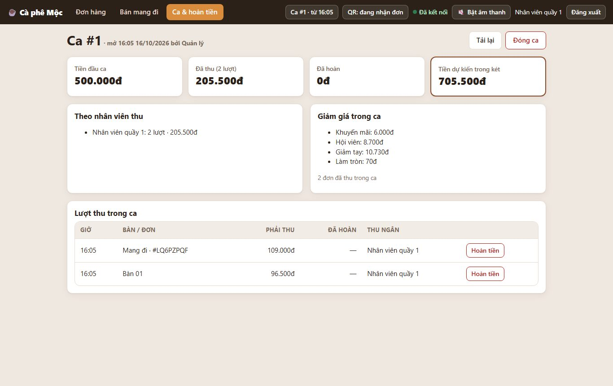
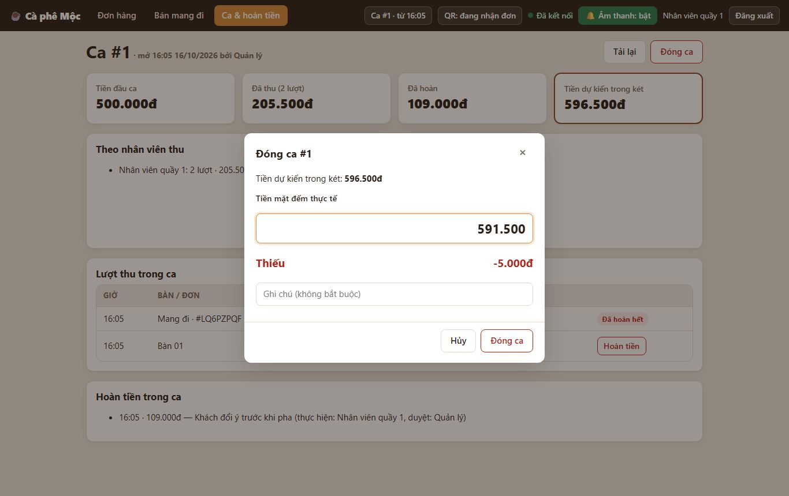
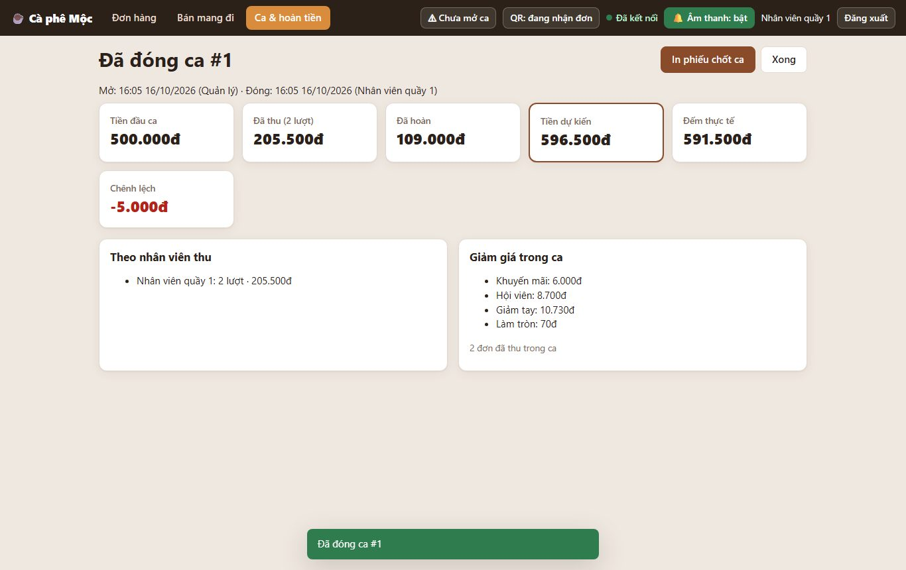
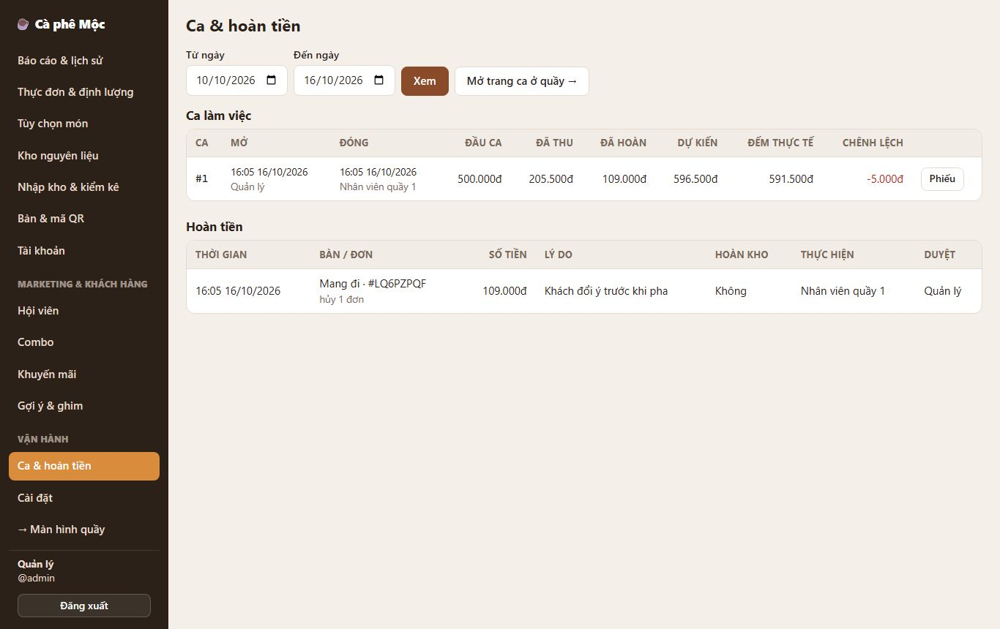

# 6. Chốt ca (mở ca / đóng ca tiền mặt)

> Đầu ca ghi số tiền lẻ trong két; cuối ca đếm tiền. Hệ thống tính **tiền lẽ ra phải có** và báo **thừa / thiếu** bao nhiêu.

**Ai dùng:** nhân viên quầy (mở / đóng ca), quản lý (xem lịch sử ca).

## Mở ca (đầu ngày / đầu ca)

1. Vào **Quầy**. Thanh trên có nút đỏ **⚠ Chưa mở ca**, dưới có dải *"Chưa mở ca — chưa nhận, xử lý đơn và thu tiền được"*.
2. Bấm **Mở ca** → nhập **tiền mặt đầu ca** trong két (tiền lẻ để thối; có thể là 0) → **Mở ca**.
3. Nút đổi thành **Ca #1 · từ 08:00**.

> **Từ 23/10/2026 (F-055): chưa mở ca thì quán không nhận và không xử lý đơn.**
>
> - **Khách** quét QR vẫn xem menu, chọn món, nhưng nút gửi hiện **"Quán chưa mở ca"** và bị khóa. Quầy bấm Mở ca là điện thoại khách tự mở lại nút gửi, không cần tải lại trang.
> - **Quầy** không tiếp nhận, hoàn tất, hủy đơn, gọi món tại bàn, sửa / xóa món, chuyển bàn, chia bill được — các nút bị khóa, ghi "Chưa mở ca". Thu tiền, bán mang đi, hoàn tiền, sổ quỹ vẫn cần ca như trước.
> - **Vẫn làm được khi chưa mở ca:** xem đơn / bàn, mở bàn và ghi chú bàn, kho ở quầy (sơ chế, hủy hàng, nhận hàng, kiểm kê), mọi trang Quản lý.
> - Đóng ca khi còn đơn chưa xong vẫn được; các đơn đó chờ ca sau mở rồi xử lý tiếp.

## Trong ca

Thanh trên → **Ca & hoàn tiền**:

- **4 ô số:** Tiền đầu ca · Đã thu (số lượt) · Đã hoàn · **Tiền dự kiến trong két**.
- **Theo nhân viên thu:** mỗi người thu bao nhiêu lượt, bao nhiêu tiền.
- **Giảm giá trong ca:** khuyến mãi / hội viên / giảm tay / làm tròn.
- **Lượt thu trong ca:** có nút **Hoàn tiền** cho từng lượt (xem [Hoàn tiền](08-hoàn-tiền.md)).

## Đóng ca (cuối ca)

1. Đếm tiền mặt trong két.
2. **Ca & hoàn tiền → Đóng ca** → nhập số đếm được. Hệ thống báo ngay **Thiếu / Thừa / Khớp** bao nhiêu → ghi chú nếu cần → **Đóng ca**.
3. Màn hình hiện **phiếu chốt ca** → **In phiếu chốt ca** (in bằng máy in hóa đơn hoặc máy in thường).

## Quản lý xem lịch sử

**Quản lý → Ca & hoàn tiền:**

- Bảng các ca theo ngày: đầu ca, đã thu, đã hoàn, dự kiến, đếm thực tế, **chênh lệch** (âm hiện màu đỏ).
- Nút **Phiếu** để xem lại phiếu chốt ca.
- Bên dưới là danh sách hoàn tiền.

## Quy tắc cần nhớ

- **Tiền dự kiến trong két** = tiền đầu ca + tổng đã thu trong ca − tổng đã hoàn trong ca.
- **Cả quán chỉ có một ca mở** tại một thời điểm. Mọi máy quầy dùng chung ca đó. Muốn đổi người thì đóng ca rồi người sau mở ca mới.
- **Ca đã đóng không sửa được nữa.**
- **Đóng ca đúng lúc đang có người bấm thu tiền:** hệ thống chờ lượt thu đó xong rồi mới tính, nên số liệu không bị lệch.

*Kỹ thuật: [FEATURE-018](../tài-liệu/chức-năng/FEATURE-018.md).*
