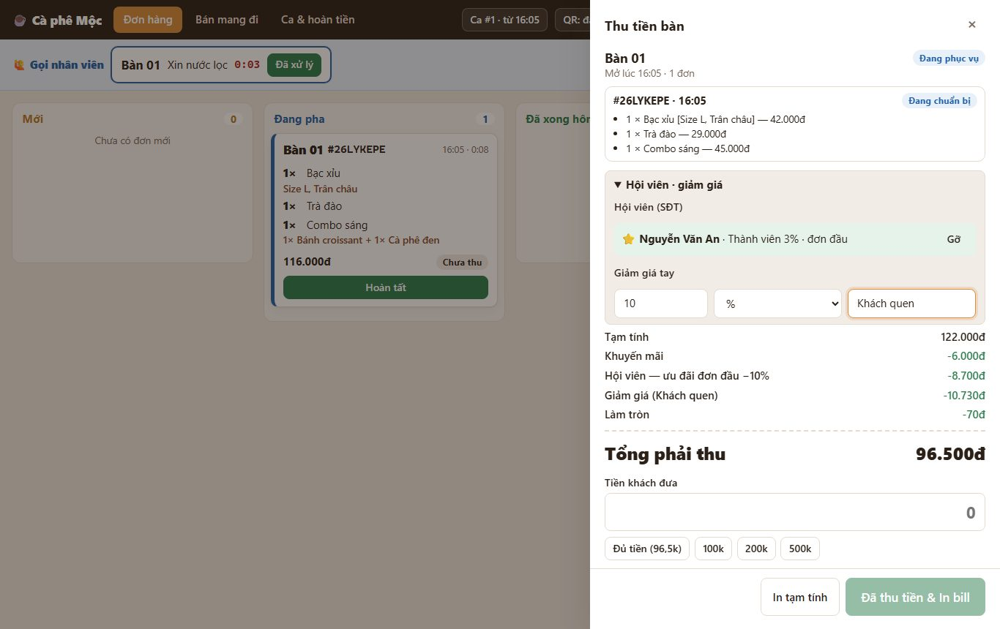
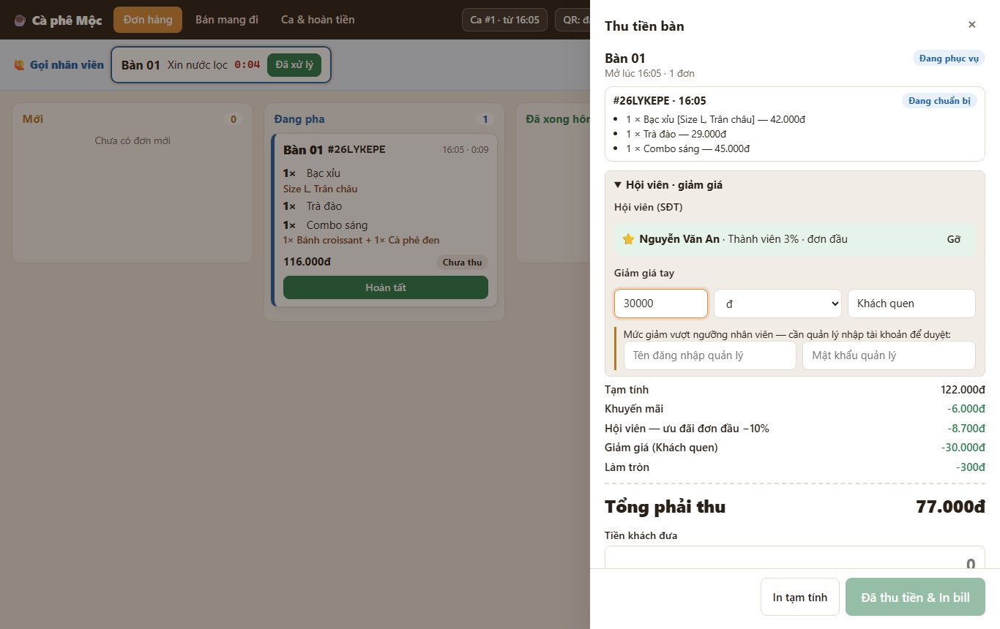

# 7. Giảm giá tay trên bill

> Nhân viên giảm giá trực tiếp khi thu tiền (khách quen, đền bù chờ lâu…), **bắt buộc ghi lý do**. Giảm nhiều quá mức cho phép thì **quản lý phải nhập tài khoản để duyệt** ngay tại máy.

**Ai dùng:** nhân viên quầy; quản lý duyệt và xem báo cáo.

## Làm thế nào

1. Mở **Thu tiền** (tại bàn) hoặc giỏ **Bán mang đi** → mở mục **Hội viên · giảm giá**.
2. Ở dòng **Giảm giá tay:**
   - nhập **số**;
   - chọn **đ** (số tiền) hoặc **%**;
   - gõ **lý do** (bắt buộc).
3. Phần tính tiền cập nhật ngay, có dòng **Giảm giá (lý do)**. **Tổng phải thu** là số đã giảm.
4. **Nếu vượt mức của nhân viên:** hiện thêm 2 ô **Tên đăng nhập quản lý / Mật khẩu quản lý** → nhờ quản lý nhập tại chỗ → thu tiền như thường.

## Mức cho phép của nhân viên

Nhân viên tự giảm được khi số giảm **không vượt quá cả hai** mức:

- **10%** số tiền bill (sau ưu đãi hội viên);
- **20.000đ**.

Ví dụ:

| Bill (sau hội viên) | Giảm | Cần quản lý duyệt? |
| --- | --- | --- |
| 100.000đ | 10% = 10.000đ | Không |
| 100.000đ | 20.000đ (= 20%) | **Có** (vượt 10%) |
| 500.000đ | 10% = 50.000đ | **Có** (vượt 20.000đ) |

Tài khoản **quản lý** đăng nhập ở quầy thì tự duyệt, không cần nhập lại.

Đổi mức 10% / 20.000đ: **Quản lý → Cài đặt → Giảm giá tay của nhân viên**.

> Cách hiểu "10% **hoặc** 20.000đ" đang theo hướng chặt hơn (không vượt cả hai) — nhóm xác nhận lại (Q-019).

## Quy tắc cần nhớ

- **Thứ tự trừ:** giảm tay tính **sau** khuyến mãi và ưu đãi hội viên, **trước** khi làm tròn.
- **Giảm theo %:** tính trên số còn lại sau hội viên.
- **Giới hạn:** không giảm quá số phải thu; tổng không bao giờ âm.
- **Lưu lại:** mỗi lượt giảm ghi **ai thu, lý do, ai duyệt**.
- **Xem lại:**
  - Báo cáo → **Thu tiền** (cột Giảm, lý do);
  - Báo cáo → **Marketing** ("Giảm giá tay theo nhân viên / ngày");
  - phiếu chốt ca.

*Kỹ thuật: [FEATURE-022](../tài-liệu/chức-năng/FEATURE-022.md).*
