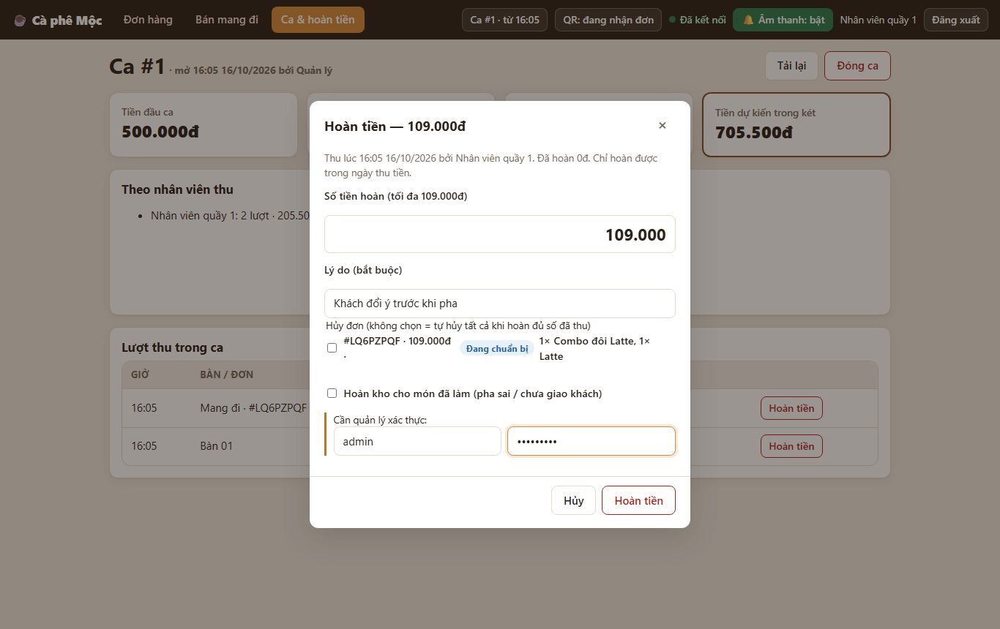
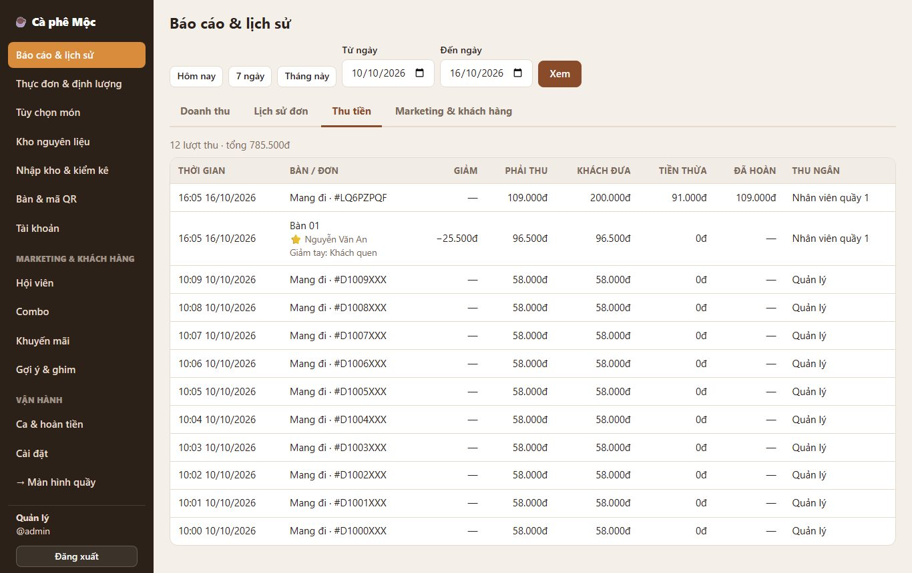

# 8. Hoàn tiền sau khi đã thu

> Trả lại tiền cho khách sau khi đã thu (pha sai, khách đổi ý trước khi pha, ly đổ…), có thể **hủy đơn** và **trả lại nguyên liệu vào kho**.

**Ai dùng:**

- **Quản lý:** tự làm.
- **Nhân viên quầy:** làm được, nhưng **quản lý phải nhập tài khoản** để duyệt.

## Làm thế nào

1. **Quầy → Ca & hoàn tiền** → bảng **Lượt thu trong ca** → bấm **Hoàn tiền** ở lượt cần hoàn.
2. Điền:
   - **Số tiền hoàn:** mặc định là toàn bộ phần chưa hoàn. Sửa nhỏ hơn nếu chỉ hoàn một phần.
   - **Lý do** (bắt buộc).
   - **Hủy đơn:**
     - tick đơn muốn hủy;
     - không tick gì mà hoàn **đủ** số đã thu thì hệ thống tự hủy tất cả đơn của lượt thu đó.
   - **Hoàn kho cho món đã làm:** chỉ tick khi món đã pha nhưng **chưa giao / pha sai mà nguyên liệu còn dùng được**.
   - **Tài khoản quản lý** (khi nhân viên làm).
3. **Hoàn tiền** → thông báo "Đã hoàn …".

## Hệ thống xử lý thế nào

| Trường hợp | Kết quả |
| --- | --- |
| Hoàn **một phần**, không chọn đơn | Đơn giữ nguyên; chỉ ghi khoản tiền trả lại |
| Đơn bị hủy, món **chưa pha xong** | Đơn → "Đã hoàn tiền"; nguyên liệu đang giữ cho đơn **tự trả lại kho** |
| Đơn bị hủy, món **đã làm xong** + tick "Hoàn kho" | Kho được cộng lại đúng lượng đã trừ (lịch sử kho ghi "Hoàn tiền: …") |
| Đơn bị hủy, món đã làm xong, **không** tick | Kho giữ nguyên (coi như đồ đã bỏ) |
| Khách là hội viên | Tổng chi tiêu của hội viên bị trừ số tiền hoàn (không xuống hạng) |

**Ở các màn hình khác:**

- Màn hình quầy, báo cáo, hóa đơn ghi rõ số tiền đã hoàn.
- Doanh thu trong ngày giảm đúng số tiền hoàn.

## Quy tắc cần nhớ

- **Chỉ hoàn được trong ngày thu tiền** (giờ Việt Nam). Nhóm xác nhận lại thời hạn này (Q-020).
- **Tổng các lần hoàn không vượt số đã thu.** Hai người bấm hoàn cùng lúc cũng không vượt được.
- **Phải đang có ca mở:** tiền hoàn được trừ vào ca đang mở, phiếu chốt ca ghi rõ.
- **Danh sách hoàn tiền** (ai làm, ai duyệt, lý do) xem ở **Quản lý → Ca & hoàn tiền**.

*Kỹ thuật: [FEATURE-019](../tài-liệu/chức-năng/FEATURE-019.md).*
