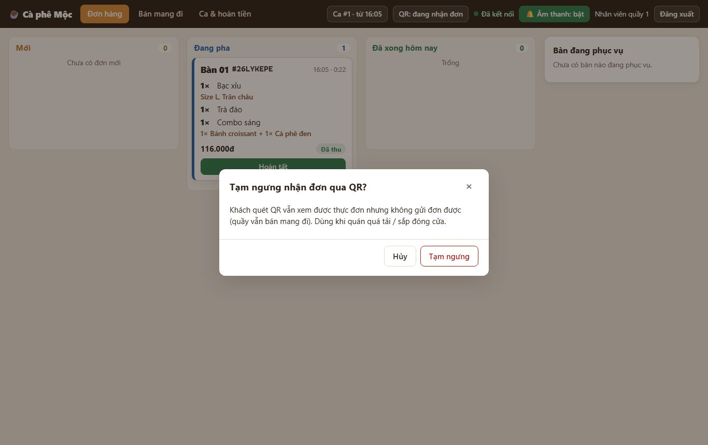
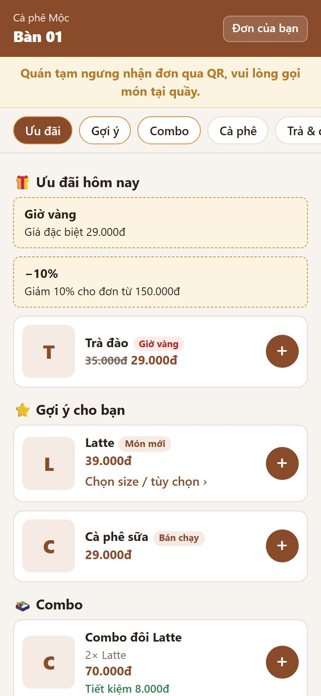
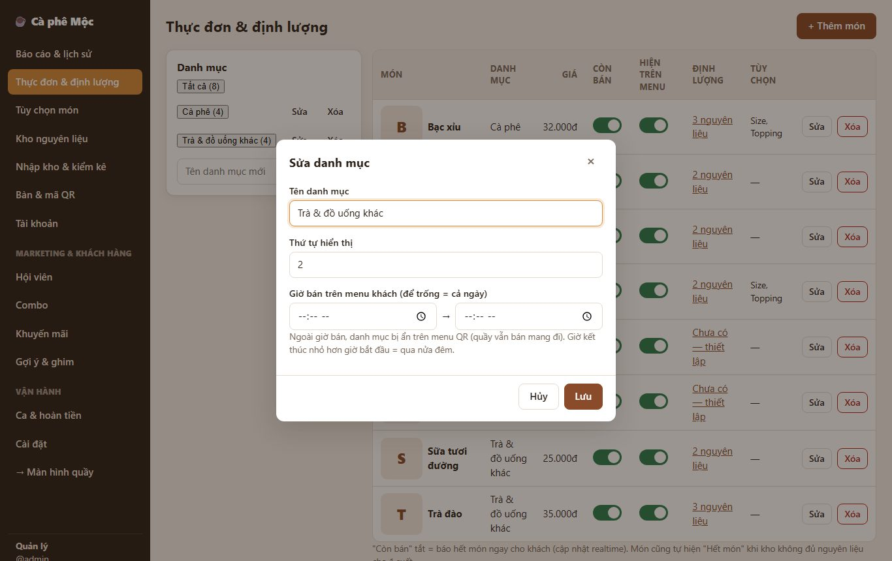

# 9. Tạm ngưng nhận đơn QR, giờ bán theo danh mục, tự "hết món"

> Khi quán quá tải hoặc sắp đóng cửa: **tạm tắt gọi món qua QR** bằng một nút. Danh mục chỉ bán buổi sáng (bánh mì, bánh ngọt…) thì **tự ẩn ngoài giờ bán**.

**Ai dùng:** nhân viên quầy (bật/tắt nhận đơn), quản lý (giờ bán, câu thông báo).

## Tạm ngưng nhận đơn qua QR

1. Thanh trên của quầy → nút **QR: đang nhận đơn** → **Tạm ngưng**.
2. Nút đổi thành **QR: tạm ngưng** (đỏ). Khách đang mở menu thấy ngay dải vàng *"Quán tạm ngưng nhận đơn qua QR, vui lòng gọi món tại quầy."*. Nút gửi đơn bị khóa.
3. Muốn nhận lại: bấm **QR: tạm ngưng** → **Mở lại**.

Khi tạm ngưng:

- khách **vẫn xem** thực đơn, theo dõi đơn đã gửi, gọi thanh toán;
- quầy **vẫn bán mang đi** bình thường.

Sửa câu thông báo ở **Quản lý → Cài đặt**.

## Giờ bán theo danh mục

1. **Quản lý → Thực đơn & định lượng** → khung Danh mục → **Sửa** cạnh danh mục.
2. Điền **Giờ bán trên menu khách**, ví dụ 06:00 → 11:00. Để trống = bán cả ngày. Giờ kết thúc nhỏ hơn giờ bắt đầu = qua nửa đêm.
3. **Lưu.**

Ngoài giờ bán:

- **Menu khách:** không hiện danh mục đó.
- **Khách cố gửi món đó** (giỏ cũ) → báo *"… hiện ngoài giờ bán"*.
- **Quầy:** vẫn thấy và **bán mang đi được**.

## Tự "hết món" (đã có từ trước, nay áp dụng cả combo)

- **Thiếu nguyên liệu:** khi kho không đủ nguyên liệu cho 1 phần, món **tự hiện "Hết món"** trên menu khách và quầy.
- **Có nguyên liệu lại:** nhập kho / điều chỉnh xong thì món **tự bán lại**.
- **Combo:** hết khi một món bên trong hết.
- **Tắt tay:** món quản lý tắt "Còn bán" bằng tay thì **không tự bật lại**.

*Kỹ thuật: [FEATURE-020](../tài-liệu/chức-năng/FEATURE-020.md).*
