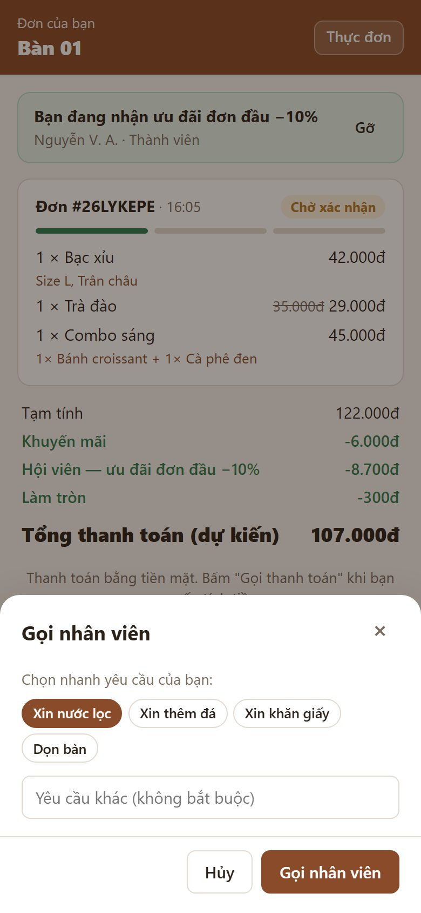

# 10. Khách gọi nhân viên

> Khách cần nước lọc, thêm đá, khăn giấy, dọn bàn… thì bấm **Gọi nhân viên** trên điện thoại thay vì vẫy tay. Quầy nghe **chuông** và thấy ngay bàn nào gọi, cần gì.

**Ai dùng:** khách gọi; nhân viên quầy xử lý.

## Khách

1. Màn **Đơn của bạn** → nút **🙋 Gọi nhân viên**.
2. Chọn nhanh **Xin nước lọc / Xin thêm đá / Xin khăn giấy / Dọn bàn**, hoặc gõ yêu cầu khác → **Gọi nhân viên**.
3. Nút đổi thành *"Đã gọi nhân viên (gọi lại sau …s)"*. Khi quầy bấm xử lý, khách thấy *"Nhân viên đã nhận yêu cầu của bạn"*.

## Quầy

- **Thông báo:** màn hình **Đơn hàng** hiện dải xanh **🙋 Gọi nhân viên**, kèm **chuông**.
  - Chuông này khác tiếng "ting" đơn mới và chuông gọi thanh toán, nghe là phân biệt được.
  - Dải ghi: tên bàn, yêu cầu, thời gian đã chờ.
- **Xử lý:** ra bàn phục vụ → bấm **Đã xử lý**. Thẻ biến mất ở mọi máy quầy.

## Quy tắc cần nhớ

- **Chống bấm liên tục:** mỗi bàn (phiên) gọi tối đa **1 lần / 60 giây**.
- **Hai nhân viên cùng bấm "Đã xử lý":** chỉ một người được ghi nhận.
- **Quầy mất mạng:** khi có mạng lại, dải *"Có đơn hàng bị trễ"* báo cả số bàn đã gọi nhân viên trong lúc mất mạng.
- **Âm thanh:** nhớ bấm **Bật âm thanh** trên thanh quầy mỗi lần mở trang, nếu không chuông không kêu.

*Kỹ thuật: [FEATURE-021](../tài-liệu/chức-năng/FEATURE-021.md).*
