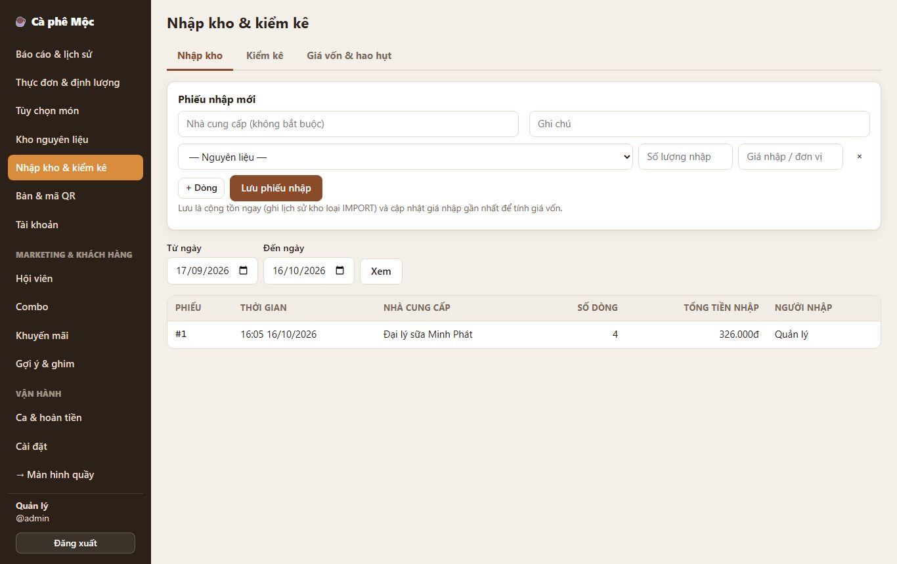
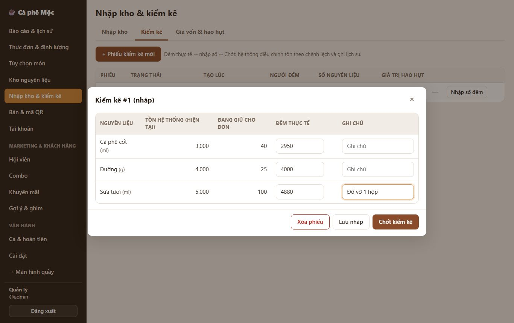
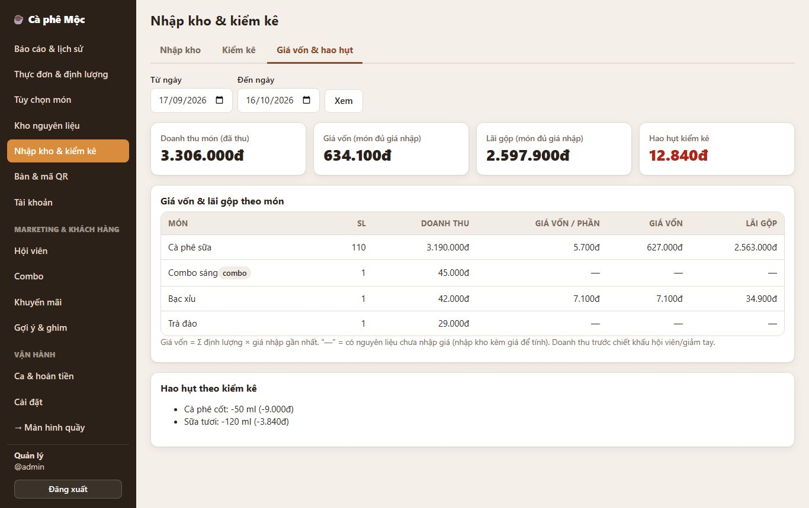

# 11. Nhập kho, kiểm kê, giá vốn & hao hụt

> - **Nhập kho:** ghi hàng về kèm giá nhập.
> - **Kiểm kê:** đếm kho thật, hệ thống tự chỉnh tồn và tính **hao hụt**.
> - **Báo cáo giá vốn:** mỗi món tốn bao nhiêu tiền nguyên liệu, **lãi gộp** bao nhiêu.

**Ai dùng:** quản lý. Trang: **Quản lý → Nhập kho & kiểm kê** (3 tab).

## Tab "Nhập kho"

1. Điền **Nhà cung cấp**, **Ghi chú** (không bắt buộc).
2. Mỗi dòng gồm:
   - **nguyên liệu**;
   - **số lượng nhập**, theo đơn vị của nguyên liệu (ml, g, cái…);
   - **giá nhập / đơn vị** (ví dụ sữa tươi 32đ/ml).
3. Bấm **+ Dòng** để thêm dòng → **Lưu phiếu nhập**.

**Kết quả:**

- Tồn kho cộng ngay.
- Lịch sử kho của nguyên liệu ghi *"Nhập kho #… — nhà cung cấp"*.
- **Giá nhập gần nhất** được cập nhật để tính giá vốn.
- Món đang "hết món" vì thiếu nguyên liệu tự bán lại.

Bên dưới là danh sách phiếu nhập theo khoảng ngày. Bấm vào một phiếu (hoặc nút **Chi tiết**) để xem.

### Sửa / hủy phiếu nhập (chỉ Quản lý)

Nhập sai số lượng, giá, nguyên liệu hay nhà cung cấp:

- **Sửa:** **Chi tiết** → **Sửa** → chỉnh các dòng như lúc nhập → nhập **Lý do sửa** → **Lưu thay đổi**.
  - Số phiếu giữ nguyên.
  - Dòng không đổi thì giữ nguyên. Dòng đổi thì lịch sử kho ghi *"Sửa phiếu nhập #… — lý do"*: cộng dòng mới, trừ dòng cũ.
  - Tồn, giá vốn bình quân, lô / hạn dùng và đơn đặt hàng được tính lại.
  - Danh sách hiện nhãn **Đã sửa**.
- **Hủy phiếu:** **Chi tiết** → **Hủy phiếu** → nhập **lý do**.
  - Kho trừ lại đúng số đã nhập. Lịch sử kho ghi *"Hủy phiếu nhập #… — lý do"*.
  - Phiếu vẫn còn trong danh sách, nhãn **Đã hủy**, dòng mờ gạch ngang.
  - Phiếu nhận theo đơn đặt hàng thì đơn đó trở lại "chưa nhận".

**Không sửa / hủy được khi** (hệ thống báo tên nguyên liệu, không đổi gì):

- **Hàng của phiếu đã được dùng:** tồn còn lại không đủ để trừ lại, kể cả phần đang giữ cho đơn chưa hoàn tất.
- **Đã kiểm kê nguyên liệu đó sau lúc nhập:** tồn đã chốt theo số đếm. Muốn chỉnh, làm phiếu kiểm kê mới.
- **Nguyên liệu đang nằm trong phiếu kiểm kê nháp:** chốt hoặc xóa phiếu nháp trước.
- **Nguyên liệu theo lô mà lô của phiếu đã bị dùng / hủy một phần.**

## Tab "Kiểm kê"

1. **+ Phiếu kiểm kê mới** → chọn nguyên liệu cần đếm (mặc định chọn tất cả) → **Tạo phiếu**.
2. Đi đếm thực tế. Bấm **Nhập số đếm** → nhập **số đếm thực tế** (và ghi chú, ví dụ "Đổ vỡ 1 hộp") → **Lưu nháp** nếu chưa xong.
3. Xong thì **Chốt kiểm kê**:
   - tồn kho được đặt bằng số đếm;
   - lịch sử kho ghi *"Kiểm kê #…"*;
   - hệ thống tính **giá trị hao hụt** = lượng thiếu × giá nhập gần nhất.

**Lưu ý:**

- **Trong lúc phiếu còn nháp:** các nguyên liệu trong phiếu **không điều chỉnh tay được** (trang Kho nguyên liệu báo "đang được kiểm kê"), để số liệu không lệch. Chốt hoặc **Xóa phiếu** để mở khóa.
- **Đơn vẫn chạy bình thường khi đang đếm.** Hệ thống tính chênh lệch theo **tồn thực tế lúc chốt**, nên đơn hoàn tất trong lúc đếm không làm sai kết quả.
- **Số đếm thấp hơn phần "đang giữ cho đơn"** (đơn đã gửi chưa hoàn tất) → báo lỗi kèm tên nguyên liệu. Hoàn tất / hủy các đơn đó rồi chốt lại.
- **Phiếu nháp:** trên danh sách có nút **Sửa** (đổi ghi chú, thêm / bớt nguyên liệu; bớt thì mất số đếm của nguyên liệu đó) và **Xóa**. Trưởng ca làm được ở quầy.
- **Phiếu đã chốt không sửa số đếm được.** Đếm sai thì Quản lý bấm **Hủy phiếu** (nhập lý do):
  - tồn trở lại như trước khi chốt;
  - phiếu thành **Đã hủy**, không còn tính vào hao hụt / thất thoát.

  Sau đó tạo phiếu mới để đếm lại. Chỉ hủy được **phiếu chốt gần nhất** của các nguyên liệu trong phiếu. Nếu phần "thừa" đã ghi khi chốt nay đã dùng hết thì không hủy được.

## Tab "Giá vốn & hao hụt"

Chọn khoảng ngày → **Xem**:

- **4 ô:**
  - doanh thu món (đã thu);
  - **giá vốn**;
  - **lãi gộp** (chỉ tính món đã đủ giá nhập);
  - **hao hụt kiểm kê**.
- **Bảng theo món:** số lượng bán, doanh thu, giá vốn / phần, giá vốn, lãi gộp.
- **Hao hụt theo nguyên liệu.**

**Cách tính:**

- **Giá vốn 1 phần** = Σ định lượng × giá nhập gần nhất. Có tính cả **định lượng tùy chọn** (Size L thêm sữa).
- **Combo** = tổng giá vốn các món bên trong.
- **Hiện "—":** món có nguyên liệu **chưa có giá nhập** → hãy nhập kho kèm giá.
- **Hiện "chưa có định lượng":** món chưa khai báo định lượng (BOM).
- **Doanh thu ở đây** là giá bán của món (trước ưu đãi hội viên / giảm tay), để so với giá vốn từng món.

> Mẹo: lần đầu dùng, hãy làm **một phiếu nhập có giá cho tất cả nguyên liệu** để báo cáo giá vốn đầy đủ.

*Kỹ thuật: [FEATURE-023](../tài-liệu/chức-năng/FEATURE-023.md).*
