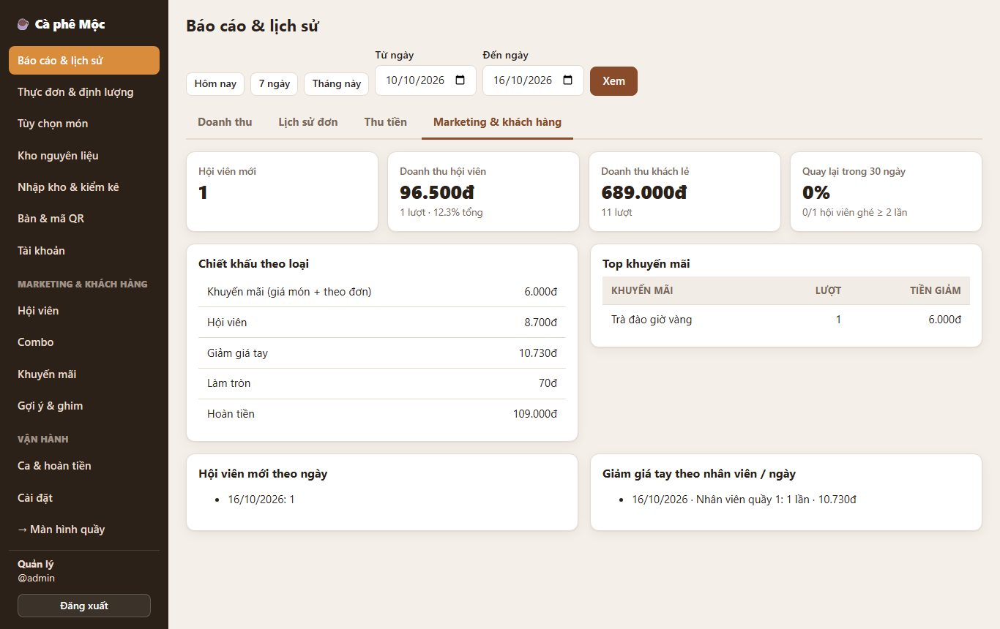
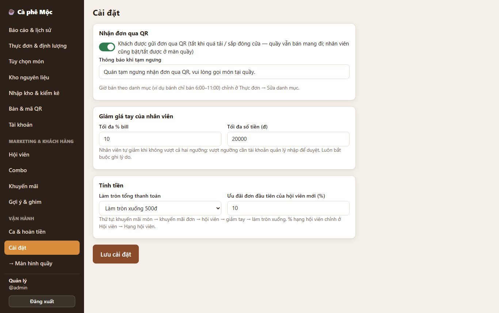

# Báo cáo mới & trang Cài đặt

## Báo cáo (Quản lý → Báo cáo & lịch sử)

**Tab "Doanh thu":**

- Doanh thu giờ là **tiền thực thu** (đã trừ khuyến mãi, hội viên, giảm tay, làm tròn) **trừ tiền hoàn** theo ngày hoàn.
- Ô "Tổng doanh thu" ghi thêm *"đã trừ hoàn tiền …"* nếu có hoàn.
- Không có giảm giá thì con số giống cách tính cũ.

**Tab "Thu tiền":** thêm các cột và dòng:

- **Giảm:** tổng mọi khoản giảm của lượt thu.
- **Đã hoàn.**
- Tên **hội viên** (nếu có) và **lý do giảm tay**.

**Tab mới "Marketing & khách hàng"** (theo khoảng ngày đang chọn):

| Mục | Ý nghĩa |
| --- | --- |
| Hội viên mới | Số người đăng ký trong khoảng ngày (và theo từng ngày) |
| Doanh thu hội viên / khách lẻ | Tiền thu từ khách có hội viên so với khách không đăng ký, kèm % |
| Quay lại trong 30 ngày | Trong các hội viên ghé quán 30 ngày gần nhất, bao nhiêu % ghé từ 2 lần trở lên |
| Chiết khấu theo loại | Tổng tiền đã giảm do khuyến mãi / hội viên / giảm tay / làm tròn, và tổng hoàn tiền |
| Top khuyến mãi | Khuyến mãi nào được dùng nhiều, giảm bao nhiêu |
| Giảm giá tay theo nhân viên / ngày | Ai giảm, bao nhiêu lần, bao nhiêu tiền, ai duyệt |

**Báo cáo khác:**

- **Giá vốn & hao hụt:** xem [Nhập kho, kiểm kê, giá vốn](11-nhập-kho-kiểm-kê-giá-vốn.md).
- **Lịch sử ca:** xem [Chốt ca](06-chốt-ca.md).

## Cài đặt (Quản lý → Cài đặt)

| Mục | Mặc định | Ghi chú |
| --- | --- | --- |
| Nhận đơn qua QR + thông báo khi tạm ngưng | Bật | Nhân viên cũng bật/tắt được bằng nút **QR** trên thanh quầy |
| Giảm giá tay — tối đa % bill / tối đa số tiền | 10% / 20.000đ | Vượt cả một trong hai → cần quản lý duyệt |
| Làm tròn tổng thanh toán | Xuống 500đ | Chọn: không làm tròn / 100đ / 500đ / 1.000đ |
| Ưu đãi đơn đầu tiên của hội viên mới | 10% | % theo hạng chỉnh ở Hội viên → Hạng hội viên |

**Chỉnh ở trang khác:**

- **Giờ bán theo danh mục:** Thực đơn → Sửa danh mục (xem [mục 9](09-tạm-ngưng-nhận-đơn-và-giờ-bán.md)).
- **Gợi ý / ghim món:** trang Gợi ý & ghim (xem [mục 4](04-gợi-ý-bán-chạy.md)).
