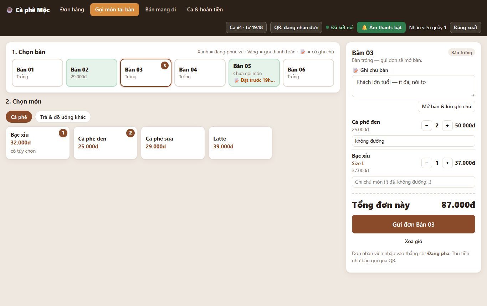
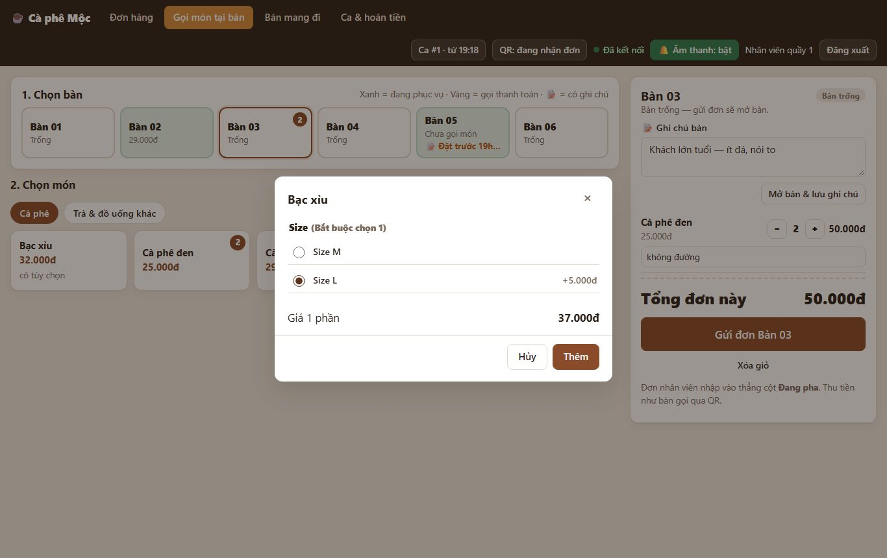
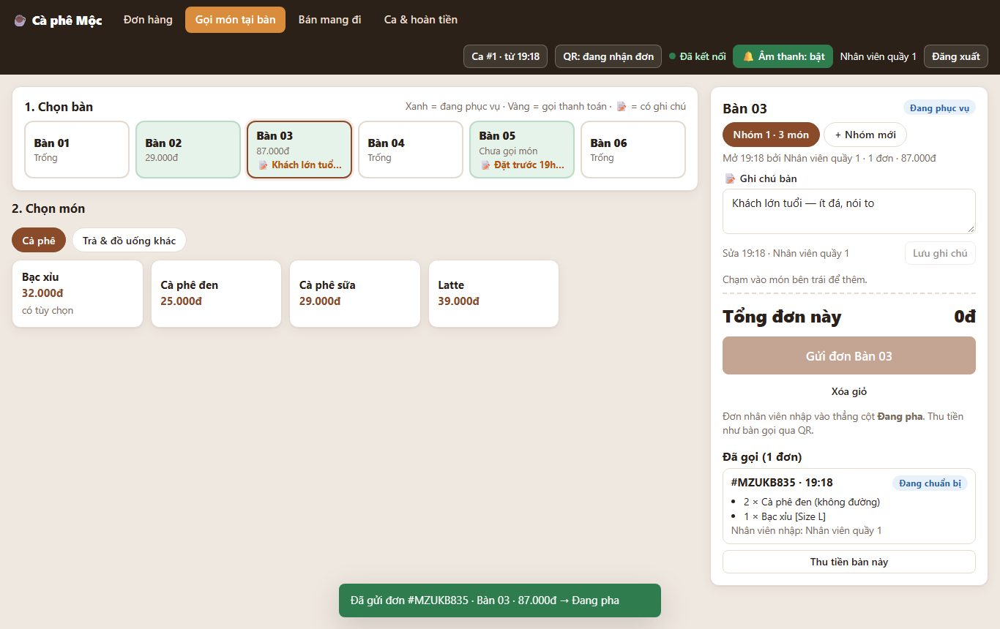
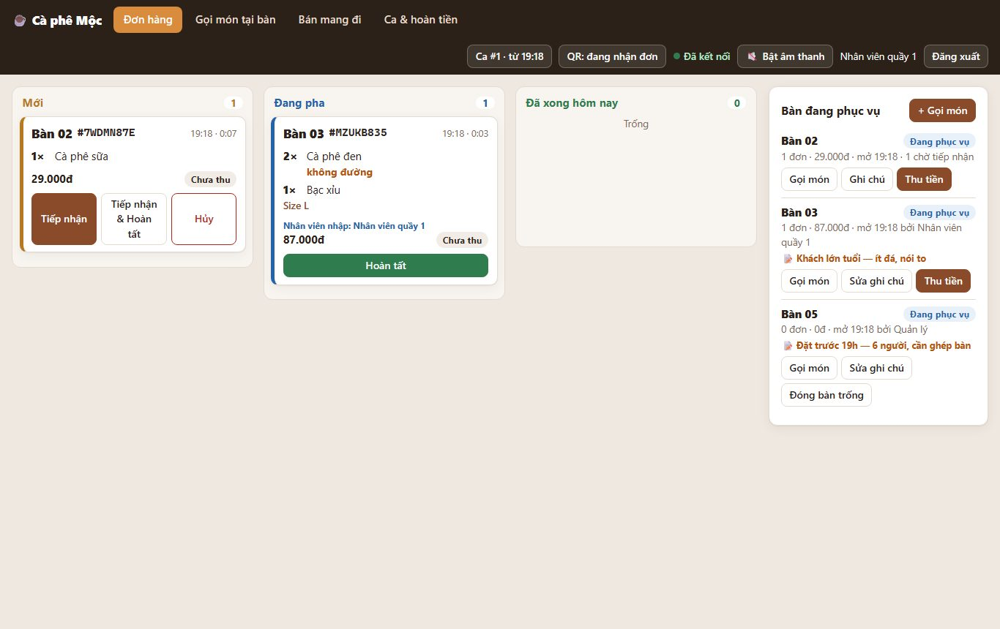
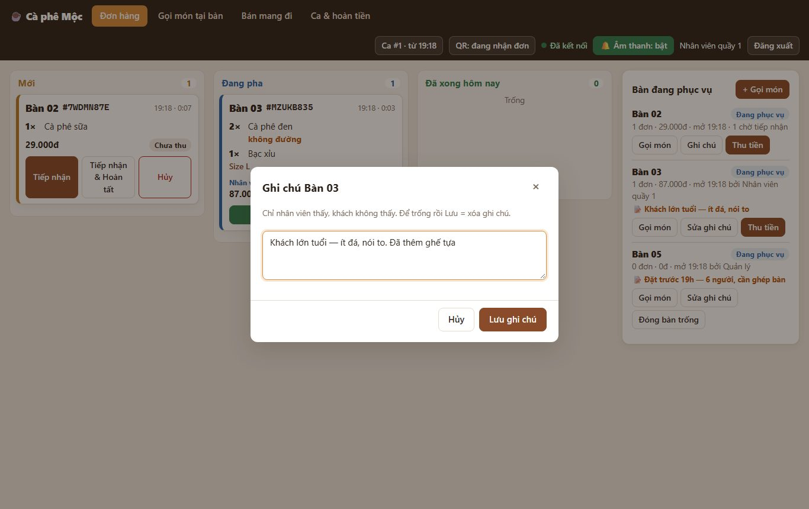
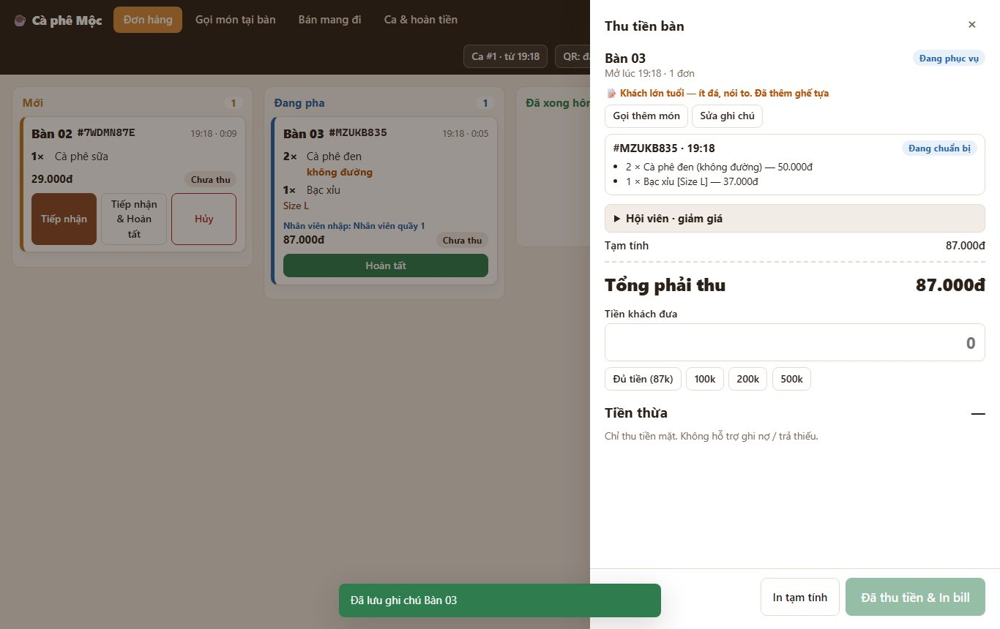
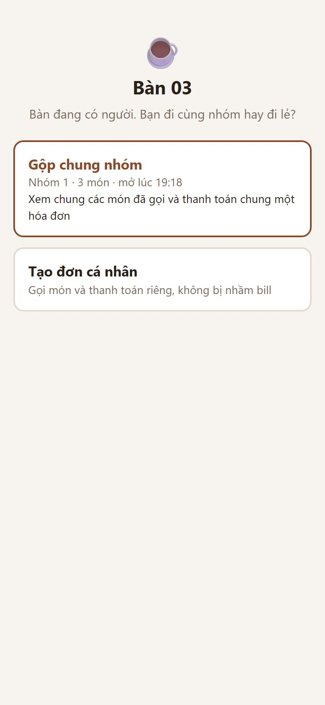
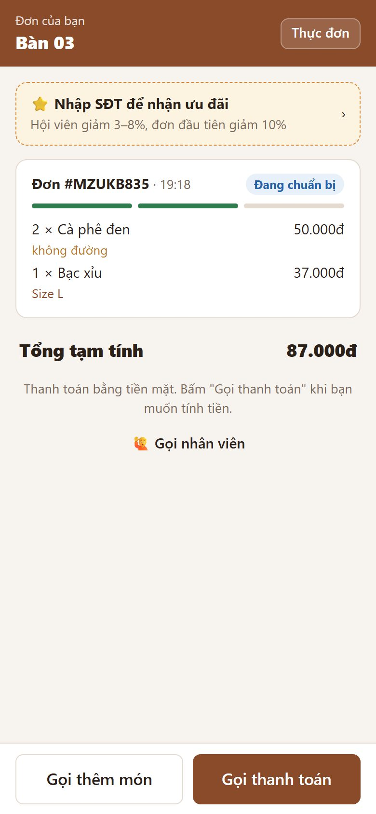

# 13. Gọi món tại bàn (nhân viên nhập giúp) & ghi chú bàn

> Nhiều khách, nhất là người lớn tuổi, chưa quen quét QR để gọi món. Nhân viên ra bàn hỏi món như cách truyền thống, rồi **nhập vào máy quầy đúng bàn đó**. Đơn vào thẳng cột **Đang pha**, tính tiền và thu tiền như bàn gọi qua QR.
>
> Nhân viên còn ghi được **ghi chú bàn** để nhớ, ví dụ "chờ thêm 2 người", "khách quen — ít ngọt". **Chỉ nhân viên thấy** ghi chú này.

**Ai dùng:** nhân viên quầy, quản lý. Trang: **Gọi món tại bàn** trên thanh quầy. Ở màn **Đơn hàng** có nút **+ Gọi món**.

## Gọi món giúp khách

1. Mở **Gọi món tại bàn**.
2. **Chọn bàn.** Màu ô bàn cho biết tình trạng:
   - **Trắng:** trống.
   - **Xanh:** đang phục vụ (hiện số tiền đã gọi).
   - **Vàng:** khách đã gọi thanh toán.
   - **📝:** bàn có ghi chú.
   - **Số đỏ ở góc:** món đã chọn nhưng **chưa gửi**. Giỏ lưu riêng từng bàn, nên chuyển qua lại giữa các bàn không mất món.
3. **Chạm món** để thêm.
   - Món có size / topping sẽ mở bảng chọn: hỏi khách rồi bấm **Thêm**.
   - Mỗi món có ô **ghi chú món** (ít đá, không đường…). Người pha thấy ghi chú này trên phiếu.
4. Bấm **Gửi đơn Bàn …**.
   - Bàn trống thì hệ thống **tự mở bàn**.
   - Đơn vào thẳng cột **Đang pha**, không cần bấm "Tiếp nhận".
   - Bên dưới hiện **Đã gọi**: các đơn của bàn, ghi "Nhân viên nhập: …" hoặc "Khách gọi qua QR".

**Gọi thêm món sau đó:**

- Chọn lại bàn đó (hoặc bấm **Gọi món** ở bàn trong màn Đơn hàng), rồi làm như trên.
- Đơn mới gộp vào **cùng hóa đơn** của bàn.
- Nếu bàn đã **gọi thanh toán**, gọi thêm sẽ đưa bàn về "Đang phục vụ" (giống khách tự gọi thêm qua QR).

**Bàn có nhiều nhóm** (ví dụ ghép bàn, mỗi nhóm trả riêng):

- Phía phải hiện nút **Nhóm 1**, **Nhóm 2**… để chọn đúng nhóm.
- Bấm **+ Nhóm mới** để mở thêm một hóa đơn riêng trên cùng bàn.

## Ghi chú bàn

- **Ghi ở trang Gọi món tại bàn:**
  - gõ vào ô **📝 Ghi chú bàn** → **Lưu ghi chú**;
  - bàn còn trống thì bấm **Mở bàn & lưu ghi chú**. Dùng khi khách mới ngồi, chưa gọi món, hoặc bàn được đặt trước.
- **Ghi ở màn Đơn hàng:** mục "Bàn đang phục vụ" → **Ghi chú** / **Sửa ghi chú**.
- **Xóa ghi chú:** để trống rồi lưu.
- **Ai thấy:** mọi máy quầy thấy ngay. Hộp **Thu tiền bàn** cũng hiện ghi chú, kèm nút **Gọi thêm món**.
- **Ai không thấy:** **khách không thấy** ghi chú. Ghi chú không in lên hóa đơn và không gửi tới điện thoại khách.
- **Thời hạn:** ghi chú gắn với **lượt khách đang ngồi**. Thu tiền xong, lượt khách mới ở bàn đó bắt đầu không có ghi chú.

## Khách vẫn quét QR được

Nếu khách (hoặc người đi cùng) quét QR ở bàn nhân viên đã mở:

- màn hình hỏi **Gộp chung nhóm** / **Tạo đơn cá nhân**;
- chọn **Gộp chung nhóm** thì khách thấy các món nhân viên đã nhập, gọi thêm và gọi thanh toán bằng điện thoại như bình thường.

 

## Quy tắc cần nhớ

- **Vẫn nhập được khi tắt QR:** nút **QR: tạm ngưng** chỉ chặn khách tự gọi. Nhân viên vẫn nhập đơn tại bàn, và vẫn bán được món ngoài giờ bán của danh mục (giống bán mang đi).
- **Không cần mở ca để gửi đơn**, vì chưa thu tiền. **Thu tiền thì vẫn cần ca mở.**
- **Hai nhân viên cùng mở một bàn trống:** chỉ một người mở được. Người kia được báo *"Bàn vừa được mở… Kiểm tra nhóm rồi bấm lại"*. Món đã chọn vẫn còn trong giỏ.
- **Bàn vừa được thu tiền ở máy khác** trong lúc bạn đang chọn món: trang tự chuyển sang **Nhóm mới**, không gộp nhầm vào hóa đơn đã trả.
- **Bấm "Gửi" 2 lần liên tiếp** (mạng chậm): chỉ tạo **1 đơn**.
- **Món hết** lúc gửi: báo tên món, ô món chuyển "Hết món". Bỏ món đó khỏi giỏ rồi gửi lại.

## Cần chủ quán xác nhận (Q-021)

Các điểm dưới đây đang làm theo mặc định. Muốn khác thì báo lại:

| Điểm | Đang làm |
| --- | --- |
| Đơn nhân viên nhập có cần bấm "Tiếp nhận" không? | **Không** — vào thẳng Đang pha |
| Khi tạm ngưng nhận đơn QR / ngoài giờ bán, nhân viên có nhập được không? | **Có** (quầy tự quyết, giống bán mang đi) |
| Ghi chú gắn với bàn mãi mãi hay theo lượt khách? | **Theo lượt khách** — thu tiền xong là hết |
| Khách có thấy ghi chú không? | **Không** |

*Kỹ thuật: [FEATURE-024](../tài-liệu/chức-năng/FEATURE-024.md).*
