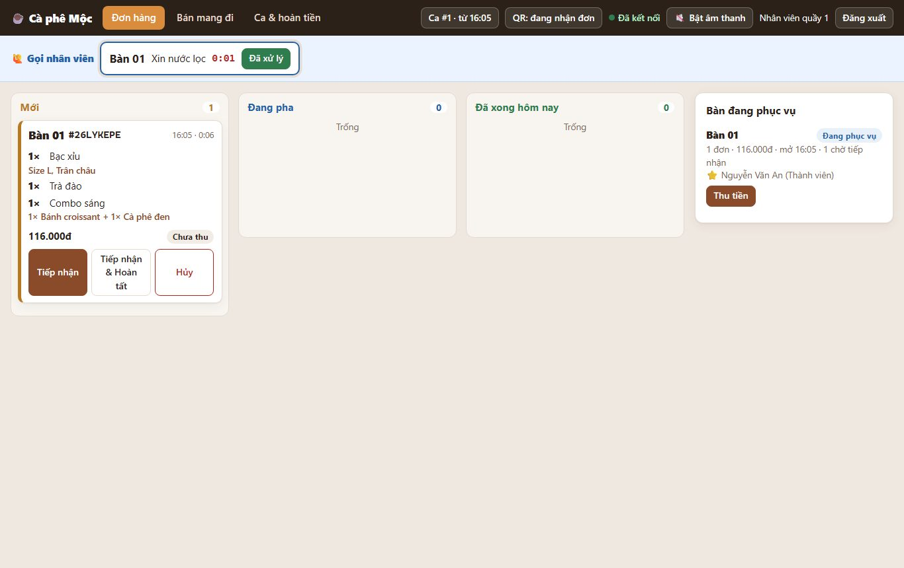
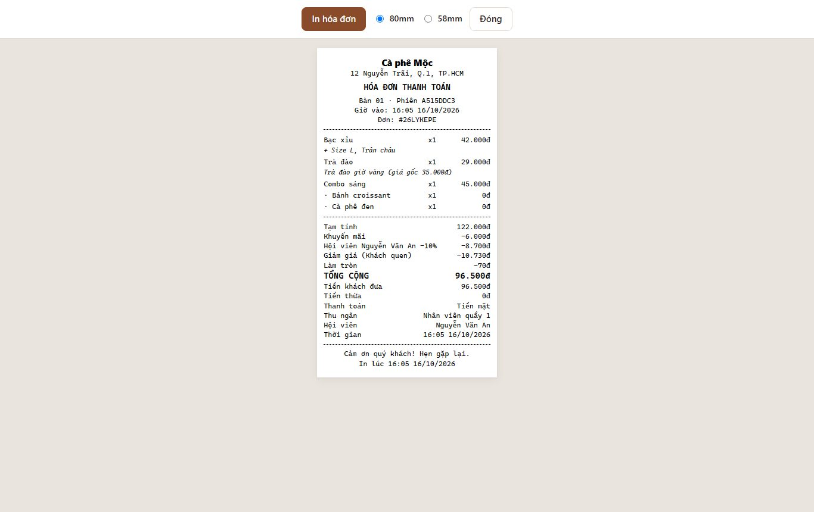

# Chức năng mới (giai đoạn 2 — 16/10/2026 · giai đoạn 4–8 — 18/10/2026)

Thư mục này giới thiệu **11 chức năng mới** thêm vào app theo file yêu cầu `SKILL them chuc nang.md`, cộng chức năng **Gọi món tại bàn** thêm theo yêu cầu sau đó (mục 13).

**Mục 14…24** giới thiệu **20 chức năng nâng cao** thêm ngày 18/10/2026 theo file yêu cầu `skill them chuc nang 1.md`: gọi lại đơn, thực đơn theo lịch, thời gian chờ, chia bill, kho nâng cao, trưởng ca, sổ quỹ, chấm công, lãi / lỗ, tích điểm & voucher, chiến dịch, phân tích, màn Hôm nay.

**Mục 25, 26** (18/10/2026, theo yêu cầu chủ dự án sau đó): sửa / xóa món đã gọi, xóa đơn, hủy bàn ngay trong hộp Thu tiền bàn; gắn SĐT hội viên khi gọi món tại bàn và Thẻ thành viên cho khách.

Mỗi file nói rõ:

- chức năng dùng để làm gì, ai dùng;
- bấm vào đâu, từng bước (mục 1…13 có ảnh chụp màn hình thật; mục 14…26 chưa có ảnh);
- quy tắc cần nhớ và lỗi hay gặp.

Mở app và chạy test: xem [`../hướng-dẫn/README.md`](../hướng-dẫn/README.md).

## Danh sách

| # | Chức năng | Dùng để | Ai dùng |
| --- | --- | --- | --- |
| 1 | [Hội viên](01-hội-viên.md) | Khách nhập số điện thoại để được giảm giá; tích lũy, lên hạng | Khách · Quầy · Quản lý |
| 2 | [Combo](02-combo.md) | Bán nhiều món cùng lúc với giá gộp rẻ hơn | Quản lý tạo; khách và quầy bán |
| 3 | [Khuyến mãi](03-khuyến-mãi.md) | Giá đặc biệt theo khung giờ (happy hour), giảm % / giảm tiền cho đơn lớn | Quản lý tạo; tự áp dụng |
| 4 | [Gợi ý / bán chạy](04-gợi-ý-bán-chạy.md) | Mục "Gợi ý cho bạn" trên menu: món quán ghim + món bán chạy | Quản lý cài; khách xem |
| 5 | [Tùy chọn món](05-tùy-chọn-món.md) | Size, topping… có phụ thu và trừ kho thêm | Quản lý cài; khách và quầy chọn |
| 6 | [Chốt ca](06-chốt-ca.md) | Mở ca / đóng ca, đếm tiền két, biết thừa thiếu | Quầy · Quản lý |
| 7 | [Giảm giá tay](07-giảm-giá-tay.md) | Nhân viên giảm giá trên bill có lý do; vượt mức thì quản lý duyệt | Quầy · Quản lý |
| 8 | [Hoàn tiền](08-hoàn-tiền.md) | Trả lại tiền sau khi đã thu, có thể hủy đơn và trả kho | Quầy (quản lý duyệt) · Quản lý |
| 9 | [Tạm ngưng nhận đơn & giờ bán](09-tạm-ngưng-nhận-đơn-và-giờ-bán.md) | Tạm tắt gọi món qua QR; danh mục chỉ bán trong khung giờ | Quầy · Quản lý |
| 10 | [Gọi nhân viên](10-gọi-nhân-viên.md) | Khách bấm gọi (xin nước, thêm đá…); quầy nghe chuông | Khách · Quầy |
| 11 | [Nhập kho, kiểm kê, giá vốn](11-nhập-kho-kiểm-kê-giá-vốn.md) | Phiếu nhập có giá, phiếu kiểm kê, lãi gộp và hao hụt | Quản lý |
| + | [Báo cáo & cài đặt](12-báo-cáo-và-cài-đặt.md) | Tab báo cáo Marketing, cột giảm/hoàn, trang Cài đặt | Quản lý |
| 13 | [Gọi món tại bàn & ghi chú bàn](13-gọi-món-tại-bàn.md) | Khách không dùng QR: nhân viên hỏi món rồi nhập vào máy đúng bàn; ghi chú bàn để nhớ (khách không thấy) | Quầy · Quản lý |

### Giai đoạn 4–8 (18/10/2026)

| # | Chức năng | Dùng để | Ai dùng |
| --- | --- | --- | --- |
| 14 | [Gọi lại đơn, thực đơn theo lịch, thời gian chờ](14-gọi-lại-đơn-lịch-thực-đơn-thời-gian-chờ.md) | Hội viên bấm "Gọi lại" đơn lần trước, thả tim món yêu thích; món tự hiện / ẩn theo giờ, theo mùa; khách thấy dự kiến chờ bao lâu | Khách · Quầy · Quản lý |
| 15 | [Chia bill theo người](15-chia-bill.md) | Bàn gộp chung nhưng mỗi người trả phần của mình; quầy thu từng phần, in bill riêng | Khách · Quầy |
| 16 | [Kho nâng cao](16-kho-nâng-cao.md) | Nhập theo thùng / lon, giá vốn bình quân, pha bán thành phẩm, phiếu hủy, lô hạn dùng, nhà cung cấp & đơn đặt hàng, đề xuất nhập hàng | Quầy · Trưởng ca · Quản lý |
| 17 | [Trưởng ca & phân quyền](17-trưởng-ca-và-phân-quyền.md) | Vai trò Trưởng ca: tự duyệt giảm giá, hoàn tiền, chi quỹ, chấm công, kiểm kê ở quầy | Quản lý · Trưởng ca |
| 18 | [Sổ quỹ](18-sổ-quỹ.md) | Ghi chi tiền / thu khác ngoài bán hàng (mua đá, tiền lẻ…), khoản lớn chờ duyệt; két cuối ca khớp | Quầy · Trưởng ca · Quản lý |
| 19 | [Chấm công, lịch làm, nhật ký thao tác](19-chấm-công-lịch-làm-nhật-ký.md) | Đăng nhập = vào ca, đăng xuất = ra ca; xếp lịch tuần, báo đi muộn / vắng; năng suất; ai đã làm gì | Quầy · Trưởng ca · Quản lý |
| 20 | [Lãi / lỗ](20-lãi-lỗ.md) | Lãi / lỗ ước tính theo ngày / tháng, chi phí cố định, doanh thu hòa vốn mỗi ngày | Quản lý |
| 21 | [Tích điểm, tem, voucher, giới thiệu bạn](21-tích-điểm-tem-voucher-giới-thiệu.md) | 10.000đ = 1 điểm đổi quà; thẻ tem 10 ly tặng 1; voucher; giới thiệu bạn cả hai nhận voucher | Khách · Quầy · Quản lý |
| 22 | [Chiến dịch](22-chiến-dịch.md) | Lọc nhóm khách, tặng voucher riêng, xuất danh sách gửi tin, đo khách quay lại | Quản lý |
| 23 | [Phân tích & menu engineering](23-phân-tích-và-menu-engineering.md) | Món nào giữ / đẩy / bỏ; giờ cao điểm; dự báo doanh thu; so sánh kỳ; bàn ngồi lâu | Quản lý |
| 24 | [Màn "Hôm nay"](24-màn-hôm-nay.md) | Tóm tắt hôm qua + việc cần làm, xem nhanh trên điện thoại | Quản lý · Trưởng ca |

### Sau giai đoạn 4–8 (18/10/2026)

| # | Chức năng | Dùng để | Ai dùng |
| --- | --- | --- | --- |
| 25 | [Sửa / xóa món, xóa đơn, hủy bàn](25-sửa-xóa-món-hủy-bàn.md) | Trước khi thu tiền: giảm / xóa món gọi nhầm, xóa cả đơn, hủy lượt phục vụ khi khách bỏ về / mở nhầm bàn; đơn đã pha chọn ghi hủy hàng hay hoàn kho; có lịch sử | Quầy · Trưởng ca · Quản lý |
| 26 | [Hội viên tại bàn & Thẻ thành viên](26-hội-viên-tại-bàn-thẻ-thành-viên.md) | Nhân viên gắn / đăng ký SĐT hội viên ngay ở Gọi món tại bàn; khách xem điểm, tem, quà, voucher (kèm hạn, tên chiến dịch) trên điện thoại; bill in điểm hiện có và voucher còn hạn | Quầy · Khách |

## Những chỗ **đã đổi** trong cách làm quen thuộc

1. **Phải mở ca trước khi thu tiền.**
   - Đầu ngày bấm nút đỏ **⚠ Chưa mở ca** trên thanh quầy → nhập tiền lẻ trong két → **Mở ca**.
   - Chưa mở ca thì khách vẫn gọi món được, nhưng **không thu tiền và không hoàn tiền được**.
   - Xem [Chốt ca](06-chốt-ca.md).
2. **Hộp "Thu tiền bàn" có thêm mục "Hội viên · giảm giá".**
   - Số phải thu do hệ thống tính sẵn, hiện từng dòng: Tạm tính → Khuyến mãi → Hội viên → Giảm giá → Làm tròn.
3. **Tổng thanh toán được làm tròn xuống 500đ** (ví dụ 96.570đ → 96.500đ). Đổi được ở Quản lý → Cài đặt.
4. **Doanh thu trong báo cáo** = số tiền thực thu (đã trừ mọi giảm giá) **trừ tiền hoàn**. Không có giảm giá thì con số giống như trước.
5. **Menu khách có thêm các mục** Ưu đãi · Gợi ý · Combo ở đầu trang. Món có tùy chọn có thêm chữ "Chọn size / tùy chọn ›".
6. **Thanh trên của quầy có thêm 2 nút:**
   - nút ca (**Ca #1 · từ 08:00** / **⚠ Chưa mở ca**);
   - nút **QR: đang nhận đơn**.
7. **Thanh trên có thêm trang "Ca & hoàn tiền"**, và màn hình quầy có thêm dải xanh **🙋 Gọi nhân viên**.
8. **Thanh trên có thêm trang "Gọi món tại bàn"** (mục 13). Ở màn Đơn hàng, mỗi bàn đang phục vụ có thêm nút **Gọi món** / **Ghi chú**, và phiếu đơn do nhân viên nhập ghi "Nhân viên nhập: …".



**Thêm từ 18/10/2026 (mục 14…24):**

9. **Thanh quầy có thêm trang "Kho & sơ chế"** (pha mẻ, hủy hàng, hạn dùng, nhận hàng, tồn kho). Tài khoản **Trưởng ca** có thêm mục **Hôm nay** và nhãn "Trưởng ca" cạnh tên.
10. **Đăng xuất = ra ca.** Đăng nhập máy quầy được tính vào ca, nên dặn nhân viên **bấm Đăng xuất khi hết ca** (mục 19).
11. **Lấy tiền trong két ra phải ghi Sổ quỹ** (Ca & hoàn tiền → **Chi tiền**). Tiền dự kiến trong két đã tính cả sổ quỹ; còn khoản chi chờ duyệt thì **chưa đóng ca được** (mục 18).
12. **Mục "Hội viên · giảm giá" khi thu tiền đổi tên thành "Hội viên · giảm giá · voucher"**, có thêm điểm, thẻ tem, ô **Đổi thưởng** và ô **Mã voucher**. Thứ tự tính tiền: Tạm tính → Khuyến mãi → Hội viên → **Voucher** → **Đổi thưởng** / Giảm giá tay → Làm tròn (mục 21).
13. **Điểm hội viên đổi tỷ lệ: 10.000đ thực trả = 1 điểm** và đổi được quà (mục 1 và mục 21). Điểm tích trước 18/10/2026 giữ nguyên.
14. **Bàn đã chia bill thì thu từng phần** (nút **Thu phần này**), hoặc bấm **Thu chung** để gộp lại (mục 15).
15. **Menu khách có thêm** thẻ "Lần trước bạn gọi", dải món yêu thích (khi đã gắn hội viên), dòng "⏱ Dự kiến có món sau khoảng …"; món có thể **tự ẩn / hiện theo lịch**. Quầy vẫn bán được món ngoài lịch (nhãn "Ngoài lịch").

**Thêm sau đó (mục 25, 26):**

16. **Hộp "Thu tiền bàn" có thêm nút ✎ trên từng món chưa thu, nút Xóa đơn và nút Hủy bàn.** Luôn phải ghi lý do; món của đơn **đã tiếp nhận / đã pha** thì nhân viên cần trưởng ca / quản lý nhập tài khoản duyệt. Chỉ giảm được số lượng — muốn thêm vẫn dùng **Gọi thêm món** (mục 25).
17. **Trang "Gọi món tại bàn" có thêm khung ⭐ Hội viên** (tra cứu / đăng ký nhanh / gắn / gỡ SĐT). Khách đã gắn SĐT có link **Xem thẻ thành viên ›**; bill thanh toán có hội viên in thêm khối **"THẺ THÀNH VIÊN (lúc in)"** (mục 26).

## Tiền được tính theo thứ tự nào?

Lấy ví dụ hóa đơn trong ảnh dưới (khách hội viên mới, nhân viên giảm 10% "Khách quen"):

| Bước | Khoản | Số tiền |
| --- | --- | --- |
| 1 | Tạm tính theo giá niêm yết (Bạc xỉu Size L + Trân châu 42.000 · Trà đào 35.000 · Combo sáng 45.000) | 122.000đ |
| 2 | Khuyến mãi: trà đào giờ vàng 35.000 → 29.000 | −6.000đ |
| 3 | Hội viên đơn đầu −10%. **Không** tính trên trà đào vì khuyến mãi này không cho cộng dồn hội viên: 10% × (42.000 + 45.000) | −8.700đ |
| 4 | Giảm giá tay 10% trên số còn lại (107.300đ) | −10.730đ |
| 5 | Làm tròn xuống 500đ | −70đ |
| | **Tổng phải thu** | **96.500đ** |

Khuyến mãi (bước 2) được **chốt lúc khách gửi đơn**. Ưu đãi hội viên và giảm tay (bước 3–4) **tính lúc thu tiền**.



## Muốn thử ngay với dữ liệu mẫu

Database của bạn đã được cập nhật cấu trúc (dữ liệu cũ giữ nguyên). Muốn có sẵn ví dụ thì trong thư mục `cafe-qr-app` chạy:

```bash
npm run db:seed:mau2
```

Lệnh này thêm:

- tùy chọn **Size M/L** và **Topping** cho Bạc xỉu, Latte;
- **Combo sáng** (Cà phê đen + Bánh croissant, 45.000đ);
- khuyến mãi **Happy hour trà đào 14–17h 29.000đ** và **giảm 10% đơn từ 200.000đ**;
- món **Latte** được ghim "Món mới".

Lệnh chỉ chạy khi quán chưa tạo tùy chọn / combo / khuyến mãi nào. Chạy xong thì tắt và mở lại app.

## Các điểm nhóm cần xác nhận

| Mã | Nội dung | Đang làm theo |
| --- | --- | --- |
| Q-019 | "Nhân viên giảm tối đa 10% hoặc 20.000đ" hiểu thế nào? | Phải **không vượt cả hai** (cách chặt hơn) |
| Q-020 | Hoàn tiền được trong bao lâu? | Chỉ **trong ngày thu tiền** |
| Q-021 | Gọi món tại bàn: đơn nhân viên nhập có cần "Tiếp nhận"? Nhập được khi tạm ngưng QR? Ghi chú theo lượt khách hay cố định theo bàn? | Vào thẳng Đang pha · nhập được · theo lượt khách, khách không thấy |
| Q-022 | File yêu cầu giai đoạn 4–8 ghi nhân viên không mở / đóng ca, không ghi chi quỹ — khác tài liệu dự án | Nhân viên **vẫn** mở / đóng ca và ghi chi quỹ; khoản > 500.000đ hoặc "Khác (chi)" chờ trưởng ca / quản lý duyệt (mục 17) |

Muốn đổi thì báo lại; ngưỡng 10% / 20.000đ đã chỉnh được ở Cài đặt.

## Tài liệu kỹ thuật (cho người lập trình)

- Đặc tả và tiêu chí nghiệm thu: [`../tài-liệu/chức-năng/FEATURE-013…024`](../tài-liệu/chức-năng/README.md); giai đoạn 4–8: FEATURE-025…043 và FEATURE-045 (cùng trang).
- Quyết định mặc định: [`../tài-liệu/quyết-định/ADR-005-mo-rong-giai-doan-2.md`](../tài-liệu/quyết-định/ADR-005-mo-rong-giai-doan-2.md) · [`ADR-006-mo-rong-giai-doan-4-8.md`](../tài-liệu/quyết-định/ADR-006-mo-rong-giai-doan-4-8.md).
- Task và kế hoạch giai đoạn 4–8: [`../tài-liệu/công-việc/README.md`](../tài-liệu/công-việc/README.md) (TASK-035…054) · [`../tài-liệu/kế-hoạch/TASK-035-054-plan.md`](../tài-liệu/kế-hoạch/TASK-035-054-plan.md).
- Báo cáo bàn giao, kết quả test: [`../tài-liệu/chất-lượng/handover-2026-10-16.md`](../tài-liệu/chất-lượng/handover-2026-10-16.md). Kết quả 18/10/2026: `npm test` 217/217, `npm run test:e2e` 27/27, `npm run load` 10/10.
- Mục 25: [`../tài-liệu/chức-năng/FEATURE-046.md`](../tài-liệu/chức-năng/FEATURE-046.md) · [`ADR-007-sua-xoa-mon-huy-ban.md`](../tài-liệu/quyết-định/ADR-007-sua-xoa-mon-huy-ban.md) · TASK-055 · bàn giao [`../tài-liệu/chất-lượng/handover-2026-10-18.md`](../tài-liệu/chất-lượng/handover-2026-10-18.md) (mục "Bổ sung F-046"). Kết quả sau mục 25: `npm test` 228/228, `npm run test:e2e` 28/28.
- Mục 26: [`../tài-liệu/chức-năng/FEATURE-047.md`](../tài-liệu/chức-năng/FEATURE-047.md) · [`ADR-008-hoi-vien-tai-ban-the-thanh-vien.md`](../tài-liệu/quyết-định/ADR-008-hoi-vien-tai-ban-the-thanh-vien.md) · TASK-056 · bàn giao [`../tài-liệu/chất-lượng/handover-2026-10-18.md`](../tài-liệu/chất-lượng/handover-2026-10-18.md) (mục "Bổ sung F-047"). Kết quả sau mục 26: `npm test` 234/234, `npm run test:e2e` 29/29.
- Ảnh trong thư mục này chụp từ dữ liệu thử của bộ test (database test), không phải dữ liệu quán.
