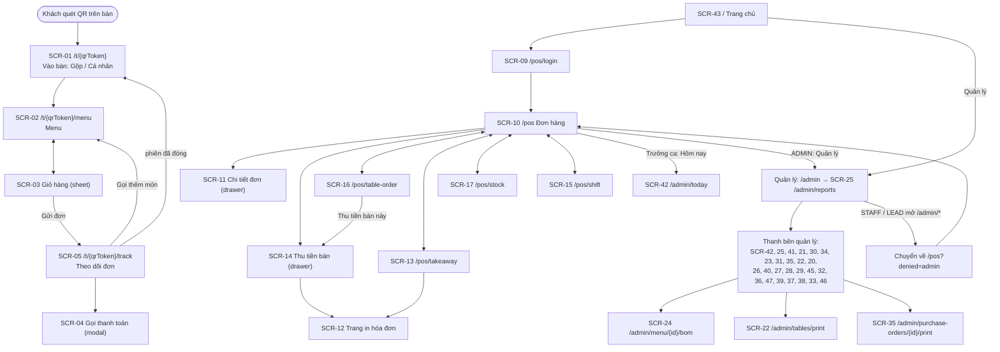

# Sitemap và danh mục màn hình (Screen Inventory) — bước 09

> **Nguồn:** sổ tay quy trình 15 bước (Playbook v1.0) bước 09; route thật trong `ứng-dụng/máy-chủ/src/routes/pages.js` và file HTML trong `ứng-dụng/giao-diện/public/` (đối chiếu 20/10/2026); mã màn hình ở [screens-flows.md](screens-flows.md). **Trạng thái tài liệu:** BẢN NHÁP — chờ chủ dự án duyệt ở Gate G2.

## Quy ước mã màn hình

- `SCR-xx` = mã `S-xx` đã dùng trong [screens-flows.md](screens-flows.md) và trong comment đầu mỗi file HTML, **giữ nguyên số** (quy ước [TASK-057](../công-việc/TASK-057.md)). Ví dụ `SCR-10` = `S-10`.
- Số `S-06`, `S-07`, `S-08`, `S-18`, `S-19` chưa từng được dùng và **không** được gán lại.
- **Mã mới trong tài liệu này:** chỉ hai trang thật chưa có mã S-xx — `SCR-43` (trang chủ `/`, file `index.html`) và `SCR-44` (trang 404, file `404.html`). Hai trang in `/admin/tables/print` và `/admin/purchase-orders/{id}/print` đã thuộc `S-22` và `S-35` trong screens-flows nên giữ mã đó, không cấp mã mới.
- Một số màn là drawer / modal / sheet trên cùng một trang HTML, nên có thể nhiều mã SCR cùng một route (ví dụ `SCR-10`, `SCR-11`, `SCR-14` cùng nằm ở `/pos`).
- Actor theo quy ước TASK-057: `ACT-GUEST`, `ACT-MEMBER`, `ACT-STAFF`, `ACT-LEAD` (Trưởng ca — `MANAGER`), `ACT-ADMIN`. Quyền xem từng trang là trải nghiệm phía giao diện (`js/auth.js`, `js/admin-shell.js`); quyền thật được kiểm ở API — xem [roles-permissions.md](../nghiệp-vụ/roles-permissions.md) và [module-map.md](../kiến-trúc/module-map.md).

## Sơ đồ điều hướng chính

## Danh mục màn hình theo khu vực

### Khách (điện thoại)

| SCR | Route | File | Actor | FEATURE | Ghi chú |
| --- | --- | --- | --- | --- | --- |
| SCR-01 | `/t/{qrToken}` | `t/index.html`, `js/pages/t-entry.js` | ACT-GUEST | [F-001](../chức-năng/FEATURE-001.md) | Bàn trống vào thẳng menu; bàn có người → chọn Gộp chung / Cá nhân |
| SCR-02 | `/t/{qrToken}/menu` | `t/menu.html`, `js/pages/t-menu.js` | ACT-GUEST, ACT-MEMBER | [F-002](../chức-năng/FEATURE-002.md), [F-013](../chức-năng/FEATURE-013.md), [F-015](../chức-năng/FEATURE-015.md), [F-016](../chức-năng/FEATURE-016.md), [F-017](../chức-năng/FEATURE-017.md), [F-020](../chức-năng/FEATURE-020.md), [F-040](../chức-năng/FEATURE-040.md), [F-045](../chức-năng/FEATURE-045.md), [F-049](../chức-năng/FEATURE-049.md), [F-051](../chức-năng/FEATURE-051.md), [F-055](../chức-năng/FEATURE-055.md) | Tab Ưu đãi / Gợi ý / Combo; sheet chọn tùy chọn |
| SCR-03 | `/t/{qrToken}/menu` (sheet giỏ) | như SCR-02, `js/cart.js`, `js/member-box.js` | ACT-GUEST, ACT-MEMBER | [F-002](../chức-năng/FEATURE-002.md), [F-003](../chức-năng/FEATURE-003.md), [F-014](../chức-năng/FEATURE-014.md), [F-025](../chức-năng/FEATURE-025.md), [F-038](../chức-năng/FEATURE-038.md), [F-039](../chức-năng/FEATURE-039.md), [F-047](../chức-năng/FEATURE-047.md), [F-055](../chức-năng/FEATURE-055.md) | Ô hội viên, sheet Thẻ thành viên |
| SCR-04 | `/t/{qrToken}/track` (modal) | `t/track.html`, `js/pages/t-track.js` | ACT-GUEST, ACT-MEMBER | [F-005](../chức-năng/FEATURE-005.md) | Xác nhận gọi thanh toán |
| SCR-05 | `/t/{qrToken}/track` | `t/track.html`, `js/pages/t-track.js`, `js/member-box.js` | ACT-GUEST, ACT-MEMBER | [F-004](../chức-năng/FEATURE-004.md), [F-005](../chức-năng/FEATURE-005.md), [F-014](../chức-năng/FEATURE-014.md), [F-021](../chức-năng/FEATURE-021.md), [F-025](../chức-năng/FEATURE-025.md), [F-026](../chức-năng/FEATURE-026.md), [F-039](../chức-năng/FEATURE-039.md), [F-047](../chức-năng/FEATURE-047.md), [F-049](../chức-năng/FEATURE-049.md), [F-051](../chức-năng/FEATURE-051.md) | Sheet chia bill, gọi nhân viên, Thẻ thành viên |

### Quầy (POS)

| SCR | Route | File | Actor | FEATURE | Ghi chú |
| --- | --- | --- | --- | --- | --- |
| SCR-09 | `/pos/login` | `pos/login.html`, `js/pages/pos-login.js` | ACT-STAFF, ACT-LEAD, ACT-ADMIN | [F-009](../chức-năng/FEATURE-009.md) | `?next=…`, `?reason=expired` / `locked` |
| SCR-10 | `/pos` | `pos/index.html`, `js/pages/pos-dashboard.js`, `js/pos-shell.js` | ACT-STAFF, ACT-LEAD, ACT-ADMIN | [F-007](../chức-năng/FEATURE-007.md), [F-018](../chức-năng/FEATURE-018.md), [F-020](../chức-năng/FEATURE-020.md), [F-021](../chức-năng/FEATURE-021.md), [F-025](../chức-năng/FEATURE-025.md), [F-026](../chức-năng/FEATURE-026.md), [F-049](../chức-năng/FEATURE-049.md), [F-051](../chức-năng/FEATURE-051.md), [F-055](../chức-năng/FEATURE-055.md) | 3 cột Mới / Đang pha / Đã xong; dải Gọi thanh toán; bàn đang phục vụ; `?settle={sessionId}` mở thẳng SCR-14 |
| SCR-11 | `/pos` (drawer) | `js/pages/pos-dashboard.js` | ACT-STAFF, ACT-LEAD, ACT-ADMIN | [F-007](../chức-năng/FEATURE-007.md) | Tiếp nhận / Hoàn tất / Hủy |
| SCR-14 | `/pos` (drawer) | `js/pages/pos-dashboard.js`, `js/billing-controls.js` | ACT-STAFF, ACT-LEAD, ACT-ADMIN | [F-006](../chức-năng/FEATURE-006.md), [F-014](../chức-năng/FEATURE-014.md), [F-022](../chức-năng/FEATURE-022.md), [F-024](../chức-năng/FEATURE-024.md), [F-026](../chức-năng/FEATURE-026.md), [F-038](../chức-năng/FEATURE-038.md), [F-039](../chức-năng/FEATURE-039.md), [F-046](../chức-năng/FEATURE-046.md) | Thu tiền bàn, chia bill, sửa / xóa món, hủy bàn |
| SCR-13 | `/pos/takeaway` | `pos/takeaway.html`, `js/pages/pos-takeaway.js` | ACT-STAFF, ACT-LEAD, ACT-ADMIN | [F-008](../chức-năng/FEATURE-008.md), [F-013](../chức-năng/FEATURE-013.md), [F-015](../chức-năng/FEATURE-015.md), [F-022](../chức-năng/FEATURE-022.md), [F-038](../chức-năng/FEATURE-038.md), [F-039](../chức-năng/FEATURE-039.md), [F-045](../chức-năng/FEATURE-045.md) | Bán mang đi, thu tiền tại quầy |
| SCR-16 | `/pos/table-order` | `pos/table-order.html`, `js/pages/pos-table-order.js` | ACT-STAFF, ACT-LEAD, ACT-ADMIN | [F-024](../chức-năng/FEATURE-024.md), [F-040](../chức-năng/FEATURE-040.md), [F-047](../chức-năng/FEATURE-047.md), [F-055](../chức-năng/FEATURE-055.md) | Sơ đồ bàn, gọi món giúp khách, ghi chú, hội viên tại bàn |
| SCR-15 | `/pos/shift` | `pos/shift.html`, `js/pages/pos-shift.js`, `js/cash-book.js`, `js/attendance.js` | ACT-STAFF, ACT-LEAD, ACT-ADMIN | [F-018](../chức-năng/FEATURE-018.md), [F-019](../chức-năng/FEATURE-019.md), [F-033](../chức-năng/FEATURE-033.md), [F-035](../chức-năng/FEATURE-035.md), [F-036](../chức-năng/FEATURE-036.md), [F-050](../chức-năng/FEATURE-050.md) | Thẻ "Chấm công hôm nay" chỉ LEAD / ADMIN; `?then=logout` (F-054): nhắc + tự mở hộp đóng ca, đóng xong có nút Đăng xuất |
| SCR-17 | `/pos/stock` | `pos/stock.html`, `js/pages/pos-stock.js` | ACT-STAFF, ACT-LEAD, ACT-ADMIN | [F-023](../chức-năng/FEATURE-023.md), [F-027](../chức-năng/FEATURE-027.md), [F-028](../chức-năng/FEATURE-028.md), [F-030](../chức-năng/FEATURE-030.md), [F-032](../chức-năng/FEATURE-032.md), [F-048](../chức-năng/FEATURE-048.md) | Tab Kiểm kê và nút Điều chỉnh chỉ LEAD / ADMIN; phiếu nháp Sửa / Xóa trên danh sách |

### Quản lý (admin)

Mọi trang dưới `/admin/*` gọi `mountAdminShell` (riêng trang in PO gọi `requireStaffPage({ admin: true })`) → chỉ `ACT-ADMIN`; `ACT-STAFF` / `ACT-LEAD` bị chuyển về `/pos?denied=admin`. Ngoại lệ duy nhất là SCR-42. `GET /admin` chuyển hướng tới `/admin/reports`.

Thanh bên (ADR-013 D-58, từ 23/10/2026): **Hôm nay** (SCR-42) luôn ở trên, rồi 6 nhóm thu gọn — **Tổng quan** (SCR-25, SCR-41, SCR-39), **Thực đơn** (SCR-21, SCR-30, SCR-27, SCR-34), **Kho hàng** (SCR-23, SCR-31, SCR-35), **Khách hàng** (SCR-26, SCR-40, SCR-28, SCR-29, SCR-45), **Thu chi & nhân sự** (SCR-32, SCR-36, SCR-47, SCR-37), **Hệ thống** (SCR-22, SCR-20, SCR-38, SCR-33, SCR-46). Nhóm của trang đang mở tự mở. Từ F-061 (ADR-021 D-79) 5 nhóm mục nâng cao chỉ hiện khi bật ở Cài đặt → Giao diện quản lý — quán mới chỉ thấy Hôm nay, Báo cáo, Thực đơn (trừ Lịch thực đơn), Ca & hoàn tiền, Cảnh báo, Bàn & QR, Tài khoản, Cài đặt.

| SCR | Route | File | Actor | FEATURE | Ghi chú |
| --- | --- | --- | --- | --- | --- |
| SCR-42 | `/admin/today` | `admin/today.html`, `js/pages/admin-today.js` | ACT-ADMIN; ACT-LEAD (bản rút gọn) | [F-043](../chức-năng/FEATURE-043.md) | Mục đầu thanh bên; STAFF → `/pos?denied=admin` |
| SCR-25 | `/admin/reports` | `admin/reports.html`, `js/pages/admin-reports.js` | ACT-ADMIN | [F-012](../chức-năng/FEATURE-012.md), [F-016](../chức-năng/FEATURE-016.md), [F-019](../chức-năng/FEATURE-019.md) | Tab Doanh thu / Lịch sử đơn / Thu tiền / Marketing & khách hàng |
| SCR-41 | `/admin/analytics` | `admin/analytics.html`, `js/pages/admin-analytics.js` | ACT-ADMIN | [F-041](../chức-năng/FEATURE-041.md), [F-042](../chức-năng/FEATURE-042.md) | |
| SCR-21 | `/admin/menu` | `admin/menu.html`, `js/pages/admin-menu.js` | ACT-ADMIN | [F-010](../chức-năng/FEATURE-010.md), [F-013](../chức-năng/FEATURE-013.md), [F-020](../chức-năng/FEATURE-020.md), [F-025](../chức-năng/FEATURE-025.md) | |
| SCR-24 | `/admin/menu/{id}/bom` | `admin/bom.html`, `js/pages/admin-bom.js` | ACT-ADMIN | [F-011](../chức-năng/FEATURE-011.md) | Mở từ SCR-21 |
| SCR-30 | `/admin/modifiers` | `admin/modifiers.html`, `js/pages/admin-modifiers.js` | ACT-ADMIN | [F-013](../chức-năng/FEATURE-013.md) | |
| SCR-34 | `/admin/menu-schedules` | `admin/menu-schedules.html`, `js/pages/admin-menu-schedules.js` | ACT-ADMIN | [F-040](../chức-năng/FEATURE-040.md), [F-025](../chức-năng/FEATURE-025.md) | |
| SCR-23 | `/admin/ingredients` | `admin/ingredients.html`, `js/pages/admin-ingredients.js`, `js/inventory-advanced.js` | ACT-ADMIN | [F-011](../chức-năng/FEATURE-011.md), [F-027](../chức-năng/FEATURE-027.md), [F-028](../chức-năng/FEATURE-028.md), [F-031](../chức-năng/FEATURE-031.md), [F-032](../chức-năng/FEATURE-032.md) | |
| SCR-31 | `/admin/stock` | `admin/stock.html`, `js/pages/admin-stock.js` | ACT-ADMIN | [F-023](../chức-năng/FEATURE-023.md), [F-031](../chức-năng/FEATURE-031.md), [F-032](../chức-năng/FEATURE-032.md), [F-048](../chức-năng/FEATURE-048.md) | Phiếu nhập: Chi tiết → Sửa / Hủy phiếu; kiểm kê đã chốt: Hủy phiếu |
| SCR-35 | `/admin/purchasing` | `admin/purchasing.html`, `js/pages/admin-purchasing.js` | ACT-ADMIN | [F-029](../chức-năng/FEATURE-029.md), [F-030](../chức-năng/FEATURE-030.md) | |
| SCR-22 | `/admin/tables` | `admin/tables.html`, `js/pages/admin-tables.js` | ACT-ADMIN | [F-010](../chức-năng/FEATURE-010.md) | |
| SCR-20 | `/admin/users` | `admin/users.html`, `js/pages/admin-users.js` | ACT-ADMIN | [F-009](../chức-năng/FEATURE-009.md), [F-036](../chức-năng/FEATURE-036.md) | |
| SCR-26 | `/admin/members` | `admin/members.html`, `js/pages/admin-members.js` | ACT-ADMIN | [F-014](../chức-năng/FEATURE-014.md), [F-037](../chức-năng/FEATURE-037.md), [F-039](../chức-năng/FEATURE-039.md) | Nhóm "Khách hàng" (D-58) |
| SCR-40 | `/admin/loyalty` | `admin/loyalty.html`, `js/pages/admin-loyalty.js` | ACT-ADMIN | [F-037](../chức-năng/FEATURE-037.md), [F-038](../chức-năng/FEATURE-038.md), [F-039](../chức-năng/FEATURE-039.md) | |
| SCR-27 | `/admin/combos` | `admin/combos.html`, `js/pages/admin-combos.js` | ACT-ADMIN | [F-015](../chức-năng/FEATURE-015.md) | |
| SCR-28 | `/admin/promotions` | `admin/promotions.html`, `js/pages/admin-promotions.js` | ACT-ADMIN | [F-016](../chức-năng/FEATURE-016.md) | |
| SCR-29 | `/admin/suggestions` | `admin/suggestions.html`, `js/pages/admin-suggestions.js` | ACT-ADMIN | [F-017](../chức-năng/FEATURE-017.md) | |
| SCR-32 | `/admin/shifts` | `admin/shifts.html`, `js/pages/admin-shifts.js` | ACT-ADMIN | [F-018](../chức-năng/FEATURE-018.md), [F-019](../chức-năng/FEATURE-019.md) | Nhóm "Thu chi & nhân sự" (D-58) |
| SCR-36 | `/admin/cash` | `admin/cash.html`, `js/pages/admin-cash.js` | ACT-ADMIN | [F-033](../chức-năng/FEATURE-033.md), [F-050](../chức-năng/FEATURE-050.md) | |
| SCR-39 | `/admin/pnl` | `admin/pnl.html`, `js/pages/admin-pnl.js` | ACT-ADMIN | [F-034](../chức-năng/FEATURE-034.md) | |
| SCR-37 | `/admin/staff` | `admin/staff.html`, `js/pages/admin-staff.js` | ACT-ADMIN | [F-035](../chức-năng/FEATURE-035.md) | |
| SCR-38 | `/admin/audit` | `admin/audit.html`, `js/pages/admin-audit.js` | ACT-ADMIN | [F-035](../chức-năng/FEATURE-035.md) | Chỉ đọc |
| SCR-33 | `/admin/settings` | `admin/settings.html`, `js/pages/admin-settings.js` | ACT-ADMIN | [F-020](../chức-năng/FEATURE-020.md), [F-022](../chức-năng/FEATURE-022.md), [F-036](../chức-năng/FEATURE-036.md), [F-053](../chức-năng/FEATURE-053.md) | Nhóm "Hệ thống" (D-58); thẻ "Thông tin quán" — tên quán, địa chỉ in trên hóa đơn (F-053) |

### In

| SCR | Route | File | Actor | FEATURE | Ghi chú |
| --- | --- | --- | --- | --- | --- |
| SCR-12 | `/pos/sessions/{id}/receipt?mode=final` hoặc `?mode=provisional` | `pos/receipt.html`, `js/pages/pos-receipt.js`, `css/print.css` | ACT-STAFF, ACT-LEAD, ACT-ADMIN | [F-006](../chức-năng/FEATURE-006.md), [F-039](../chức-năng/FEATURE-039.md), [F-047](../chức-năng/FEATURE-047.md) | Bill phiên; tạm tính có chữ TẠM TÍNH |
| SCR-12 | `/pos/orders/{id}/receipt` | như trên | ACT-STAFF, ACT-LEAD, ACT-ADMIN | [F-008](../chức-năng/FEATURE-008.md) | Bill mang đi |
| SCR-12 | `/pos/payments/{id}/receipt` | như trên | ACT-STAFF, ACT-LEAD, ACT-ADMIN | [F-026](../chức-năng/FEATURE-026.md) | Bill từng phần chia bill |
| SCR-22 | `/admin/tables/print` | `admin/qr-print.html`, `js/pages/admin-qr-print.js` | ACT-ADMIN | [F-010](../chức-năng/FEATURE-010.md) | In mã QR các bàn |
| SCR-35 | `/admin/purchase-orders/{id}/print` | `admin/po-print.html`, `js/pages/admin-po-print.js` | ACT-ADMIN | [F-030](../chức-năng/FEATURE-030.md) | In / PDF / chép nội dung đơn đặt hàng |

### Chung

| SCR | Route | File | Actor | FEATURE | Ghi chú |
| --- | --- | --- | --- | --- | --- |
| SCR-43 (**mới**) | `/` | `index.html` | Mọi actor | — (điều hướng) | Hướng dẫn khách quét QR; nút "Màn hình quầy (nhân viên)" → `/pos`, "Quản lý" → `/admin` |
| SCR-44 (**mới**) | mọi đường dẫn trang không tồn tại (HTTP 404) | `404.html` | Mọi actor | — | "Không tìm thấy trang", nút "Về trang chủ". API lạ luôn trả JSON, không trả trang này (chưa đăng nhập 401, nhân viên 404 `NOT_FOUND` — AC-001-08) |
| SCR-45 (**mới**, F-051) | `/admin/reviews` | `admin/reviews.html`, `js/pages/admin-reviews.js` | ACT-ADMIN | [F-051](../chức-năng/FEATURE-051.md) | Đánh giá món: theo món (lượt, sao trung bình, phân bố), các lượt đánh giá + góp ý + đã xử lý |
| SCR-46 (**mới**, F-052) | `/admin/api-docs` | `admin/api-docs.html`, `js/pages/admin-api-docs.js` | ACT-ADMIN | [F-052](../chức-năng/FEATURE-052.md) | Tra cứu API: mọi endpoint `/api` đang chạy (method, đường dẫn, quyền), tìm / lọc, mở dòng xem request / response / mã lỗi từ `api-contract.md`, sao chép lệnh curl |
| SCR-47 (**mới**, F-060) | `/admin/alerts` | `admin/alerts.html`, `js/pages/admin-alerts.js` | ACT-ADMIN | [F-060](../chức-năng/FEATURE-060.md) | Cảnh báo bất thường: lọc Mới / Tất cả, Đã xem / Đã xử lý (ghi chú), link Nhật ký thao tác lọc sẵn; nhận `alert.created` qua phòng realtime `admin` |
| SCR-48 (**mới**, F-062) | `/chinh-sach-du-lieu` | `chinh-sach-du-lieu.html`, `js/pages/privacy.js` | Mọi actor (công khai) | [F-062](../chức-năng/FEATURE-062.md) | Chính sách dữ liệu khách hàng; link từ câu đồng ý hội viên (khách + quầy) và trang chủ |

Tổng: 39 file HTML; 40 route trang trong `PAGES` + 1 chuyển hướng (`/admin`) + trang 404; 41 mã SCR đang dùng (SCR-01…05, SCR-09…17, SCR-20…46).

## Đối chiếu route ↔ file

Mọi route trong `PAGES` (`routes/pages.js`) đều có trong bảng trên, và mọi file HTML trong `public/` đều có route hoặc là trang 404. Không có trang mồ côi. File tĩnh (`/css/*`, `/js/*`) do `express.static` phục vụ; `/socket.io/socket.io.min.js` do Socket.io phục vụ.

## Ảnh chuẩn theo màn hình (TASK-057)

> Mẫu 06 của sổ tay ("Screenshot chuẩn"). Chụp tự động bởi `kiểm-thử/e2e/a11y.spec.js` trên dữ liệu E2E ngày 20/10/2026 (khách: 390 × 844, quầy / quản lý: 1366 × 860), sau khi đợi hết hiệu ứng mở drawer / sheet. Chạy lại `npm run test:e2e` sẽ chụp mới vào `kiểm-thử/kết-quả/ảnh/` — chép sang đây khi giao diện đổi có chủ đích. Trang SCR-43 / SCR-44 kiểm bằng `tests/acceptance.test.js` (AC-001-07/08).

| SCR | Ảnh | Nội dung |
| --- | --- | --- |
| SCR-01 | [khach-chon-nhom.jpg](ảnh/khach-chon-nhom.jpg) | Khách quét QR bàn đang có nhóm — chọn Gộp chung / Cá nhân |
| SCR-02 | [khach-menu.jpg](ảnh/khach-menu.jpg) | Menu khách (điện thoại 390 px) |
| SCR-03 | [khach-gio-hang.jpg](ảnh/khach-gio-hang.jpg) | Giỏ hàng (sheet) |
| SCR-05 | [khach-chia-bill.jpg](ảnh/khach-chia-bill.jpg) | Sheet chia bill theo người |
| SCR-05 | [khach-theo-doi-don.jpg](ảnh/khach-theo-doi-don.jpg) | Theo dõi đơn |
| SCR-09 | [quay-dang-nhap.jpg](ảnh/quay-dang-nhap.jpg) | Đăng nhập quầy |
| SCR-10 | [quay-don-hang.jpg](ảnh/quay-don-hang.jpg) | Đơn hàng — 3 cột + bàn đang phục vụ |
| SCR-12 | [quay-phieu-tam-tinh.jpg](ảnh/quay-phieu-tam-tinh.jpg) | Phiếu tạm tính 80 mm |
| SCR-13 | [quay-ban-mang-di.jpg](ảnh/quay-ban-mang-di.jpg) | Bán mang đi |
| SCR-14 | [quay-drawer-thu-tien.jpg](ảnh/quay-drawer-thu-tien.jpg) | Drawer Thu tiền bàn |
| SCR-14 | [quay-hop-thoai-sua-mon.jpg](ảnh/quay-hop-thoai-sua-mon.jpg) | Hộp thoại sửa / xóa món (F-046) |
| SCR-15 | [quay-ca-hoan-tien.jpg](ảnh/quay-ca-hoan-tien.jpg) | Ca & hoàn tiền |
| SCR-16 | [quay-goi-mon-tai-ban.jpg](ảnh/quay-goi-mon-tai-ban.jpg) | Gọi món tại bàn |
| SCR-16 | [quay-goi-mon-tai-ban-chon-ban.jpg](ảnh/quay-goi-mon-tai-ban-chon-ban.jpg) | Gọi món tại bàn — đã chọn bàn, khung hội viên (F-047) |
| SCR-17 | [quay-kho-so-che.jpg](ảnh/quay-kho-so-che.jpg) | Kho & sơ chế ở quầy |
| SCR-20 | [quan-ly-users.jpg](ảnh/quan-ly-users.jpg) | Quản lý — `/admin/users` |
| SCR-21 | [quan-ly-menu.jpg](ảnh/quan-ly-menu.jpg) | Quản lý — `/admin/menu` |
| SCR-22 | [quan-ly-tables.jpg](ảnh/quan-ly-tables.jpg) | Quản lý — `/admin/tables` |
| SCR-22 | [quan-ly-tables-print.jpg](ảnh/quan-ly-tables-print.jpg) | Quản lý — `/admin/tables/print` |
| SCR-23 | [quan-ly-ingredients.jpg](ảnh/quan-ly-ingredients.jpg) | Quản lý — `/admin/ingredients` |
| SCR-24 | [quan-ly-menu-id-bom.jpg](ảnh/quan-ly-menu-id-bom.jpg) | Quản lý — `/admin/menu/{id}/bom` |
| SCR-25 | [quan-ly-reports.jpg](ảnh/quan-ly-reports.jpg) | Quản lý — `/admin/reports` |
| SCR-26 | [quan-ly-members.jpg](ảnh/quan-ly-members.jpg) | Quản lý — `/admin/members` |
| SCR-27 | [quan-ly-combos.jpg](ảnh/quan-ly-combos.jpg) | Quản lý — `/admin/combos` |
| SCR-28 | [quan-ly-promotions.jpg](ảnh/quan-ly-promotions.jpg) | Quản lý — `/admin/promotions` |
| SCR-29 | [quan-ly-suggestions.jpg](ảnh/quan-ly-suggestions.jpg) | Quản lý — `/admin/suggestions` |
| SCR-30 | [quan-ly-modifiers.jpg](ảnh/quan-ly-modifiers.jpg) | Quản lý — `/admin/modifiers` |
| SCR-31 | [quan-ly-stock.jpg](ảnh/quan-ly-stock.jpg) | Quản lý — `/admin/stock` |
| SCR-32 | [quan-ly-shifts.jpg](ảnh/quan-ly-shifts.jpg) | Quản lý — `/admin/shifts` |
| SCR-33 | [quan-ly-settings.jpg](ảnh/quan-ly-settings.jpg) | Quản lý — `/admin/settings` |
| SCR-34 | [quan-ly-menu-schedules.jpg](ảnh/quan-ly-menu-schedules.jpg) | Quản lý — `/admin/menu-schedules` |
| SCR-35 | [quan-ly-purchasing.jpg](ảnh/quan-ly-purchasing.jpg) | Quản lý — `/admin/purchasing` |
| SCR-36 | [quan-ly-cash.jpg](ảnh/quan-ly-cash.jpg) | Quản lý — `/admin/cash` |
| SCR-37 | [quan-ly-staff.jpg](ảnh/quan-ly-staff.jpg) | Quản lý — `/admin/staff` |
| SCR-38 | [quan-ly-audit.jpg](ảnh/quan-ly-audit.jpg) | Quản lý — `/admin/audit` |
| SCR-47 | [quan-ly-alerts.jpg](ảnh/quan-ly-alerts.jpg) | Quản lý — `/admin/alerts` |
| SCR-48 | [khach-chinh-sach-du-lieu.jpg](ảnh/khach-chinh-sach-du-lieu.jpg) | Khách — `/chinh-sach-du-lieu` |
| SCR-39 | [quan-ly-pnl.jpg](ảnh/quan-ly-pnl.jpg) | Quản lý — `/admin/pnl` |
| SCR-40 | [quan-ly-loyalty.jpg](ảnh/quan-ly-loyalty.jpg) | Quản lý — `/admin/loyalty` |
| SCR-41 | [quan-ly-analytics.jpg](ảnh/quan-ly-analytics.jpg) | Quản lý — `/admin/analytics` |
| SCR-42 | [quan-ly-today.jpg](ảnh/quan-ly-today.jpg) | Quản lý — `/admin/today` |
