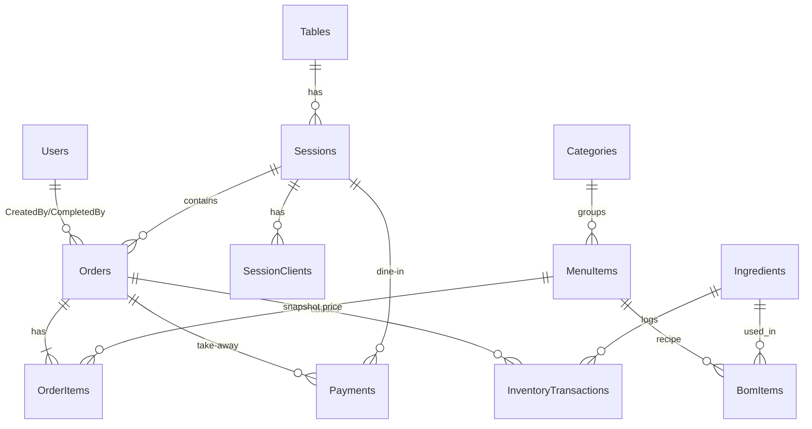

# Data model và stored procedures

> **Nguồn:** `tài-liệu/nguồn/huong-dan-web-app-v1.2.md` §11.1–11.2 (bản 1.2, 14/10/2026). **Trạng thái tài liệu:** BẢN NHÁP — trạng thái từng mục ghi tại chỗ (CONFIRMED / PROPOSED / NEEDS_CONFIRMATION / UNKNOWN / N/A). Quyết định đã chốt: [ADR-000](../quyết-định/ADR-000-thanh-toan-tien-mat.md) (D-1/D-2/D-3).

> **Cập nhật 14/10/2026 — đã triển khai.** Nguồn sự thật của schema/SP là `cơ-sở-dữ-liệu/chuyển-đổi/0001_init.sql` và `cơ-sở-dữ-liệu/thủ-tục/*.sql` (theo ADR-001…003). Phần DDL/SP dưới đây là **bản đề xuất ban đầu** giữ lại để đối chiếu; khác biệt khi triển khai ghi ở mục "Triển khai thực tế" cuối file.

> **Cập nhật 18/10/2026:** schema giai đoạn 4–8 (migration `0015`…`0032`), SP mới, mã lỗi và bất biến mới nằm ở mục "Mở rộng giai đoạn 4–8 (ADR-006)" cuối file.

> **Cập nhật 18/10/2026 (ADR-007):** migration `0033_sua_xoa_mon.sql`, SP sửa / xóa món / hủy bàn, mã lỗi `50181`…`50186` và bất biến mới nằm ở mục "Sửa / xóa món, hủy bàn (FEATURE-046, ADR-007)" cuối file. Migration mới nhất: `0033`; số kế tiếp: **`0034`**.

## 11.1. Data model (data-model) — PROPOSED, SQL Server

Sơ đồ quan hệ:



DDL cốt lõi (chạy được trên SQL Server 2019+; `ReservedQty` chỉ cần nếu Q-001 = A):

```sql
CREATE TABLE Users (
  UserId        INT IDENTITY PRIMARY KEY,
  Username      NVARCHAR(50)  NOT NULL,
  PasswordHash  NVARCHAR(255) NOT NULL,
  FullName      NVARCHAR(100) NOT NULL,
  Role          VARCHAR(10)   NOT NULL CHECK (Role IN ('STAFF','ADMIN')),
  IsActive      BIT           NOT NULL DEFAULT 1,
  CreatedAt     DATETIME2(0)  NOT NULL DEFAULT SYSUTCDATETIME()
);
CREATE UNIQUE INDEX UX_Users_Username ON Users (Username);  -- collation DB mặc định CI → không phân biệt hoa/thường (BR-004)

CREATE TABLE Tables (
  TableId   INT IDENTITY PRIMARY KEY,
  Code      NVARCHAR(10) NOT NULL UNIQUE,
  Name      NVARCHAR(50) NOT NULL,
  QrToken   CHAR(32)     NOT NULL UNIQUE,
  IsActive  BIT          NOT NULL DEFAULT 1
);

CREATE TABLE Sessions (
  SessionId  UNIQUEIDENTIFIER PRIMARY KEY DEFAULT NEWSEQUENTIALID(),
  TableId    INT NOT NULL REFERENCES Tables(TableId),
  Status     VARCHAR(20) NOT NULL DEFAULT 'OPEN' CHECK (Status IN ('OPEN','PAYMENT_REQUESTED','CLOSED')),  -- D-2
  OpenedAt   DATETIME2(0) NOT NULL DEFAULT SYSUTCDATETIME(),
  PaymentRequestedAt DATETIME2(0) NULL,                       -- lần gọi thanh toán gần nhất
  ClosedAt   DATETIME2(0) NULL,
  ClosedBy   INT NULL REFERENCES Users(UserId)
);
CREATE INDEX IX_Sessions_Table_Status ON Sessions (TableId, Status);

CREATE TABLE SessionClients (
  SessionId   UNIQUEIDENTIFIER NOT NULL REFERENCES Sessions(SessionId),
  ClientToken CHAR(32) NOT NULL,
  JoinedAt    DATETIME2(0) NOT NULL DEFAULT SYSUTCDATETIME(),
  PRIMARY KEY (SessionId, ClientToken)
);

CREATE TABLE Categories (
  CategoryId INT IDENTITY PRIMARY KEY,
  Name       NVARCHAR(50) NOT NULL,
  SortOrder  INT NOT NULL DEFAULT 0
);

CREATE TABLE MenuItems (
  MenuItemId  INT IDENTITY PRIMARY KEY,
  CategoryId  INT NOT NULL REFERENCES Categories(CategoryId),
  Name        NVARCHAR(100) NOT NULL,
  Price       DECIMAL(12,0) NOT NULL CHECK (Price >= 0),      -- VND nguyên
  ImageUrl    NVARCHAR(500) NULL,
  IsAvailable BIT NOT NULL DEFAULT 1,                           -- "hết món" tạm thời
  IsActive    BIT NOT NULL DEFAULT 1                            -- ẩn khỏi menu
);

CREATE TABLE Ingredients (
  IngredientId      INT IDENTITY PRIMARY KEY,
  Name              NVARCHAR(100) NOT NULL UNIQUE,
  Unit              NVARCHAR(10)  NOT NULL,                     -- ml, g, cai...
  StockQty          DECIMAL(18,3) NOT NULL DEFAULT 0,
  ReservedQty       DECIMAL(18,3) NOT NULL DEFAULT 0,           -- chỉ dùng nếu Q-001 = A
  LowStockThreshold DECIMAL(18,3) NOT NULL DEFAULT 0,
  CONSTRAINT CK_Ingredients_Stock    CHECK (StockQty >= 0),     -- lưới an toàn cuối cùng cho BR-001
  CONSTRAINT CK_Ingredients_Reserved CHECK (ReservedQty >= 0 AND ReservedQty <= StockQty)
);

CREATE TABLE BomItems (
  MenuItemId   INT NOT NULL REFERENCES MenuItems(MenuItemId),
  IngredientId INT NOT NULL REFERENCES Ingredients(IngredientId),
  Amount       DECIMAL(18,3) NOT NULL CHECK (Amount > 0),       -- BR-003
  PRIMARY KEY (MenuItemId, IngredientId)
);

CREATE TABLE Orders (
  OrderId        INT IDENTITY PRIMARY KEY,
  OrderCode      CHAR(8) NOT NULL UNIQUE,                       -- dùng trong nội dung chuyển khoản, ví dụ 'A7K3M2QX'
  SessionId      UNIQUEIDENTIFIER NULL REFERENCES Sessions(SessionId),
  TableId        INT NULL REFERENCES Tables(TableId),
  Type           VARCHAR(10) NOT NULL CHECK (Type IN ('DINE_IN','TAKE_AWAY')),
  Status         VARCHAR(10) NOT NULL DEFAULT 'PENDING'
                   CHECK (Status IN ('PENDING','PREPARING','COMPLETED','CANCELLED')),
  PaymentStatus  VARCHAR(6)  NOT NULL DEFAULT 'UNPAID' CHECK (PaymentStatus IN ('UNPAID','PAID')),
  PaymentMethod  VARCHAR(10) NULL CHECK (PaymentMethod IN ('CASH')),             -- mở rộng 'TRANSFER' sau (D-1)
  TotalAmount    DECIMAL(12,0) NOT NULL,
  Note           NVARCHAR(200) NULL,
  CreatedBy      INT NULL REFERENCES Users(UserId),             -- NULL = khách
  CreatedAt      DATETIME2(0) NOT NULL DEFAULT SYSUTCDATETIME(),
  PaidAt         DATETIME2(0) NULL,
  CompletedAt    DATETIME2(0) NULL,
  CompletedBy    INT NULL REFERENCES Users(UserId),
  CancelledAt    DATETIME2(0) NULL,
  RowVer         ROWVERSION,
  CONSTRAINT CK_Orders_DineInHasSession CHECK (Type = 'TAKE_AWAY' OR SessionId IS NOT NULL)
);
CREATE INDEX IX_Orders_Status_CreatedAt ON Orders (Status, CreatedAt);
CREATE INDEX IX_Orders_Session ON Orders (SessionId);
CREATE INDEX IX_Orders_PaidAt ON Orders (PaidAt) WHERE PaymentStatus = 'PAID';   -- báo cáo

CREATE TABLE OrderItems (
  OrderItemId INT IDENTITY PRIMARY KEY,
  OrderId     INT NOT NULL REFERENCES Orders(OrderId),
  MenuItemId  INT NOT NULL REFERENCES MenuItems(MenuItemId),
  Quantity    INT NOT NULL CHECK (Quantity BETWEEN 1 AND 50),  -- BR-015
  UnitPrice   DECIMAL(12,0) NOT NULL,                          -- snapshot giá (BR-011)
  Note        NVARCHAR(200) NULL
);
CREATE INDEX IX_OrderItems_Order ON OrderItems (OrderId);

CREATE TABLE Payments (                                        -- D-1: chỉ tiền mặt; một dòng cho một phiên (dine-in) HOẶC một đơn (mang đi)
  PaymentId      INT IDENTITY PRIMARY KEY,
  SessionId      UNIQUEIDENTIFIER NULL REFERENCES Sessions(SessionId),
  OrderId        INT NULL REFERENCES Orders(OrderId),
  Method         VARCHAR(10) NOT NULL DEFAULT 'CASH' CHECK (Method IN ('CASH')),   -- mở rộng 'TRANSFER' sau
  AmountDue      DECIMAL(12,0) NOT NULL,
  AmountReceived DECIMAL(12,0) NOT NULL,
  ChangeGiven    AS (AmountReceived - AmountDue) PERSISTED,
  ReceivedBy     INT NOT NULL REFERENCES Users(UserId),        -- BR-007: luôn là nhân viên
  PaidAt         DATETIME2(0) NOT NULL DEFAULT SYSUTCDATETIME(),
  CONSTRAINT CK_Payments_Target   CHECK ((SessionId IS NOT NULL AND OrderId IS NULL) OR (SessionId IS NULL AND OrderId IS NOT NULL)),
  CONSTRAINT CK_Payments_Received CHECK (AmountReceived >= AmountDue)
);
CREATE UNIQUE INDEX UX_Payments_Session ON Payments (SessionId) WHERE SessionId IS NOT NULL;  -- BR-019: một phiên thu một lần
CREATE UNIQUE INDEX UX_Payments_Order   ON Payments (OrderId)   WHERE OrderId   IS NOT NULL;  -- mang đi thu một lần
CREATE INDEX IX_Payments_PaidAt ON Payments (PaidAt);                                         -- đối soát ca

CREATE TABLE InventoryTransactions (
  TxnId        BIGINT IDENTITY PRIMARY KEY,
  IngredientId INT NOT NULL REFERENCES Ingredients(IngredientId),
  OrderId      INT NULL REFERENCES Orders(OrderId),
  Type         VARCHAR(10) NOT NULL CHECK (Type IN ('DEDUCT','ADJUST','IMPORT')),
  Delta        DECIMAL(18,3) NOT NULL,   -- âm khi trừ
  BalanceAfter DECIMAL(18,3) NOT NULL,
  Reason       NVARCHAR(200) NULL,
  CreatedBy    INT NULL REFERENCES Users(UserId),
  CreatedAt    DATETIME2(0) NOT NULL DEFAULT SYSUTCDATETIME()
);
CREATE INDEX IX_InvTxn_Ingredient ON InventoryTransactions (IngredientId, CreatedAt);
CREATE UNIQUE INDEX UX_InvTxn_Order_Ingredient ON InventoryTransactions (OrderId, IngredientId)
  WHERE Type = 'DEDUCT';                 -- lưới an toàn cho BR-002: không trừ 2 lần cùng đơn
```

Ghi chú thiết kế:
- Mọi `DATETIME2` lưu **UTC**; hiển thị theo `Asia/Ho_Chi_Minh` ở client; báo cáo theo ngày quy đổi múi giờ quán.
- `OrderCode` 8 ký tự chữ-số không nhầm lẫn (bỏ O/0, I/1) để ghi vào nội dung chuyển khoản.
- Không xóa cứng `Users`, `MenuItems`, `Ingredients` (dùng `IsActive`) vì có FK từ lịch sử.
- Index chỉ thêm theo truy vấn đã biết (dashboard theo trạng thái; báo cáo theo `PaidAt`; đơn theo phiên). Không thêm index hàng loạt.

## 11.2. Stored procedures giữ invariant kho — PROPOSED (phương án Q-001 = A)

Nguyên tắc chống race condition trên SQL Server: trong **một transaction**, **khóa các dòng `Ingredients` liên quan bằng `UPDLOCK, HOLDLOCK`** (theo thứ tự `IngredientId` để tránh deadlock), kiểm tra, rồi cập nhật. `CHECK` constraint là lưới an toàn cuối: nếu logic sai, DB vẫn ném lỗi thay vì âm kho.

```sql
-- Kiểu bảng truyền danh sách món từ app
CREATE TYPE dbo.OrderItemInput AS TABLE (
  MenuItemId INT NOT NULL, Quantity INT NOT NULL, Note NVARCHAR(200) NULL
);
GO

CREATE OR ALTER PROCEDURE dbo.sp_SubmitOrder
  @Type         VARCHAR(10),            -- 'DINE_IN' | 'TAKE_AWAY'
  @SessionId    UNIQUEIDENTIFIER = NULL,
  @TableId      INT = NULL,
  @CreatedBy    INT = NULL,
  @PaymentMethod VARCHAR(10) = NULL,    -- mang đi: 'CASH' → PAID ngay (D-3); dine-in: NULL
  @AmountReceived DECIMAL(12,0) = NULL, -- mang đi: tiền khách đưa (BR-006)
  @Items        dbo.OrderItemInput READONLY,
  @OrderId      INT OUTPUT,
  @OrderCode    CHAR(8) OUTPUT
AS
BEGIN
  SET NOCOUNT ON; SET XACT_ABORT ON;
  BEGIN TRAN;

  -- 1. Món còn bán?
  IF EXISTS (SELECT 1 FROM @Items i JOIN MenuItems m ON m.MenuItemId = i.MenuItemId
             WHERE m.IsActive = 0 OR m.IsAvailable = 0)
  BEGIN ROLLBACK; THROW 50010, 'ITEM_UNAVAILABLE', 1; END

  -- 2. Nhu cầu nguyên liệu
  DECLARE @Need TABLE (IngredientId INT PRIMARY KEY, Qty DECIMAL(18,3));
  INSERT @Need SELECT b.IngredientId, SUM(i.Quantity * b.Amount)
  FROM @Items i JOIN BomItems b ON b.MenuItemId = i.MenuItemId
  GROUP BY b.IngredientId;

  -- 3. Khóa và kiểm khả dụng (StockQty - ReservedQty)
  DECLARE @Short NVARCHAR(MAX) = (
    SELECT STRING_AGG(CAST(ing.IngredientId AS NVARCHAR(10)), ',')
    FROM Ingredients ing WITH (UPDLOCK, HOLDLOCK)
    JOIN @Need n ON n.IngredientId = ing.IngredientId
    WHERE ing.StockQty - ing.ReservedQty < n.Qty);
  IF @Short IS NOT NULL
  BEGIN ROLLBACK; THROW 50002, @Short, 1; END   -- app map IngredientId → tên món thiếu (OUT_OF_STOCK)

  -- 4. Giữ chỗ
  UPDATE ing SET ReservedQty = ing.ReservedQty + n.Qty
  FROM Ingredients ing JOIN @Need n ON n.IngredientId = ing.IngredientId;

  -- 5. Ghi đơn
  SET @OrderCode = dbo.fn_NewOrderCode();   -- hàm cần tạo ở TASK-003: 8 ký tự A-Z/2-9 (bỏ O,0,I,1); app retry nếu trùng (hiếm)
  INSERT Orders (OrderCode, SessionId, TableId, Type, TotalAmount, CreatedBy, PaymentMethod,
                 PaymentStatus, Status, PaidAt)
  SELECT @OrderCode, @SessionId, @TableId, @Type,
         SUM(i.Quantity * m.Price), @CreatedBy, @PaymentMethod,
         CASE WHEN @PaymentMethod = 'CASH' THEN 'PAID' ELSE 'UNPAID' END,
         CASE WHEN @PaymentMethod = 'CASH' THEN 'PREPARING' ELSE 'PENDING' END,
         CASE WHEN @PaymentMethod = 'CASH' THEN SYSUTCDATETIME() END
  FROM @Items i JOIN MenuItems m ON m.MenuItemId = i.MenuItemId;
  SET @OrderId = SCOPE_IDENTITY();

  INSERT OrderItems (OrderId, MenuItemId, Quantity, UnitPrice, Note)
  SELECT @OrderId, i.MenuItemId, i.Quantity, m.Price, i.Note
  FROM @Items i JOIN MenuItems m ON m.MenuItemId = i.MenuItemId;

  IF @PaymentMethod = 'CASH'                     -- mang đi: thu tiền ngay tại quầy
  BEGIN
    IF @AmountReceived IS NULL OR @AmountReceived < (SELECT TotalAmount FROM Orders WHERE OrderId = @OrderId)
    BEGIN ROLLBACK; THROW 50020, 'INSUFFICIENT_AMOUNT', 1; END
    INSERT Payments (OrderId, Method, AmountDue, AmountReceived, ReceivedBy)
    SELECT @OrderId, 'CASH', TotalAmount, @AmountReceived, @CreatedBy FROM Orders WHERE OrderId = @OrderId;
  END

  COMMIT;
END
GO

CREATE OR ALTER PROCEDURE dbo.sp_RequestPayment      -- D-2: khách bấm Gọi thanh toán
  @SessionId UNIQUEIDENTIFIER
AS
BEGIN
  SET NOCOUNT ON;
  IF NOT EXISTS (SELECT 1 FROM Orders WHERE SessionId = @SessionId AND Status <> 'CANCELLED')
    THROW 50030, 'NO_ORDERS', 1;                                        -- BR-018
  UPDATE Sessions SET Status = 'PAYMENT_REQUESTED', PaymentRequestedAt = SYSUTCDATETIME()
  WHERE SessionId = @SessionId AND Status IN ('OPEN','PAYMENT_REQUESTED');  -- idempotent
  IF @@ROWCOUNT = 0 THROW 50031, 'SESSION_CLOSED', 1;
END
GO

CREATE OR ALTER PROCEDURE dbo.sp_SettleSession       -- D-2: nhân viên bấm "Đã thu tiền"
  @SessionId UNIQUEIDENTIFIER, @AmountReceived DECIMAL(12,0), @UserId INT,
  @PaymentId INT OUTPUT
AS
BEGIN
  SET NOCOUNT ON; SET XACT_ABORT ON;
  BEGIN TRAN;

  -- 1. Chỉ một client thắng (BR-019)
  UPDATE Sessions SET Status = 'CLOSED', ClosedAt = SYSUTCDATETIME(), ClosedBy = @UserId
  WHERE SessionId = @SessionId AND Status IN ('OPEN','PAYMENT_REQUESTED');
  IF @@ROWCOUNT = 0 BEGIN ROLLBACK; THROW 50032, 'ALREADY_SETTLED', 1; END

  -- 2. Không còn đơn chưa tiếp nhận
  IF EXISTS (SELECT 1 FROM Orders WITH (UPDLOCK, HOLDLOCK) WHERE SessionId = @SessionId AND Status = 'PENDING')
  BEGIN ROLLBACK; THROW 50033, 'HAS_PENDING_ORDERS', 1; END

  -- 3. Tổng phải thu = mọi đơn không hủy
  DECLARE @Due DECIMAL(12,0) = (SELECT ISNULL(SUM(TotalAmount),0) FROM Orders WHERE SessionId = @SessionId AND Status <> 'CANCELLED');
  IF @Due = 0 BEGIN ROLLBACK; THROW 50030, 'NO_ORDERS', 1; END          -- dùng sp_CloseEmptySession thay thế
  IF @AmountReceived < @Due BEGIN ROLLBACK; THROW 50020, 'INSUFFICIENT_AMOUNT', 1; END

  -- 4. Ghi nhận
  UPDATE Orders SET PaymentStatus = 'PAID', PaymentMethod = 'CASH', PaidAt = SYSUTCDATETIME()
  WHERE SessionId = @SessionId AND Status <> 'CANCELLED' AND PaymentStatus = 'UNPAID';
  INSERT Payments (SessionId, Method, AmountDue, AmountReceived, ReceivedBy)
  VALUES (@SessionId, 'CASH', @Due, @AmountReceived, @UserId);
  SET @PaymentId = SCOPE_IDENTITY();

  COMMIT;
END
GO

CREATE OR ALTER PROCEDURE dbo.sp_CompleteOrder
  @OrderId INT, @UserId INT
AS
BEGIN
  SET NOCOUNT ON; SET XACT_ABORT ON;
  BEGIN TRAN;

  -- 1. Đổi trạng thái có điều kiện: chỉ một client thắng (BR-002, BR-013)
  UPDATE Orders SET Status = 'COMPLETED', CompletedAt = SYSUTCDATETIME(), CompletedBy = @UserId
  WHERE OrderId = @OrderId AND Status = 'PREPARING';
  IF @@ROWCOUNT = 0
  BEGIN
    ROLLBACK;
    IF EXISTS (SELECT 1 FROM Orders WHERE OrderId = @OrderId AND Status = 'COMPLETED')
      THROW 50001, 'ALREADY_PROCESSED', 1;
    THROW 50003, 'INVALID_STATE', 1;
  END

  -- 2. Nhu cầu
  DECLARE @Need TABLE (IngredientId INT PRIMARY KEY, Qty DECIMAL(18,3));
  INSERT @Need SELECT b.IngredientId, SUM(oi.Quantity * b.Amount)
  FROM OrderItems oi JOIN BomItems b ON b.MenuItemId = oi.MenuItemId
  WHERE oi.OrderId = @OrderId GROUP BY b.IngredientId;

  -- 3. Khóa, kiểm (BR-001) — với phương án A điều kiện này luôn đúng trừ khi kho bị điều chỉnh tay
  IF EXISTS (SELECT 1 FROM Ingredients ing WITH (UPDLOCK, HOLDLOCK)
             JOIN @Need n ON n.IngredientId = ing.IngredientId WHERE ing.StockQty < n.Qty)
  BEGIN ROLLBACK; THROW 50002, 'OUT_OF_STOCK', 1; END

  -- 4. Trừ thật + trả giữ chỗ
  UPDATE ing SET StockQty = ing.StockQty - n.Qty, ReservedQty = ing.ReservedQty - n.Qty
  FROM Ingredients ing JOIN @Need n ON n.IngredientId = ing.IngredientId;

  -- 5. Nhật ký (unique index chặn trừ 2 lần)
  INSERT InventoryTransactions (IngredientId, OrderId, Type, Delta, BalanceAfter, CreatedBy)
  SELECT n.IngredientId, @OrderId, 'DEDUCT', -n.Qty, ing.StockQty, @UserId
  FROM @Need n JOIN Ingredients ing ON ing.IngredientId = n.IngredientId;

  COMMIT;
END
GO

CREATE OR ALTER PROCEDURE dbo.sp_CancelOrder @OrderId INT, @UserId INT
AS
BEGIN
  SET NOCOUNT ON; SET XACT_ABORT ON;
  BEGIN TRAN;
  UPDATE Orders SET Status = 'CANCELLED', CancelledAt = SYSUTCDATETIME()
  WHERE OrderId = @OrderId AND Status = 'PENDING';
  IF @@ROWCOUNT = 0 BEGIN ROLLBACK; THROW 50003, 'INVALID_STATE', 1; END

  UPDATE ing SET ReservedQty = ing.ReservedQty - n.Qty
  FROM Ingredients ing JOIN (
    SELECT b.IngredientId, SUM(oi.Quantity * b.Amount) Qty
    FROM OrderItems oi JOIN BomItems b ON b.MenuItemId = oi.MenuItemId
    WHERE oi.OrderId = @OrderId GROUP BY b.IngredientId) n ON n.IngredientId = ing.IngredientId;
  COMMIT;
END
GO
```

Nếu nhóm chọn **Q-001 = B** (không giữ): bỏ bước 3–4 trong `sp_SubmitOrder` (chỉ kiểm `StockQty ≥ cần`), bỏ `ReservedQty` ở mọi nơi; `sp_CompleteOrder` giữ nguyên và sẽ là nơi duy nhất từ chối. Nếu chọn **C** (trừ ngay khi gửi): chuyển bước 3–5 của `sp_CompleteOrder` sang `sp_SubmitOrder`; `sp_CancelOrder` phải **cộng lại** kho.

Ứng dụng xử lý lỗi SP: `50001 → 409 ALREADY_PROCESSED`, `50002 → 409 OUT_OF_STOCK` (map ID nguyên liệu → tên món bị ảnh hưởng), `50003 → 409 INVALID_STATE`, `50010 → 409 ITEM_UNAVAILABLE`, `50020 → 400 INSUFFICIENT_AMOUNT`, `50030 → 409 NO_ORDERS`, `50031 → 409 SESSION_CLOSED`, `50032 → 409 ALREADY_SETTLED`, `50033 → 409 HAS_PENDING_ORDERS`, deadlock `1205` → retry tối đa 3 lần với backoff ngắn. Tiếp nhận đơn (`PENDING → PREPARING`) và đóng bàn trống không chạm kho nên có thể là `UPDATE … WHERE Status = …` có điều kiện trong service, không cần SP.

## Ghi chú đối chiếu khi tách docs (13/10/2026)

Phần DDL/SP ở trên được giữ **nguyên văn** từ tài liệu nguồn (PROPOSED). Các điểm dưới đây cần xử lý khi viết migration/SP thật ở TASK-003/TASK-004. Agent không tự sửa phần thiết kế khi nhóm chưa chốt.

**Trạng thái 14/10/2026:** cả 7 điểm đã xử lý trong `cơ-sở-dữ-liệu/` — #1 comment đã sửa; #2 `sp_CloseEmptySession` đã viết (Q-018); #3 sinh mã bằng `CRYPT_GEN_RANDOM` trong thân `sp_SubmitOrder`; #4 khóa `Sessions` (Q-013); #5 kiểm `MenuItemId` không tồn tại → 50010; #6 đủ 7 SP; #7 DB tạo với `Vietnamese_CI_AS`.

| # | Điểm | Đề xuất | Theo dõi |
| --- | --- | --- | --- |
| 1 | Comment của `Orders.OrderCode` và dòng "Ghi chú thiết kế" vẫn ghi "dùng trong nội dung chuyển khoản". Ý này có từ thời VietQR; theo ADR-000 (D-1) không còn chuyển khoản | Giữ `OrderCode` làm mã ngắn in trên bill/thẻ đơn POS và sửa lại comment khi viết `0001_init.sql` | TASK-003 |
| 2 | Comment trong `sp_SettleSession` trỏ tới `sp_CloseEmptySession`, nhưng SP này không được định nghĩa ở đâu (đoạn cuối mục SP nói đóng bàn trống là `UPDATE` có điều kiện trong service) | Xem Q-018 | Q-018, TASK-015 |
| 3 | `dbo.fn_NewOrderCode()`: hàm scalar của SQL Server **không** được gọi `NEWID()`/`RAND()` (toán tử có side-effect) | Sinh mã ngay trong thân SP (ví dụ từ `CRYPT_GEN_RANDOM`), hoặc dùng view trung gian `SELECT NEWID()`, hoặc để app sinh rồi truyền vào. Chọn một cách ở TASK-004, giữ nguyên việc retry khi trùng | TASK-004 |
| 4 | `sp_SubmitOrder` (dine-in) không khóa/kiểm `Sessions` trong transaction, nên đơn có thể rơi vào phiên vừa `CLOSED` | Xem Q-013 | Q-013, TASK-004 |
| 5 | `sp_SubmitOrder` dùng `JOIN MenuItems`, nên dòng có `MenuItemId` không tồn tại sẽ **bị bỏ qua âm thầm** thay vì bị từ chối | Ngoài DTO validation, thêm kiểm tra trong SP: `LEFT JOIN … WHERE m.MenuItemId IS NULL` → `THROW 50010` (đây là chi tiết kỹ thuật nhỏ, đảo ngược được) | TASK-004 |
| 6 | Thư mục `cơ-sở-dữ-liệu/thủ-tục/` theo cây repo của tài liệu nguồn chỉ liệt kê 3 SP | Danh sách đầy đủ: `sp_SubmitOrder`, `sp_CompleteOrder`, `sp_CancelOrder`, `sp_RequestPayment`, `sp_SettleSession` (cộng thêm hàm/view sinh mã đơn nếu có) | TASK-004, TASK-015 |
| 7 | BR-004 (username không phân biệt hoa/thường) phụ thuộc vào collation **CI**. SQL Server trên máy dev đã kiểm có collation `SQL_Latin1_General_CP1_CI_AS` | Nên chỉ định collation CI rõ ràng khi tạo DB/cột `Username` thay vì dựa vào mặc định của server | TASK-003 |

**Bảng mã lỗi SP → HTTP** (danh sách chuẩn, skills và api-contract tham chiếu về đây): `50001 → 409 ALREADY_PROCESSED`, `50002 → 409 OUT_OF_STOCK`, `50003 → 409 INVALID_STATE`, `50010 → 409 ITEM_UNAVAILABLE`, `50020 → 400 INSUFFICIENT_AMOUNT`, `50030 → 409 NO_ORDERS`, `50031 → 409 SESSION_CLOSED`, `50032 → 409 ALREADY_SETTLED`, `50033 → 409 HAS_PENDING_ORDERS`; deadlock `1205` → retry ≤ 3.

## Triển khai thực tế (14/10/2026)

### Khác biệt so với bản đề xuất

| Hạng mục | Triển khai | Lý do |
| --- | --- | --- |
| `OrderIngredients (OrderId, IngredientId, Qty)` | **Bảng mới** — chụp lượng nguyên liệu giữ cho từng đơn lúc gửi; `sp_CompleteOrder` / `sp_CancelOrder` dùng đúng số này | ADR-001: tránh lệch `ReservedQty` khi admin sửa BOM lúc đơn đang chờ |
| `Orders` | Thêm `AcceptedAt`, `CancelledBy`, `CancelReason`; CHECK `CK_Orders_PaidHasMethod` (PAID ⇒ có `PaymentMethod` và `PaidAt`) | Q-010; toàn vẹn thanh toán |
| `Sessions.SessionId` | `DEFAULT NEWID()` (thay `NEWSEQUENTIALID()`) | Mã phiên khó đoán hơn |
| `Ingredients` | Thêm `IsActive`, CHECK `LowStockThreshold >= 0` | Không xóa cứng nguyên liệu |
| Index | Thêm `IX_Sessions_Status` (POS: bàn đang phục vụ), `IX_SessionClients_Client` (vào lại phiên cũ), `IX_BomItems_Ingredient` (tính "hết món") | Theo truy vấn thật |
| Collation | Database `Vietnamese_CI_AS` | BR-004 (username không phân biệt hoa/thường) + sắp xếp tiếng Việt |
| `dbo.SchemaMigrations` | Bảng ghi migration đã chạy (do `kịch-bản/db-migrate.js` tạo) | Không chạy lại migration cũ |

### Stored procedures (`cơ-sở-dữ-liệu/thủ-tục/`)

| SP | Việc | Khóa (thứ tự) |
| --- | --- | --- |
| `sp_SubmitOrder` | Gửi đơn dine-in / tạo đơn mang đi đã thu tiền; giữ kho có điều kiện; phiên `PAYMENT_REQUESTED` → `OPEN` khi gọi thêm | `Sessions` (UPDLOCK) → `Ingredients` (UPDATE có điều kiện) → insert `Orders` |
| `sp_CompleteOrder` | `PREPARING → COMPLETED`, trừ `StockQty` + `ReservedQty` theo `OrderIngredients`, ghi `DEDUCT`; trả result set nguyên liệu đã trừ | `Orders` → `Ingredients` |
| `sp_CancelOrder` | Hủy `PENDING` kèm lý do, trả phần giữ | `Orders` → `Ingredients` |
| `sp_RequestPayment` | Gọi thanh toán (idempotent) | `Sessions` |
| `sp_SettleSession` | Thu tiền phiên một lần; `@ExpectedDue` chống thu sai khi tổng vừa đổi | `Sessions` → `Orders` |
| `sp_CloseEmptySession` | Đóng bàn trống (không có đơn nào khác `CANCELLED`) | `Sessions` |
| `sp_AdjustInventory` | Điều chỉnh tay (số mới hoặc ±), không âm, không dưới phần giữ | `Ingredients` |

### Bảng mã lỗi SP đầy đủ (app map trong `ứng-dụng/máy-chủ/src/errors.js`)

| Số | Mã | HTTP | Số | Mã | HTTP |
| --- | --- | --- | --- | --- | --- |
| 50001 | ALREADY_PROCESSED | 409 | 50030 | NO_ORDERS | 409 |
| 50002 | OUT_OF_STOCK (message = danh sách MenuItemId) | 409 | 50031 | SESSION_CLOSED | 409 |
| 50003 | INVALID_STATE | 409 | 50032 | ALREADY_SETTLED | 409 |
| 50004 | NOT_FOUND (đơn) | 404 | 50033 | HAS_PENDING_ORDERS (message = danh sách OrderId) | 409 |
| 50005 | NOT_FOUND (phiên) | 404 | 50034 | AMOUNT_CHANGED | 409 |
| 50010 | ITEM_UNAVAILABLE (danh sách MenuItemId) | 409 | 50035 | HAS_ORDERS | 409 |
| 50011 | VALIDATION_ERROR (giỏ trống) | 400 | 50040 | INVALID_ADJUSTMENT | 400 |
| 50012 | VALIDATION_ERROR (đơn sai loại) | 400 | 50041 | NOT_FOUND (nguyên liệu) | 404 |
| 50020 | INSUFFICIENT_AMOUNT | 400 | 50042 | NEGATIVE_STOCK | 400 |
| 1205 | deadlock → app retry ≤ 3 | — | 50043 | BELOW_RESERVED | 409 |
| 50072 | CASH_PENDING | 409 | 50132 | PO_HAS_RECEIPTS | 409 |
| 50110 | SPLIT_PAID | 409 | 50133 | PO_NOT_RECEIVABLE | 409 |
| 50111 | COMMON_REQUIRED | 409 | 50140 | CASH_CATEGORY_INVALID | 400 |
| 50112 | SPLIT_EMPTY | 409 | 50141 | CASH_NOT_PENDING | 409 |
| 50113 | SESSION_HAS_SPLITS | 409 | 50150 | LAST_ADMIN | 409 |
| 50120 | PREP_SHORT (message = tên nguyên liệu thiếu) | 409 | 50160 | AUDIT_READONLY | 409 |
| 50121 | WASTE_INVALID | 400 | 50170 | VOUCHER_UNAVAILABLE | 409 |
| 50122 | LOT_SHORT | 409 | 50171 | REWARD_UNAVAILABLE | 409 |
| 50123 | NO_RECIPE | 404 | 50172 | POINTS_INSUFFICIENT | 409 |
| 50130 | NOT_FOUND (đơn đặt hàng) | 404 | 50173 | STAMP_REWARD_UNAVAILABLE | 409 |
| 50131 | OVER_RECEIPT (message = tên nguyên liệu) | 409 | 50174 | REFERRAL_LIMIT | 409 |
| 50181 | ITEM_NOT_EDITABLE | 409 | 50184 | SESSION_HAS_PAYMENTS | 409 |
| 50182 | INVALID_QTY | 400 | 50185 | ITEM_NOT_FOUND | 404 |
| 50183 | ADMIN_APPROVAL_REQUIRED (SP ném `APPROVAL_REQUIRED`) | 403 | 50186 | VALIDATION_ERROR (SP ném `REASON_REQUIRED`) | 400 |

> **Cập nhật 18/10/2026 (ADR-006):** các dòng từ `50072` trở xuống là mã giai đoạn 4–8. Ngữ cảnh của từng mã nằm ở mục "Mở rộng giai đoạn 4–8" cuối file. Một số mã không phát ra từ SP: `50150` ném từ `sp_DeleteUser` và từ SQL nội tuyến của `usersRepo` (khi hạ vai trò hoặc khóa tài khoản); `50160` do trigger `TR_AuditLogs_ReadOnly` ném; `50174` ném từ SQL nội tuyến của `membersRepo`. `50132` mới chỉ được map sẵn, còn hiện tại service ném thẳng `409 PO_HAS_RECEIPTS`. Mã giai đoạn 2 (`50056`, `50060`–`50104`) xem mục ADR-005.

> **Cập nhật 18/10/2026 (ADR-007):** `50181`…`50186` là mã của F-046 (`sp_VoidOrderItem`, `sp_CancelOrders`), ngữ cảnh ở mục "Sửa / xóa món, hủy bàn" cuối file.

### Bất biến được test tự động (`ứng-dụng/máy-chủ/tests/helpers/testDb.js` → `inventoryViolations`)

`StockQty ≥ 0` và `ReservedQty ≥ 0`; `ReservedQty = Σ OrderIngredients.Qty` của đơn `PENDING/PREPARING`; mỗi `(OrderId, IngredientId)` ≤ 1 dòng `DEDUCT`; không có đơn `UNPAID` (không hủy) trong phiên `CLOSED`.

> Từ 0022, khóa `DEDUCT` là `(OrderId, IngredientId, LotId)`. Các bất biến bổ sung của ADR-006 xem mục "Mở rộng giai đoạn 4–8".

### Cập nhật ADR-004 — xóa trong Quản lý (migration `0002_xoa_mem.sql`)

- Cột `DeletedAt DATETIME2(0) NULL` trên `Users`, `Tables`, `Categories`, `MenuItems`, `Ingredients`. Bản ghi có `DeletedAt` = **đã xóa mềm**: không hiện ở danh sách/menu/QR/đăng nhập, nhưng báo cáo và lịch sử vẫn join được.
- Ràng buộc duy nhất đổi thành index có lọc để dùng lại tên/mã đã xóa: `UX_Users_Username`, `UX_Tables_Code`, `UX_Ingredients_Name` (`WHERE DeletedAt IS NULL`).
- Ghi chú thiết kế cũ "Không xóa cứng `Users`, `MenuItems`, `Ingredients`" được thay bằng: **xóa hẳn khi chưa có lịch sử, xóa mềm khi đã có** (ADR-004).

| SP | Xóa hẳn khi | Xóa mềm khi | Lỗi |
| --- | --- | --- | --- |
| `sp_DeleteMenuItem` | Chưa có trong `OrderItems` (xóa kèm `BomItems`) | Đã bán (đặt `IsActive = 0`, `IsAvailable = 0`) | 50050 |
| `sp_DeleteCategory` | Không còn món nào | Chỉ còn món đã xóa mềm | 50050, 50054 HAS_ITEMS |
| `sp_DeleteTable` | Chưa có phiên/đơn | Đã có (đổi `QrToken` → QR cũ chết) | 50050, 50053 TABLE_BUSY |
| `sp_DeleteIngredient` | Chưa có giao dịch kho / đơn / BOM | Đã có lịch sử | 50050, 50051 IN_USE (message = tên món), 50052 HAS_RESERVED |
| `sp_DeleteUser` | Chưa có thao tác nào | Đã tạo/hoàn tất/hủy đơn, thu tiền, đóng phiên hoặc điều chỉnh kho | 50050, 50055 CANNOT_DELETE_SELF |

Mã lỗi mới: `50050 → 404 NOT_FOUND`, `50051 → 409 IN_USE`, `50052 → 409 HAS_RESERVED`, `50053 → 409 TABLE_BUSY`, `50054 → 409 HAS_ITEMS`, `50055 → 400 CANNOT_DELETE_SELF`. `sp_SubmitOrder` từ chối món đã xóa (`ITEM_UNAVAILABLE`); `sp_AdjustInventory` coi nguyên liệu đã xóa là không tồn tại.

## Mở rộng giai đoạn 2 (ADR-005, 16/10/2026)

| Migration | Bảng / cột |
| --- | --- |
| `0003_hoi_vien.sql` | `Settings(SettingKey, SettingValue)`; `MemberTiers`; `Members` (Phone unique, `ConsentAt`, `AnonymizedAt`); `MemberTransactions`; `MemberId` trên `Sessions`, `Orders`, `Payments`; breakdown `Payments.SubtotalAmount/PromoDiscount/MemberDiscount/MemberPercent/ManualDiscount/RoundingAdj` + CHECK |
| `0004_goi_y.sql` | `MenuItems.IsPinned/PinLabel/PinOrder/HideFromSuggestions`; settings `suggestion.*` |
| `0005_combo.sql` | `MenuItems.ItemType` (SINGLE/COMBO), `CategoryId` NULL cho combo; `ComboComponents`; `OrderItems.ParentOrderItemId/ListPrice`; CHECK SL dòng con ≤ 500; TVP `OrderLineInput` |
| `0006_khuyen_mai.sql` | `Promotions`, `PromotionTargets`, `PromotionUsages`; `OrderItems.PromotionId/LineDiscount/AllowMemberStack`; `Orders.SubtotalAmount/PromoDiscount/OrderPromotionId` + CHECK `TotalAmount = SubtotalAmount − PromoDiscount` |
| `0007_tuy_chon_mon.sql` | `ModifierGroups`, `ModifierOptions`, `ModifierOptionBom`, `MenuItemModifierGroups`, `OrderItemModifiers`; TVP `OrderLineOptionInput` |
| `0008_chot_ca.sql` | `Shifts` (unique lọc "một ca mở"); `Payments.ShiftId` |
| `0009_giam_gia_tay.sql` | `Payments.ManualReason/ApprovedBy` + CHECK có giảm phải có lý do; settings `discount.*` |
| `0010_nhan_don_gio_ban.sql` | `Categories.SellFrom/SellTo`; settings `store.*` |
| `0011_goi_nhan_vien.sql` | `StaffCalls` |
| `0012_hoan_tien.sql` | `Orders.Status` + `VOIDED`, `Orders.VoidedAt`; `InventoryTransactions.Type` + `RESTOCK` (unique đơn × nguyên liệu); `Refunds` |
| `0013_nhap_kho_kiem_ke.sql` | `Ingredients.LastUnitCost`; `StockReceipts(+Lines)`, `Stocktakes(+Lines)`; `InventoryTransactions.StockReceiptId/StocktakeId`; TVP `StockLineInput` |

**SP mới/sửa:**

- `sp_SubmitOrder`: nhận `@Lines/@LineOptions` đã tính giá (vẫn chạy với `@Items` cũ); combo cha + con; BOM tùy chọn; khóa `Promotions` kiểm `MaxUsesPerDay` (50060); mang đi ghi breakdown + ca (50070) + hội viên.
- `sp_SettleSession`: `@OrdersTotal` (lệch → 50034), hội viên, giảm tay, làm tròn, ca.
- `sp_ApplyMemberPayment` (mới).
- `sp_CloseShift` (mới).
- `sp_RefundPayment` (mới; 50090–50093).
- `sp_ReceiveStock` (mới; 50100).
- `sp_PostStocktake` (mới; 50101–50103).
- `sp_AdjustInventory`: khóa khi đang kiểm kê (50104).
- `sp_Delete*`: thành phần combo (50056 `IN_COMBO`), mục tiêu khuyến mãi, BOM tùy chọn, lịch sử mới.

**Thứ tự khóa:** Sessions → Shifts (S) → Promotions → Ingredients → Orders → Members. Bất biến tiền được test tự động (`inventoryViolations`).

## Gọi món tại bàn + ghi chú bàn (FEATURE-024, 16/10/2026)

| Migration | Nội dung |
| --- | --- |
| `0014_goi_mon_tai_ban.sql` | `Sessions.OpenedBy` (FK Users; NULL = khách quét QR mở), `Sessions.Note` NVARCHAR(200), `NoteUpdatedAt`, `NoteUpdatedBy` (FK Users) |

- `sp_SubmitOrder @AcceptNow BIT = 0`: chỉ hợp lệ với `DINE_IN` + `@CreatedBy` (50012 nếu sai). Đơn vào `PREPARING`, `AcceptedAt` = lúc gửi; giữ kho như cũ.
- `sp_DeleteUser`: người đã mở bàn / sửa ghi chú → xóa mềm (giữ lịch sử).
- Mở bàn (`sessionsRepo.openByStaff`): transaction `UPDLOCK, HOLDLOCK` trên dòng `Tables` → đếm phiên chưa đóng → `INSERT Sessions`. Hai máy quầy mở cùng bàn trống chạy tuần tự.

## Mở rộng giai đoạn 4–8 (ADR-006, cập nhật 18/10/2026)

Quyết định: [ADR-006](../quyết-định/ADR-006-mo-rong-giai-doan-4-8.md) (D-17…D-32). Kế hoạch và bảng map: [TASK-035…054](../kế-hoạch/TASK-035-054-plan.md). Hệ thống vẫn một chi nhánh, một kho, và mọi bất biến kho/tiền cũ giữ nguyên. F-041 và F-042 không đổi schema (số liệu tính khi xem).

### Migration 0015–0032

| Migration | Feature | Bảng / cột | Ràng buộc / index chính |
| --- | --- | --- | --- |
| `0015_goi_lai_don.sql` | F-045 | `MemberFavorites(MemberId, MenuItemId, CreatedAt)` | PK `(MemberId, MenuItemId)`; `IX_Payments_Member (MemberId, PaidAt) WHERE MemberId IS NOT NULL` |
| `0016_lich_thuc_don.sql` | F-040 | `MenuSchedules(Name, StartDate, EndDate, DaysOfWeekMask, StartTime, EndTime, IsActive, SourceCategoryId)`; `MenuScheduleItems(ScheduleId, MenuItemId \| CategoryId, Mode)` | `DaysOfWeekMask` 1–127 (bit0 = CN); `StartDate ≤ EndDate`; giờ cùng NULL hoặc cùng có và khác nhau (`StartTime > EndTime` = qua nửa đêm); `Mode IN (SHOW, HIDE)`; mỗi dòng trỏ đúng một món **hoặc** một danh mục; `UX_MenuSchedules_SourceCategory` (lọc). Giờ bán danh mục F-020 được chuyển thành lịch SHOW "Giờ bán — <danh mục>" |
| `0017_thoi_gian_cho.sql` | F-025 | `MenuItems.PrepSeconds`; `ItemPrepStats(MenuItemId PK, MedianSeconds, SampleCount, ComputedAt)`; **`JobRuns(RunId, Name, StartedAt, FinishedAt, Status, Info, Error)`** dùng chung cho mọi job | `PrepSeconds` NULL hoặc 10–3600; `JobRuns.Status IN (RUNNING, OK, FAILED, SKIPPED)`, `IX_JobRuns_Name (Name, StartedAt DESC)`; settings `kitchen.base_seconds=120`, `kitchen.parallelism=1`, `eta.spread_percent=25`, `eta.default_item_seconds=180` |
| `0018_chia_bill.sql` | F-026 | `SessionSplits(SessionId, Label, ClientToken, MemberId, IsCommon, Status, PaymentId)`; `OrderItems.SplitId` (NULL = phần Chung), `PaidAt`, `PaymentId`; `Payments.SplitId` | `Status IN (OPEN, PAID)`; `UX_SessionSplits_Common` (mỗi phiên một phần Chung); `UX_Payments_Session` đổi thành lọc `SessionId IS NOT NULL AND SplitId IS NULL` (phiên không chia); `UX_Payments_Split` (mỗi phần một lượt thu) |
| `0019_don_vi_gia_von.sql` | F-031 | `Units(UnitCode NVARCHAR(10) PK, Name, BaseUnitCode, Factor)`; `Ingredients.BaseUnitCode`, `AvgCost`; `StockReceiptLines.PackUnitCode/PackQty/PackPrice`; `InventoryTransactions.UnitCost/CostAmount`; `OrderItems.CogsAmount` | `CK_Units_Factor` (đơn vị gốc: không có hệ số; đơn vị quy đổi: `Factor > 0`, khác chính nó); `AvgCost ≥ 0`. Seed ml, g, cái, miếng, l, kg, lon, thùng và mọi đơn vị nguyên liệu đang dùng; `AvgCost` khởi tạo bằng `LastUnitCost`; setting `cost.method=AVG` |
| `0020_ban_thanh_pham.sql` | F-027 | `Ingredients.Kind`, `ShelfLifeHours`; `SemiRecipes(SemiIngredientId PK, OutputQty, Instructions)`; `SemiRecipeLines(SemiIngredientId, InputIngredientId, Qty)`; `PrepBatches(SemiIngredientId, Multiplier, OutputQty, TotalCost, UnitCost, PreparedBy, PreparedAt, ExpiresAt, Note)`; `InventoryTransactions.PrepBatchId` | `Kind IN (RAW, SEMI)`; `ShelfLifeHours` 1–8760; `OutputQty > 0`, `Qty > 0`; `CK_SemiRecipeLines_Self` (không dùng chính nó). Vòng lặp và độ sâu > 3 cấp do app kiểm. `CK_InvTxn_Type` thêm `PREP_OUT`, `PREP_IN` |
| `0021_hao_hut.sql` | F-032 | `Ingredients.WastePercent`; `WasteLogs(IngredientId, Qty, Reason, Note, CostAmount, CreatedBy, CreatedAt)`; `InventoryTransactions.WasteId` | `WastePercent` 0–100; `Qty > 0`; `Reason IN (SPILL, EXPIRED, QUALITY, OTHER)` |
| `0022_lo_han_dung.sql` | F-028 | `Ingredients.TrackLots`; `IngredientLots(IngredientId, LotCode, Qty, ExpiryDate, UnitCost, Source, SourceId, ReceivedAt, IsClosed)`; `InventoryTransactions.LotId`; `WasteLogs.LotId` | `Qty ≥ 0`; `Source IN (RECEIPT, PREP, ADJUST, RESTOCK)`; `IX_Lots_FEFO (IngredientId, IsClosed, ExpiryDate, ReceivedAt)`; `UX_InvTxn_Order_Ingredient` đổi thành `(OrderId, IngredientId, LotId) WHERE Type='DEDUCT'` (một lần trừ có thể tách theo lô) |
| `0023_nha_cung_cap.sql` | F-030 | `Suppliers(Name, Phone, Email, LeadTimeDays, DeliveryDaysMask, Note, IsActive)`; `SupplierIngredients(SupplierId, IngredientId, PackUnitCode, PackSize, LastPrice, IsPreferred)`; `PurchaseOrders(SupplierId, Status, ExpectedDate, CreatedBy, SentAt, ReceivedAt, Note)`; `PurchaseOrderLines(PoId, IngredientId, PackUnitCode, PackSize, OrderedPacks, OrderedBaseQty, ReceivedBaseQty, UnitPrice)`; `SupplierPriceHistory(SupplierId, IngredientId, PackUnitCode, PackPrice, UnitCost, ReceiptId, RecordedAt)`; `StockReceipts.PoId/SupplierId`; `StockReceiptLines.PoLineId/ExpiryDate/LotId` | `LeadTimeDays` 0–60; `UX_SupIng_Preferred` (mỗi nguyên liệu tối đa một nhà cung cấp ưu tiên); PO `Status IN (DRAFT, SENT, PARTIAL, RECEIVED, CANCELLED)`; `UQ_POL_Ingredient (PoId, IngredientId)`; `ReceivedBaseQty ≥ 0` |
| `0024_du_bao_nhap.sql` | F-029 | `DemandForecasts(IngredientId, ForecastDate, ForecastQty, Samples, ComputedAt)` | PK `(IngredientId, ForecastDate)` (job MERGE); `ForecastQty ≥ 0`; `Samples = 0` nghĩa là không đủ dữ liệu; settings `forecast.safety_percent=20`, `forecast.weeks=4` |
| `0025_truong_ca.sql` | F-036 | `CK_Users_Role` thêm `MANAGER` | settings `manager.discount_max_percent=20`, `manager.discount_max_amount=50000`, `manager.refund_same_shift_only=true`, `manager.cash_out_approve_max=2000000` |
| `0026_so_quy.sql` | F-033 | `CashCategories(Name, Direction, IsExpense, RequiresApproval, IsActive, SortOrder)`; `CashTransactions(ShiftId, CategoryId, Direction, Amount, Reason, ReceiptImagePath, Status, CreatedBy, CreatedAt, ApprovedBy, ApprovedAt, RejectReason)` | `Direction IN (IN, OUT)`; `Amount > 0`; `Reason NOT NULL`; `Status IN (PENDING, APPROVED, REJECTED)`; `IX_CashTxn_Shift (ShiftId, Status)`. Seed 7 danh mục chi và 2 danh mục thu: "Khác (chi)" luôn chờ duyệt, "Nộp tiền về két tổng" không tính là chi phí. Setting `cash.approve_threshold=500000` |
| `0027_cham_cong_audit.sql` | F-035 | `Attendance(UserId, ClockIn, ClockOut, ShiftId, Source, EditedBy, EditReason, EditedAt)`; `Rosters(UserId, WorkDate, StartTime, EndTime, Note, CreatedBy)`; `AuditLogs(AuditId BIGINT, UserId, UserName, Role, Action, Entity, EntityId, BeforeJson, AfterJson, Ip, UserAgent, At)` | `Source IN (LOGIN, MANUAL)`; `ClockOut ≥ ClockIn`; `IX_Attendance_Open (UserId) WHERE ClockOut IS NULL`; `Rosters`: `StartTime <> EndTime` (kết thúc < bắt đầu = qua nửa đêm); `AuditLogs.UserId` **không có FK** để giữ nhật ký khi tài khoản bị xóa hẳn; index `At`, `(Entity, EntityId)`, `(UserId, At)`; trigger `TR_AuditLogs_ReadOnly` (INSTEAD OF UPDATE → 50160) |
| `0028_lai_lo.sql` | F-034 | `FixedCosts(Name, MonthlyAmount, EffectiveFrom, EffectiveTo)` | `MonthlyAmount ≥ 0`; `EffectiveTo IS NULL OR EffectiveTo ≥ EffectiveFrom` |
| `0029_tich_diem.sql` | F-039 | `PointTransactions(MemberId, PaymentId, Delta, Type, Note, CreatedBy)`; `RewardCatalog(Name, PointsCost, RewardType, DiscountAmount, MenuItemId, IsActive, SortOrder)`; `RewardRedemptions(MemberId, RewardId, PaymentId, PointsSpent, DiscountAmount, ReturnedAt)`; `StampPrograms(Name, RequiredStamps, RewardMenuItemId, IsActive)`; `StampProgramItems(ProgramId, MenuItemId)`; `StampCards(MemberId, ProgramId, Stamps, CompletedCards, RewardsAvailable)`; `StampEvents(MemberId, ProgramId, PaymentId, Type, Stamps, Rewards…)`; `Payments.RewardDiscount/RewardId/StampProgramId/PointsEarned/StampsEarned` | `Delta <> 0`; `Type IN (EARN, REDEEM, ADJUST, EXPIRE, REFUND)`; **`UX_PointTxn_Earn (PaymentId) WHERE Type='EARN'`**; `CK_Reward_Kind` (DISCOUNT có số tiền, FREE_ITEM có món); `RequiredStamps` 2–50; `Stamps ≥ 0`, `RewardsAvailable ≥ 0`; `CK_Payments_Reward` (có giảm đổi thưởng thì phải có hội viên); `CK_Members_Points (Points ≥ 0)`. Số dư điểm cũ (D-5) ghi thành một dòng `ADJUST` "Số dư trước F-039"; setting `loyalty.point_value=10000` |
| `0030_gioi_thieu.sql` | F-038 | `Members.ReferredByMemberId`, `ReferralRewardedAt`; `Vouchers(Code, MemberId, PromotionId, DiscountPercent, DiscountAmount, MaxDiscount, MinOrderAmount, StackWithMember, ExpiresAt, UsedAt, UsedPaymentId, Source, CampaignId, IssuedForPaymentId, CreatedBy)`; `Payments.VoucherId`, `VoucherDiscount` | `UX_Vouchers_Code`; **`UX_Vouchers_UsedPayment`** (một voucher / lượt thu); `CK_Vouchers_Value` (theo % **hoặc** theo số tiền); `CK_Vouchers_Used` (`UsedAt` ⇔ `UsedPaymentId`); `Source IN (REFERRAL, CAMPAIGN, MANUAL)`; `CK_Payments_Voucher` (có giảm thì phải có `VoucherId`); `IX_Members_ReferredBy`. Settings `referral.min_first_payment=30000`, `referral.voucher_percent=10`, `referral.voucher_days=30`, `referral.monthly_limit=5` |
| `0031_chien_dich.sql` | F-037 | `Members.OptOut`, `LastContactedAt`; `Segments(Name, RuleJson)`; `Campaigns(Name, SegmentId, Channel, MessageTemplate, VoucherPercent, VoucherDays, VoucherMinOrder, ScheduledAt, Status, StartedAt, FinishedAt, Error)`; `CampaignDeliveries(CampaignId, MemberId, VoucherId, Status, SentAt, Error)`; FK `Vouchers.CampaignId` | `CK_Segments_Json (ISJSON)`; `Channel IN (EXPORT, ZALO_OA, SMS)`; `Status IN (DRAFT, SCHEDULED, RUNNING, DONE, FAILED)`; `CK_Campaigns_Voucher` (`VoucherPercent` và `VoucherDays` đi cùng nhau); `IX_Campaigns_Due (Status, ScheduledAt)`; **`UQ_Deliveries (CampaignId, MemberId)`** (chạy lại không gửi trùng); delivery `Status IN (SENT, EXPORTED, SKIPPED, FAILED)`; setting `campaign.min_days_between=7` |
| `0032_tong_hop_ngay.sql` | F-043 | `DailySummaries(SummaryDate PK, RevenueNet, PaymentCount, OrderCount, AvgBill, Cogs, GrossProfit, CashVariance, ShiftCount, NewMembers, VouchersUsed, TopItemsJson, LowStockJson, ExpiringJson, PendingApprovals, ComputedAt)` | PK theo ngày quán; job `MERGE` nên chạy lại không nhân đôi. `CashVariance` NULL khi trong ngày không có ca nào đóng |

Khóa job `Settings.job.<name>.running` không có migration riêng: bộ lập lịch tự tạo dòng này khi chạy lần đầu (xem [system-overview](system-overview.md)).

### Breakdown lượt thu (`Payments`)

`AmountDue = SubtotalAmount − PromoDiscount − MemberDiscount − VoucherDiscount − RewardDiscount − ManualDiscount − RoundingAdj`.

- `pricing.settleTotals` áp các khoản giảm theo thứ tự: khuyến mãi (đã có trên đơn) → hội viên (bỏ qua nếu voucher có `StackWithMember = 0`) → voucher (giới hạn bởi `MaxDiscount`) → đổi thưởng → giảm tay → làm tròn. Đổi thưởng **không** dùng cùng giảm tay trên một lượt thu.
- Sau khi tính, các SP thu tiền (`sp_SettleSession`, `sp_SettleSplit`, và `sp_SubmitOrder` cho đơn mang đi) tự tính lại `AmountDue` theo đúng công thức trên. Test kiểm bằng bất biến `PAYMENT_BREAKDOWN`.
- Lượt thu còn ghi `VoucherId`, `RewardId` / `StampProgramId`, `PointsEarned`, `StampsEarned` và `SplitId` (khi thu một phần chia bill).

### Stored procedures mới / sửa

| SP / hàm | Việc | Khóa / bảo đảm | Lỗi chính |
| --- | --- | --- | --- |
| `sp_SettleSplit` (mới, F-026) | Thu **một phần** của phiên đã chia (phần thường hoặc phần Chung): ghi một `Payments(SplitId)`, đánh dấu `OrderItems.PaidAt/PaymentId`, đơn đủ dòng → `PAID`. Phần cuối còn mở bắt buộc gộp các dòng Chung chưa thu. Hết dòng chưa thu → đóng phiên. Gọi `sp_ApplyMemberPayment` và `sp_ApplyLoyalty` trong cùng transaction | Sessions (UPDLOCK) → SessionSplits (UPDLOCK, HOLDLOCK) → Shifts (S) → Orders → Members; `UX_Payments_Split` chặn thu trùng một phần. Kiểm Σ dòng (`@LinesTotal`) chưa đổi | 50110, 50111, 50112, 50033, 50034, 50070 |
| `sp_SettleSession` (sửa) | Từ chối phiên đã chia; ghi `PaidAt/PaymentId` lên từng dòng; nhận `@VoucherDiscount`, `@RewardDiscount`, `@LoyaltyJson` → `sp_ApplyLoyalty` | Như cũ (Sessions trước tiên) | 50113 |
| `sp_SubmitOrder` (sửa) | Khả dụng = tồn − đang giữ − lô hết hạn (`tvf_ExpiredLotQty`); đơn mang đi nhận voucher/đổi thưởng → `sp_ApplyLoyalty` | Như cũ | — |
| `sp_CompleteOrder` (sửa) | Nguyên liệu theo lô trừ FEFO, mỗi lô một dòng `DEDUCT`; mỗi dòng ghi `UnitCost/CostAmount` (AVG, hoặc giá lô khi `cost.method=FIFO`); phân bổ giá vốn vào `OrderItems.CogsAmount` (Σ dòng = Σ `CostAmount`; chưa biết giá → NULL) | Orders → Ingredients → IngredientLots | 50122 |
| `sp_ReceiveStock` (sửa) | Nhận dòng qua `@LinesJson` (đơn vị đóng gói; TVP cũ vẫn chạy). Tính lại `AvgCost` bình quân; nguyên liệu theo lô → mỗi dòng một lô. Nhận theo PO (`@PoId`, `@SupplierId`, `@ConfirmOver`): cộng `ReceivedBaseQty`, chuyển PO sang `PARTIAL` / `RECEIVED`, ghi lịch sử giá và `LastPrice` | PurchaseOrders (UPDLOCK, HOLDLOCK) → PurchaseOrderLines (UPDLOCK) → Ingredients (UPDLOCK, HOLDLOCK) | 50130, 50131, 50133 |
| `sp_PostPrepBatch` (mới, F-027) | Một mẻ sơ chế là một transaction: trừ đầu vào (`PREP_OUT`) và cộng bán thành phẩm (`PREP_IN`). Giá vốn mẻ = Σ giá vốn đầu vào; bình quân lại `AvgCost` bán thành phẩm; bán thành phẩm theo lô → tạo lô `PREP` với hạn = lúc pha + `ShelfLifeHours` | Ingredients theo `IngredientId` tăng dần (UPDLOCK, HOLDLOCK). Đầu vào phải đủ khả dụng (đã trừ lô hết hạn); thiếu thì không đổi gì | 50120, 50123, 50104, 50122 |
| `sp_LogWaste` (mới, F-032/F-028) | Phiếu hủy: trừ tồn, ghi `InventoryTransactions(ADJUST, Reason 'WASTE:…', WasteId)` có giá vốn và `WasteLogs`. Có `@LotId` → hủy đúng lô đó (mặc định toàn bộ phần còn lại, lý do `EXPIRED`) | Dòng lô (khi có `@LotId`) và dòng Ingredients (UPDLOCK, HOLDLOCK). Không được hủy vào phần đang giữ; bị khóa khi đang kiểm kê | 50041, 50043, 50104, 50121, 50122 |
| `sp_LotConsume` (mới, F-028) | Trừ một lượng theo FEFO; ghi phần đã lấy vào bảng tạm `#LotUse` của SP gọi | Chỉ gọi **trong** transaction của SP khác, sau khi đã khóa Ingredients; IngredientLots (UPDLOCK, HOLDLOCK) | 50122 (Σ lô < số cần) |
| `sp_SetTrackLots` (mới, F-028) | Bật: tồn hiện có thành một lô mở (Source `ADJUST`, không hạn, giá = `AvgCost`). Tắt: đóng mọi lô | Ingredients (UPDLOCK, HOLDLOCK) | 50041 |
| `tvf_ExpiredLotQty()` (mới, F-028) | Lượng còn trong các lô **đã hết hạn** của từng nguyên liệu (theo giờ quán); dùng để trừ khỏi khả dụng | — | — |
| `sp_AdjustInventory`, `sp_PostStocktake` (sửa) | Dòng `ADJUST` ghi giá vốn. Với nguyên liệu theo lô: giảm → trừ FEFO, tăng → tạo lô `ADJUST` | Như cũ | 50122 |
| `sp_RefundPayment` (sửa) | Hoàn kho ghi giá vốn đã trừ, nguyên liệu theo lô → lô `RESTOCK`. Lượt thu của một phần chia bill chỉ được hoàn tiền, không hủy đơn (`@OrderIds` → 50093). Gọi `sp_ReverseLoyalty` | Payments → Shifts (S) → Orders → Ingredients → Members | 50093 |
| `sp_CreateCashTxn` (mới, F-033) | Ghi khoản thu/chi vào **ca đang mở**: chi > `cash.approve_threshold` hoặc danh mục `RequiresApproval` → `PENDING`, còn lại → `APPROVED` | Shifts (S, HOLDLOCK) nên chạy tuần tự với `sp_CloseShift` | 50070, 50140 |
| `sp_ReviewCashTxn` (mới, F-033) | Duyệt / từ chối khoản `PENDING` (ca còn mở) | CashTransactions (UPDLOCK, HOLDLOCK) → Shifts (S); hai người cùng duyệt thì chỉ một người thắng | 50141, 50070 |
| `sp_CloseShift` (viết lại) | `ExpectedCash = OpeningCash + Σ AmountDue − Σ hoàn + Σ thu khác APPROVED − Σ chi APPROVED`; ca còn khoản `PENDING` thì không đóng được; chấm công ra cho người đóng ca | Shifts (UPDLOCK, HOLDLOCK) nên các lượt thu/hoàn/sổ quỹ đang giữ S phải xong trước | 50071, 50072 |
| `sp_ClockIn` (mới, F-035) | Đăng nhập → `ClockIn` nếu chưa có bản ghi mở; bản ghi mở quá `@StaleHours` (12) giờ được đóng tại `ClockIn + 12 giờ` | Attendance theo `UserId` (UPDLOCK, HOLDLOCK): đăng nhập đồng thời chỉ tạo một bản ghi mở | — |
| `sp_ApplyLoyalty` (mới, F-038/F-039) | Gọi **trong** transaction của `sp_SettleSession` / `sp_SettleSplit` / `sp_SubmitOrder`, ngay sau khi ghi `Payments`. Lần lượt: dùng voucher (`UPDATE … WHERE UsedAt IS NULL AND ExpiresAt > now`); trừ điểm hoặc lượt quà tem; tích điểm (1 điểm / `loyalty.point_value` đồng thực trả, một dòng `EARN`); tích tem (đủ thẻ → `RewardsAvailable` +1); tặng 2 voucher giới thiệu ở lượt thu đầu ≥ `referral.min_first_payment` | Members (UPDLOCK, HOLDLOCK) → StampCards; hai quầy dùng cùng voucher hoặc cùng đổi điểm thì chỉ một bên thắng | 50170–50173 |
| `sp_ReverseLoyalty` (mới) | Gọi trong `sp_RefundPayment`: trừ điểm đã tích dư so với số còn thực trả (không để điểm âm); hoàn toàn bộ lượt thu → trả lại điểm/lượt quà đã đổi; đơn bị hủy → trừ tem | Members (UPDLOCK, HOLDLOCK) → StampCards | — |
| `sp_AdjustPoints` (mới) | Quản lý cộng/trừ điểm, bắt buộc lý do, ghi dòng `ADJUST` | Members (UPDLOCK, HOLDLOCK) | 50080, 50172 |
| `sp_ApplyMemberPayment` (sửa) | Thôi cộng điểm trực tiếp vì việc này đã chuyển sang `sp_ApplyLoyalty` | Như cũ | — |
| `sp_DeleteUser` (sửa) | Không xóa quản lý đang hoạt động cuối cùng. Lịch sử mới (sổ quỹ, chấm công, lịch làm do người đó tạo, sơ chế, hủy hàng, PO, điểm/tem, voucher, phân khúc, chiến dịch) tính là "đã có lịch sử" → xóa mềm. Lịch phân ca chưa làm của chính người đó bị xóa cùng khi xóa hẳn | Như cũ | 50150 |

Khóa ngoài SP (SQL nội tuyến trong repository):

- **`LAST_ADMIN`** (`usersRepo`): khóa U toàn bộ dòng ADMIN đang hoạt động rồi mới đếm. Vì vậy hai quản lý hạ quyền hoặc khóa nhau cùng lúc sẽ chạy tuần tự, và người sau nhận 50150.
- **`REFERRAL_LIMIT`** (`membersRepo.create`): khóa dòng người giới thiệu rồi đếm số người được giới thiệu trong tháng (giờ VN), nên đăng ký đồng thời không vượt `referral.monthly_limit`.
- **Chiến dịch**: chuyển `DRAFT/SCHEDULED → RUNNING` bằng một `UPDATE` có điều kiện, nên chỉ một tiến trình chạy được. Mỗi người nhận có đúng một dòng nhờ `UQ_Deliveries`.

**Thứ tự khóa chung (ADR-006):** Sessions → SessionSplits → Shifts (S) → Promotions → Ingredients (tăng dần `IngredientId`) → IngredientLots → Orders → Members → Vouchers. Transaction giữ ngắn; deadlock `1205` được retry tối đa 3 lần.

### Bất biến được test tự động (bổ sung vào `inventoryViolations`)

Bộ kiểm chạy sau mọi bộ test (`ứng-dụng/máy-chủ/tests/helpers/testDb.js`); kết quả mong đợi là rỗng.

| Mã vi phạm | Điều kiện phải đúng | Feature |
| --- | --- | --- |
| `LOTS_MISMATCH` | Nguyên liệu `TrackLots = 1`: `StockQty = Σ Qty` các lô mở | F-028 |
| `CLOSED_LOT_HAS_QTY` | Lô đã đóng (của nguyên liệu theo lô) không còn `Qty > 0` | F-028 |
| `DEDUCT_QTY_MISMATCH` | Σ `DEDUCT` (gộp các lô) của mỗi đơn × nguyên liệu = `OrderIngredients.Qty` | F-028 |
| `DOUBLE_DEDUCT` (sửa) | Không trùng `(OrderId, IngredientId, LotId)` trên dòng `DEDUCT` | F-028 |
| `PREP_UNBALANCED` | Mỗi mẻ: Σ `CostAmount` của `PREP_OUT` = Σ của `PREP_IN` (lệch ≤ 0,01) | F-027 |
| `COGS_MISMATCH` | Đơn có giá vốn: Σ `OrderItems.CogsAmount` = làm tròn Σ `CostAmount` các dòng `DEDUCT` | F-031 |
| `PAYMENT_BREAKDOWN` (mở rộng) | `AmountDue = Subtotal − Promo − Member − Voucher − Reward − Manual − Rounding` | F-038, F-039 |
| `PAYMENT_ORDERS_MISMATCH` (sửa) | Chỉ kiểm lượt thu không thuộc phần chia (`SplitId IS NULL`): `Subtotal − Promo` = Σ đơn | F-026 |
| `SPLIT_SESSION_MISMATCH` | Phiên đã đóng có chia bill: Σ (`Subtotal − Promo`) các lượt thu = Σ `TotalAmount` đơn không hủy | F-026 |
| `SPLIT_UNPAID_LINE` | Phiên đã đóng có chia bill: mọi dòng của đơn còn hiệu lực có `PaidAt` | F-026 |
| `SPLIT_PAID_NO_PAYMENT` | Phần thường `PAID` có dòng món thì phải có `PaymentId` | F-026 |
| `LINE_PAYMENT_OTHER_SESSION` | `OrderItems.PaymentId` chỉ trỏ tới lượt thu của đúng phiên (hoặc đúng đơn mang đi) | F-026 |
| `SHIFT_EXPECTED_CASH` | Ca đã đóng: `ExpectedCash = OpeningCash + Σ AmountDue − Σ hoàn + Σ thu khác APPROVED − Σ chi APPROVED` | F-033 |
| `CLOSED_SHIFT_CASH_PENDING` | Ca đã đóng không còn khoản sổ quỹ `PENDING` | F-033 |
| `MANY_OPEN_ATTENDANCE` | Mỗi người tối đa một bản ghi chấm công đang mở | F-035 |
| `POINTS_LEDGER_MISMATCH` | `Members.Points = Σ PointTransactions.Delta` | F-039 |
| `EARN_MISMATCH` | `Payments.PointsEarned` = Σ dòng `EARN` của lượt thu | F-039 |
| `VOUCHER_PAYMENT_MISMATCH` | Voucher đã dùng: lượt thu `UsedPaymentId` có `VoucherId` = voucher đó | F-038 |
| `STAMP_CARD_OVERFLOW` | `StampCards.Stamps < RequiredStamps` (đủ tem phải chuyển thành lượt quà) | F-039 |

Ngoài bộ kiểm trên, các CHECK sau cũng chặn ngay ở DB: điểm không âm (`CK_Members_Points`), tem / lượt quà không âm, lô không âm, `Amount > 0` ở sổ quỹ. Riêng `AuditLogs` không sửa được do trigger chặn UPDATE.

## Sửa / xóa món, hủy bàn (FEATURE-046, ADR-007, 18/10/2026)

Quyết định: [ADR-007](../quyết-định/ADR-007-sua-xoa-mon-huy-ban.md) (D-33…D-35). Rule: BR-066…BR-070. Mọi bất biến kho / tiền cũ giữ nguyên. **Migration kế tiếp: `0034`.**

### Migration 0033

| Migration | Feature | Bảng / cột | Ràng buộc / index chính |
| --- | --- | --- | --- |
| `0033_sua_xoa_mon.sql` | F-046 | `OrderItemVoids(VoidId PK, OrderId, OrderItemId, SessionId, MenuItemId, ItemName, Qty, UnitPrice, Amount, OrderStatus, StockMode, CogsReduction, Reason, ApprovedBy, CreatedBy, CreatedAt)`; `InventoryTransactions.VoidId`; `WasteLogs.VoidId`; `Sessions.CancelledBy`, `Sessions.CancelReason NVARCHAR(200)` | FK `OrderId` → Orders, `SessionId` → Sessions, `MenuItemId` → MenuItems, `ApprovedBy` (NULL) / `CreatedBy` → Users; **`OrderItemId` không có FK** (dòng có thể đã bị xóa hẳn); `CK_Voids_Qty (Qty > 0)`; `Amount` = `Qty × UnitPrice` trước khuyến mãi đơn; `OrderStatus` = trạng thái đơn lúc bỏ món; `CK_Voids_Stock (StockMode IN (RELEASE, RESTOCK, WASTE))`; `CogsReduction` mặc định 0; index `IX_Voids_Order (OrderId)`, `IX_Voids_At (CreatedAt)`. `CK_InvTxn_Type` thêm `VOID_BACK` (`Type` là `VARCHAR(10)`); FK `InventoryTransactions.VoidId`, `WasteLogs.VoidId` → OrderItemVoids; FK `Sessions.CancelledBy` → Users |

DB dev `CafeQrDev` đã áp `0033` ngày 18/10/2026 (chỉ thêm bảng / cột, dữ liệu cũ giữ nguyên).

### Stored procedures mới / sửa

| SP / hàm | Việc | Khóa / bảo đảm | Lỗi chính |
| --- | --- | --- | --- |
| `sp_VoidLineCore` (mới, trong `sp_VoidOrderItem.sql`) | Lõi bỏ `@RemoveQty` của **một** dòng khách chọn, gọi trong transaction của SP khác. Nhu cầu nguyên liệu = BOM món × SL bỏ + thành phần combo theo tỉ lệ + BOM tùy chọn; chặn trên bởi phần đơn **còn giữ** (chưa pha xong) hoặc `DEDUCT − VOID_BACK − lượng đã ghi hủy ở lần xóa trước` (đã pha xong). Kho: `RELEASE` (trả `ReservedQty` + `OrderIngredients`), `WASTE` (dòng `WasteLogs` lý do `OTHER` gắn `VoidId`, không trừ tồn), `RESTOCK` (dòng `VOID_BACK` theo giá vốn đã trừ, tính lại `AvgCost` bình quân; lô mới nguồn `RESTOCK` mã "Xóa món #…" nếu nguyên liệu theo lô). Ghi `OrderItemVoids`. Bỏ hết dòng → xóa dòng + dòng con + tùy chọn + lượt dùng khuyến mãi dòng; bỏ một phần → cập nhật `Quantity`, `LineDiscount`, `CogsAmount`, SL dòng con, lượt dùng khuyến mãi dòng. `@Delete = 0` giữ dòng (hủy cả đơn) và chuyển `CogsAmount` sang `CogsReduction` | Đơn đã khóa bởi SP gọi; Ingredients (UPDLOCK, HOLDLOCK) → IngredientLots | 50182, 50185 |
| `sp_RecalcOrder` (mới) | Tính lại `SubtotalAmount` / `TotalAmount` từ dòng cấp trên còn lại. Khuyến mãi đơn đã áp tính lại theo `Promotions.Type` / `Value` / `MinOrderAmount`; dưới tối thiểu → xóa lượt dùng, `OrderPromotionId = NULL`. Hết dòng → đơn `CANCELLED`, trả nốt phần còn giữ | Ingredients (UPDLOCK, HOLDLOCK) | — |
| `sp_CloseIfSettled` (mới) | Phiên **đã có lượt thu** (chia bill): đơn còn toàn dòng đã thu → `PAID`; không còn đơn chưa thu nào → phiên `CLOSED` như lượt thu phần cuối, các phần chia bill → `PAID`. Phiên chưa có lượt thu thì giữ mở (dùng Đóng bàn trống / Hủy bàn) | Trong transaction của SP gọi (phiên đã khóa) | — |
| `sp_VoidOrderItem` (mới) | `@OrderItemId, @NewQty, @UserId, @ApprovedBy, @Reason, @StockMode, OUT @OrderId, OUT @OrderStatus, OUT @SessionClosed`. Chỉ dòng chưa thu của đơn tại bàn `PENDING` / `PREPARING` / `COMPLETED`, phiên chưa đóng; `@NewQty` 0…SL hiện tại − 1; đơn khác `PENDING` mà `@ApprovedBy` NULL → 50183 (kiểm **sau khi khóa**, nên đơn vừa được tiếp nhận cũng bị chặn). Gọi `sp_VoidLineCore` → `sp_RecalcOrder` → `sp_CloseIfSettled` | Sessions (UPDLOCK, HOLDLOCK) → Orders (UPDLOCK, HOLDLOCK) → Ingredients (+ lô) | 50181, 50182, 50183, 50185, 50186 |
| `sp_CancelOrders` (mới) | `@SessionId, @OrderId NULL, @UserId, @ApprovedBy, @Reason, @StockMode, OUT @Cancelled, OUT @SessionClosed`. `@OrderId` có giá trị = **xóa cả đơn** (đơn có dòng đã thu → 50181); `@OrderId NULL` = **hủy bàn**: mọi đơn chưa thu → `CANCELLED`, đóng phiên không tạo lượt thu, ghi `CancelledBy` / `CancelReason` (phiên đã có `Payments` → 50184). Mỗi dòng gọi `sp_VoidLineCore @Delete = 0` (giữ dòng làm lịch sử) | Sessions → Orders → Ingredients (+ lô) | 50004, 50005, 50031, 50181, 50183, 50184, 50186 |
| `sp_RefundPayment` (sửa) | Khi hoàn kho, lượng đã `VOID_BACK` và lượng đã ghi hủy hàng khi xóa món (`WasteLogs` gắn `VoidId`) **không** được hoàn lần nữa | Như cũ | — |

**Thứ tự khóa:** Sessions → Orders → Ingredients → IngredientLots — cùng thứ tự với gửi đơn, thu tiền, hoàn tất. Deadlock `1205` được app retry (`withDeadlockRetry`).

### Bất biến được test tự động (bổ sung vào `inventoryViolations`)

| Mã vi phạm | Điều kiện phải đúng | Feature |
| --- | --- | --- |
| `COGS_MISMATCH` (sửa) | Đơn có giá vốn: Σ `OrderItems.CogsAmount` = làm tròn Σ `CostAmount` các dòng `DEDUCT` − Σ `OrderItemVoids.CogsReduction` của đơn | F-031, F-046 |
| `OVER_RESTOCK` | Mỗi đơn × nguyên liệu: `RESTOCK` + `VOID_BACK` + lượng ghi hủy khi xóa món (`WasteLogs` gắn `VoidId`) ≤ lượng `DEDUCT` | F-046 |
| `ORDER_LINES_MISMATCH` | Đơn không hủy: `SubtotalAmount` = Σ `Quantity × ListPrice` dòng cấp trên; `TotalAmount` = Σ `Quantity × UnitPrice` dòng cấp trên − lượt dùng khuyến mãi đơn | F-046 |
