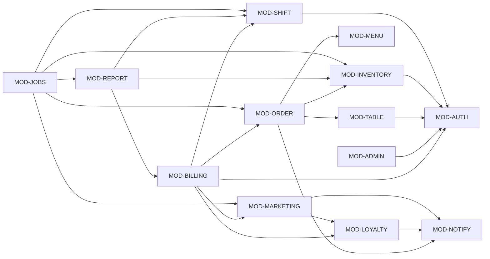

# Bản đồ module (Module Map) — bước 07

> **Nguồn:** sổ tay quy trình 15 bước (Playbook v1.0, 09/10/2026) bước 07 + Mẫu 05; quy ước ID ở [TASK-057](../công-việc/TASK-057.md); code thực tế `ứng-dụng/máy-chủ/src/` và `cơ-sở-dữ-liệu/` (đối chiếu ngày 20/10/2026). **Trạng thái tài liệu:** BẢN NHÁP — chờ chủ dự án duyệt ở Gate G2. Trạng thái từng mục ghi tại chỗ (CONFIRMED / PROPOSED / NEEDS_CONFIRMATION / UNKNOWN / N/A).

Module ở đây là **nhóm logic theo năng lực nghiệp vụ và ranh giới dữ liệu**, gom lại từ code đã chạy. Code không có thư mục riêng cho từng module: code xếp theo tầng (`routes/` → `services/` → `repositories/` → SP), nên cột "Code" của mỗi module liệt kê file thật thuộc module đó. Một số file phục vụ nhiều module (ví dụ `adminService.js`), và mục [Điểm cần duyệt ở G2](#diem-can-duyet) ghi rõ các trường hợp này.

**Ma trận quyền chính thức** là [roles-permissions.md](../nghiệp-vụ/roles-permissions.md) (mục 4.1, 4.4, 4.5). Tài liệu này chỉ tóm tắt quyền theo module, và nếu hai nơi lệch nhau thì `roles-permissions.md` và `auth/permissions.js` đúng.

## Actor và phạm vi dữ liệu (quy ước TASK-057)

| ID | Tên trong docs / code | Định danh | Ghi chú |
| --- | --- | --- | --- |
| `ACT-GUEST` | Khách (CUSTOMER) | Cookie HttpOnly `cf_client` + `sessionId` (không đăng nhập) | Chỉ thao tác trên phiên mà thiết bị có trong `SessionClients` |
| `ACT-MEMBER` | Khách đã gắn SĐT hội viên vào phiên | Như `ACT-GUEST`, cộng thêm `Sessions.MemberId` | Thêm quyền xem Thẻ thành viên, gọi lại đơn, ♥ món — chỉ khi phiên **còn mở** |
| `ACT-STAFF` | Nhân viên quầy (`STAFF`) | JWT Bearer | — |
| `ACT-LEAD` | Trưởng ca (`MANAGER`) | JWT Bearer | Thêm ở ADR-006 (D-24) |
| `ACT-ADMIN` | Quản lý (`ADMIN`) | JWT Bearer | Kế thừa mọi quyền của STAFF và MANAGER |
| `EXT-SCHEDULER` | Bộ lập lịch job nền | Trong tiến trình API | Xem MOD-JOBS |
| `EXT-ZALO` | Kênh Zalo OA | `ZALO_OA_TOKEN` | Chỉ có chiều đi; tắt khi không có token |
| `EXT-PRINTER` | Máy in nhiệt 58/80 mm | `window.print()` trên trình duyệt quầy | Không có API riêng |

Phạm vi dùng trong mục "Quyền": **own** = dữ liệu của chính tài khoản / thiết bị; **session** = phiên mà thiết bị thuộc `SessionClients`; **all** = toàn quán (một quán, một kho — không có chi nhánh).

## Module Map

| Module | Tên | Trách nhiệm (tóm tắt) | Actor dùng | Owner (BE · FE · Test) |
| --- | --- | --- | --- | --- |
| `MOD-AUTH` | Xác thực & phân quyền | Đăng nhập, JWT, tài khoản nhân viên, vai trò, ma trận quyền, xác thực lại người duyệt | Mọi nhân viên; ADMIN quản lý tài khoản | Nhật Anh · Tuyến · Sáng |
| `MOD-TABLE` | Bàn & phiên bàn | Bàn + QR, quét QR, gộp / tách phiên, mở bàn, ghi chú bàn, gọi nhân viên, đóng bàn trống | Khách, STAFF, LEAD, ADMIN | Nhật Anh · Tuyến · Sáng |
| `MOD-MENU` | Thực đơn | Danh mục, món, tùy chọn, combo, lịch thực đơn, gợi ý / ghim, còn / hết món | Khách (đọc), ADMIN (cấu hình), quầy (đọc) | Nhật Anh · Tuyến · Sáng |
| `MOD-ORDER` | Đơn hàng | Gửi đơn (QR / tại bàn / mang đi), tiếp nhận, hoàn tất, hủy, hàng chờ ETA, gọi lại đơn, sửa / xóa món, hủy bàn | Khách, STAFF, LEAD, ADMIN | Nhật Anh · Tuyến · Sáng |
| `MOD-BILLING` | Thu tiền & hóa đơn | Gọi thanh toán, thu tiền mặt, chia bill, giảm giá tay, áp khuyến mãi / hội viên / voucher lúc thu, hóa đơn, hoàn tiền | Khách (gọi thanh toán, chia phần), STAFF, LEAD, ADMIN | Nhật Anh · Tuyến · Sáng |
| `MOD-INVENTORY` | Kho | Nguyên liệu, BOM, giữ / trừ kho, nhập, kiểm kê, hao hụt, sơ chế, lô, giá vốn, nhà cung cấp / PO, dự báo | STAFF (sơ chế, hủy, nhận hàng), LEAD (+ điều chỉnh, kiểm kê), ADMIN | Nhật Anh · Tuyến · Sáng |
| `MOD-LOYALTY` | Hội viên & tích lũy | Hội viên, hạng, điểm, tem, quà, voucher, giới thiệu, Thẻ thành viên | Khách, hội viên, STAFF, LEAD, ADMIN | Nhật Anh · Tuyến · Sáng |
| `MOD-MARKETING` | Marketing | Khuyến mãi (cấu hình), phân khúc, chiến dịch, opt-out, báo cáo marketing | ADMIN | Nhật Anh · Tuyến · Sáng |
| `MOD-SHIFT` | Ca & nhân sự | Ca tiền mặt, sổ quỹ, chấm công, lịch làm, năng suất | STAFF, LEAD, ADMIN | Nhật Anh · Tuyến · Sáng |
| `MOD-REPORT` | Báo cáo & phân tích | Báo cáo doanh thu / lịch sử, lãi / lỗ, menu engineering, phân tích, dashboard "Hôm nay" | ADMIN; LEAD (dashboard rút gọn) | Nhật Anh · Tuyến · Sáng |
| `MOD-ADMIN` | Quản trị quán | Cài đặt quán, nhật ký thao tác, tạm ngưng nhận đơn QR, chính sách xóa dữ liệu quản lý (ADR-004) | ADMIN; STAFF / LEAD (bật / tắt nhận đơn) | Nhật Anh · Tuyến · Sáng |
| `MOD-NOTIFY` | Thông báo | Socket.io (room, sự kiện), âm báo quầy, kênh Zalo OA | Mọi actor (nhận), service (phát) | Nhật Anh · Tuyến · Sáng |
| `MOD-JOBS` | Job nền | Bộ lập lịch + 9 job, khóa chống chạy trùng, `JobRuns` | `EXT-SCHEDULER`; ADMIN chạy tay | Nhật Anh · Tuyến · Sáng |

Owner theo [overview.md §1.3](../sản-phẩm/overview.md): Nhật Anh — Back-end/Database, Tuyến — Front-end, Sáng — Testing. Người chốt cuối vẫn chờ Q-000 ([open-questions.md](../open-questions.md)). Với mọi module: **Agent** = Claude, **Reviewer** = chủ dự án.

Mũi tên `A --> B`: A gọi service / SP hoặc đọc dữ liệu do B sở hữu. Mọi module dùng chung `MOD-AUTH` (middleware) và `MOD-ADMIN` (`Settings`, nhật ký), nhưng sơ đồ chỉ vẽ các phụ thuộc chính.

## Đặc tả module (Mẫu 05)

### MOD-AUTH — Xác thực & phân quyền

- **Trách nhiệm chính:** đăng nhập username / mật khẩu (bcrypt) và cấp JWT; kiểm lại tài khoản ở mỗi request (khóa / xóa có hiệu lực ngay); vai trò STAFF < MANAGER < ADMIN; bảng `PERMISSIONS`, `can()`, middleware `requirePermission`, `requireStaff`, `requireAdmin`; ngưỡng giảm giá theo vai (`discountLimits`); xác thực lại người duyệt (`resolveApproval`) cho giảm tay vượt ngưỡng, hoàn tiền, duyệt chi quỹ, sửa / xóa món đã tiếp nhận; CRUD tài khoản nhân viên; giới hạn số lần đăng nhập sai.
- **Không chịu trách nhiệm:** định danh khách (cookie `cf_client` — MOD-TABLE); quyết định nghiệp vụ "có cần duyệt không" (module gọi tự quyết, MOD-AUTH chỉ kiểm người duyệt); chấm công khi đăng nhập / đăng xuất (MOD-SHIFT, được gọi từ `userService.login` và `POST /api/auth/logout`).
- **FEATURE:** [F-009](../chức-năng/FEATURE-009.md), [F-036](../chức-năng/FEATURE-036.md).
- **Thực thể dữ liệu:** `Users` (`CK_Users_Role` gồm `MANAGER` từ `0025`; `DeletedAt` xóa mềm từ `0002`).
- **API:** `POST /api/auth/login` · `GET /api/auth/me` · `POST /api/auth/logout` · `GET /api/admin/users` · `POST /api/admin/users` · `PUT /api/admin/users/{id}` · `POST /api/admin/users/{id}/reset-password` · `PATCH /api/admin/users/{id}/active` · `DELETE /api/admin/users/{id}` (xóa theo ADR-004, xem MOD-ADMIN).
- **SP chính:** `sp_DeleteUser`. Kiểm `LAST_ADMIN` (50150) nguyên tử trong SQL (`usersRepo.update` / `setActive`).
- **Code:** `routes/public.js` (login, me), `routes/admin.js` (users), `routes/finance.js` (logout) · `services/userService.js` · `repositories/usersRepo.js` · `middleware/auth.js` · `auth/permissions.js` · `middleware/rateLimit.js` (`loginLimiter`) · FE `js/auth.js`, `js/auth-store.js`, `js/pages/pos-login.js`, `js/pages/admin-users.js`.
- **Phụ thuộc:** MOD-SHIFT (chấm công vào / ra), MOD-ADMIN (nhật ký thao tác ghi thay đổi tài khoản).
- **Quyền:** `ACT-GUEST`, `ACT-MEMBER` — không có tài khoản, chỉ gọi được `POST /api/auth/login` (bị 401). `ACT-STAFF`, `ACT-LEAD` — read `/api/auth/me` (own), logout (own); không quản lý tài khoản. `ACT-ADMIN` — read / create / update / delete `Users` (all), trừ tự khóa, tự đổi vai trò, tự xóa, và hạ / khóa / xóa ADMIN cuối cùng.
- **Lỗi & ràng buộc transaction:** 401 `UNAUTHORIZED` (sai mật khẩu, token sai / hết hạn); 403 `ACCOUNT_LOCKED`, `FORBIDDEN`; 409 `USERNAME_TAKEN` (unique, không phân biệt hoa thường — BR-004); 409 `LAST_ADMIN`; 400 `CANNOT_CHANGE_OWN_ROLE`, `CANNOT_LOCK_SELF`, `CANNOT_DELETE_SELF` (50055); 403 `ADMIN_APPROVAL_REQUIRED` / `ADMIN_APPROVAL_INVALID` (người duyệt); 429 `RATE_LIMITED` (5 lần sai / phút / IP). Đổi vai trò / khóa chạy `withDeadlockRetry`; hai quản lý hạ quyền nhau đồng thời → đúng một bên thành công (`finance.test.js`).
- **Owner / Agent / Reviewer:** Nhật Anh (BE) · Tuyến (FE) · Sáng (test) / Claude / chủ dự án.

### MOD-TABLE — Bàn & phiên bàn

- **Trách nhiệm chính:** bàn và mã QR (`QrToken` 32 hex ngẫu nhiên, tạo lại QR làm QR cũ chết); quét QR → tạo / gộp / tách phiên; định danh thiết bị khách bằng cookie `cf_client` và bảng `SessionClients`; kiểm "thiết bị thuộc phiên" (`assertViewer`, `sessionsRepo.isMember`); nhân viên mở bàn, ghi chú bàn (chỉ quầy thấy); gọi nhân viên (60 giây / phiên) và "Đã xử lý"; đóng bàn trống; sơ đồ bàn và danh sách bàn đang phục vụ.
- **Không chịu trách nhiệm:** gửi đơn (MOD-ORDER); thu tiền và đóng phiên sau thu (MOD-BILLING); hủy bàn có đơn (MOD-ORDER, F-046); hội viên gắn vào phiên (MOD-LOYALTY).
- **FEATURE:** [F-001](../chức-năng/FEATURE-001.md), [F-021](../chức-năng/FEATURE-021.md); phụ cho F-010 (bàn + QR), F-024 (mở bàn, ghi chú), F-006, F-026, F-046, F-047.
- **Thực thể dữ liệu:** `Tables`, `Sessions` (`OpenedBy`, `Note`, `NoteUpdatedAt`, `NoteUpdatedBy` từ `0014`; `CancelledBy`, `CancelReason` từ `0033`), `SessionClients`, `StaffCalls`.
- **API:** `POST /api/sessions/scan` · `POST /api/sessions` · `POST /api/sessions/{id}/join` · `GET /api/sessions/{id}` · `POST /api/sessions/{id}/call-staff` · `GET /api/staff-calls` · `POST /api/staff-calls/{id}/handle` · `GET /api/tables` · `POST /api/tables/{id}/sessions` · `PUT /api/sessions/{id}/note` · `GET /api/sessions` · `POST /api/sessions/{id}/close` · `GET /api/admin/tables` · `POST /api/admin/tables` · `PUT /api/admin/tables/{id}` · `POST /api/admin/tables/{id}/regenerate-qr` · `GET /api/admin/tables/{id}/qr.png` · `DELETE /api/admin/tables/{id}`.
- **SP chính:** `sp_CloseEmptySession`, `sp_DeleteTable`. Mở bàn (`sessionsRepo.openByStaff`) dùng transaction `UPDLOCK, HOLDLOCK` trên dòng `Tables`.
- **Code:** `routes/public.js`, `routes/staff.js`, `routes/admin.js` (tables) · `services/sessionService.js`, `services/staffCallService.js`, `services/adminService.js` (bàn + QR) · `repositories/sessionsRepo.js`, `tablesRepo.js`, `staffCallsRepo.js` · `middleware/client.js` · `utils/tokens.js` · FE `js/pages/t-entry.js`, `js/customer.js`, `js/pages/pos-table-order.js`, `js/pages/admin-tables.js`, `js/pages/admin-qr-print.js`.
- **Phụ thuộc:** MOD-AUTH, MOD-NOTIFY (`session.opened`, `session.note_changed`, `session.staff_called`…), MOD-ADMIN (trạng thái nhận đơn QR).
- **Quyền:** `ACT-GUEST` / `ACT-MEMBER` — create phiên qua QR; read / update phiên của mình (session); gọi nhân viên cho phiên của mình; không thấy ghi chú bàn. `ACT-STAFF` / `ACT-LEAD` — read mọi bàn / phiên (all); create (mở bàn); update ghi chú; đóng bàn trống; xử lý gọi nhân viên. `ACT-ADMIN` — thêm create / update / delete `Tables`, tạo lại QR.
- **Lỗi & ràng buộc transaction:** 404 `TABLE_NOT_FOUND` (QR sai / đã tạo lại); 403 khi thiết bị không thuộc phiên; 409 `SESSION_CLOSED` (50031); 409 `TABLE_OCCUPIED` (mở bàn đang có khách); 409 `HAS_ORDERS` (50035, đóng bàn trống còn đơn); 409 `TABLE_BUSY` (50053, xóa bàn đang có khách); 429 `TOO_SOON` (gọi nhân viên < 60 giây). Hai máy mở cùng một bàn trống chạy tuần tự → một phiên (`table-order.test.js`).
- **Owner / Agent / Reviewer:** Nhật Anh · Tuyến · Sáng / Claude / chủ dự án.

### MOD-MENU — Thực đơn

- **Trách nhiệm chính:** danh mục (giờ bán), món (giá, ảnh, thời gian pha chuẩn), "hết món" tính động (tắt tay **hoặc** thiếu nguyên liệu khả dụng cho 1 suất — ADR-003, D-12); nhóm tùy chọn món (Min / Max, phụ thu, BOM cộng thêm); combo cố định; lịch thực đơn theo mùa / khung giờ (`nextChangeAt`); gợi ý / bán chạy / ghim; menu khách (lọc theo lịch, có giá khuyến mãi để hiển thị).
- **Không chịu trách nhiệm:** BOM và tồn kho (MOD-INVENTORY); tính tiền cuối cùng (MOD-BILLING, `pricing.js`); cấu hình khuyến mãi (MOD-MARKETING); tạm ngưng nhận đơn QR (MOD-ADMIN).
- **FEATURE:** [F-002](../chức-năng/FEATURE-002.md), [F-010](../chức-năng/FEATURE-010.md), [F-013](../chức-năng/FEATURE-013.md), [F-015](../chức-năng/FEATURE-015.md), [F-017](../chức-năng/FEATURE-017.md), [F-020](../chức-năng/FEATURE-020.md), [F-040](../chức-năng/FEATURE-040.md).
- **Thực thể dữ liệu:** `Categories`, `MenuItems` (`ItemType`, `IsPinned`, `PrepSeconds`…), `ComboComponents`, `ModifierGroups`, `ModifierOptions`, `ModifierOptionBom`, `MenuItemModifierGroups`, `MenuSchedules`, `MenuScheduleItems`; khóa `Settings` `suggestion.*`.
- **API:** `GET /api/menu` · `GET /api/admin/categories` · `POST /api/admin/categories` · `PUT /api/admin/categories/{id}` · `DELETE /api/admin/categories/{id}` · `GET /api/admin/menu-items` · `POST /api/admin/menu-items` · `PUT /api/admin/menu-items/{id}` · `PATCH /api/admin/menu-items/{id}/availability` · `DELETE /api/admin/menu-items/{id}` · `GET /api/admin/modifier-groups` · `POST /api/admin/modifier-groups` · `PUT /api/admin/modifier-groups/{id}` · `DELETE /api/admin/modifier-groups/{id}` · `GET /api/admin/combos` · `POST /api/admin/combos` · `PUT /api/admin/combos/{id}` · `PATCH /api/admin/combos/{id}/availability` · `GET /api/admin/suggestions` · `PUT /api/admin/suggestions` · `GET /api/admin/menu-schedules` · `POST /api/admin/menu-schedules` · `GET /api/admin/menu-schedules/preview` · `PUT /api/admin/menu-schedules/{id}` · `PATCH /api/admin/menu-schedules/{id}/active` · `DELETE /api/admin/menu-schedules/{id}`.
- **SP chính:** `sp_DeleteCategory`, `sp_DeleteMenuItem` (50054 `HAS_ITEMS`, 50056 `IN_COMBO`). Đọc menu không qua SP (`menuRepo` tính `SoldOut` trong một truy vấn).
- **Code:** `routes/public.js` (menu), `routes/admin.js` (categories, menu-items), `routes/operations.js` (modifier-groups), `routes/marketing.js` (combos, suggestions), `routes/advanced.js` (menu-schedules) · `services/menuService.js`, `modifierService.js`, `scheduleService.js`, `marketingService.js` (combo, gợi ý), `adminService.js` (danh mục, món) · `repositories/menuRepo.js`, `catalogRepo.js`, `modifiersRepo.js`, `scheduleRepo.js` · `domain/menuSchedule.js` · FE `js/pages/t-menu.js`, `js/options.js`, `js/pages/admin-menu.js`, `admin-modifiers.js`, `admin-combos.js`, `admin-suggestions.js`, `admin-menu-schedules.js`.
- **Phụ thuộc:** MOD-INVENTORY (tồn khả dụng để tính hết món), MOD-MARKETING (giá khuyến mãi hiển thị), MOD-NOTIFY (`menu.availability_changed`, `menu.updated`), MOD-JOBS (`refresh-caches` làm mới gợi ý).
- **Quyền:** `ACT-GUEST` / `ACT-MEMBER` — read menu (all, đã lọc theo lịch). `ACT-STAFF` / `ACT-LEAD` — read (quầy thấy cả món ngoài lịch, có nhãn "Ngoài lịch"); không sửa menu / giá. `ACT-ADMIN` — read / create / update / delete mọi thực thể của module.
- **Lỗi & ràng buộc transaction:** 400 `VALIDATION_ERROR`, `COMBO_INVALID`, `COMBO_HAS_NO_BOM`; 409 `DUPLICATE_NAME`, `HAS_ITEMS`, `IN_COMBO`, `IN_USE`; đơn cũ giữ tên + phụ thu đã chụp (đổi tùy chọn không sửa đơn cũ). Đổi trạng thái "đặt được" phát sự kiện **sau commit**.
- **Owner / Agent / Reviewer:** Nhật Anh · Tuyến · Sáng / Claude / chủ dự án.

### MOD-ORDER — Đơn hàng

- **Trách nhiệm chính:** báo giá giỏ (`/orders/quote`); gửi đơn QR (rate limit, `Idempotency-Key` 60 giây), nhân viên gọi món tại bàn (`AcceptNow` → `PREPARING`), bán mang đi; giữ kho khi gửi (ADR-001) qua `sp_SubmitOrder`; tiếp nhận (UPDATE có điều kiện), hoàn tất (trừ kho theo BOM), hủy đơn `PENDING`; hàng chờ và thời gian chờ ước tính (ETA); gọi lại đơn lần trước, món yêu thích; sửa / xóa món chưa thu, xóa đơn, hủy lượt phục vụ bàn (F-046).
- **Không chịu trách nhiệm:** thu tiền (MOD-BILLING — riêng mang đi, `sp_SubmitOrder` ghi luôn lượt thu nhưng breakdown do MOD-BILLING tính); định nghĩa BOM / tồn (MOD-INVENTORY); hội viên (MOD-LOYALTY).
- **FEATURE:** [F-003](../chức-năng/FEATURE-003.md), [F-004](../chức-năng/FEATURE-004.md), [F-007](../chức-năng/FEATURE-007.md), [F-008](../chức-năng/FEATURE-008.md), [F-024](../chức-năng/FEATURE-024.md), [F-025](../chức-năng/FEATURE-025.md), [F-045](../chức-năng/FEATURE-045.md), [F-046](../chức-năng/FEATURE-046.md).
- **Thực thể dữ liệu:** `Orders`, `OrderItems`, `OrderItemModifiers`, `OrderIngredients` (lượng giữ đã chụp), `OrderItemVoids`, `PromotionUsages` (ghi lúc gửi đơn), `MemberFavorites`, `ItemPrepStats`.
- **API:** `POST /api/orders/quote` · `POST /api/orders` · `GET /api/orders/{id}` · `GET /api/orders` · `POST /api/orders/takeaway/quote` · `POST /api/orders/takeaway` · `POST /api/orders/{id}/accept` · `POST /api/orders/{id}/complete` · `POST /api/orders/{id}/cancel` · `POST /api/sessions/{id}/orders` · `GET /api/queue/eta` · `GET /api/sessions/{id}/eta` · `GET /api/admin/prep-stats` · `GET /api/members/{id}/recent-orders` · `GET /api/members/{id}/favorites` · `PUT /api/members/{id}/favorites/{menuItemId}` · `DELETE /api/members/{id}/favorites/{menuItemId}` · `POST /api/cart/replay` · `POST /api/order-items/{id}/void` · `POST /api/orders/{id}/void` · `POST /api/sessions/{id}/cancel` · `GET /api/sessions/{id}/voids`.
- **SP chính:** `sp_SubmitOrder`, `sp_CompleteOrder`, `sp_CancelOrder`, `sp_VoidOrderItem` (+ `sp_VoidLineCore`, `sp_RecalcOrder`, `sp_CloseIfSettled`), `sp_CancelOrders`.
- **Code:** `routes/public.js` (orders), `routes/staff.js` (orders, takeaway, void), `routes/engagement.js` (ETA, gọi lại), `routes/advanced.js` (prep-stats) · `services/orderService.js`, `etaService.js`, `recallService.js`, `voidService.js`, `pricingService.js` (báo giá) · `repositories/ordersRepo.js`, `etaRepo.js`, `recallRepo.js`, `voidRepo.js` · `domain/eta.js` · FE `js/pages/t-menu.js`, `t-track.js`, `js/cart.js`, `js/pages/pos-dashboard.js`, `pos-takeaway.js`, `pos-table-order.js`.
- **Phụ thuộc:** MOD-TABLE (phiên, `isMember`), MOD-MENU (giá, tùy chọn, lịch), MOD-INVENTORY (giữ / trừ / trả kho trong SP), MOD-BILLING (bộ tính giá dùng chung), MOD-LOYALTY (hội viên cho gọi lại đơn), MOD-AUTH (`resolveApproval` cho F-046), MOD-NOTIFY (`order.*`), MOD-ADMIN (`STORE_CLOSED`).
- **Quyền:** `ACT-GUEST` — create đơn trong phiên của mình (session); read đơn của phiên mình; read ETA của phiên mình. `ACT-MEMBER` — thêm read đơn đã thu / món yêu thích và create / delete ♥ của hội viên **đang gắn với phiên còn mở của chính thiết bị** (khác → 403). `ACT-STAFF` — read mọi đơn (all); create (tại bàn, mang đi); update (tiếp nhận, hoàn tất, hủy `PENDING`); sửa / xóa món của đơn `PENDING`; đơn đã tiếp nhận / đã pha cần trưởng ca / quản lý nhập tài khoản. `ACT-LEAD` — như STAFF, tự sửa / xóa món, xóa đơn, hủy bàn mọi đơn chưa thu. `ACT-ADMIN` — như LEAD.
- **Lỗi & ràng buộc transaction:** 409 `OUT_OF_STOCK` (50002, kèm tên món), `ITEM_UNAVAILABLE` (50010), `ALREADY_PROCESSED` (50001), `INVALID_STATE` (50003), `SESSION_CLOSED`, `PROMO_EXHAUSTED` (50060), `ITEM_NOT_EDITABLE` (50181), `SESSION_HAS_PAYMENTS` (50184); 400 `INVALID_QTY` (50182), `VALIDATION_ERROR` (50186 thiếu lý do); 403 `ADMIN_APPROVAL_REQUIRED` (50183, kiểm **sau khi khóa**); 503 `STORE_CLOSED`; 429 `RATE_LIMITED` (10 đơn / phút / thiết bị). Thứ tự khóa Sessions → Orders → Ingredients → IngredientLots; deadlock 1205 được retry; không "SELECT rồi UPDATE" tách rời; realtime phát sau commit. Bất biến: kho không âm, không trừ 2 lần (NFR-002), `OVER_RESTOCK`, `ORDER_LINES_MISMATCH`.
- **Owner / Agent / Reviewer:** Nhật Anh · Tuyến · Sáng / Claude / chủ dự án.

### MOD-BILLING — Thu tiền & hóa đơn

- **Trách nhiệm chính:** khách bấm "Gọi thanh toán" (D-2); bộ tính giá dùng chung (`pricing.js`: niêm yết → khuyến mãi dòng → khuyến mãi đơn → hội viên → voucher → đổi thưởng → giảm tay → làm tròn); xem trước và thu tiền mặt bàn (`AmountDue` server tính, `@OrdersTotal` chống lệch), thu từng phần chia bill, "Thu chung"; giảm giá tay theo ngưỡng vai; hóa đơn tạm tính / thanh toán / từng phần / mang đi (khối "THẺ THÀNH VIÊN"); hoàn tiền trong ngày, trừ vào ca đang mở.
- **Không chịu trách nhiệm:** ghi sổ điểm / tem / voucher (MOD-LOYALTY — SP của MOD-LOYALTY chạy **trong** transaction thu tiền); cấu hình khuyến mãi (MOD-MARKETING); mở / đóng ca (MOD-SHIFT); in vật lý (trình duyệt + `EXT-PRINTER`).
- **FEATURE:** [F-005](../chức-năng/FEATURE-005.md), [F-006](../chức-năng/FEATURE-006.md), [F-019](../chức-năng/FEATURE-019.md), [F-022](../chức-năng/FEATURE-022.md), [F-026](../chức-năng/FEATURE-026.md); phụ cho F-008, F-014, F-016, F-038, F-039, F-047.
- **Thực thể dữ liệu:** `Payments` (breakdown `SubtotalAmount … RoundingAdj`, `ShiftId`, `SplitId`, `ApprovedBy`, `VoucherId`, `RewardId`…), `Refunds`, `SessionSplits`; cột `OrderItems.SplitId` / `PaidAt` / `PaymentId`; khóa `Settings` `discount.*`, làm tròn.
- **API:** `POST /api/sessions/{id}/request-payment` · `POST /api/sessions/{id}/settle/preview` · `POST /api/sessions/{id}/settle` · `GET /api/sessions/{id}/receipt` · `GET /api/orders/{id}/receipt` · `GET /api/payments/{id}/receipt` · `GET /api/payments/{id}` · `POST /api/payments/{id}/refunds` · `GET /api/sessions/{id}/splits` · `POST /api/sessions/{id}/splits` · `PUT /api/sessions/{id}/items/{orderItemId}/split` · `POST /api/splits/{id}/settle/preview` · `POST /api/splits/{id}/settle` · `POST /api/sessions/{id}/splits/merge` · `GET /api/admin/refunds`.
- **SP chính:** `sp_RequestPayment`, `sp_SettleSession`, `sp_SettleSplit`, `sp_RefundPayment`; gọi `sp_ApplyMemberPayment`, `sp_ApplyLoyalty`, `sp_ReverseLoyalty` của MOD-LOYALTY trong cùng transaction.
- **Code:** `routes/public.js` (request-payment), `routes/staff.js` (settle, receipt, refunds, splits), `routes/engagement.js` (splits của khách), `routes/operations.js` (refunds) · `services/billingService.js`, `pricingService.js`, `sessionService.js` (thu tiền, hóa đơn), `splitService.js`, `refundService.js`, `orderService.js` (bill mang đi) · `pricing/pricing.js` · `repositories/splitsRepo.js`, `refundsRepo.js`, `sessionsRepo.js` · FE `js/pages/pos-dashboard.js` (drawer Thu tiền bàn), `js/billing-controls.js`, `js/pages/pos-receipt.js`, `js/print.js`, `js/pages/t-track.js`, `js/pages/pos-shift.js` (hoàn tiền).
- **Phụ thuộc:** MOD-ORDER, MOD-TABLE, MOD-LOYALTY, MOD-MARKETING (khuyến mãi đang chạy), MOD-SHIFT (`NO_OPEN_SHIFT`), MOD-AUTH (`discountLimits`, `resolveApproval`), MOD-NOTIFY (`session.settled`, `payment.refunded`, `session.split_changed`).
- **Quyền:** `ACT-GUEST` / `ACT-MEMBER` — gọi thanh toán phiên của mình (session); tạo phần của mình và nhận / bỏ dòng Chung hoặc dòng của phần mình (session); không thu tiền, không đọc hóa đơn quầy. `ACT-STAFF` — thu tiền mọi phiên / phần / đơn mang đi (all); giảm tay ≤ 10 % và ≤ 20.000đ, vượt thì cần người duyệt; hoàn tiền luôn cần người duyệt. `ACT-LEAD` — giảm tay ≤ 20 % và ≤ 50.000đ; tự hoàn / duyệt lượt thu thuộc ca đang mở. `ACT-ADMIN` — không giới hạn; hoàn mọi lượt thu trong ngày.
- **Lỗi & ràng buộc transaction:** 409 `HAS_PENDING_ORDERS` (50033), `AMOUNT_CHANGED` (50034), `ALREADY_SETTLED` (50032), `NO_ORDERS` (50030), `NO_OPEN_SHIFT` (50070), `SESSION_HAS_SPLITS` (50113), `SPLIT_PAID` (50110), `COMMON_REQUIRED` (50111), `SPLIT_EMPTY` (50112), `LINE_LOCKED`, `REFUND_WINDOW_EXPIRED` (50092), các lỗi voucher / đổi thưởng (50170–50173); 400 `INSUFFICIENT_AMOUNT` (50020), `REFUND_EXCEEDS` (50091), `REWARD_WITH_MANUAL`; 403 `ADMIN_APPROVAL_REQUIRED` / `ADMIN_APPROVAL_INVALID`. Một lượt thu / phiên không chia (`UX_Payments_Session`), một lượt thu / phần (`UX_Payments_Split`); thu đồng thời → 1 OK + 1 409; Σ hoàn ≤ đã thu; `AmountDue = Subtotal − Promo − Member − Voucher − Reward − Manual − RoundingAdj` (bất biến tự động).
- **Owner / Agent / Reviewer:** Nhật Anh · Tuyến · Sáng / Claude / chủ dự án.

### MOD-INVENTORY — Kho

- **Trách nhiệm chính:** nguyên liệu, ngưỡng sắp hết; BOM món và BOM tùy chọn; giữ kho khi gửi / trừ khi hoàn tất / trả khi hủy (logic nằm trong SP của MOD-ORDER nhưng invariant thuộc module này); điều chỉnh tay có lý do; phiếu nhập; kiểm kê (khóa điều chỉnh khi đang kiểm); đơn vị quy đổi và giá vốn bình quân; bán thành phẩm + phiếu sơ chế; hao hụt định mức + phiếu hủy; lô và hạn dùng (FEFO); nhà cung cấp, PO, nhận hàng theo PO; dự báo nhập hàng và đề xuất.
- **Không chịu trách nhiệm:** trạng thái đơn (MOD-ORDER); báo cáo lãi / lỗ (MOD-REPORT — chỉ đọc giá vốn); chạy job theo giờ (MOD-JOBS).
- **FEATURE:** [F-011](../chức-năng/FEATURE-011.md), [F-023](../chức-năng/FEATURE-023.md), [F-027](../chức-năng/FEATURE-027.md), [F-028](../chức-năng/FEATURE-028.md), [F-029](../chức-năng/FEATURE-029.md), [F-030](../chức-năng/FEATURE-030.md), [F-031](../chức-năng/FEATURE-031.md), [F-032](../chức-năng/FEATURE-032.md).
- **Thực thể dữ liệu:** `Ingredients`, `BomItems`, `InventoryTransactions`, `OrderIngredients` (dùng chung với MOD-ORDER), `StockReceipts`, `StockReceiptLines`, `Stocktakes`, `StocktakeLines`, `Units`, `SemiRecipes`, `SemiRecipeLines`, `PrepBatches`, `WasteLogs`, `IngredientLots`, `Suppliers`, `SupplierIngredients`, `PurchaseOrders`, `PurchaseOrderLines`, `SupplierPriceHistory`, `DemandForecasts`.
- **API:** quản lý — `GET /api/admin/ingredients` · `POST /api/admin/ingredients` · `PUT /api/admin/ingredients/{id}` · `DELETE /api/admin/ingredients/{id}` · `POST /api/admin/ingredients/{id}/adjust` · `GET /api/admin/ingredients/{id}/transactions` · `GET /api/admin/menu-items/{id}/bom` · `PUT /api/admin/menu-items/{id}/bom` · `GET /api/admin/stock-receipts` · `GET /api/admin/stock-receipts/{id}` · `POST /api/admin/stock-receipts` · `GET /api/admin/stocktakes` · `GET /api/admin/stocktakes/{id}` · `POST /api/admin/stocktakes` · `PUT /api/admin/stocktakes/{id}/lines` · `POST /api/admin/stocktakes/{id}/post` · `DELETE /api/admin/stocktakes/{id}` · `GET /api/admin/reports/costs` · `GET /api/admin/units` · `PUT /api/admin/units/{code}` · `DELETE /api/admin/units/{code}` · `PUT /api/admin/ingredients/{id}/advanced` · `GET /api/admin/ingredients/{id}/recipe` · `PUT /api/admin/ingredients/{id}/recipe` · `GET /api/admin/ingredients/{id}/lots` · `POST /api/admin/lots/{id}/write-off` · `GET /api/admin/reports/cogs` · `GET /api/admin/reports/loss` · `GET /api/admin/reports/suppliers` · `GET /api/admin/suppliers` · `POST /api/admin/suppliers` · `PUT /api/admin/suppliers/{id}` · `GET /api/admin/purchase-orders` · `POST /api/admin/purchase-orders/from-suggestion` · `GET /api/admin/purchase-orders/{id}` · `POST /api/admin/purchase-orders` · `PUT /api/admin/purchase-orders/{id}` · `POST /api/admin/purchase-orders/{id}/send` · `POST /api/admin/purchase-orders/{id}/cancel` · `POST /api/admin/purchase-orders/{id}/receive` · `GET /api/admin/inventory/replenishment` · `GET /api/admin/inventory/forecast/{id}`. Quầy — `GET /api/ops/ingredients` · `GET /api/prep/recipes` · `GET /api/prep/preview` · `POST /api/prep/batches` · `GET /api/prep/batches` · `POST /api/waste` · `GET /api/waste` · `GET /api/lots/expiring` · `POST /api/lots/{id}/write-off` · `GET /api/receiving/purchase-orders` · `GET /api/receiving/purchase-orders/{id}` · `POST /api/receiving/purchase-orders/{id}/receive` · `POST /api/ops/ingredients/{id}/adjust` · `GET /api/ops/ingredients/{id}/transactions` · `GET /api/ops/stocktakes` · `GET /api/ops/stocktakes/{id}` · `POST /api/ops/stocktakes` · `PUT /api/ops/stocktakes/{id}/lines` · `POST /api/ops/stocktakes/{id}/post` · `DELETE /api/ops/stocktakes/{id}`.
- **SP chính:** `sp_AdjustInventory`, `sp_ReceiveStock`, `sp_PostStocktake`, `sp_PostPrepBatch`, `sp_LogWaste`, `sp_LotConsume`, `sp_SetTrackLots`, `tvf_ExpiredLotQty` (file `fn_ExpiredLots.sql`), `sp_DeleteIngredient`; phần giữ / trừ / trả kho trong `sp_SubmitOrder`, `sp_CompleteOrder`, `sp_CancelOrder`, `sp_VoidLineCore`, `sp_RefundPayment`.
- **Code:** `routes/admin.js` (ingredients, BOM), `routes/operations.js` (phiếu nhập, kiểm kê, giá vốn), `routes/advanced.js` (đơn vị, sơ chế, lô, NCC, PO, dự báo), `routes/ops.js` (quầy) · `services/adminService.js` (nguyên liệu, BOM), `stockService.js`, `inventoryService.js`, `purchasingService.js`, `forecastService.js` · `repositories/ingredientsRepo.js`, `menuRepo.js` (BOM), `stockRepo.js`, `inventoryRepo.js`, `purchasingRepo.js`, `forecastRepo.js` · `domain/inventory.js` · FE `js/pages/admin-ingredients.js`, `admin-bom.js`, `admin-stock.js`, `admin-purchasing.js`, `admin-po-print.js`, `js/pages/pos-stock.js`, `js/inventory-advanced.js`, `js/stock-adjust.js`, `js/stocktake.js`, `js/receive-po.js`.
- **Phụ thuộc:** MOD-MENU (món dùng BOM), MOD-AUTH (`inventory.adjust`, `stocktake.post`), MOD-NOTIFY (`inventory.*`), MOD-JOBS (`demand-forecast`, `lot-expiry`, `runout-alert`).
- **Quyền:** `ACT-GUEST` / `ACT-MEMBER` — không (chỉ gián tiếp qua gửi đơn). `ACT-STAFF` — read tồn kho quầy; create phiếu sơ chế, phiếu hủy, hủy lô hết hạn, nhận hàng theo PO (all); **không** điều chỉnh tay, không kiểm kê. `ACT-LEAD` — thêm điều chỉnh tay và kiểm kê qua `/api/ops/*`; không sửa NCC / PO / BOM. `ACT-ADMIN` — read / create / update / delete toàn module.
- **Lỗi & ràng buộc transaction:** 400 `INVALID_ADJUSTMENT` (50040), `NEGATIVE_STOCK` (50042), `INVALID_RECEIPT` (50100), `STOCKTAKE_INCOMPLETE` (50102), `UNIT_MISMATCH`, `RECIPE_CYCLE`, `RECIPE_TOO_DEEP`, `WASTE_INVALID` (50121); 409 `BELOW_RESERVED` (50043 / 50103), `STOCKTAKE_NOT_DRAFT` (50101), `STOCKTAKE_LOCKED` (50104), `PREP_SHORT` (50120), `LOT_SHORT` (50122), `OVER_RECEIPT` (50131), `PO_HAS_RECEIPTS` (50132), `PO_NOT_RECEIVABLE` (50133), `IN_USE` (50051), `HAS_RESERVED` (50052); 404 `NO_RECIPE` (50123). Mọi thay đổi tồn đi qua SP và ghi `InventoryTransactions`; khóa `Ingredients` (UPDLOCK, HOLDLOCK) → `IngredientLots`; CHECK `StockQty ≥ 0`, lô không âm. Bất biến tự động: `LOTS_MISMATCH`, `DEDUCT_QTY_MISMATCH`, `PREP_UNBALANCED`, `COGS_MISMATCH`, `OVER_RESTOCK`.
- **Owner / Agent / Reviewer:** Nhật Anh · Tuyến · Sáng / Claude / chủ dự án.

### MOD-LOYALTY — Hội viên & tích lũy

- **Trách nhiệm chính:** hội viên SĐT + họ tên có đồng ý (`ConsentAt`, không OTP — D-5, D-6); tra cứu (khách thấy tên che), đăng ký, gắn / gỡ vào phiên; hạng và ưu đãi đơn đầu; điểm (`PointTransactions`), quà đổi điểm, thẻ tem; voucher (giới thiệu, chiến dịch, tay) và giới thiệu bạn; Thẻ thành viên cho khách (che tên / SĐT, không có mã voucher); ẩn danh hội viên; điều chỉnh điểm có lý do.
- **Không chịu trách nhiệm:** tính số tiền giảm (MOD-BILLING, `pricing.js`); phân khúc và gửi chiến dịch (MOD-MARKETING); khuyến mãi theo lịch (MOD-MARKETING).
- **FEATURE:** [F-014](../chức-năng/FEATURE-014.md), [F-038](../chức-năng/FEATURE-038.md), [F-039](../chức-năng/FEATURE-039.md), [F-047](../chức-năng/FEATURE-047.md).
- **Thực thể dữ liệu:** `Members` (`Phone` unique, `ConsentAt`, `AnonymizedAt`, `ReferredByMemberId`, `OptOut`…), `MemberTiers`, `MemberTransactions`, `PointTransactions`, `RewardCatalog`, `RewardRedemptions`, `StampPrograms`, `StampProgramItems`, `StampCards`, `StampEvents`, `Vouchers`.
- **API:** `POST /api/members/lookup` · `POST /api/members` · `POST /api/sessions/{id}/member` · `DELETE /api/sessions/{id}/member` · `GET /api/sessions/{id}/member-card` · `GET /api/members/{id}/loyalty` · `GET /api/members/{id}/vouchers` · `POST /api/vouchers/validate` · `GET /api/admin/members` · `GET /api/admin/members/{id}` · `PUT /api/admin/members/{id}` · `POST /api/admin/members/{id}/anonymize` · `GET /api/admin/member-tiers` · `PUT /api/admin/member-tiers` · `GET /api/admin/rewards` · `POST /api/admin/rewards` · `PUT /api/admin/rewards/{id}` · `DELETE /api/admin/rewards/{id}` · `GET /api/admin/stamp-programs` · `POST /api/admin/stamp-programs` · `PUT /api/admin/stamp-programs/{id}` · `DELETE /api/admin/stamp-programs/{id}` · `GET /api/admin/members/{id}/loyalty` · `POST /api/admin/members/{id}/points` · `GET /api/admin/vouchers` · `POST /api/admin/vouchers`.
- **SP chính:** `sp_ApplyMemberPayment`, `sp_ApplyLoyalty`, `sp_ReverseLoyalty`, `sp_AdjustPoints` (file `sp_Loyalty.sql`).
- **Code:** `routes/public.js` (lookup, đăng ký, gắn / gỡ), `routes/engagement.js` (member-card), `routes/loyalty.js` (quầy), `routes/marketing.js` (quản lý hội viên, hạng, quà, tem, voucher, điểm) · `services/memberService.js`, `loyaltyService.js`, `sessionService.js` (`memberCard`) · `repositories/membersRepo.js`, `loyaltyRepo.js` · FE `js/member-box.js`, `js/billing-controls.js`, `js/pages/pos-table-order.js` (khung hội viên), `js/pages/admin-members.js`, `admin-loyalty.js` (tab quà / tem / voucher).
- **Phụ thuộc:** MOD-TABLE (phiên còn mở, `isMember`), MOD-BILLING (lượt thu gọi SP), MOD-NOTIFY (`session.member_changed`, `member.vouchers_issued`), MOD-AUTH.
- **Quyền:** `ACT-GUEST` — tra cứu (tên che, giới hạn 10 lần / phút / IP và 20 lần / phút / thiết bị), đăng ký có đồng ý, gắn / gỡ hội viên vào phiên của mình (session). `ACT-MEMBER` — read Thẻ thành viên, điểm, tem, số voucher của hội viên gắn với phiên **còn mở** của thiết bị (session); không thấy mã voucher. `ACT-STAFF` / `ACT-LEAD` — tra cứu (tên đầy đủ, không giới hạn tần suất), đăng ký (bắt buộc tick đồng ý), gắn / gỡ mọi phiên chưa thu; read điểm / tem / voucher kèm mã; kiểm voucher. `ACT-ADMIN` — thêm read / update hội viên, ẩn danh, hạng, quà, tem, voucher tay, điều chỉnh điểm (all).
- **Lỗi & ràng buộc transaction:** 400 `INVALID_PHONE`, `CONSENT_REQUIRED`, `SELF_REFERRAL`, `MEMBER_REQUIRED`; 404 `MEMBER_NOT_FOUND`, `REFERRER_NOT_FOUND`, `NO_MEMBER`, `VOUCHER_NOT_FOUND`; 409 `PHONE_EXISTS`, `SESSION_CLOSED`, `VOUCHER_UNAVAILABLE` (50170), `VOUCHER_USED`, `VOUCHER_EXPIRED`, `VOUCHER_NOT_OWNER`, `VOUCHER_MIN_ORDER`, `REWARD_UNAVAILABLE` (50171), `POINTS_INSUFFICIENT` (50172), `STAMP_REWARD_UNAVAILABLE` (50173), `REFERRAL_LIMIT` (50174); 403 thiết bị không thuộc phiên; 429 `RATE_LIMITED`. Điểm / tem / voucher commit hoặc rollback cùng lượt thu; `UX_PointTxn_Earn`, `UX_Vouchers_UsedPayment`, `CK_Members_Points`; bất biến `POINTS_LEDGER_MISMATCH`, `EARN_MISMATCH`, `VOUCHER_PAYMENT_MISMATCH`, `STAMP_CARD_OVERFLOW`.
- **Owner / Agent / Reviewer:** Nhật Anh · Tuyến · Sáng / Claude / chủ dự án.

### MOD-MARKETING — Marketing

- **Trách nhiệm chính:** cấu hình khuyến mãi (lịch ngày / thứ / giờ, mục tiêu món / danh mục, lượt / ngày, cộng dồn hội viên) và thống kê; phân khúc hội viên (luật AND → SQL có tham số) và xem trước số người; chiến dịch (nội dung `{name}` `{voucher}` `{expires}`, voucher riêng, hẹn giờ, chạy ngay, xuất CSV); opt-out; báo cáo marketing.
- **Không chịu trách nhiệm:** áp khuyến mãi vào bill (MOD-BILLING); phát hành / dùng voucher khi thu (MOD-LOYALTY); gửi tin qua kênh (MOD-NOTIFY, `zaloOa.js`).
- **FEATURE:** [F-016](../chức-năng/FEATURE-016.md), [F-037](../chức-năng/FEATURE-037.md).
- **Thực thể dữ liệu:** `Promotions`, `PromotionTargets`, `PromotionUsages` (đọc để thống kê), `Segments`, `Campaigns`, `CampaignDeliveries`; cột `Members.OptOut`, `LastContactedAt`.
- **API:** `GET /api/admin/promotions` · `POST /api/admin/promotions` · `GET /api/admin/promotions/{id}` · `PUT /api/admin/promotions/{id}` · `PATCH /api/admin/promotions/{id}/active` · `DELETE /api/admin/promotions/{id}` · `GET /api/admin/promotions/{id}/stats` · `GET /api/admin/segments` · `POST /api/admin/segments/preview` · `POST /api/admin/segments` · `PUT /api/admin/segments/{id}` · `DELETE /api/admin/segments/{id}` · `GET /api/admin/campaigns` · `GET /api/admin/campaigns/{id}` · `POST /api/admin/campaigns` · `PUT /api/admin/campaigns/{id}` · `DELETE /api/admin/campaigns/{id}` · `POST /api/admin/campaigns/{id}/run` · `GET /api/admin/campaigns/{id}/export.csv` · `PATCH /api/admin/members/{id}/opt-out` · `GET /api/admin/reports/marketing`.
- **SP chính:** không có SP riêng; lượt dùng khuyến mãi bị giới hạn trong `sp_SubmitOrder` (50060).
- **Code:** `routes/marketing.js` · `services/marketingService.js` (khuyến mãi), `campaignService.js` · `repositories/promotionsRepo.js`, `campaignRepo.js` · `utils/csv.js` · FE `js/pages/admin-promotions.js`, `admin-loyalty.js` (tab Phân khúc & chiến dịch), `admin-reports.js` (tab Marketing).
- **Phụ thuộc:** MOD-LOYALTY (hội viên, voucher), MOD-NOTIFY (kênh Zalo OA), MOD-JOBS (`campaigns-due`), MOD-MENU (`menu.updated` khi đổi khuyến mãi).
- **Quyền:** `ACT-GUEST` / `ACT-MEMBER` — chỉ thấy khuyến mãi đã áp trên menu / bill (đọc qua MOD-MENU / MOD-BILLING). `ACT-STAFF` / `ACT-LEAD` — không. `ACT-ADMIN` — read / create / update / delete toàn module (all).
- **Lỗi & ràng buộc transaction:** 400 `VALIDATION_ERROR`, `CHANNEL_NOT_CONFIGURED` (Zalo chưa có token), `CHANNEL_NOT_SUPPORTED` (SMS); 409 `CAMPAIGN_LOCKED`, `CAMPAIGN_NOT_RUNNABLE`, `PROMO_EXHAUSTED`. `UQ_Deliveries (CampaignId, MemberId)` chống gửi trùng khi chạy lại; giãn cách `campaign.min_days_between` = 7 ngày → `SKIPPED`; ô CSV bắt đầu `= + - @` được thêm `'` (chống công thức Excel).
- **Owner / Agent / Reviewer:** Nhật Anh · Tuyến · Sáng / Claude / chủ dự án.

### MOD-SHIFT — Ca & nhân sự

- **Trách nhiệm chính:** mở / đóng ca tiền mặt (một ca mở tại một thời điểm), phiếu chốt ca và chênh lệch két; sổ quỹ thu / chi ngoài bán hàng (chờ duyệt theo ngưỡng, ảnh hóa đơn ≤ 2 MB); chấm công tự động khi đăng nhập / đăng xuất / đóng ca, sửa tay có lý do; lịch làm tuần (kéo ca, chép tuần); năng suất.
- **Không chịu trách nhiệm:** thu tiền (MOD-BILLING, chỉ kiểm "có ca mở"); nhật ký thao tác (MOD-ADMIN); lương (ngoài phạm vi).
- **FEATURE:** [F-018](../chức-năng/FEATURE-018.md), [F-033](../chức-năng/FEATURE-033.md), [F-035](../chức-năng/FEATURE-035.md) (phần chấm công, lịch làm, năng suất). · [F-054](../chức-năng/FEATURE-054.md) (người mở ca phải đóng ca trước khi đăng xuất); [F-055](../chức-năng/FEATURE-055.md) (chưa mở ca thì không nhận / xử lý đơn — `requireOpenShift('xử lý đơn')` dùng ở MOD-ORDER, MOD-TABLE, MOD-BILLING)
- **Thực thể dữ liệu:** `Shifts`, `CashCategories`, `CashTransactions`, `Attendance`, `Rosters`.
- **API:** `GET /api/shifts/current` · `POST /api/shifts/open` · `POST /api/shifts/{id}/close` · `GET /api/shifts/{id}/report` · `GET /api/admin/shifts` · `GET /api/cash-categories` · `GET /api/cash-transactions` · `POST /api/cash-transactions` · `PUT /api/cash-transactions/{id}/receipt` · `GET /api/cash-transactions/{id}/receipt` · `POST /api/cash-transactions/{id}/approve` · `POST /api/cash-transactions/{id}/reject` · `GET /api/admin/cash-transactions` · `GET /api/admin/cash-transactions/export.csv` · `GET /api/admin/cash-categories` · `POST /api/admin/cash-categories` · `PUT /api/admin/cash-categories/{id}` · `DELETE /api/admin/cash-categories/{id}` · `GET /api/attendance/me` · `GET /api/attendance/users` · `GET /api/attendance` · `POST /api/attendance` · `PUT /api/attendance/{id}` · `GET /api/admin/rosters` · `POST /api/admin/rosters` · `PUT /api/admin/rosters/{id}` · `DELETE /api/admin/rosters/{id}` · `POST /api/admin/rosters/copy-week` · `GET /api/admin/reports/productivity`.
- **SP chính:** `sp_CloseShift`, `sp_CreateCashTxn`, `sp_ReviewCashTxn` (file `sp_CashTransactions.sql`), `sp_ClockIn` (file `sp_Attendance.sql`).
- **Code:** `routes/staff.js` (ca), `routes/finance.js` (sổ quỹ, chấm công), `routes/operations.js` (lịch sử ca), `routes/financeAdmin.js` (sổ quỹ tổng, danh mục, lịch làm, năng suất) · `services/shiftService.js`, `cashService.js`, `attendanceService.js` · `repositories/shiftsRepo.js`, `cashRepo.js`, `attendanceRepo.js` · FE `js/pages/pos-shift.js`, `js/cash-book.js`, `js/attendance.js`, `js/pages/admin-shifts.js`, `admin-cash.js`, `admin-staff.js`.
- **Phụ thuộc:** MOD-AUTH (`shift.manage`, `cash.create`, `cash.approve`, `attendance.edit`, `resolveApproval`), MOD-BILLING (tiền thu / hoàn trong ca), MOD-NOTIFY (`shift.*`, `cash.*`), MOD-JOBS (`attendance-autoclose`).
- **Quyền:** `ACT-GUEST` / `ACT-MEMBER` — không. `ACT-STAFF` — mở / đóng ca (lệch D-24, đang chạy theo mặc định — Q-022); create khoản thu / chi (khoản > 500.000đ hoặc danh mục cần duyệt → chờ duyệt); gắn ảnh khoản do mình tạo; read chấm công của mình. `ACT-LEAD` — thêm duyệt chi ≤ 2.000.000đ (không tự duyệt khoản do mình tạo), sửa / thêm chấm công **trong ngày hôm nay**. `ACT-ADMIN` — duyệt mọi khoản, sửa chấm công mọi ngày, sổ quỹ tổng + CSV, danh mục, lịch làm, năng suất (all).
- **Lỗi & ràng buộc transaction:** 409 `SHIFT_ALREADY_OPEN`, `SHIFT_NOT_OPEN` (50071), `CASH_PENDING` (50072, còn khoản chờ duyệt khi đóng ca), `CASH_NOT_PENDING` (50141), `ATTENDANCE_OVERLAP`; 400 `CASH_CATEGORY_INVALID` (50140), `RECEIPT_TOO_LARGE`, `RECEIPT_INVALID`; 403 `SELF_APPROVAL`, `ATTENDANCE_NOT_TODAY`, `ADMIN_APPROVAL_REQUIRED`. `UX_Shifts_OneOpen`; ghi / duyệt quỹ khóa ca nên chạy tuần tự với `sp_CloseShift`; `IX_Attendance_Open` lọc (một lần chấm công mở / người); bất biến `SHIFT_EXPECTED_CASH`, `CLOSED_SHIFT_CASH_PENDING`, `MANY_OPEN_ATTENDANCE`.
- **Owner / Agent / Reviewer:** Nhật Anh · Tuyến · Sáng / Claude / chủ dự án.

### MOD-REPORT — Báo cáo & phân tích

- **Trách nhiệm chính:** báo cáo doanh thu theo ngày giờ VN (doanh thu = thực thu − hoàn), lịch sử đơn, bảng thu tiền theo nhân viên; lãi / lỗ ước tính + điểm hòa vốn + chi phí cố định; menu engineering (4 nhóm) + ghim; giờ cao điểm, dự báo doanh thu, so sánh kỳ, theo bàn; dashboard "Hôm nay" đọc `DailySummaries` (trưởng ca: server bỏ giá vốn / lãi).
- **Không chịu trách nhiệm:** ghi dữ liệu nghiệp vụ (chỉ đọc); giá vốn từng đơn (MOD-INVENTORY ghi `CogsAmount`); báo cáo kho (giá vốn, thất thoát, nhà cung cấp — MOD-INVENTORY), báo cáo marketing (MOD-MARKETING), năng suất (MOD-SHIFT).
- **FEATURE:** [F-012](../chức-năng/FEATURE-012.md), [F-034](../chức-năng/FEATURE-034.md), [F-041](../chức-năng/FEATURE-041.md), [F-042](../chức-năng/FEATURE-042.md), [F-043](../chức-năng/FEATURE-043.md).
- **Thực thể dữ liệu:** `DailySummaries`, `FixedCosts`; đọc `Payments`, `Refunds`, `Orders`, `OrderItems`, `CashTransactions`, `InventoryTransactions`.
- **API:** `GET /api/admin/reports/revenue` · `GET /api/admin/payments` · `GET /api/admin/orders` · `GET /api/admin/reports/pnl` · `GET /api/admin/fixed-costs` · `POST /api/admin/fixed-costs` · `PUT /api/admin/fixed-costs/{id}` · `DELETE /api/admin/fixed-costs/{id}` · `GET /api/admin/reports/menu-engineering` · `POST /api/admin/reports/menu-engineering/pin` · `GET /api/admin/reports/heatmap` · `GET /api/admin/reports/revenue-forecast` · `GET /api/admin/reports/compare` · `GET /api/admin/reports/tables` · `GET /api/dashboard/today` · `POST /api/dashboard/recompute`.
- **SP chính:** không (truy vấn đọc; job `daily-summary` dùng `MERGE`).
- **Code:** `routes/admin.js` (reports, payments, orders), `routes/financeAdmin.js` (pnl, fixed-costs), `routes/analytics.js` · `services/adminService.js` (báo cáo), `pnlService.js`, `analyticsService.js`, `dashboardService.js` · `repositories/reportsRepo.js`, `pnlRepo.js`, `analyticsRepo.js`, `dashboardRepo.js` · `domain/analytics.js` · FE `js/pages/admin-reports.js`, `admin-pnl.js`, `admin-analytics.js`, `admin-today.js`.
- **Phụ thuộc:** MOD-BILLING, MOD-ORDER, MOD-INVENTORY, MOD-SHIFT (đọc dữ liệu), MOD-MENU (ghim món), MOD-AUTH (`dashboard.view`), MOD-JOBS (`daily-summary`).
- **Quyền:** `ACT-GUEST` / `ACT-MEMBER` / `ACT-STAFF` — không (STAFF mở `/admin/today` → 403 / chuyển về quầy). `ACT-LEAD` — read dashboard "Hôm nay" bản rút gọn, "Tính lại hôm nay"; không xem báo cáo tài chính, lãi / lỗ, phân tích. `ACT-ADMIN` — read toàn module; create / update / delete chi phí cố định; ghim món.
- **Lỗi & ràng buộc transaction:** 400 `INVALID_RANGE` (khoảng ngày sai / tương lai — BR-005); ngày theo giờ VN (UTC+7) trên dữ liệu UTC. Nhãn "Ước tính" cố định ở lãi / lỗ. Bỏ giá vốn / lãi khỏi response cho trưởng ca ở **server** (không chỉ ẩn ở UI).
- **Owner / Agent / Reviewer:** Nhật Anh · Tuyến · Sáng / Claude / chủ dự án.

### MOD-ADMIN — Quản trị quán

- **Trách nhiệm chính:** cài đặt quán dạng khóa / giá trị (`Settings`: hội viên, làm tròn, gợi ý, ngưỡng giảm tay, trưởng ca & sổ quỹ…; cache ngắn, xóa khi sửa); công tắc tạm ngưng nhận đơn QR; nhật ký thao tác (middleware ghi theo bảng luật, che mật khẩu / token / SĐT, chỉ đọc); chính sách xóa trong trang Quản lý (ADR-004: chưa có lịch sử → xóa hẳn; có lịch sử → xóa mềm, giữ báo cáo cũ); health check. Trang **Tra cứu API** (F-052): đọc router lúc chạy + ghép mô tả từ `api-contract.md`, chỉ đọc.
- **Không chịu trách nhiệm:** nội dung từng thực thể bị xóa (module sở hữu thực thể); dọn nhật ký quá 12 tháng (MOD-JOBS chạy `audit-retention`).
- **FEATURE:** phụ cho [F-020](../chức-năng/FEATURE-020.md) (tạm ngưng nhận đơn), [F-035](../chức-năng/FEATURE-035.md) (nhật ký thao tác), [F-022](../chức-năng/FEATURE-022.md) / [F-036](../chức-năng/FEATURE-036.md) (ngưỡng trong Cài đặt), [F-053](../chức-năng/FEATURE-053.md) (tên quán / địa chỉ — `settingsService.shopInfo()` là nguồn duy nhất); xóa dữ liệu theo [ADR-004](../quyết-định/ADR-004-xoa-du-lieu-quan-ly.md) cho F-009, F-010, F-011.; chính cho [F-052](../chức-năng/FEATURE-052.md) (tra cứu API).
- **Thực thể dữ liệu:** `Settings`, `AuditLogs` (`UserId` không có FK; trigger `TR_AuditLogs_ReadOnly`); cột `DeletedAt` trên `Users`, `Tables`, `Categories`, `MenuItems`, `Ingredients` (migration `0002`).
- **API:** `GET /api/health` · `GET /api/store` · `PUT /api/store` · `GET /api/admin/settings` · `PUT /api/admin/settings` · `GET /api/admin/audit-logs` · `GET /api/admin/audit-logs/facets` · các `DELETE /api/admin/{categories,menu-items,tables,ingredients,users}/{id}` (logic xóa ở SP `sp_Delete*`). · `GET /api/admin/api-docs` (F-052)
- **SP chính:** `sp_DeleteCategory`, `sp_DeleteMenuItem`, `sp_DeleteTable`, `sp_DeleteIngredient`, `sp_DeleteUser`; trigger `TR_AuditLogs_ReadOnly` (INSTEAD OF UPDATE → 50160).
- **Code:** `routes/public.js` (health), `routes/staff.js` (store), `routes/operations.js` (settings), `routes/financeAdmin.js` (audit-logs) · `services/settingsService.js` · `repositories/settingsRepo.js`, `auditRepo.js` · `middleware/audit.js`, `middleware/errorHandler.js` · FE `js/pages/admin-settings.js`, `admin-audit.js`, `js/pos-shell.js` (nút "QR: đang nhận đơn / tạm ngưng"), `js/admin-shell.js` (`confirmAndDelete`). · `routes/apiDocs.js`, `services/apiDocsService.js` (F-052; bảng router `app.locals.apiRouters` ở `app.js`)
- **Phụ thuộc:** MOD-AUTH; MOD-NOTIFY (`store.status_changed`); mọi module đọc `Settings`.
- **Quyền:** `ACT-GUEST` / `ACT-MEMBER` — read trạng thái nhận đơn (qua menu và sự kiện `store.status_changed`). `ACT-STAFF` / `ACT-LEAD` — read / update công tắc nhận đơn QR (`/api/store`). `ACT-ADMIN` — read / update cài đặt; read nhật ký (chỉ đọc, không ai sửa được); delete dữ liệu quản lý theo ADR-004.
- **Lỗi & ràng buộc transaction:** 409 `AUDIT_READONLY` (50160); lỗi xóa ADR-004: 404 (50050), 409 `IN_USE` / `HAS_RESERVED` / `TABLE_BUSY` / `HAS_ITEMS` / `IN_COMBO`, 400 `CANNOT_DELETE_SELF`. Nhật ký chỉ ghi khi response < 400 (sau commit); lỗi ghi nhật ký không làm hỏng thao tác chính.
- **Owner / Agent / Reviewer:** Nhật Anh · Tuyến · Sáng / Claude / chủ dự án.

### MOD-NOTIFY — Thông báo

- **Trách nhiệm chính:** hub Socket.io trong cùng tiến trình; xác thực lúc handshake (JWT → room `staff`; `sessionId` + cookie `cf_client` thuộc phiên → room `session:{id}`; mọi kết nối → `public`); `publish` / `publishOrderEvent` **sau commit**; client tải lại ảnh chụp khi kết nối lại (REQ-017); âm báo quầy bằng Web Audio ("ting", chuông 3 nốt, `bell`); toast; kênh Zalo OA (`send({ phone, text })`, timeout 10 giây, chỉ bật khi có token).
- **Không chịu trách nhiệm:** nguồn sự thật (realtime chỉ là gợi ý cập nhật); quyết định ai được nhận nội dung nhạy cảm (service chọn room và payload — ví dụ `session.note_changed` chỉ vào `staff`, voucher gửi khách không có mã).
- **FEATURE:** phụ cho F-004, F-007, F-020, F-021, F-037 và mọi feature có sự kiện ở [realtime-events.md](realtime-events.md).
- **Thực thể dữ liệu:** không có bảng riêng (`CampaignDeliveries` thuộc MOD-MARKETING ghi kết quả gửi).
- **API:** handshake Socket.io tại `/socket.io/` (auth `{ token, sessionId }`); script client `/socket.io/socket.io.min.js`. Danh sách sự kiện: [realtime-events.md](realtime-events.md).
- **SP chính:** không.
- **Code:** `realtime/io.js`, `realtime/publisher.js`, `channels/zaloOa.js` · FE `js/socket.js`, `js/ui.js` (`playSound`, `toast`), `js/pos-shell.js` (trạng thái kết nối).
- **Phụ thuộc:** MOD-AUTH (`userFromToken`), MOD-TABLE (`isMember`).
- **Quyền:** `ACT-GUEST` / `ACT-MEMBER` — nhận sự kiện room `public` và room phiên của mình (session); handshake với `sessionId` không thuộc thiết bị → `FORBIDDEN`. `ACT-STAFF` / `ACT-LEAD` / `ACT-ADMIN` — nhận room `staff` (all). Không actor nào phát sự kiện trực tiếp từ client.
- **Lỗi & ràng buộc transaction:** handshake lỗi → `connect_error` (`UNAUTHORIZED` / `FORBIDDEN` / `ACCOUNT_LOCKED`), client không tự kết nối lại mà về trang đăng nhập / quét lại QR. Không phát trong transaction. Zalo lỗi → delivery `FAILED`, không chặn chiến dịch.
- **Owner / Agent / Reviewer:** Nhật Anh · Tuyến · Sáng / Claude / chủ dự án.

### MOD-JOBS — Job nền

- **Trách nhiệm chính:** bộ lập lịch duy nhất (`setInterval` 30 giây, giờ quán); job theo giờ (`at`) chạy bù khi khởi động muộn, job theo chu kỳ (`everyMinutes`); khóa DB `Settings.job.<name>.running` (hết hạn 30 phút) chống chạy trùng giữa nhiều tiến trình; ghi `JobRuns` (`RUNNING → OK / FAILED`, `SKIPPED`); chạy tay; `JOBS_ENABLED=false` tắt tự chạy (test, E2E).
- **Không chịu trách nhiệm:** nội dung nghiệp vụ của job (service của module sở hữu); chốt ca tự động (vẫn thủ công); dọn giỏ rác (làm sau — REQ-020).
- **FEATURE:** phụ cho F-017, F-025 (`refresh-caches`, `prep-stats`), F-028 (`lot-expiry`), F-029 (`demand-forecast`, `runout-alert`), F-035 (`attendance-autoclose`, `audit-retention`), F-037 (`campaigns-due`), F-043 (`daily-summary`).
- **Thực thể dữ liệu:** `JobRuns`; dòng `Settings` `job.<name>.running`; ghi gián tiếp `ItemPrepStats`, `DemandForecasts`, `DailySummaries`, `Attendance`, `AuditLogs` (xóa), `CampaignDeliveries`.
- **API:** `GET /api/admin/jobs` · `POST /api/admin/jobs/{name}/run`; gián tiếp qua nút "Tính lại" (`POST /api/dashboard/recompute`).
- **SP chính:** không (service gọi SP / `MERGE` của module sở hữu).
- **Code:** `jobs/scheduler.js`, `jobs/index.js`; `server.js` gọi `startScheduler()`; `routes/advanced.js` (jobs).
- **Phụ thuộc:** MOD-ORDER (ETA), MOD-MENU (gợi ý), MOD-INVENTORY, MOD-SHIFT, MOD-ADMIN (nhật ký), MOD-MARKETING, MOD-REPORT, MOD-NOTIFY.
- **Quyền:** `EXT-SCHEDULER` — chạy theo lịch. `ACT-ADMIN` — read trạng thái job, chạy tay. `ACT-LEAD` — chỉ "Tính lại hôm nay" ở dashboard. `ACT-GUEST` / `ACT-MEMBER` / `ACT-STAFF` — không.
- **Lỗi & ràng buộc transaction:** job phải idempotent (MERGE theo khóa); chạy trùng → `SKIPPED` (`phase4.test.js`: hai lần cùng lúc → một `SKIPPED`); lỗi job ghi `FAILED` + `Error`, không làm dừng tiến trình API.
- **Owner / Agent / Reviewer:** Nhật Anh · Tuyến · Sáng / Claude / chủ dự án.

## Story → Module mapping

User Story `US-<FFF>-*` của mỗi feature thuộc **MOD chính** của feature đó (quy ước ID ở [TASK-057](../công-việc/TASK-057.md)). Không có FEATURE-044 (mã skill F-024 "Gọi lại đơn" đổi thành FEATURE-045 — xem [chức-năng/README.md](../chức-năng/README.md)).

| FEATURE | Tên | MOD chính | MOD phụ |
| --- | --- | --- | --- |
| [F-001](../chức-năng/FEATURE-001.md) | Quét QR, tách / gộp phiên | MOD-TABLE | MOD-NOTIFY |
| [F-002](../chức-năng/FEATURE-002.md) | Menu & giỏ | MOD-MENU | MOD-ORDER (báo giá giỏ) |
| [F-003](../chức-năng/FEATURE-003.md) | Gửi đơn + kiểm kho | MOD-ORDER | MOD-INVENTORY, MOD-TABLE, MOD-NOTIFY |
| [F-004](../chức-năng/FEATURE-004.md) | Theo dõi đơn realtime | MOD-ORDER | MOD-NOTIFY, MOD-TABLE |
| [F-005](../chức-năng/FEATURE-005.md) | Gọi thanh toán | MOD-BILLING | MOD-TABLE, MOD-NOTIFY |
| [F-006](../chức-năng/FEATURE-006.md) | Thu tiền mặt, in bill, đóng phiên | MOD-BILLING | MOD-TABLE, MOD-SHIFT |
| [F-007](../chức-năng/FEATURE-007.md) | Dashboard quầy: tiếp nhận, hoàn tất & trừ kho | MOD-ORDER | MOD-INVENTORY, MOD-NOTIFY |
| [F-008](../chức-năng/FEATURE-008.md) | Bán mang đi | MOD-ORDER | MOD-BILLING, MOD-INVENTORY |
| [F-009](../chức-năng/FEATURE-009.md) | Đăng nhập & tài khoản | MOD-AUTH | MOD-ADMIN (xóa ADR-004) |
| [F-010](../chức-năng/FEATURE-010.md) | Menu / danh mục / bàn / QR | MOD-MENU | MOD-TABLE, MOD-NOTIFY, MOD-ADMIN |
| [F-011](../chức-năng/FEATURE-011.md) | Nguyên liệu / BOM / kho | MOD-INVENTORY | MOD-MENU, MOD-ADMIN |
| [F-012](../chức-năng/FEATURE-012.md) | Báo cáo + lịch sử đơn | MOD-REPORT | MOD-BILLING, MOD-ORDER |
| [F-013](../chức-năng/FEATURE-013.md) | Tùy chọn món | MOD-MENU | MOD-ORDER, MOD-INVENTORY, MOD-BILLING |
| [F-014](../chức-năng/FEATURE-014.md) | Hội viên SĐT + họ tên | MOD-LOYALTY | MOD-BILLING, MOD-TABLE |
| [F-015](../chức-năng/FEATURE-015.md) | Combo cố định | MOD-MENU | MOD-ORDER, MOD-INVENTORY, MOD-BILLING |
| [F-016](../chức-năng/FEATURE-016.md) | Khuyến mãi | MOD-MARKETING | MOD-BILLING, MOD-MENU, MOD-ORDER |
| [F-017](../chức-năng/FEATURE-017.md) | Gợi ý / bán chạy / ghim | MOD-MENU | MOD-JOBS |
| [F-018](../chức-năng/FEATURE-018.md) | Chốt ca tiền mặt | MOD-SHIFT | MOD-BILLING |
| [F-019](../chức-năng/FEATURE-019.md) | Hoàn tiền sau thu | MOD-BILLING | MOD-SHIFT, MOD-INVENTORY, MOD-AUTH, MOD-LOYALTY |
| [F-020](../chức-năng/FEATURE-020.md) | Tự hết món, tạm ngưng nhận đơn QR, giờ bán | MOD-MENU | MOD-ADMIN, MOD-ORDER, MOD-NOTIFY |
| [F-021](../chức-năng/FEATURE-021.md) | Gọi nhân viên | MOD-TABLE | MOD-NOTIFY |
| [F-022](../chức-năng/FEATURE-022.md) | Giảm giá tay trên bill | MOD-BILLING | MOD-AUTH, MOD-ADMIN |
| [F-023](../chức-năng/FEATURE-023.md) | Nhập kho & kiểm kê, giá vốn | MOD-INVENTORY | MOD-REPORT |
| [F-024](../chức-năng/FEATURE-024.md) | Gọi món tại bàn + ghi chú bàn | MOD-ORDER | MOD-TABLE, MOD-NOTIFY |
| [F-025](../chức-năng/FEATURE-025.md) | Thời gian chờ ước tính | MOD-ORDER | MOD-MENU, MOD-JOBS |
| [F-026](../chức-năng/FEATURE-026.md) | Chia bill theo người | MOD-BILLING | MOD-TABLE, MOD-LOYALTY, MOD-NOTIFY |
| [F-027](../chức-năng/FEATURE-027.md) | Bán thành phẩm / BOM 2 cấp / sơ chế | MOD-INVENTORY | MOD-MENU |
| [F-028](../chức-năng/FEATURE-028.md) | Lô & hạn sử dụng (FEFO) | MOD-INVENTORY | MOD-JOBS, MOD-NOTIFY |
| [F-029](../chức-năng/FEATURE-029.md) | Dự báo nhập hàng | MOD-INVENTORY | MOD-JOBS |
| [F-030](../chức-năng/FEATURE-030.md) | Nhà cung cấp & PO | MOD-INVENTORY | — |
| [F-031](../chức-năng/FEATURE-031.md) | Đơn vị & giá vốn | MOD-INVENTORY | MOD-REPORT, MOD-ORDER |
| [F-032](../chức-năng/FEATURE-032.md) | Hao hụt định mức & phiếu hủy | MOD-INVENTORY | MOD-REPORT |
| [F-033](../chức-năng/FEATURE-033.md) | Sổ quỹ | MOD-SHIFT | MOD-AUTH, MOD-REPORT |
| [F-034](../chức-năng/FEATURE-034.md) | Lãi / lỗ & điểm hòa vốn | MOD-REPORT | MOD-SHIFT, MOD-INVENTORY |
| [F-035](../chức-năng/FEATURE-035.md) | Chấm công, lịch làm, năng suất, nhật ký thao tác | MOD-SHIFT | MOD-ADMIN (nhật ký), MOD-JOBS, MOD-AUTH |
| [F-036](../chức-năng/FEATURE-036.md) | Vai Trưởng ca & ma trận quyền | MOD-AUTH | MOD-BILLING, MOD-SHIFT, MOD-INVENTORY, MOD-REPORT |
| [F-037](../chức-năng/FEATURE-037.md) | Chiến dịch theo phân khúc | MOD-MARKETING | MOD-LOYALTY, MOD-NOTIFY, MOD-JOBS |
| [F-038](../chức-năng/FEATURE-038.md) | Giới thiệu bạn & voucher | MOD-LOYALTY | MOD-BILLING, MOD-NOTIFY |
| [F-039](../chức-năng/FEATURE-039.md) | Tích điểm đổi quà & tem | MOD-LOYALTY | MOD-BILLING |
| [F-040](../chức-năng/FEATURE-040.md) | Thực đơn theo mùa / khung giờ | MOD-MENU | MOD-ORDER, MOD-NOTIFY |
| [F-041](../chức-năng/FEATURE-041.md) | Menu engineering | MOD-REPORT | MOD-MENU, MOD-MARKETING |
| [F-042](../chức-năng/FEATURE-042.md) | Giờ cao điểm, dự báo doanh thu, so sánh kỳ, theo bàn | MOD-REPORT | — |
| [F-043](../chức-năng/FEATURE-043.md) | Dashboard chủ quán "Hôm nay" | MOD-REPORT | MOD-JOBS, MOD-AUTH |
| [F-045](../chức-năng/FEATURE-045.md) | Gọi lại đơn & món yêu thích | MOD-ORDER | MOD-LOYALTY, MOD-MENU |
| [F-046](../chức-năng/FEATURE-046.md) | Sửa / xóa món, xóa đơn, hủy bàn | MOD-ORDER | MOD-INVENTORY, MOD-BILLING, MOD-TABLE, MOD-AUTH |
| [F-047](../chức-năng/FEATURE-047.md) | Hội viên tại bàn, Thẻ thành viên, quyền lợi trên bill | MOD-LOYALTY | MOD-TABLE, MOD-BILLING |

Đếm theo MOD chính: AUTH 2 · TABLE 2 · MENU 7 · ORDER 8 · BILLING 5 · INVENTORY 8 · LOYALTY 4 · MARKETING 2 · SHIFT 3 · REPORT 5 · ADMIN 0 · NOTIFY 0 · JOBS 0 (tổng 46). MOD-ADMIN, MOD-NOTIFY, MOD-JOBS là module hạ tầng, không sở hữu feature nào — đây là điểm cần duyệt ở G2 (xem dưới).

## Ma trận quyền Module × Actor (tóm tắt)

**Có** = dùng toàn bộ chức năng của module dành cho actor đó; **Theo phạm vi** = chỉ một phần hành động hoặc chỉ dữ liệu của mình / phiên mình / dưới ngưỡng; **Không** = mọi API của module trả 401 / 403 (trừ dữ liệu đọc gián tiếp qua module khác).

| Module | ACT-GUEST | ACT-MEMBER | ACT-STAFF | ACT-LEAD | ACT-ADMIN |
| --- | --- | --- | --- | --- | --- |
| MOD-AUTH | Không (chỉ form đăng nhập) | Không | Theo phạm vi (own: `me`, đăng xuất) | Theo phạm vi (own) | Có (trừ tự khóa / tự đổi vai / ADMIN cuối) |
| MOD-TABLE | Theo phạm vi (session) | Theo phạm vi (session) | Có (không CRUD bàn) | Có (không CRUD bàn) | Có |
| MOD-MENU | Theo phạm vi (đọc menu) | Theo phạm vi (đọc menu) | Theo phạm vi (đọc) | Theo phạm vi (đọc) | Có |
| MOD-ORDER | Theo phạm vi (session) | Theo phạm vi (session + hội viên của phiên mở) | Theo phạm vi (đơn đã tiếp nhận cần người duyệt khi sửa / xóa) | Có | Có |
| MOD-BILLING | Theo phạm vi (gọi thanh toán, phần chia bill của mình) | Theo phạm vi (như GUEST) | Theo phạm vi (giảm ≤ 10 % / 20.000đ, hoàn cần duyệt) | Theo phạm vi (giảm ≤ 20 % / 50.000đ, hoàn trong ca mở) | Có |
| MOD-INVENTORY | Không | Không | Theo phạm vi (sơ chế, hủy, hủy lô, nhận PO) | Theo phạm vi (+ điều chỉnh, kiểm kê) | Có |
| MOD-LOYALTY | Theo phạm vi (tra cứu tên che, đăng ký, gắn phiên mình) | Theo phạm vi (Thẻ thành viên, không mã voucher) | Theo phạm vi (quầy: tra cứu, đăng ký, gắn, dùng voucher) | Theo phạm vi (như STAFF) | Có |
| MOD-MARKETING | Không | Không | Không | Không | Có |
| MOD-SHIFT | Không | Không | Theo phạm vi (mở / đóng ca — Q-022, ghi quỹ, chấm công của mình) | Theo phạm vi (+ duyệt ≤ 2.000.000đ, sửa chấm công hôm nay) | Có |
| MOD-REPORT | Không | Không | Không | Theo phạm vi (dashboard rút gọn, không giá vốn / lãi) | Có |
| MOD-ADMIN | Không (chỉ thấy trạng thái nhận đơn) | Không | Theo phạm vi (bật / tắt nhận đơn QR) | Theo phạm vi (bật / tắt nhận đơn QR) | Có (nhật ký chỉ đọc) |
| MOD-NOTIFY | Theo phạm vi (room `public` + phiên mình) | Theo phạm vi (như GUEST) | Có (room `staff`) | Có | Có |
| MOD-JOBS | Không | Không | Không | Theo phạm vi ("Tính lại hôm nay") | Có |

**Thực thi quyền ở server, không ở giao diện.** Mọi endpoint kiểm quyền bằng middleware trong `auth/permissions.js` (`requirePermission(permission)`, bảng `PERMISSIONS`) và `middleware/auth.js` (`requireStaff`, `requireAdmin` cho toàn bộ `/api/admin/*`). Quyền theo tài nguyên (khách chỉ phiên của mình, hội viên chỉ của phiên mở, ngưỡng giảm / duyệt) kiểm trong service (`sessionService.assertViewer`, `sessionsRepo.isMember`, `discountLimits`, `userService.resolveApproval`) và trong SP (ví dụ 50183 kiểm lại sau khi khóa). Chưa đăng nhập → 401, không đủ quyền → 403. Giao diện chỉ ẩn / hiện nút. Bằng chứng: `finance.test.js` "ma trận actor × endpoint sinh từ PERMISSIONS" (test fail nếu thêm quyền mà chưa có probe) và "khách (không token) … → 401"; `api.test.js` "ma trận quyền"; `delete.test.js` "STAFF không xóa được"; `member-card.test.js` (403 / 404 / 409). Chi tiết: [security-model.md](security-model.md).

## Điểm cần duyệt ở G2

| # | Điểm | Hiện trạng code | Đề xuất | Trạng thái |
| --- | --- | --- | --- | --- |
| 1 | Code chưa tách theo module | Tầng `routes/` / `services/` / `repositories/`; [system-overview.md §9.2](system-overview.md) ghi "một thư mục theo module" | Giữ cách xếp theo tầng; dùng bảng "Code" ở trên làm ranh giới module | PROPOSED |
| 2 | `services/adminService.js` phục vụ 4 module (MENU, TABLE, INVENTORY, REPORT) | Một file | Chỉ tách khi file cần sửa lớn (tránh đổi code không có yêu cầu) | PROPOSED |
| 3 | Một số route gọi thẳng repository | `ops.js` → `ingredientsRepo.list`, `finance.js` → `usersRepo.list`, `loyalty.js` → `membersRepo.findById`, `financeAdmin.js` → `auditRepo`; `public.js` `/api/health` chạy `SELECT 1` | Chấp nhận cho truy vấn đọc đơn giản, hoặc chuyển qua service ở task sau — xem quy tắc tầng ở [system-overview.md](system-overview.md) | NEEDS_CONFIRMATION |
| 4 | STAFF vẫn mở / đóng ca và ghi chi quỹ (lệch D-24) | `PERMISSIONS['shift.manage']` gồm STAFF | Chờ nhóm xác nhận Q-022 | NEEDS_CONFIRMATION |
| 5 | MOD-ADMIN / MOD-NOTIFY / MOD-JOBS không sở hữu feature | Là module hạ tầng | Chấp nhận; traceability đi qua MOD phụ | PROPOSED |
