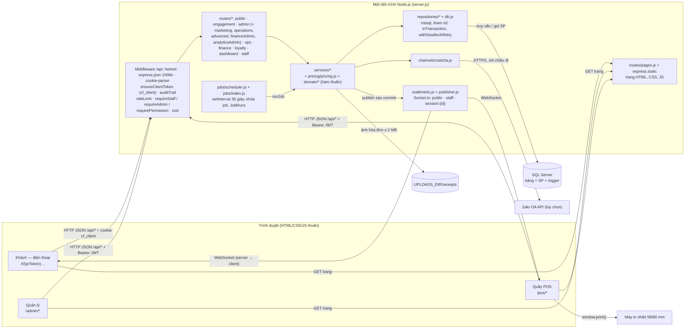

# Kiến trúc hệ thống

> **Nguồn:** `tài-liệu/nguồn/huong-dan-web-app-v1.2.md` §9 (bản 1.2, 14/10/2026). **Trạng thái tài liệu:** BẢN NHÁP — trạng thái từng mục ghi tại chỗ (CONFIRMED / PROPOSED / NEEDS_CONFIRMATION / UNKNOWN / N/A). Quyết định đã chốt: [ADR-000](../quyết-định/ADR-000-thanh-toan-tien-mat.md) (D-1/D-2/D-3).

> **Cập nhật 18/10/2026:** khối mới giai đoạn 4–8 (bộ lập lịch job, ma trận quyền, nhật ký thao tác, tích điểm trong giao dịch thu tiền, kênh Zalo OA, thư mục ảnh hóa đơn, bảng tổng hợp ngày) nằm ở mục 9.4.

> **Cập nhật 20/10/2026 (TASK-057, bước 10):** sơ đồ kiến trúc vẽ theo code hiện tại và quy tắc ranh giới tầng nằm ở mục 9.5. Bản đồ module: [module-map.md](module-map.md); mô hình bảo mật: [security-model.md](security-model.md).

## 9.1. Thành phần và trách nhiệm

```
┌──────────────────────┐   HTTPS/JSON    ┌─────────────────────────────┐   TDS    ┌───────────────┐
│  HTML/CSS/JS thuần   │ ◄─────────────► │  Node.js (Express) REST API │ ◄──────► │  SQL Server   │
│  /t/{qr}  khách      │   WebSocket     │  + Socket.io hub            │          │  Tables, SP   │
│  /pos     quầy       │ ◄─────────────► │  (cũng serve file tĩnh FE)  │          │  Transactions │
│  /pos/takeaway       │                 └─────────────────────────────┘          └───────────────┘
│  /admin   quản lý    │
└──────────────────────┘
        │ window.print()
   ┌────────────┐
   │ Máy in nhiệt│        Không có dịch vụ thanh toán bên ngoài (D-1). Toàn bộ hệ thống có thể chạy
   └────────────┘        trong LAN quán hoặc trên Internet (Q-008); không cần URL công khai cho webhook.
```

| Thành phần | Trách nhiệm | Không làm |
| --- | --- | --- |
| **Frontend HTML/CSS/JS thuần** (D-4; 3 khu vực: `/t/*` khách, `/pos/*` quầy, `/admin/*` quản lý — mỗi khu vực một bộ trang HTML + module JS dùng chung `api.js`, `socket.js`, `ui.js`) | Render UI bằng DOM API/template, giữ giỏ hàng (localStorage), gọi REST API bằng `fetch`, subscribe Socket.io, trang in | Không tính tiền, không quyết định kho, không kiểm quyền "thật" |
| **Backend API** | Xác thực/phân quyền, validate input, điều phối use case, gọi SP, phát sự kiện realtime | Không chứa logic trừ kho bằng "đọc rồi ghi" ngoài transaction |
| **Realtime hub** (trong cùng process backend) | Quản lý kết nối, room `staff` và `session:{id}`, broadcast | Không phải nguồn sự thật; không lưu trạng thái |
| **SQL Server** | Lưu dữ liệu; **giữ invariant kho** bằng SP + transaction + row-lock + CHECK constraint | — |

## 9.2. Phân tầng backend và hướng phụ thuộc

Áp dụng **phân tầng đơn giản** (không cần Clean Architecture đầy đủ cho đồ án 8 tuần — PROPOSED):

```
HTTP/WS adapter (controllers, hubs, DTO, auth guard)
        │  gọi
        ▼
Application services (use case: SubmitOrder, AcceptOrder, CompleteOrder, RequestPayment, SettleSession, …)
        │  gọi
        ▼
Repositories / DB access (gọi SP, query) ──► SQL Server
        │
Integrations (RealtimePublisher, ReceiptRenderer) ◄── được Application gọi qua interface
```

Quy tắc:
- Controller **không** gọi DB trực tiếp; chỉ parse request, gọi service, map lỗi → HTTP status.
- Service **không** biết HTTP; ném lỗi nghiệp vụ có mã (`OUT_OF_STOCK`, `ALREADY_PROCESSED`, …).
- Mọi thao tác **đổi trạng thái đơn + kho** đi qua SP hoặc một transaction duy nhất; không "SELECT rồi UPDATE" tách rời.
- Realtime được phát **sau khi commit** (không phát trong transaction).
- Một thư mục theo module: `orders/`, `sessions/`, `payments/`, `inventory/`, `menu/`, `auth/`, `reports/`, `realtime/` — khớp 5 module trong Word.
- Express **serve FE tĩnh** từ `ứng-dụng/giao-diện/public` và có route trang sạch (`GET /t/:qrToken` → `t/index.html`, `GET /pos` → `pos/index.html`); mọi dữ liệu đi qua `/api/*` dạng JSON — FE không nhúng dữ liệu server-side.
- FE là **ứng dụng nhiều trang** (mỗi màn hình một HTML); state dùng chung (token nhân viên, `sessionId`/`clientToken` khách, giỏ hàng) lưu `localStorage`/cookie; không cần router phía client.

## 9.3. Mapping module Word → thành phần code

| Module Word | Backend module | Frontend khu vực | SP |
| --- | --- | --- | --- |
| 1. Đặt món & định danh | `sessions`, `orders` | `/t/*`, `/pos/takeaway` (D-3) | `sp_SubmitOrder` |
| 2. Thanh toán (D-1/D-2: gọi thanh toán + thu tiền mặt + in bill) | `payments` (request-payment, settle, receipt) | `/t/*` nút Gọi thanh toán, `/pos` drawer Thu tiền bàn, `/pos/sessions/*/receipt` | `sp_SettleSession` |
| 3. Vận hành & realtime | `realtime`, `orders` | `/pos` | `sp_CompleteOrder` |
| 4. Kho & BOM | `inventory`, `menu` (BOM) | `/admin/ingredients`, `/admin/menu/[id]/bom` | `sp_SubmitOrder`, `sp_CompleteOrder`, `sp_CancelOrder` |
| 5. Quản trị & báo cáo | `auth`, `users`, `reports`, `menu`, `tables` | `/admin/*` | — |

## 9.4. Khối mới giai đoạn 4–8 (ADR-006, cập nhật 18/10/2026)

Kiến trúc vẫn chạy trong **một tiến trình** Node (API + Socket.io + FE tĩnh) với một SQL Server, một chi nhánh, một kho. ADR-006 thêm ba thứ vào sơ đồ 9.1:

- bộ lập lịch job chạy ngay trong tiến trình API;
- thư mục `uploads/` chứa ảnh hóa đơn;
- kênh gửi tin Zalo OA, tùy chọn và chỉ có chiều đi.

Hệ thống vẫn không có dịch vụ thanh toán ngoài và không có webhook vào.

| Thành phần | Vị trí | Trách nhiệm | Ghi chú |
| --- | --- | --- | --- |
| **Bộ lập lịch job** (duy nhất) | `src/jobs/scheduler.js`; danh sách job ở `src/jobs/index.js` | Một `setInterval` 30 giây. Job chạy theo giờ quán (`at: 'HH:MM'`) hoặc theo chu kỳ (`everyMinutes`). Mỗi lần chạy, bộ lập lịch giành khóa DB `Settings.job.<name>.running` (hết hạn sau 30 phút) nên nhiều tiến trình không chạy trùng, rồi ghi `JobRuns`: `RUNNING → OK / FAILED`, hoặc `SKIPPED` khi đang có lần chạy khác. Job phải idempotent (MERGE theo khóa) | `server.js` bật bộ lập lịch. `JOBS_ENABLED=false` (test, E2E) thì không tự chạy, nhưng vẫn gọi được `runJob(name)`: test, `POST /api/admin/jobs/{name}/run`, nút "Tính lại". Job theo giờ chạy bù khi app khởi động sau mốc giờ mà hôm nay chưa có lần OK. Job theo chu kỳ chờ đủ một chu kỳ sau khi khởi động. Không dùng `node-cron` |
| **Ma trận quyền** | `src/auth/permissions.js` | Gồm bảng `PERMISSIONS`, hàm `can(user, permission)`, middleware `requirePermission(permission)` (401 / 403) và `discountLimits(role, settings)`. Thứ bậc vai: STAFF < MANAGER (Trưởng ca) < ADMIN | Server kiểm ở mọi endpoint; FE chỉ ẩn / hiện. `/api/admin/*` vẫn dùng `requireAdmin`, nên MANAGER thao tác kho qua `/api/ops/*` và xem dashboard qua `/api/dashboard/*`. Test quyền sinh từ chính bảng này |
| **Nhật ký thao tác** | `src/middleware/audit.js`, gắn ở `/api` trước mọi router | Ghi theo bảng luật: mọi request đổi dữ liệu dưới `/api/admin/*` và các route quầy đổi tiền / kho / ca. Ảnh "trước" chụp dòng DB trước khi xử lý; "sau" = input + kết quả. Chỉ ghi `AuditLogs` khi response xong với status < 400, tức sau commit. Bỏ mọi khóa chứa password / hash / token / secret / otp; số điện thoại chỉ còn 3 số cuối; ảnh chỉ ghi kích thước | Ghi nhật ký lỗi không làm hỏng thao tác. Trigger DB chặn UPDATE; job `audit-retention` giữ 12 tháng; ADMIN chỉ đọc |
| **Tích điểm / voucher trong giao dịch thu tiền** | `src/pricing/pricing.js`; `sp_ApplyLoyalty`, `sp_ReverseLoyalty` | `pricing` tính voucher và đổi thưởng cùng các khoản giảm khác (D-7). Ba SP thu tiền (`sp_SettleSession`, `sp_SettleSplit`, `sp_SubmitOrder` cho mang đi) gọi `sp_ApplyLoyalty` **trong cùng transaction**, nên dùng voucher, trừ điểm / lượt tem, tích điểm / tem và tặng voucher giới thiệu commit hoặc rollback cùng lượt thu. `sp_RefundPayment` gọi `sp_ReverseLoyalty` | Không có API trừ điểm riêng ở quầy. Sau commit, service mới phát `member.vouchers_issued` |
| **Kênh Zalo OA** | `src/channels/zaloOa.js` | Interface kênh `send({ phone, text }) → { ok, error }`: gọi HTTP, timeout 10 giây, báo lỗi rõ ràng. Test thay hàm gửi bằng `setSender` | Chỉ bật khi có `ZALO_OA_TOKEN` (cổng gửi đặt bằng `ZALO_OA_URL`). Không có token thì không gửi gì ra ngoài, và chiến dịch dùng kênh `EXPORT` (CSV) |
| **Thư mục ảnh hóa đơn** | `<UPLOADS_DIR>/receipts/`: mặc định `uploads/` ở gốc repo, test dùng thư mục tạm | Lưu ảnh jpg / png / webp ≤ 2 MB, tên `<id>-<ngẫu nhiên>.<đuôi>`. Server kiểm chữ ký file, không tin `Content-Type` | Không serve tĩnh; chỉ xem được qua `GET /api/cash-transactions/{id}/receipt` (cần đăng nhập) |
| **Số liệu tính sẵn cho dashboard** | Bảng `DailySummaries`; `dashboardService`, `analyticsService` | Job 00:30 tính số liệu **hôm qua** (MERGE theo ngày). `GET /api/dashboard/today` đọc dòng hôm qua và dòng cùng thứ tuần trước; thiếu thì tính một lần rồi lưu. "Việc cần làm" là vài phép đếm nhẹ, tính trực tiếp | Với trưởng ca, server tự bỏ giá vốn / lãi khỏi response. Menu engineering và phân tích (F-041, F-042) tính khi xem, không có bảng hay job riêng |

### Job nền (`src/jobs/index.js`)

| Job | Lịch (giờ quán) | Việc | Feature |
| --- | --- | --- | --- |
| `refresh-caches` | Mỗi 15 phút | Làm mới cache gợi ý món và thời gian chuẩn của món | F-017, F-025 |
| `attendance-autoclose` | Mỗi 15 phút | Đóng chấm công quên đăng xuất tại `ClockIn` + thời hạn token (`JWT_EXPIRES_IN`, mặc định 8 giờ) | F-035 |
| `campaigns-due` | Mỗi 5 phút | Chạy các chiến dịch `SCHEDULED` đã tới giờ hẹn | F-037 |
| `daily-summary` | 00:30 | Ghi `DailySummaries` của hôm qua | F-043 |
| `prep-stats` | 02:00 | Ghi `ItemPrepStats` (trung vị thời gian pha 30 ngày) | F-025 |
| `demand-forecast` | 02:00 | Ghi `DemandForecasts` cho 14 ngày tới | F-029 |
| `audit-retention` | 03:00 | Xóa `AuditLogs` cũ hơn 12 tháng, mỗi lô 5.000 dòng | F-035 |
| `lot-expiry` | 06:00 | Phát `inventory.expiring` / `inventory.expired` | F-028 |
| `runout-alert` | 06:05 | Phát `inventory.runout` | F-029 |

Trạng thái job và lần chạy gần nhất xem ở `GET /api/admin/jobs`.

### Gắn router (`src/app.js`) và biến môi trường mới

Thứ tự trong `/api`: `ensureClientToken` → `auditTrail` → `public` → `engagement` (khách + quầy: gọi lại đơn, ETA, chia bill) → `/admin` (`requireAdmin`; gồm `advanced`, `financeAdmin`, `marketing`, `analytics`) → `ops` (kho quầy) → `finance` (sổ quỹ, chấm công, đăng xuất) → `loyalty` (điểm / tem / voucher ở quầy) → `dashboard` → `staff`.

| Nhóm | Route | Service chính | SP chính |
| --- | --- | --- | --- |
| Giai đoạn 4 | `engagement.js`, `staff.js` (thu từng phần), `advanced.js` | `recallService`, `etaService`, `splitService`, `scheduleService` | `sp_SettleSplit` |
| Giai đoạn 5 | `ops.js`, `advanced.js`, `operations.js` (phiếu nhập) | `inventoryService`, `purchasingService`, `forecastService`, `stockService` | `sp_PostPrepBatch`, `sp_LogWaste`, `sp_LotConsume`, `sp_SetTrackLots`, `sp_ReceiveStock` |
| Giai đoạn 6 | `finance.js`, `financeAdmin.js` | `cashService`, `attendanceService`, `pnlService` | `sp_CreateCashTxn`, `sp_ReviewCashTxn`, `sp_CloseShift`, `sp_ClockIn` |
| Giai đoạn 7 | `loyalty.js`, `marketing.js`, `public.js` (đăng ký có người giới thiệu) | `loyaltyService`, `memberService`, `campaignService` | `sp_ApplyLoyalty`, `sp_ReverseLoyalty`, `sp_AdjustPoints` |
| Giai đoạn 8 | `analytics.js` | `analyticsService`, `dashboardService` | — |
| F-046 (ADR-007) | `staff.js` (sửa / xóa món, xóa đơn, hủy bàn) | `voidService` (`voidRepo`) | `sp_VoidOrderItem` (+ `sp_VoidLineCore`, `sp_RecalcOrder`, `sp_CloseIfSettled`), `sp_CancelOrders` |
| F-047 (ADR-008) | `engagement.js` (`GET /api/sessions/{id}/member-card`); 3 route bill có sẵn trong `staff.js` thêm `memberCard` | `sessionService.memberCard`, `loyaltyService.memberCard` / `receiptCard`, `orderService` (bill mang đi) | — (không đổi schema) |

Biến môi trường mới (đọc trong `src/config.js`):

| Biến | Ý nghĩa |
| --- | --- |
| `JOBS_ENABLED` | `false` thì tắt tự chạy job |
| `UPLOADS_DIR` | Thư mục gốc chứa ảnh hóa đơn |
| `ZALO_OA_TOKEN`, `ZALO_OA_URL` | Bật kênh Zalo OA |
| `JWT_EXPIRES_IN` | Thời hạn token; nay còn là mốc job đóng chấm công quên đăng xuất |

## 9.5. Sơ đồ kiến trúc và ranh giới tầng (bước 10, cập nhật 20/10/2026)

> **Trạng thái:** sơ đồ mô tả code **đã có** (đối chiếu `src/app.js`, `src/server.js`, `src/routes/*`, ngày 20/10/2026). Quy tắc tầng là CONFIRMED (`.agent/rules.md`: "controller/hub → service → repository/SP; Controller không gọi DB; service không biết HTTP"). Bảng "Hiện trạng lệch" bên dưới chờ duyệt ở Gate G2.

### Sơ đồ



Ghi chú sơ đồ:

- Một tiến trình phục vụ cả trang tĩnh, REST API và Socket.io; một SQL Server; một quán, một kho. Không có cổng thanh toán, không có webhook vào (D-1).
- Socket.io chỉ phát từ server xuống client; client không gửi lệnh qua socket. Quyền vào room kiểm lúc handshake ([security-model.md](security-model.md) §12).
- Trang quản lý không mở socket (chỉ REST). Trưởng ca dùng `/admin/today` qua `/api/dashboard/*`.
- Thứ tự router trong `/api` như mục 9.4. `staffRouter` gắn `requireStaff` cho mọi đường dẫn tới được nó, nên đường dẫn `/api` lạ trả 401 khi chưa đăng nhập và 404 khi đã đăng nhập.

### Quy tắc ranh giới tầng

Hướng phụ thuộc một chiều: `routes` → `services` → (`pricing`, `domain`, `repositories`, `realtime/publisher`, `channels`) → `db.js` → SQL Server. `middleware` dùng chung cho `routes`; `jobs` gọi `services`.

| Tầng | Được làm | Không được làm |
| --- | --- | --- |
| `routes/*` (controller) | Gắn middleware quyền; parse + validate bằng zod; gọi **một** service; trả JSON / status | Viết SQL hoặc gọi repository; tính tiền; phát realtime; chứa quy tắc nghiệp vụ |
| `services/*` | Use case; kiểm quyền theo tài nguyên (phiên của khách, ngưỡng theo vai, người duyệt); gọi `pricing` / `domain`; gọi repository / SP; phát realtime **sau commit**; ném `AppError` có mã | Đọc `req` / `res` hay biết status HTTP; viết SQL trực tiếp |
| `pricing/pricing.js`, `domain/*` | Hàm thuần (tính tiền, ETA, lịch thực đơn, quy đổi đơn vị, dự báo, phân tích), test độc lập | Truy cập DB, Express, realtime |
| `repositories/*` | SQL có tham số; gọi SP; transaction (`inTransaction`), retry deadlock 1205 | Biết HTTP; phát realtime; quyết định quyền |
| SP (`cơ-sở-dữ-liệu/thủ-tục/`) | Giữ bất biến kho / tiền bằng transaction + khóa dòng + CHECK; `THROW 5000x` → `errors.js` map ra HTTP | "Đọc rồi ghi" tách rời ngoài transaction |
| `realtime/*` | Handshake, room, `publish` | Là nguồn sự thật; nhận lệnh từ client |
| `jobs/*` | Lập lịch, khóa chống chạy trùng, gọi service | Gọi route |
| Giao diện (`public/js`) | Hiển thị số do server tính; ẩn / hiện theo vai | Tính tiền; là nơi kiểm quyền thật |

Kiểm ngày 20/10/2026: không file nào trong `services/`, `repositories/`, `domain/`, `pricing/` import `express`; `repositories/`, `domain/`, `pricing/` không import `realtime`; `domain/`, `pricing/` không import `db.js` hay repository.

### Hiện trạng lệch (chờ duyệt G2)

| # | Lệch | Vị trí | Đề xuất | Trạng thái |
| --- | --- | --- | --- | --- |
| 1 | Route gọi thẳng repository (chỉ đọc) | `routes/ops.js` → `ingredientsRepo.list`; `routes/finance.js` → `usersRepo.list`; `routes/loyalty.js` → `membersRepo.findById`; `routes/financeAdmin.js` → `auditRepo.list` / `facets` | Chấp nhận cho truy vấn đọc một bước, hoặc bọc bằng service ở task sau (không đổi hành vi) | NEEDS_CONFIRMATION |
| 2 | Route chạy SQL | `routes/public.js` `GET /api/health` chạy `SELECT 1` qua `db.request()` | Chấp nhận (health check), hoặc chuyển sang hàm `db.ping()` | NEEDS_CONFIRMATION |
| 3 | Job gọi repository | `jobs/index.js` → `auditRepo.purgeOlderThan` (job `audit-retention`) | Chấp nhận (job đóng vai service) | PROPOSED |
| 4 | Mục 9.2 ghi "một thư mục theo module (`orders/`, `sessions/`…)" | Code xếp theo tầng (`routes/`, `services/`, `repositories/`) | Giữ cách xếp theo tầng; ranh giới module ghi ở [module-map.md](module-map.md) | PROPOSED |
