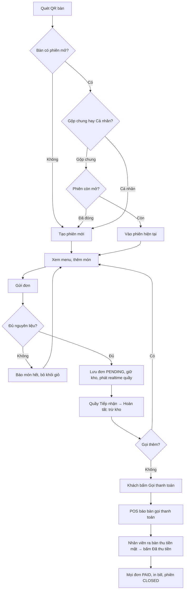

# Quy trình và trạng thái

> **Nguồn:** `tài-liệu/nguồn/huong-dan-web-app-v1.2.md` §6 (bản 1.2, 14/10/2026). **Trạng thái tài liệu:** BẢN NHÁP — trạng thái từng mục ghi tại chỗ (CONFIRMED / PROPOSED / NEEDS_CONFIRMATION / UNKNOWN / N/A). Quyết định đã chốt: [ADR-000](../quyết-định/ADR-000-thanh-toan-tien-mat.md) (D-1/D-2/D-3).

## 6.1. Luồng đầu-cuối (dine-in) — theo D-1/D-2

```
Khách quét QR bàn
  → [bàn trống] tạo phiên mới  |  [bàn có phiên mở] chọn Gộp chung / Cá nhân
  → xem menu, thêm món, ghi chú
  → Gửi đơn ──► server kiểm kho (BR-001/BR-009) ──► từ chối: báo món hết, về menu
                                                └──► OK: lưu đơn PENDING, giữ kho (nếu A), phát realtime cho quầy
  → Quầy: thẻ đơn nảy lên + "Ting" → bấm Tiếp nhận (PREPARING) → pha chế
  → Quầy bấm "Hoàn tất" ──► SP: COMPLETED + trừ kho (một lần) ──► realtime cho khách "Đã xong, nhận tại quầy"
  → (Khách có thể gọi thêm: lặp lại gửi đơn trong cùng phiên)
  → Khách bấm "GỌI THANH TOÁN" ──► phiên PAYMENT_REQUESTED ──► realtime: POS hiện "Bàn 05 gọi thanh toán · 125.000đ" + âm thanh
  → Nhân viên ra bàn thu tiền mặt → trên POS bấm "Đã thu tiền" (nhập tiền khách đưa, tiền thừa)
       ──► SP: mọi đơn trong phiên → PAID, Payments(CASH), phiên CLOSED ──► in bill ──► khách thấy "Cảm ơn, đã thanh toán"
```

Sơ đồ Mermaid (từ Word, chuẩn hóa tên trạng thái và thay nhánh VietQR bằng gọi thanh toán):



Luồng **bán mang đi** (D-3): Nhân viên mở mục "Bán mang đi" → chọn món → nhập tiền khách đưa → bấm "Thu tiền & In bill" → SP tạo đơn `TAKE_AWAY` đã `PAID` + giữ kho → in bill → thẻ đơn vào cột Đang pha → Hoàn tất → trừ kho.

## 6.2. Máy trạng thái đơn hàng (`Orders.Status`) — PROPOSED (Q-004b: có bước Tiếp nhận)

| Trạng thái | Nhãn hiển thị cho khách | Vào khi | Ra khi |
| --- | --- | --- | --- |
| `PENDING` | Chờ xác nhận | Gửi đơn thành công (đã qua kiểm kho) | → `PREPARING` khi quầy Tiếp nhận; → `CANCELLED` khi quầy hủy |
| `PREPARING` | Đang chuẩn bị | Quầy bấm Tiếp nhận (hoặc ngay khi tạo đơn mang đi) | → `COMPLETED` khi quầy hoàn tất |
| `COMPLETED` | Đã xong, vui lòng nhận tại quầy | SP hoàn tất commit (đã trừ kho) | Kết thúc |
| `CANCELLED` | Đã hủy | Quầy hủy đơn `PENDING` (Q-010) | Kết thúc; trả `ReservedQty` |

| Trạng thái hiện tại | Hành động | Người thực hiện | Trạng thái sau | Điều kiện / Hệ quả |
| --- | --- | --- | --- | --- |
| — | Gửi đơn | Khách | `PENDING` | Kiểm kho; giữ kho (A); phát `order.created` |
| — | Tạo đơn mang đi | Quầy | `PREPARING` + `PAID` | Kiểm kho; giữ kho; `Payments(CASH)`; phát `order.created` |
| `PENDING` | Tiếp nhận | Quầy | `PREPARING` | Phát `order.status_changed` |
| `PENDING` | Hủy | Quầy | `CANCELLED` | Trả giữ kho; phát `order.cancelled` |
| `PREPARING` | Hoàn tất | Quầy | `COMPLETED` | **Atomic**: `UPDATE … WHERE Status='PREPARING'` + trừ kho trong cùng transaction; lần bấm thứ hai → 409 |
| `PREPARING` | Hủy | — | — | **Không cho phép** trong bản đầu (đang làm) — PROPOSED |
| bất kỳ (≠ CANCELLED) | Thu tiền phiên | Quầy | giữ nguyên `Status`; `PaymentStatus → PAID` | Chỉ qua `sp_SettleSession`; phiên không còn đơn `PENDING` |

> Nếu nhóm chọn Q-004b = "không có Tiếp nhận": đơn dine-in vào thẳng `PREPARING`; bỏ hàng "Tiếp nhận"; hủy áp dụng cho `PREPARING` chưa hoàn tất (PROPOSED).

## 6.3. Trạng thái thanh toán (`Orders.PaymentStatus`) và bản ghi `Payments`

| `Orders.PaymentStatus` | Ý nghĩa |
| --- | --- |
| `UNPAID` | Chưa thu tiền |
| `PAID` | Nhân viên đã ghi nhận thu tiền mặt (qua thu tiền phiên hoặc tạo đơn mang đi) |

`Payments` chỉ có `Method = 'CASH'` trong MVP và luôn gắn với **một phiên** (dine-in, có thể gồm nhiều đơn) **hoặc một đơn** (mang đi). Lưu `AmountDue`, `AmountReceived`, `ChangeGiven`, `ReceivedBy`, `PaidAt` để in bill và đối soát ca. Không có trạng thái PENDING/EXPIRED vì không còn chờ cổng.

## 6.4. Trạng thái phiên (`Sessions.Status`) — theo D-2

| Trạng thái | Nhãn trên POS | Vào khi | Ra khi |
| --- | --- | --- | --- |
| `OPEN` | Đang phục vụ | Khách quét QR tạo phiên | → `PAYMENT_REQUESTED` khi khách bấm Gọi thanh toán; → `CLOSED` khi quầy thu tiền trực tiếp |
| `PAYMENT_REQUESTED` | **Gọi thanh toán** (nổi bật, kèm thời gian chờ) | Khách bấm Gọi thanh toán | → `CLOSED` khi quầy bấm Đã thu tiền; → `OPEN` nếu khách gọi thêm món (PROPOSED: tự quay lại OPEN và báo quầy) |
| `CLOSED` | Đã thanh toán | `sp_SettleSession` commit | Kết thúc; khách quét QR sau đó sẽ tạo phiên mới (BR-008) |

Phiên `OPEN` không có đơn nào sau 2 giờ (khách quét rồi bỏ đi) → quầy có thể "Đóng bàn trống" thủ công; tự động hóa xếp vào cron "làm sau" (REQ-020).
