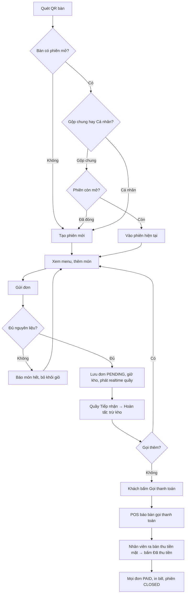

# Quy trình và trạng thái

> **Nguồn:** `tài-liệu/nguồn/huong-dan-web-app-v1.2.md` §6 (bản 1.2, 14/10/2026). **Trạng thái tài liệu:** BẢN NHÁP — trạng thái từng mục ghi tại chỗ (CONFIRMED / PROPOSED / NEEDS_CONFIRMATION / UNKNOWN / N/A). Quyết định đã chốt: [ADR-000](../quyết-định/ADR-000-thanh-toan-tien-mat.md) (D-1/D-2/D-3).

## 6.1. Luồng đầu-cuối (dine-in) — theo D-1/D-2

```
Khách quét QR bàn
  → [bàn trống] tạo phiên mới  |  [bàn có phiên mở] chọn Gộp chung / Cá nhân
  → xem menu, thêm món, ghi chú
  → Gửi đơn ──► server kiểm kho (BR-001/BR-009) ──► từ chối: báo món hết, về menu
                                                └──► OK: lưu đơn PENDING, giữ kho (nếu A), phát realtime cho quầy
  → Quầy: thẻ đơn nảy lên + "Ting" → bấm Tiếp nhận (PREPARING) → pha chế
  → Quầy bấm "Hoàn tất" ──► SP: COMPLETED + trừ kho (một lần) ──► realtime cho khách "Đã xong, nhận tại quầy"
  → (Khách có thể gọi thêm: lặp lại gửi đơn trong cùng phiên)
  → Khách bấm "GỌI THANH TOÁN" ──► phiên PAYMENT_REQUESTED ──► realtime: POS hiện "Bàn 05 gọi thanh toán · 125.000đ" + âm thanh
  → Nhân viên ra bàn thu tiền mặt → trên POS bấm "Đã thu tiền" (nhập tiền khách đưa, tiền thừa)
       ──► SP: mọi đơn trong phiên → PAID, Payments(CASH), phiên CLOSED ──► in bill ──► khách thấy "Cảm ơn, đã thanh toán"
```

Sơ đồ Mermaid (từ Word, chuẩn hóa tên trạng thái và thay nhánh VietQR bằng gọi thanh toán):



Luồng **bán mang đi** (D-3): Nhân viên mở mục "Bán mang đi" → chọn món → nhập tiền khách đưa → bấm "Thu tiền & In bill" → SP tạo đơn `TAKE_AWAY` đã `PAID` + giữ kho → in bill → thẻ đơn vào cột Đang pha → Hoàn tất → trừ kho.

## 6.2. Máy trạng thái đơn hàng (`Orders.Status`) — PROPOSED (Q-004b: có bước Tiếp nhận)

| Trạng thái | Nhãn hiển thị cho khách | Vào khi | Ra khi |
| --- | --- | --- | --- |
| `PENDING` | Chờ xác nhận | Gửi đơn thành công (đã qua kiểm kho) | → `PREPARING` khi quầy Tiếp nhận; → `CANCELLED` khi quầy hủy |
| `PREPARING` | Đang chuẩn bị | Quầy bấm Tiếp nhận (hoặc ngay khi tạo đơn mang đi) | → `COMPLETED` khi quầy hoàn tất |
| `COMPLETED` | Đã xong, vui lòng nhận tại quầy | SP hoàn tất commit (đã trừ kho) | Kết thúc |
| `CANCELLED` | Đã hủy | Quầy hủy đơn `PENDING` (Q-010) | Kết thúc; trả `ReservedQty` |

| Trạng thái hiện tại | Hành động | Người thực hiện | Trạng thái sau | Điều kiện / Hệ quả |
| --- | --- | --- | --- | --- |
| — | Gửi đơn | Khách | `PENDING` | Kiểm kho; giữ kho (A); phát `order.created` |
| — | Tạo đơn mang đi | Quầy | `PREPARING` + `PAID` | Kiểm kho; giữ kho; `Payments(CASH)`; phát `order.created` |
| `PENDING` | Tiếp nhận | Quầy | `PREPARING` | Phát `order.status_changed` |
| `PENDING` | Hủy | Quầy | `CANCELLED` | Trả giữ kho; phát `order.cancelled` |
| `PREPARING` | Hoàn tất | Quầy | `COMPLETED` | **Atomic**: `UPDATE … WHERE Status='PREPARING'` + trừ kho trong cùng transaction; lần bấm thứ hai → 409 |
| `PREPARING` | Hủy | — | — | **Không cho phép** trong bản đầu (đang làm) — PROPOSED |
| bất kỳ (≠ CANCELLED) | Thu tiền phiên | Quầy | giữ nguyên `Status`; `PaymentStatus → PAID` | Chỉ qua `sp_SettleSession`; phiên không còn đơn `PENDING` |

> Nếu nhóm chọn Q-004b = "không có Tiếp nhận": đơn dine-in vào thẳng `PREPARING`; bỏ hàng "Tiếp nhận"; hủy áp dụng cho `PREPARING` chưa hoàn tất (PROPOSED).

> **Từ ADR-007 (F-046, 18/10/2026):** đơn tại bàn **chưa thu** ở `PENDING` / `PREPARING` / `COMPLETED` còn chuyển `CANCELLED` khi xóa hết món, **Xóa đơn** hoặc **Hủy bàn** (đơn đã tiếp nhận / đã pha cần trưởng ca / quản lý). Hàng "`PREPARING` · Hủy · Không cho phép" ở trên vẫn đúng cho nút **Hủy** cũ — xem 6.12.

## 6.3. Trạng thái thanh toán (`Orders.PaymentStatus`) và bản ghi `Payments`

| `Orders.PaymentStatus` | Ý nghĩa |
| --- | --- |
| `UNPAID` | Chưa thu tiền |
| `PAID` | Nhân viên đã ghi nhận thu tiền mặt (qua thu tiền phiên hoặc tạo đơn mang đi) |

`Payments` chỉ có `Method = 'CASH'` trong MVP và luôn gắn với **một phiên** (dine-in, có thể gồm nhiều đơn) **hoặc một đơn** (mang đi). Lưu `AmountDue`, `AmountReceived`, `ChangeGiven`, `ReceivedBy`, `PaidAt` để in bill và đối soát ca. Không có trạng thái PENDING/EXPIRED vì không còn chờ cổng.

## 6.4. Trạng thái phiên (`Sessions.Status`) — theo D-2

| Trạng thái | Nhãn trên POS | Vào khi | Ra khi |
| --- | --- | --- | --- |
| `OPEN` | Đang phục vụ | Khách quét QR tạo phiên | → `PAYMENT_REQUESTED` khi khách bấm Gọi thanh toán; → `CLOSED` khi quầy thu tiền trực tiếp |
| `PAYMENT_REQUESTED` | **Gọi thanh toán** (nổi bật, kèm thời gian chờ) | Khách bấm Gọi thanh toán | → `CLOSED` khi quầy bấm Đã thu tiền; → `OPEN` nếu khách gọi thêm món (PROPOSED: tự quay lại OPEN và báo quầy) |
| `CLOSED` | Đã thanh toán | `sp_SettleSession` commit | Kết thúc; khách quét QR sau đó sẽ tạo phiên mới (BR-008) |

Phiên `OPEN` không có đơn nào sau 2 giờ (khách quét rồi bỏ đi) → quầy có thể "Đóng bàn trống" thủ công; tự động hóa xếp vào cron "làm sau" (REQ-020).

> **Từ ADR-007 (F-046, 18/10/2026):** phiên `OPEN` / `PAYMENT_REQUESTED` còn → `CLOSED` khi quầy **Hủy bàn** (không tạo lượt thu, ghi `Sessions.CancelledBy`, `CancelReason`), hoặc khi bỏ nốt món chưa thu ở phiên đã thu một phần (chia bill) — xem 6.12.

---

# Bổ sung giai đoạn 4–8 (ADR-006, 18/10/2026)

Các máy trạng thái dưới đây đã triển khai và có test (FEATURE-026, 028, 030, 033, 037, 038, 039). Rule chi tiết: `business-rules.md` BR-033…BR-065.

## 6.5. Phần chia bill (`SessionSplits.Status`) — F-026, D-17

Phiên có chia bill vẫn đi theo 6.4, nhưng không thu cả bàn bằng `sp_SettleSession` được (`409 SESSION_HAS_SPLITS`); mỗi phần thu bằng `sp_SettleSplit`.

| Trạng thái | Ý nghĩa | Vào khi | Ra khi |
| --- | --- | --- | --- |
| `OPEN` | Phần đang mở, còn nhận/bỏ dòng | Khách tạo "phần của tôi" (mỗi điện thoại một phần) hoặc quầy "+ Thêm phần". Phần **Chung** (`IsCommon = 1`) tự tạo khi có phần đầu tiên | → `PAID` khi thu phần đó; bị xóa khi "Thu chung" |
| `PAID` | Đã có đúng một `Payments(SplitId)` | `sp_SettleSplit` commit | Kết thúc; dòng không chuyển được nữa (`409 SPLIT_PAID`) |

| Hiện tại | Hành động | Người thực hiện | Sau | Điều kiện / Hệ quả |
| --- | --- | --- | --- | --- |
| Phiên chưa chia | Tạo phần đầu tiên | Khách / quầy | phần mới `OPEN` + phần Chung `OPEN` | Dòng chưa ai nhận thuộc Chung (`OrderItems.SplitId = NULL`); phát `session.split_changed` |
| `OPEN` | Thu phần (không phải phần cuối) | Quầy | `PAID` | Dòng của phần ghi `PaidAt`/`PaymentId`; đơn đủ dòng → `PaymentStatus = PAID`; phiên vẫn `OPEN` |
| `OPEN` (phần cuối còn mở) | Thu phần | Quầy | `PAID`; phiên `CLOSED` | Tự gộp các dòng Chung chưa thu (thiếu → `409 COMMON_REQUIRED`); hết dòng chưa thu → mọi phần `PAID`, phiên `CLOSED`, phát `session.settled` |
| Chung `OPEN` | Thu phần Chung riêng | Quầy | — | Được khi còn phần khác mở; Chung trống → `409 SPLIT_EMPTY` |
| bất kỳ, chưa có lượt thu nào | "Thu chung" | Quầy | (xóa mọi phần) | Bỏ chia hẳn; phiên thu cả bàn như 6.4 |
| có ≥ 1 phần `PAID` | "Thu chung" | Quầy | các phần `OPEN` bị xóa | Dòng chưa thu dồn về Chung để thu nốt |
| `OPEN` | Thu đồng thời cùng một phần | 2 máy | một `PAID` | Máy sau nhận `409` (khóa phiên + `UX_Payments_Split`) |

Còn đơn `PENDING` trong phiên → không thu phần nào (`HAS_PENDING_ORDERS`, BR-019). Hoàn tiền lượt thu của một phần chỉ hoàn tiền, không hủy đơn.

## 6.6. Khoản sổ quỹ (`CashTransactions.Status`) — F-033, D-23

| Trạng thái | Ý nghĩa | Trừ / cộng két? |
| --- | --- | --- |
| `PENDING` | Chi chờ duyệt | Chưa |
| `APPROVED` | Đã duyệt (hoặc duyệt ngay lúc ghi) | Có — vào `ExpectedCash` của ca |
| `REJECTED` | Bị từ chối, có `RejectReason` | Không |

| Hiện tại | Hành động | Người thực hiện | Sau | Điều kiện / Hệ quả |
| --- | --- | --- | --- | --- |
| — | Ghi khoản thu (`IN`) | STAFF / MANAGER / ADMIN | `APPROVED` | Cần ca đang mở (`409 NO_OPEN_SHIFT`); phát `cash.created` |
| — | Ghi khoản chi (`OUT`) ≤ 500.000đ, danh mục không cần duyệt | STAFF / MANAGER / ADMIN | `APPROVED` | Như trên |
| — | Ghi khoản chi > 500.000đ **hoặc** danh mục cần duyệt ("Khác (chi)") | STAFF / MANAGER / ADMIN | `PENDING` | Như trên |
| `PENDING` | Duyệt | MANAGER (≤ 2.000.000đ) / ADMIN; STAFF qua tài khoản trưởng ca/quản lý | `APPROVED` | Không tự duyệt khoản của mình (`403 SELF_APPROVAL`, trừ ADMIN); phát `cash.reviewed` |
| `PENDING` | Từ chối | Như duyệt | `REJECTED` | Bắt buộc lý do |
| `APPROVED` / `REJECTED` | Duyệt / từ chối lần nữa | — | — | `409 CASH_NOT_PENDING` (hai người cùng duyệt → người sau nhận lỗi này) |

Ca còn khoản `PENDING` → không đóng ca được (`409 CASH_PENDING`); ca đã đóng không ghi quỹ được.

## 6.7. Đơn đặt hàng (`PurchaseOrders.Status`) — F-030

| Trạng thái | Nhãn | Vào khi | Ra khi |
| --- | --- | --- | --- |
| `DRAFT` | Nháp | Quản lý tạo PO (tay hoặc "Tạo đơn đặt hàng từ dòng đã chọn" ở Đề xuất nhập hàng) | → `SENT` khi Gửi & in; → `CANCELLED` khi hủy |
| `SENT` | Đã gửi | Bấm Gửi (in / PDF / chép gửi Zalo) | → `PARTIAL` / `RECEIVED` khi nhận hàng; → `CANCELLED` khi hủy |
| `PARTIAL` | Nhận một phần | Nhận hàng chưa đủ mọi dòng | → `RECEIVED` khi nhận đủ |
| `RECEIVED` | Đã nhận đủ | Mọi dòng `ReceivedBaseQty ≥ OrderedBaseQty` | Kết thúc |
| `CANCELLED` | Đã hủy | Hủy PO `DRAFT` / `SENT` | Kết thúc |

| Hiện tại | Hành động | Người thực hiện | Sau | Điều kiện / Hệ quả |
| --- | --- | --- | --- | --- |
| `DRAFT` | Sửa | ADMIN | `DRAFT` | Trạng thái khác → `409 PO_NOT_DRAFT` |
| `SENT` / `PARTIAL` | Nhận hàng | STAFF+ (quầy → Kho & sơ chế → Nhận hàng) hoặc ADMIN | `PARTIAL` / `RECEIVED` | `sp_ReceiveStock @PoId`: cộng tồn, giá vốn bình quân, lô, lịch sử giá trong một transaction; vượt số đặt → `409 OVER_RECEIPT` trừ khi `confirmOver`; trạng thái khác → `409 PO_NOT_RECEIVABLE` |
| `PARTIAL` / `RECEIVED` | Hủy | ADMIN | — | `409 PO_HAS_RECEIPTS` |
| `CANCELLED` | Hủy | ADMIN | — | `409 PO_CANCELLED` |

PO `SENT` / `PARTIAL` chưa nhận đủ được tính là "đang về" trong đề xuất nhập hàng (F-029).

## 6.8. Lô nguyên liệu (`IngredientLots`) — F-028, D-20

Chỉ áp cho nguyên liệu bật `TrackLots`. "Hết hạn" là trạng thái suy ra, không lưu cột riêng.

| Trạng thái | Điều kiện | Tính vào khả dụng? |
| --- | --- | --- |
| Mở, còn hạn | `IsClosed = 0`, `Qty > 0`, `ExpiryDate` trống hoặc ≥ hôm nay (giờ quán) | Có |
| Mở, **hết hạn** | `IsClosed = 0`, `Qty > 0`, `ExpiryDate` < hôm nay | **Không** (`tvf_ExpiredLotQty`) — vẫn nằm trong `StockQty` đến khi hủy |
| Đóng | `IsClosed = 1` (lô về 0, hoặc tắt theo lô) | Không |

| Hiện tại | Sự kiện | Sau | Ghi chú |
| --- | --- | --- | --- |
| — | Bật theo lô | lô "Tồn đầu" mở (không hạn) | Tồn hiện có thành một lô |
| — | Nhập kho / phiếu nhập theo PO | lô mở (`RECEIPT`) | Hạn nhập tay hoặc hôm nay + `ShelfLifeHours` |
| — | Sơ chế / điều chỉnh tăng, kiểm kê thừa / hoàn kho | lô mở (`PREP` / `ADJUST` / `RESTOCK`) | — |
| mở | Trừ (hoàn tất đơn, sơ chế, hủy, điều chỉnh giảm, kiểm kê thiếu) | mở, hoặc đóng khi `Qty` về 0 | FEFO: lô còn hạn hết hạn sớm trước → lô không hạn → lô đã hết hạn |
| mở, sắp hết hạn | Job `lot-expiry` 06:00 | — | Phát `inventory.expiring` (≤ 2 ngày) / `inventory.expired` tới quầy |
| mở | Hủy lô | đóng | Phiếu hủy `EXPIRED` cho toàn bộ phần còn lại (`sp_LogWaste @LotId`) |
| mở | Tắt theo lô | đóng | Đóng mọi lô của nguyên liệu |

Bất biến: Σ `Qty` lô mở = `StockQty` (`LOTS_MISMATCH`); lô đóng không còn hàng (`CLOSED_LOT_HAS_QTY`).

## 6.9. Voucher (`Vouchers`) — F-038, D-28

Trạng thái suy ra từ cột, không lưu cột `Status`.

| Trạng thái | Điều kiện | Ra khi |
| --- | --- | --- |
| Chưa dùng | `UsedAt IS NULL` và `ExpiresAt > bây giờ` | → Đã dùng khi một lượt thu áp mã; → Hết hạn khi qua `ExpiresAt` |
| Đã dùng | `UsedAt`, `UsedPaymentId` có giá trị (CHECK cả hai cùng có/không) | Kết thúc |
| Hết hạn | `UsedAt IS NULL` và `ExpiresAt ≤ bây giờ` | Kết thúc |

Nguồn tạo: `REFERRAL` (lượt thu đầu tiên ≥ 30.000đ của người được giới thiệu → 2 voucher), `CAMPAIGN` (mỗi người nhận tin một voucher `CD…`), `MANUAL` (quản lý tạo `QL…`, không gắn hội viên). Chuyển sang Đã dùng trong cùng transaction lượt thu (`sp_ApplyLoyalty`); hai quầy dùng cùng mã → một bên `409 VOUCHER_UNAVAILABLE`. Dùng lại → `409 VOUCHER_USED`; hết hạn → `409 VOUCHER_EXPIRED`. Theo code hiện tại, hoàn tiền **không** trả lại voucher đã dùng (Q-022).

## 6.10. Thẻ tem (`StampCards`) — F-039, D-27

Mỗi hội viên × chương trình tem một thẻ: `Stamps` (tem đang có, `0 ≤ Stamps < RequiredStamps`), `CompletedCards`, `RewardsAvailable` (lượt món miễn phí còn dùng được, ≥ 0).

```
Thu tiền có hội viên, bill có n món thuộc chương trình (không tính món được tặng)
  → Stamps += n
  → nếu Stamps ≥ RequiredStamps: CompletedCards += ⌊Stamps / Required⌋, RewardsAvailable += ⌊Stamps / Required⌋, Stamps = phần dư
Đổi lượt món miễn phí ở khung thu tiền (cần món của chương trình trên bill)
  → RewardsAvailable −= 1 (cùng transaction lượt thu; hết lượt → 409 STAMP_REWARD_UNAVAILABLE)
Hoàn tiền
  → hoàn toàn bộ lượt thu: trả lại lượt món miễn phí đã dùng (một lần)
  → đơn bị hủy trong lần hoàn: trừ tem của các món đó (không dưới 0, không quá số tem lượt thu đã tích)
```

Ví dụ: chương trình 10 tem, đang 8/10, mua 2 ly → thẻ hoàn thành, tem về 0, có 1 lượt món miễn phí. Mọi thay đổi ghi `StampEvents` (`EARN` / `REDEEM` / `REFUND`). Bất biến `STAMP_CARD_OVERFLOW`: không thẻ nào có `Stamps ≥ RequiredStamps`.

## 6.11. Chiến dịch (`Campaigns.Status`) và bản ghi gửi (`CampaignDeliveries.Status`) — F-037, D-29

| Trạng thái | Vào khi | Ra khi |
| --- | --- | --- |
| `DRAFT` | Tạo chiến dịch không hẹn giờ | → `RUNNING` khi bấm "Chạy ngay" |
| `SCHEDULED` | Tạo / sửa có `ScheduledAt` | → `RUNNING` khi "Chạy ngay" hoặc job `campaigns-due` (mỗi 5 phút) thấy đã đến giờ |
| `RUNNING` | Một tiến trình giành quyền chạy (`UPDATE … WHERE Status IN ('DRAFT','SCHEDULED')`) | → `DONE` khi duyệt hết danh sách; → `FAILED` khi lỗi |
| `DONE` | Chạy xong | Kết thúc |
| `FAILED` | Lỗi khi chạy (ghi `Error`) | Kết thúc |

- Chỉ sửa / xóa khi `DRAFT` / `SCHEDULED` (khác → `409 CAMPAIGN_LOCKED`); chạy lại chiến dịch đã chạy → `409 CAMPAIGN_NOT_RUNNABLE`.
- Mỗi hội viên trong phân khúc một bản ghi gửi (unique chiến dịch × hội viên):
  - `EXPORTED` — kênh `EXPORT`, quản lý tải CSV;
  - `SENT` — kênh `ZALO_OA` gửi được;
  - `FAILED` — kênh `ZALO_OA` gửi lỗi, không tạo voucher;
  - `SKIPPED` — đã nhận tin trong 7 ngày, ghi lý do, không tạo voucher.
- `EXPORTED` / `SENT` → tạo voucher riêng (nếu chiến dịch có voucher) và cập nhật `Members.LastContactedAt`.

---

# Bổ sung F-046 — sửa / xóa món, xóa đơn, hủy bàn (ADR-007, 18/10/2026)

Đã triển khai và có test (`void.test.js`, E2E "sửa / xóa món + hủy bàn"). Rule chi tiết: `business-rules.md` BR-066…BR-070.

## 6.12. Đơn và phiên khi sửa / xóa món, xóa đơn, hủy bàn — F-046, D-33…D-35

Chỉ áp cho đơn **tại bàn chưa thu** (`PaymentStatus = UNPAID`, dòng chưa có `PaidAt`) trong phiên chưa đóng. Đơn mang đi, dòng / đơn đã thu → `409 ITEM_NOT_EDITABLE` (dùng hoàn tiền, F-019).

**Người thực hiện (BR-067):** đơn `PENDING` → mọi nhân viên; đơn `PREPARING` / `COMPLETED` → MANAGER / ADMIN, hoặc STAFF kèm tài khoản trưởng ca / quản lý (thiếu → `403 ADMIN_APPROVAL_REQUIRED`, SP kiểm lại lúc ghi). Luôn bắt buộc lý do. Kho theo BR-068 (`RELEASE` / `WASTE` / `RESTOCK`).

**Đơn (`Orders.Status`):**

| Hiện tại | Hành động | Người thực hiện | Sau | Điều kiện / Hệ quả |
| --- | --- | --- | --- | --- |
| `PENDING` / `PREPARING` / `COMPLETED` | Giảm số lượng một dòng (số mới ≥ 1) | Quầy (BR-067) | giữ nguyên | Tạm tính, tổng, khuyến mãi đơn, giá vốn dòng tính lại (BR-069); ghi `OrderItemVoids`; phát `order.status_changed` |
| `PENDING` / `PREPARING` / `COMPLETED` | Xóa một dòng (số mới 0), đơn còn dòng khác | Quầy (BR-067) | giữ nguyên | Xóa hẳn dòng + dòng con combo + tùy chọn + lượt dùng khuyến mãi dòng; như trên |
| `PENDING` / `PREPARING` / `COMPLETED` | Xóa dòng cuối cùng | Quầy (BR-067) | `CANCELLED` | Trả nốt phần kho còn giữ; phát `order.cancelled` |
| `PENDING` / `PREPARING` / `COMPLETED` | **Xóa đơn** | Quầy (BR-067) | `CANCELLED` | Giữ các dòng làm lịch sử; giá vốn dòng chuyển sang `CogsReduction`; đơn đã có dòng được thu → `409 ITEM_NOT_EDITABLE`; phát `order.cancelled` |
| `PENDING` / `PREPARING` / `COMPLETED` | Hủy bàn | Quầy (BR-067) | `CANCELLED` | Mọi đơn chưa thu của phiên, xem bảng phiên |
| `PENDING` → `PREPARING` | Nhân viên xóa đúng lúc đơn được tiếp nhận | 2 máy | — | Hoặc xóa xong trước (không cần duyệt), hoặc `403 ADMIN_APPROVAL_REQUIRED`; kho không lệch |
| bất kỳ | Hai máy cùng xóa một dòng | 2 máy | — | Một máy thành công, máy sau `404 ITEM_NOT_FOUND`; lịch sử chỉ một dòng |

**Phiên (`Sessions.Status`):**

| Hiện tại | Hành động | Người thực hiện | Sau | Điều kiện / Hệ quả |
| --- | --- | --- | --- | --- |
| `OPEN` / `PAYMENT_REQUESTED`, chưa có lượt thu | **Hủy bàn** | Quầy (BR-067) | `CLOSED` | Mọi đơn chưa thu → `CANCELLED`, kho theo BR-068 (đơn chưa pha xong trả phần giữ; đơn đã pha: ghi hủy / hoàn kho); **không** tạo `Payments`; ghi `CancelledBy`, `CancelReason`; phát `session.closed { sessionId, table, cancelled: true, reason }`; bàn trống lại |
| `OPEN` / `PAYMENT_REQUESTED`, đã có lượt thu (chia bill một phần) | Hủy bàn | — | — | `409 SESSION_HAS_PAYMENTS` — xóa từng món / đơn chưa thu |
| `OPEN` / `PAYMENT_REQUESTED`, đã có lượt thu | Bỏ nốt món / đơn chưa thu cuối cùng | Quầy (BR-067) | `CLOSED` | `sp_CloseIfSettled`: đơn còn toàn dòng đã thu → `PAID`, các phần chia bill → `PAID`, phiên đóng như lượt thu phần cuối; phát `session.closed { sessionId, table }` |
| `OPEN` / `PAYMENT_REQUESTED`, chưa có lượt thu | Bỏ hết món mọi đơn | Quầy | giữ nguyên | Phiên chỉ còn đơn hủy → "Đóng bàn trống" (Q-018) |
| `CLOSED` | Hủy bàn / sửa món | — | — | `409 SESSION_CLOSED` / `409 ITEM_NOT_EDITABLE` |

Bất biến kiểm sau mọi bộ test: không hoàn kho / ghi hủy quá lượng đã trừ (`OVER_RESTOCK`), tổng đơn khớp dòng (`ORDER_LINES_MISMATCH`), giá vốn dòng = giá vốn kho đã trừ − Σ `CogsReduction` (`COGS_MISMATCH`), không còn đơn chưa thu trong phiên đã đóng.
