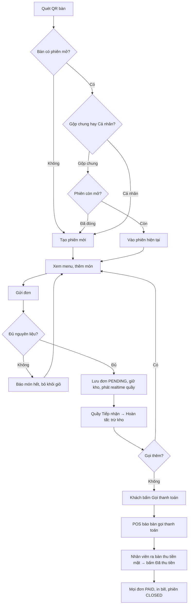
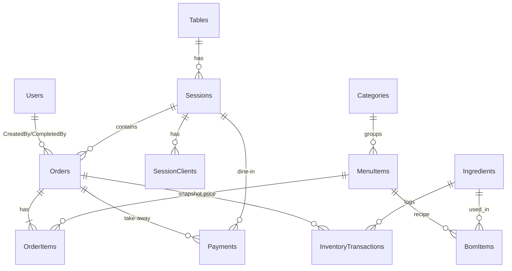

# Hướng dẫn triển khai Web-App Quán Cà Phê — Gọi món QR, Realtime, Trừ kho BOM

**Phiên bản:** 1.2 — ngày 14/10/2026
**Nguồn đầu vào:** `demo.docx` (bản nháp ý tưởng, user stories, user flow, phân rã module), `Hướng dẫn Dự án Web-APP.md` (phương pháp chuyển Word → docs → rules/skills → task) và **quyết định của chủ dự án ngày 13/10/2026** (xem "Thay đổi so với Word" bên dưới).
**Trạng thái tài liệu:** BẢN NHÁP — chờ nhóm chốt các câu hỏi ở mục 3 trước khi coi các phần liên quan là chính thức.

**Thay đổi so với demo.docx (quyết định của chủ dự án, 13/10/2026 — CONFIRMED):**

| # | Quyết định | Thay thế nội dung nào trong Word | Ảnh hưởng |
| --- | --- | --- | --- |
| D-1 | **Không tích hợp thanh toán quét mã (VietQR/PayOS/SePay/MoMo). Chỉ thu tiền mặt.** | US3 (VietQR), Module 2.1–2.2 (tạo QR, webhook), actor "Cổng thanh toán" | Bỏ FEATURE thanh toán online, webhook, bảng `WebhookLogs`; Q-003 đóng |
| D-2 | **Khách bấm "Gọi thanh toán" trên điện thoại** (màn hình sau khi đặt món). Quầy thấy ngay (realtime), nhân viên **ra bàn thu tiền mặt**, rồi bấm "Đã thu tiền" trên POS → in bill, đóng bàn | Thay cho luồng VietQR; làm rõ US4 (theo dõi đơn) | Thêm FEATURE-005 (gọi thanh toán) và FEATURE-006 (thu tiền tại bàn); phiên có trạng thái `PAYMENT_REQUESTED`; Q-004 đóng = **trả sau**; Q-009 đóng = phiên đóng khi thu tiền |
| D-3 | **Có mục riêng "Bán mang đi"** trên POS cho khách vãng lai, thu tiền mặt ngay tại quầy | Giữ US8 / Module 1.3, bỏ lựa chọn "chuyển khoản" | FEATURE-008 giữ, chỉ `CASH`; màn hình riêng S-13 |
| D-4 (14/10) | **Stack chốt: Front-end HTML/CSS/JavaScript thuần (không framework); Back-end Node.js; SQL Server; giao tiếp qua REST API** (+ Socket.io cho realtime) | Word ghi "Front-end Next.js, Back-end Node.js/C#" | DEC-003 đổi từ Next.js → HTML/CSS/JS thuần; Q-002 đóng = Node.js; realtime = Socket.io; bỏ phương án C# |

> Tất cả mục còn lại của Word giữ nguyên. Những chỗ trong tài liệu bị ảnh hưởng đều ghi "(D-1)", "(D-2)" hoặc "(D-3)".
**Người quyết định nghiệp vụ:** Nhóm đồ án (Tuyến – Front-end, Nhật Anh – Back-end/Database, Sáng – Testing). Chưa ghi ai là người chốt cuối; cần ghi rõ (xem Q-000).

---

## 0. Tài liệu này dùng thế nào

Tài liệu gom toàn bộ nội dung cần có để **bắt đầu triển khai** dự án trong 8 tuần, gồm hai phần:

| Phần | Mục | Dùng cho ai | Mục đích |
| --- | --- | --- | --- |
| A. Đặc tả hệ thống | 1 – 13 | Cả nhóm + AI agent | Biết hệ thống làm gì, luật nào phải đúng, thiết kế đã chọn hay mới đề xuất |
| B. Thiết lập cho AI agent | 14 – 17 | Người giao việc cho agent (Codex / Claude Code / Cursor) | `AGENTS.md`, rules, skills để agent đi đúng kiến trúc |
| C. Kế hoạch và cách giao việc | 18 – 21 | Cả nhóm | Task có thứ tự, kế hoạch 8 tuần, prompt copy-paste, checklist |

**Quy ước trạng thái** (dùng thống nhất trong mọi bảng):

- `CONFIRMED` — Word ghi rõ như yêu cầu/quyết định; nhóm có thể triển khai.
- `PROPOSED` — tài liệu này đề xuất (hoặc Word chỉ nói "ví dụ", "hoặc"); chưa có hiệu lực cho đến khi nhóm chốt.
- `NEEDS_CONFIRMATION` — Word mâu thuẫn hoặc có nhiều cách hiểu; phải có người quyết định.
- `UNKNOWN` — Word không nói; chưa có thông tin.
- `N/A` — không áp dụng, kèm lý do.

**Quy ước ID:** `REQ-` phạm vi/yêu cầu chung · `BR-` quy tắc nghiệp vụ · `DEC-` quyết định kỹ thuật · `NFR-` chất lượng/hiệu năng · `FEATURE-` chức năng · `AC-` tiêu chí nghiệm thu · `Q-` câu hỏi chưa chốt · `TASK-` công việc triển khai. ID không mang ý nghĩa ưu tiên.

**Cách dùng nhanh (5 bước):**

1. Cả nhóm đọc mục 1–3, **chốt các câu hỏi còn mở Q-001, Q-004b, Q-005, Q-006 trong tuần 1** (đây là những câu hỏi làm đảo thiết kế nếu để muộn; Q-002/Q-003/Q-004/Q-009 đã được chủ dự án chốt — xem D-1…D-4 ở đầu tài liệu).
2. Tạo repository theo mục 14; copy `AGENTS.md`, `.agent/rules.md`, skills từ mục 15–17 vào đúng vị trí công cụ nhận diện.
3. Tách mục 4–13 thành bộ `docs/` (bản đồ ở mục 14.2). Có thể giữ nguyên tài liệu này làm `docs/system-spec.md` ở giai đoạn đầu rồi tách dần.
4. Giao agent phân tích + tạo docs bằng prompt 19.1 và 19.2; nhóm review, sửa trạng thái `PROPOSED` → `CONFIRMED` khi đồng ý.
5. Giao từng `TASK-` theo thứ tự ở mục 18 bằng prompt 19.4; nghiệm thu theo AC và Definition of Done ở mục 13.

---

# PHẦN A — ĐẶC TẢ HỆ THỐNG

## 1. Tổng quan dự án

### 1.1. Vấn đề và mục tiêu (nguồn: demo.docx, mục I–II)

| Nội dung | Mô tả | Trạng thái |
| --- | --- | --- |
| Hệ thống | Web-App khép kín cho quán cà phê vừa và nhỏ: khách quét QR tại bàn để xem menu và gọi món trên trình duyệt điện thoại (không cài app); nhân viên quầy nhận đơn realtime, thu tiền, bấm hoàn tất, in hóa đơn; quản lý cấu hình menu/bàn/BOM, xem kho và báo cáo | CONFIRMED |
| Vấn đề phía khách | Chờ nhân viên ghi order giờ cao điểm; sai món do ghi tay | CONFIRMED |
| Vấn đề phía vận hành | Nghẽn thông tin giữa bàn khách và quầy pha chế | CONFIRMED |
| Vấn đề phía quản lý | Thất thoát nguyên liệu, khó kiểm soát định lượng; cần trừ kho tự động theo BOM | CONFIRMED |
| Mục tiêu dài hạn | Luồng Khách → Thu ngân → Pha chế liền mạch; dữ liệu toàn vẹn (không âm kho, không lệch doanh thu); đủ ổn định để chạy thử tại một quán thật | CONFIRMED |
| Sản phẩm bàn giao | 01 web-app chạy online (Front-end **HTML/CSS/JS thuần**, Back-end **Node.js**, **SQL Server**, REST API — D-4) + bộ tài liệu đồ án (đặc tả, UI/UX, sơ đồ CSDL) | CONFIRMED (D-4 thay "Next.js, Node.js/C#" trong Word) |

### 1.2. Phạm vi (nguồn: demo.docx, mục IV.3 và module 1–5)

| Nhóm | Nội dung |
| --- | --- |
| **Làm trong bản đầu (MVP)** | Luồng cốt lõi **Order QR → Realtime quầy → Hoàn tất & trừ kho → Gọi thanh toán → Thu tiền mặt tại bàn → In bill**, cụ thể: (1) quét QR định danh bàn, tách/gộp phiên; (2) xem menu, giỏ hàng, gửi đơn; (3) theo dõi trạng thái đơn realtime phía khách + nút **Gọi thanh toán** (D-2); (4) dashboard nhân viên: nhận đơn realtime, tiếp nhận, hoàn tất món, nhận yêu cầu thanh toán, **thu tiền mặt tại bàn**, in hóa đơn, đóng bàn; (5) **mục Bán mang đi** riêng, thu tiền mặt tại quầy (D-3); (6) admin: menu, bàn + QR, nguyên liệu, BOM, tài khoản nhân viên, báo cáo doanh thu |
| **Làm sau** | Thanh toán chuyển khoản/VietQR qua cổng (PayOS/SePay/MoMo) — D-1 đã bỏ khỏi MVP; cron job chốt ca / tổng hợp doanh thu cuối ngày; hệ thống lưu trữ & nén ảnh món; mở ngăn kéo tiền (xem Q-007) |
| **Không làm** | Quản lý nhân sự (chấm công, lương), CRM khách hàng, chuỗi nhiều chi nhánh — Word ghi "kiên quyết cắt giảm" |
| **Giới hạn tổ chức** | **Một quán, một cơ sở, một kho nguyên liệu**. Không có khái niệm chi nhánh, không có dữ liệu riêng từng tổ chức |

> Agent không được tự thêm chọn chi nhánh, nhiều kho, tích điểm/CRM, chấm công dù "tiện tay" làm được.

### 1.3. Nguồn lực và thời gian (nguồn: demo.docx, mục IV)

| Hạng mục | Nội dung | Trạng thái |
| --- | --- | --- |
| Nhóm | Tuyến – Front-end; Nhật Anh – Back-end/Database; Sáng – Testing | CONFIRMED |
| Thời gian | 8 tuần; **tối thiểu 2 tuần cuối dành cho kiểm thử** (đặc biệt kịch bản ép tải/tranh chấp kho) | CONFIRMED |
| Chi phí | Dùng hosting/API miễn phí cho mục đích học tập | CONFIRMED (nhà cung cấp cụ thể: UNKNOWN) |
| Công cụ AI | Đã có skill `do-an-cafe-reviewer` hỗ trợ rà soát mã nguồn | CONFIRMED (nội dung skill chưa được đọc trong tài liệu này — cần đối chiếu khi tạo skill ở mục 17) |

### 1.4. Chỉ tiêu định lượng đã nêu trong Word

| ID | Chỉ tiêu | Cách kiểm chứng đề xuất | Trạng thái |
| --- | --- | --- | --- |
| NFR-001 | Đồng bộ trạng thái đơn giữa các thiết bị **< 2 giây** (từ lúc khách bấm gửi đến khi quầy thấy) | Đo timestamp client gửi → timestamp quầy nhận sự kiện realtime, trên mạng Wi-Fi quán, lặp ≥ 30 lần, lấy p95 | CONFIRMED (chỉ tiêu) / PROPOSED (cách đo) |
| NFR-002 | **100 %** kịch bản ép tải tranh chấp tồn kho pass: nhiều bàn order cùng lúc, kho không bao giờ âm, tổng trừ = tổng BOM của các đơn thành công | Script bắn N request đồng thời (k6/Artillery/script Node) vào API hoàn tất/đặt món với kho chỉ đủ M suất; assert: đúng M thành công, N–M bị từ chối, `StockQty ≥ 0`, tổng `InventoryTransactions` khớp | CONFIRMED (chỉ tiêu) / PROPOSED (cách đo) |
| NFR-003 | Khách order trong **≤ 3 thao tác** sau khi quét QR | Đếm số tap trên luồng chuẩn: chọn món → giỏ → gửi | CONFIRMED (chỉ tiêu, cần định nghĩa "thao tác") |
| NFR-004 | Giao diện khách mobile-first, "siêu nhẹ" | Chưa có số cụ thể; đề xuất: trang menu load được trên 4G trong < 3 s, bundle trang khách < 300 KB gzip | UNKNOWN (số) / PROPOSED (ngưỡng) |

> Theo phương pháp: agent **không** tự thêm cam kết hiệu năng/quy mô khác (ví dụ "chịu 10.000 user") nếu nhóm chưa quyết định.

---

## 2. Bảng yêu cầu đã trích xuất (có nguồn và trạng thái)

### 2.1. Phạm vi và chức năng (REQ)

| ID | Nội dung | Nguồn trong Word | Trạng thái |
| --- | --- | --- | --- |
| REQ-001 | Một quán, một cơ sở, một kho; không multi-branch | IV.3 "Chiến lược ứng phó" | CONFIRMED |
| REQ-002 | Khách **không cần tài khoản**; định danh bằng QR bàn | Actor 1.1 | CONFIRMED |
| REQ-003 | Nhân viên quầy là **một vai trò gộp** Thu ngân + Pha chế, có tài khoản đăng nhập | Actor 1.2 "(Gộp Thu ngân & Pha chế)" | CONFIRMED (bản mới của Word thay bản cũ có "màn hình Bếp/KDS" riêng) |
| REQ-004 | Quản lý (Admin) là quyền cao nhất: menu, bàn/QR, BOM, kho, báo cáo, cấp tài khoản | Actor 1.3 | CONFIRMED |
| REQ-005 | Khi quét QR bàn đang có phiên chưa thanh toán: cho chọn **Gộp chung nhóm** hoặc **Tạo đơn cá nhân** (phiên song song trên cùng bàn) | US1, User flow bước 2–3, Module 1.1 | CONFIRMED |
| REQ-006 | Khách xem menu, thêm món, tùy chỉnh ghi chú (ít đường/nhiều đá), gửi đơn | US2, Module 1.2 | CONFIRMED |
| REQ-007 | ~~Thanh toán VietQR động qua cổng PayOS/SePay + webhook~~ → **Chỉ thu tiền mặt; không tích hợp cổng thanh toán** | US3, Module 2.1–2.2 → thay bởi D-1 | CONFIRMED (D-1) — phần VietQR xếp "làm sau" |
| REQ-023 | Trên màn hình theo dõi đơn, khách bấm **"Gọi thanh toán"** → quầy nhận thông báo realtime kèm số bàn và tổng tiền → nhân viên ra bàn thu tiền mặt → bấm "Đã thu tiền" trên POS → in bill, đóng phiên | D-2 | CONFIRMED |
| REQ-024 | Thu tiền theo **phiên** (toàn bộ đơn của nhóm trong phiên, một hóa đơn); phiên cá nhân trên cùng bàn thu riêng | D-2 + US1 (tách/gộp bill) | CONFIRMED (suy trực tiếp từ mục đích tách/gộp bill) |
| REQ-008 | Khách theo dõi trạng thái đơn realtime trên điện thoại | US4 | CONFIRMED |
| REQ-009 | Quầy nhận đơn mới realtime: âm thanh + thẻ đơn nảy lên, không reload | US5 (bản 1) / US4 (bản 2) | CONFIRMED |
| REQ-010 | Quầy bấm **Hoàn tất** → đơn sang "Đã phục vụ", kích hoạt trừ kho theo BOM (Stored Procedure/Transaction) | US6, Actor 1.2, Module 3.2 + 4.2 | CONFIRMED (thời điểm trừ/giữ kho: Q-001) |
| REQ-011 | In hóa đơn từ trình duyệt ra máy in nhiệt 58/80 mm bằng `window.print()` + CSS ẩn UI | US7, Module 2.3, Actor 7 | CONFIRMED |
| REQ-012 | Quầy có **mục riêng "Bán mang đi"**: tạo đơn thủ công cho khách vãng lai, thu tiền mặt ngay tại quầy → đơn đã thanh toán, in bill, đẩy vào luồng pha chế | US8, Module 1.3, D-3 | CONFIRMED (bỏ lựa chọn "chuyển khoản" theo D-1) |
| REQ-013 | Admin thiết lập BOM cho từng món (nguyên liệu + định lượng > 0) | US9, Module 4.1 | CONFIRMED |
| REQ-014 | Admin xem báo cáo doanh thu theo khoảng ngày: tổng doanh thu, số hóa đơn, món bán chạy, cảnh báo nguyên liệu sắp hết | US11 (bản 1) / US9 (bản 2), Module 5.1 | CONFIRMED |
| REQ-015 | Admin CRUD tài khoản nhân viên: tạo, khóa, phân quyền; username duy nhất; mật khẩu băm | US8 (bản 2), Module 5.2 | CONFIRMED |
| REQ-016 | Admin quản lý menu (món, giá, ảnh, hết hàng) và danh sách bàn (sinh QR) | Actor 1.3, Module 5 | CONFIRMED (chi tiết trường: PROPOSED ở FEATURE-010) |
| REQ-017 | Quầy mất mạng → hiện icon "Mất kết nối"; có mạng lại → tự kéo đơn bị nhỡ, cảnh báo "Có đơn hàng bị trễ" | US4 AC2 (bản 2) | CONFIRMED |
| REQ-018 | Hai nhân viên cùng bấm Hoàn tất một đơn → máy sau bị chặn "Đơn hàng này đã được nhân viên khác xử lý"; không trừ kho 2 lần | US5 AC2 (bản 2) | CONFIRMED |
| REQ-019 | ~~Sau 5 phút chưa nhận webhook khớp → báo khách đối soát~~ | US3 AC2 (bản 2) | N/A — không còn thanh toán online (D-1). Thay bằng: khách đã bấm Gọi thanh toán mà sau 5 phút chưa được thu tiền → màn hình khách hiện "Nhân viên đang bận, vui lòng đợi hoặc ra quầy" và nút "Gọi lại" (PROPOSED) |
| REQ-020 | Cron job: chốt ca, tổng hợp doanh thu cuối ngày, dọn giỏ hàng rác | Actor phụ 8 | PROPOSED — không có user story; xếp "làm sau" |
| REQ-021 | Lưu trữ/nén/phân phối ảnh món | Actor phụ 9 | PROPOSED — bản đầu có thể dùng ảnh tĩnh/URL; xếp "làm sau" |
| REQ-022 | Mở ngăn kéo tiền | III.1 "Module Ngoại vi" | NEEDS_CONFIRMATION — Q-007 |

### 2.2. Quy tắc nghiệp vụ (BR) — chi tiết ở mục 7

| ID | Tóm tắt | Nguồn | Trạng thái |
| --- | --- | --- | --- |
| BR-001 | Tồn kho nguyên liệu **không bao giờ âm**; thiếu nguyên liệu → giao dịch rollback và báo "hết nguyên liệu" | US10, Module 4.2, Actor phụ 2 | CONFIRMED |
| BR-002 | Một đơn chỉ được trừ kho **đúng một lần** | US5 AC2 (bản 2) | CONFIRMED |
| BR-003 | Định lượng BOM phải > 0; nguyên liệu bắt buộc không được trống | US9/US7 AC2 | CONFIRMED |
| BR-004 | Username nhân viên duy nhất | US8 AC2 (bản 2) | CONFIRMED |
| BR-005 | Khoảng ngày báo cáo hợp lệ: ngày bắt đầu ≤ ngày kết thúc, không ở tương lai | US9 AC2 (bản 2) | CONFIRMED |
| BR-006 | Đơn mang đi được chốt = đã thu tiền mặt; nhân viên phải xác nhận "Đã nhận tiền" (và có thể nhập tiền khách đưa để tính tiền thừa) trước khi chốt | US6 AC2 (bản 2), D-3 | CONFIRMED (nhập tiền khách đưa: PROPOSED) |
| BR-007 | Thanh toán chỉ được ghi nhận khi **nhân viên đăng nhập** bấm "Đã thu tiền" trên POS; khách không tự đánh dấu đã trả | D-1, D-2 | CONFIRMED |
| BR-008 | Gộp phiên chỉ được khi phiên đó **còn mở (chưa thanh toán)**; nếu vừa đóng → tự chuyển sang tạo phiên mới và báo khách | US1 AC2 (bản 2) | CONFIRMED |
| BR-009 | Khi gửi đơn, nếu một món đã hết nguyên liệu → **từ chối cả đơn**, báo tên món, cập nhật trạng thái hết hàng trên menu, cho khách sửa giỏ | US2 AC2, User flow bước 5 | CONFIRMED (cách hiểu "từ chối cả đơn" vs "bỏ món đó": Q-005) |
| BR-010 | Thời điểm giữ/trừ kho (khi gửi đơn hay khi hoàn tất) | Mâu thuẫn giữa User flow bước 5–6 và US6/Module 4.2 | NEEDS_CONFIRMATION — Q-001 |

### 2.3. Quyết định kỹ thuật (DEC)

| ID | Nội dung | Nguồn | Trạng thái |
| --- | --- | --- | --- |
| DEC-001 | Database: **SQL Server** | III.1, IV.1 | CONFIRMED (bắt buộc) |
| DEC-002 | Logic trừ kho đặt trong **Transaction + Stored Procedure** ở SQL Server, dùng row-lock | III.1, IV.1, US10 | CONFIRMED |
| DEC-003 | Front-end: **HTML/CSS/JavaScript thuần** (không Next.js/React) | III.2 → thay bởi D-4 | CONFIRMED (D-4) |
| DEC-004 | Back-end: **Node.js** (Express — PROPOSED) + REST API | III.2, D-4 | CONFIRMED (Node) / PROPOSED (Express) |
| DEC-005 | Realtime: **Socket.io** | III.1, D-4 | CONFIRMED (hệ quả của Node) |
| DEC-006 | ~~Cổng thanh toán VietQR: PayOS hoặc SePay~~ | IV.1, Actor phụ 1 | N/A — D-1 bỏ tích hợp cổng; thiết kế để thêm sau không phá schema (`PaymentMethod` mở rộng được) |
| DEC-007 | In hóa đơn qua `window.print()` + CSS `@media print`, khổ 58/80 mm | Actor phụ 7, Module 2.3 | CONFIRMED |
| DEC-008 | QR bàn tự sinh bằng thư viện (không cần dịch vụ ngoài) | IV.1 | CONFIRMED |
| DEC-009 | Mật khẩu băm (bcrypt/argon2) | Module 5.2 | CONFIRMED (thuật toán cụ thể: PROPOSED) |
| DEC-010 | Deploy online trên "server thực"/Internet, ưu tiên dịch vụ miễn phí | III.2, IV.2 | CONFIRMED (nhà cung cấp: UNKNOWN — Q-008) |
| DEC-011 | Kiến trúc backend phân tầng (xem mục 9) | — | PROPOSED |

---

## 3. Câu hỏi chưa chốt (Open Questions)

Các câu hỏi dưới đây **chặn** phần triển khai được ghi trong cột "Chặn". Nhóm nên chốt Q-001 → Q-006 ngay tuần 1. Agent gặp câu hỏi mới phải thêm vào `docs/open-questions.md` theo cùng mẫu, **không tự chọn ngầm** một cách hiểu.

### Q-000 — Ai là người chốt nghiệp vụ và kỹ thuật?

- **Điều đã biết:** Nhóm 3 người, phân vai FE/BE/Test.
- **Điều chưa biết:** Khi Word mâu thuẫn, ai quyết? Khi stack chưa chốt, ai quyết?
- **Đề xuất:** Nghiệp vụ → cả nhóm biểu quyết, ghi vào `docs/decisions/`; kỹ thuật backend/DB → Nhật Anh; FE → Tuyến; test/DoD → Sáng.
- **Chặn:** Không chặn code, nhưng chặn việc đổi trạng thái PROPOSED → CONFIRMED.

### Q-001 — Kho được **giữ** lúc gửi đơn hay chỉ **trừ** lúc hoàn tất? (quan trọng nhất)

- **Nguồn:** User flow bước 5–6 ("Database gọi Transaction kiểm tra nguyên liệu… Lưu đơn hàng, **khóa nguyên liệu**"); US2 AC2 ("món vừa hết nguyên liệu" lúc gửi đơn); US10 ("hệ thống tự động **từ chối đơn đặt món** nếu kho không đủ"). Ngược lại: US6, Actor 1.2, Module 3.2/4.2 ("bấm Hoàn tất… kích hoạt Stored Procedure **trừ** kho").
- **Điều chưa biết:** Giữa lúc gửi đơn và lúc hoàn tất, nguyên liệu có được "giữ chỗ" cho đơn đó không?
- **Ba phương án:**

| Phương án | Cách hoạt động | Ưu | Nhược |
| --- | --- | --- | --- |
| **A. Giữ khi gửi, trừ khi hoàn tất** (2 pha) | Gửi đơn: SP kiểm `StockQty − ReservedQty ≥ cần` rồi tăng `ReservedQty`. Hoàn tất: SP giảm cả `ReservedQty` và `StockQty`. Hủy đơn: trả `ReservedQty` | Khớp **cả hai** đoạn Word; khách bị từ chối ngay lúc gửi (không chờ xong mới biết hết); kho không âm | Thêm cột `ReservedQty`, thêm logic hủy/hết hạn đơn; 2 SP |
| **B. Chỉ kiểm khi gửi, trừ khi hoàn tất** | Gửi đơn: kiểm tồn kho tức thời (không giữ). Hoàn tất: SP trừ; nếu thiếu → rollback | Đơn giản | Hai đơn cùng qua kiểm tra → một đơn **thất bại lúc hoàn tất** sau khi khách đã chờ và có thể đã trả tiền; không đáp ứng US10 ("từ chối đơn đặt món") |
| **C. Trừ ngay khi gửi** | Gửi đơn: SP trừ kho luôn. Hoàn tất: chỉ đổi trạng thái | Đơn giản nhất, một SP | Trái với US6/Module 4.2 (trừ khi hoàn tất); đơn không thanh toán/hủy phải cộng lại kho |

- **Đề xuất (PROPOSED):** Phương án **A**. Nếu nhóm chọn A, thiết kế ở mục 10–11 áp dụng nguyên văn; nếu chọn B/C, bỏ cột `ReservedQty` và sửa `sp_SubmitOrder`.
- **Chặn:** FEATURE-003 (gửi đơn), FEATURE-007 (hoàn tất), data model `Ingredients`, SP, test ép tải NFR-002.

### Q-002 — Backend dùng Node.js hay C#? — **ĐÃ CHỐT (D-4): Node.js**

- **Quyết định 14/10/2026:** Backend Node.js, REST API, SQL Server; frontend HTML/CSS/JS thuần; realtime Socket.io.
- **Còn PROPOSED:** framework HTTP — tài liệu này đề xuất **Express** (đơn giản, hợp với FE thuần và nhóm sinh viên); NestJS nếu nhóm muốn DI/guard sẵn. Driver SQL Server: gói `mssql` (gọi SP, TVP). Chi tiết ở mục 10.
- **Chặn:** không còn.

### Q-003 — Cổng thanh toán: PayOS hay SePay? MoMo có trong phạm vi không? — **ĐÃ CHỐT (D-1)**

- **Quyết định 13/10/2026:** Không tích hợp cổng thanh toán nào trong MVP; chỉ thu tiền mặt. VietQR/MoMo xếp "làm sau".
- **Hệ quả:** Bỏ FEATURE thanh toán online và webhook; không cần sandbox, API key, URL webhook công khai. Khi làm sau chỉ cần thêm giá trị `TRANSFER` cho `PaymentMethod` và một module `payments/gateway`.

### Q-004 — Đơn vào hàng pha chế **ngay khi gửi** hay **sau khi thanh toán**? — **ĐÃ CHỐT (D-2): trả sau**

- **Quyết định 13/10/2026:** Khách gọi món → quầy làm ngay → khách dùng xong bấm "Gọi thanh toán" → nhân viên ra bàn thu tiền mặt. Không có bước thanh toán trước khi pha.
- **Còn một chi tiết nhỏ cần chốt (Q-004b, PROPOSED):** Đơn mới có cần quầy bấm **"Tiếp nhận"** (Chờ xác nhận → Đang chuẩn bị) hay tự chuyển sang Đang chuẩn bị ngay khi gửi? Word có trạng thái "Chờ xác nhận" nên tài liệu này **đề xuất có nút Tiếp nhận** — giúp quầy từ chối/hủy đơn lạ trước khi pha và khách biết quầy đã thấy đơn. Nếu nhóm muốn ít thao tác hơn: bỏ nút, đơn vào `PREPARING` ngay; máy trạng thái bỏ `PENDING`.
- **Chặn:** Chỉ Q-004b chặn nhãn/nút trên dashboard; không chặn gì khác.

### Q-005 — Hết nguyên liệu lúc gửi đơn: từ chối **cả đơn** hay **chỉ loại món đó**?

- **Nguồn:** US2 AC2: "từ chối lưu đơn, báo lỗi 'Trà đào vừa hết'… tự cập nhật hết hàng trên menu"; sơ đồ Mermaid: "Báo lỗi & **Xóa món khỏi giỏ**" rồi quay lại menu.
- **Đề xuất:** Từ chối cả đơn (không lưu gì), trả về danh sách món thiếu; **client** tự bỏ món đó khỏi giỏ và hiện thông báo. Kết quả nhìn từ khách giống sơ đồ, nhưng server đơn giản và không tạo đơn "một nửa".
- **Chặn:** FEATURE-003 AC-03.

### Q-006 — Hoàn tất theo **đơn** hay theo **từng món**?

- **Nguồn:** US6/US5: "bấm Hoàn tất món" trên **đơn hàng** của Bàn 05; Module 3.2 input là "OrderID, **ItemID**".
- **Đề xuất (PROPOSED):** Bản đầu hoàn tất theo **đơn** (một nút, một SP, một lần trừ kho) — đơn giản và khớp AC về chống trừ kho 2 lần. Hoàn tất từng món xếp "làm sau".
- **Chặn:** FEATURE-007, bảng `OrderItems.Status`.

### Q-007 — Mở ngăn kéo tiền có trong MVP không?

- **Nguồn:** III.1 ghi "kết nối mở ngăn kéo đựng tiền".
- **Thực tế kỹ thuật:** `window.print()` **không** gửi được lệnh ESC/POS mở ngăn kéo. Cần một trong: máy in nhiệt có cấu hình "kick drawer khi in" ở driver; hoặc app cầu nối chạy trên máy POS (ví dụ QZ Tray) nhận lệnh từ web. Cả hai đều ngoài "in từ trình duyệt" thuần.
- **Đề xuất:** Xếp **làm sau**; bản đầu chỉ in bill. Nếu máy in của quán thử nghiệm hỗ trợ kick-drawer ở driver thì ghi vào `operations/`.
- **Chặn:** Không chặn gì nếu chọn "làm sau".

### Q-008 — Hosting cụ thể?

- **Điều chưa biết:** Tiến trình Node (API + FE tĩnh, D-4) deploy đâu, SQL Server chạy đâu (Azure SQL free tier / VPS Docker / máy trong quán?). Vì không còn webhook (D-1), hệ thống **có thể chạy hoàn toàn trong mạng LAN của quán** (một máy tính chạy API + SQL Server, điện thoại khách truy cập qua Wi-Fi quán) — đơn giản và không phụ thuộc Internet; nhưng Word yêu cầu "deploy chạy online" nên vẫn cần một bản trên Internet để bảo vệ đồ án.
- **Chặn:** TASK-018 (deploy staging). Không còn chặn gì về webhook.

### Q-009 — Phiên (Session) đóng khi nào? — **ĐÃ CHỐT (D-2)**

- **Quyết định:** Phiên có nhiều đơn (khách gọi thêm nhiều lần). Phiên đóng **khi nhân viên bấm "Đã thu tiền"** cho phiên đó (sau khi khách Gọi thanh toán hoặc nhân viên chủ động thu). Phiên A và B trên cùng bàn thu tiền và đóng độc lập (US1 tách bill).
- **Chi tiết còn PROPOSED:** quầy cũng có thể thu tiền một phiên **chưa** bấm Gọi thanh toán (khách ra quầy trả trực tiếp); thu tiền yêu cầu phiên không còn đơn `PENDING` chưa tiếp nhận (phải tiếp nhận hoặc hủy trước).

### Q-010 — Hủy đơn

- **Điều chưa biết:** Khách có được hủy đơn sau khi gửi không? Quầy có được hủy không? Đơn chưa thanh toán sau X phút có tự hủy không (liên quan REQ-019 và dọn "giỏ hàng rác")?
- **Đề xuất (PROPOSED):** Bản đầu: chỉ **quầy** hủy được đơn `PENDING` (chưa pha); hủy trả lại `ReservedQty` nếu dùng phương án A; khách không tự hủy. Tự hủy theo thời gian xếp "làm sau" cùng cron job.
- **Chặn:** Trạng thái `CANCELLED` trong máy trạng thái; nút hủy trên dashboard.

### Q-011 — Số liệu kho ban đầu nhập ở đâu? Có nhập kho (import) không?

- **Điều chưa biết:** Word chỉ nói "kiểm tra tồn kho" và trừ kho. Không nói nhập kho/điều chỉnh.
- **Đề xuất:** Bản đầu có màn hình admin **điều chỉnh tồn kho thủ công** (nhập số mới + lý do) ghi `InventoryTransactions` loại `ADJUST`. Phiếu nhập kho đầy đủ xếp "làm sau".
- **Chặn:** FEATURE-011 (kho).


---

## 4. Người dùng và quyền (roles-permissions)

### 4.1. Tác nhân chính

| Actor | Định danh | Hành động được phép | Phạm vi dữ liệu | Điều kiện | Trạng thái |
| --- | --- | --- | --- | --- | --- |
| **Khách (CUSTOMER)** | Không đăng nhập; nhận **session token** (cookie/localStorage) khi quét QR | Quét QR, chọn gộp/tách phiên, xem menu, gửi đơn (nhiều lần), theo dõi đơn, **bấm Gọi thanh toán** (D-2) | Chỉ phiên mình đang tham gia và các đơn trong phiên đó | Token hợp lệ, phiên còn mở | CONFIRMED |
| **Nhân viên quầy (STAFF)** | Đăng nhập username/password | Xem **tất cả** đơn/phiên đang xử lý; tiếp nhận đơn (Q-004b); hoàn tất đơn; nhận yêu cầu thanh toán; **thu tiền mặt tại bàn & đóng phiên**; in bill; **bán mang đi** (D-3); hủy đơn PENDING (Q-010) | Toàn bộ đơn/phiên của quán | Tài khoản `IsActive = true` | CONFIRMED (hủy: PROPOSED) |
| **Quản lý (ADMIN)** | Đăng nhập | Mọi quyền của STAFF **+** CRUD menu/danh mục, bàn + QR, nguyên liệu, BOM, điều chỉnh kho, tài khoản nhân viên, báo cáo | Toàn bộ | Tài khoản `IsActive = true`, role ADMIN | CONFIRMED (ADMIN kế thừa STAFF: PROPOSED — Word không nói rõ, nhưng hợp lý cho quán nhỏ) |

### 4.2. Tác nhân hệ thống (secondary)

| Actor | Vai trò | Ghi chú |
| --- | --- | --- |
| ~~Cổng thanh toán VietQR~~ | — | Bỏ theo D-1; làm sau |
| SQL Server | Thực thi SP trừ kho trong transaction; rollback khi thiếu | Nơi giữ invariant BR-001/BR-002 |
| Realtime hub (Socket.io) | Phát sự kiện đến đúng nhóm client (quầy / phiên khách) | Không phải nguồn sự thật; client phải fetch lại khi reconnect |
| Máy in nhiệt | Nhận lệnh in từ trình duyệt máy POS | Khổ 58/80 mm |
| Cron job | Chốt ca, tổng hợp ngày, dọn giỏ rác | Làm sau (REQ-020) |
| Storage ảnh | Lưu/nén ảnh món | Làm sau (REQ-021) |

### 4.3. Câu hỏi quyền đã trả lời / chưa trả lời

| Câu hỏi | Trả lời | Trạng thái |
| --- | --- | --- |
| Khách có tự đăng ký tài khoản không? | Không. Khách không có tài khoản | CONFIRMED |
| Ai cấp tài khoản STAFF? | ADMIN | CONFIRMED |
| Tài khoản ADMIN đầu tiên tạo thế nào? | Seed khi khởi tạo DB (username/password đặt qua biến môi trường) | PROPOSED |
| Một người có nhiều vai trò không? | Không; mỗi tài khoản một role (STAFF/ADMIN) | PROPOSED |
| Khách A có xem được đơn của khách B không? | Chỉ khi cùng phiên (đã chọn "Gộp chung"). Phiên cá nhân trên cùng bàn **không** thấy nhau | CONFIRMED (suy trực tiếp từ US1) |
| Nhiều nhân viên dùng chung một tài khoản trên nhiều máy? | Word giả định có thể xảy ra (US5 AC2 bản 2) → hệ thống phải an toàn trong trường hợp đó, nhưng không khuyến khích | CONFIRMED |
| STAFF có sửa menu/kho không? | Không | PROPOSED |

> **Nguyên tắc bắt buộc:** Quyền được kiểm ở **server** cho mọi endpoint; ẩn/disable nút trên UI chỉ là trải nghiệm. Khách gọi thẳng API hoàn tất đơn phải bị từ chối 401/403.

---

## 5. Thuật ngữ (glossary)

| Thuật ngữ | Tên trong code | Định nghĩa |
| --- | --- | --- |
| Bàn | `Table` | Vị trí vật lý trong quán, có mã bàn và một mã QR cố định |
| Mã QR bàn | `QrToken` | Chuỗi ngẫu nhiên gắn với bàn, nhúng trong URL QR (`/t/{qrToken}`); **không** dùng `TableId` số đếm được trong URL để tránh đoán bàn |
| Phiên | `Session` | Một "lượt ngồi" trên một bàn, gom các đơn của một nhóm khách để tính tiền chung. Một bàn có thể có **nhiều phiên mở song song** (khách chọn "Cá nhân") |
| Gộp phiên | `JoinSession` | Khách mới vào cùng phiên đang mở, thấy chung giỏ/đơn |
| Token khách | `ClientToken` | Định danh trình duyệt khách (ngẫu nhiên, lưu cookie); gắn vào phiên |
| Đơn hàng | `Order` | Một lần gửi món; thuộc một phiên (dine-in) hoặc không thuộc phiên (take-away) |
| Dòng đơn | `OrderItem` | Món + số lượng + đơn giá tại thời điểm đặt + ghi chú |
| Món | `MenuItem` | Sản phẩm bán; có giá, ảnh, danh mục, cờ `IsAvailable` (còn bán) |
| Nguyên liệu | `Ingredient` | Vật tư trong kho: tên, đơn vị (ml, g, cái…), tồn kho |
| BOM / Định lượng | `BomItem` | Công thức: món X cần Y đơn vị nguyên liệu Z cho **một** suất |
| Tồn kho | `StockQty` | Số lượng nguyên liệu thực có |
| Giữ chỗ | `ReservedQty` | Số lượng đã được đơn `PENDING/PREPARING` giữ nhưng chưa trừ (chỉ có nếu chọn Q-001 = A) |
| Khả dụng | `Available` | `StockQty − ReservedQty` |
| Giao dịch kho | `InventoryTransaction` | Nhật ký mọi thay đổi tồn kho (trừ do đơn, điều chỉnh tay) |
| Thanh toán | `Payment` | Một lần thu tiền mặt do nhân viên ghi nhận: cho **cả phiên** (dine-in) hoặc cho **một đơn** (mang đi) |
| Gọi thanh toán | `RequestPayment` | Khách bấm trên điện thoại để báo quầy ra thu tiền; phiên chuyển `PAYMENT_REQUESTED` |
| Thu tiền / Đóng bàn | `SettleSession` | Nhân viên bấm "Đã thu tiền" trên POS: mọi đơn trong phiên → PAID, in bill, phiên → CLOSED |
| Tiếp nhận | `Accept` | Quầy xác nhận đã thấy đơn: `PENDING → PREPARING` (Q-004b) |
| Hoàn tất | `Complete` | Quầy xác nhận món đã làm xong/đã phục vụ; **thời điểm trừ kho** |
| Bán mang đi / Take-away | `TAKE_AWAY` | Đơn do quầy tạo ở mục riêng cho khách mang đi, không gắn bàn, thu tiền mặt ngay |
| Dashboard quầy / POS | — | Màn hình nhân viên trên máy tính/tablet tại quầy |

---

## 6. Quy trình và trạng thái

### 6.1. Luồng đầu-cuối (dine-in) — theo D-1/D-2

```
Khách quét QR bàn
  → [bàn trống] tạo phiên mới  |  [bàn có phiên mở] chọn Gộp chung / Cá nhân
  → xem menu, thêm món, ghi chú
  → Gửi đơn ──► server kiểm kho (BR-001/BR-009) ──► từ chối: báo món hết, về menu
                                                └──► OK: lưu đơn PENDING, giữ kho (nếu A), phát realtime cho quầy
  → Quầy: thẻ đơn nảy lên + "Ting" → bấm Tiếp nhận (PREPARING) → pha chế
  → Quầy bấm "Hoàn tất" ──► SP: COMPLETED + trừ kho (một lần) ──► realtime cho khách "Đã xong, nhận tại quầy"
  → (Khách có thể gọi thêm: lặp lại gửi đơn trong cùng phiên)
  → Khách bấm "GỌI THANH TOÁN" ──► phiên PAYMENT_REQUESTED ──► realtime: POS hiện "Bàn 05 gọi thanh toán · 125.000đ" + âm thanh
  → Nhân viên ra bàn thu tiền mặt → trên POS bấm "Đã thu tiền" (nhập tiền khách đưa, tiền thừa)
       ──► SP: mọi đơn trong phiên → PAID, Payments(CASH), phiên CLOSED ──► in bill ──► khách thấy "Cảm ơn, đã thanh toán"
```

Sơ đồ Mermaid (từ Word, chuẩn hóa tên trạng thái và thay nhánh VietQR bằng gọi thanh toán):



Luồng **bán mang đi** (D-3): Nhân viên mở mục "Bán mang đi" → chọn món → nhập tiền khách đưa → bấm "Thu tiền & In bill" → SP tạo đơn `TAKE_AWAY` đã `PAID` + giữ kho → in bill → thẻ đơn vào cột Đang pha → Hoàn tất → trừ kho.

### 6.2. Máy trạng thái đơn hàng (`Orders.Status`) — PROPOSED (Q-004b: có bước Tiếp nhận)

| Trạng thái | Nhãn hiển thị cho khách | Vào khi | Ra khi |
| --- | --- | --- | --- |
| `PENDING` | Chờ xác nhận | Gửi đơn thành công (đã qua kiểm kho) | → `PREPARING` khi quầy Tiếp nhận; → `CANCELLED` khi quầy hủy |
| `PREPARING` | Đang chuẩn bị | Quầy bấm Tiếp nhận (hoặc ngay khi tạo đơn mang đi) | → `COMPLETED` khi quầy hoàn tất |
| `COMPLETED` | Đã xong, vui lòng nhận tại quầy | SP hoàn tất commit (đã trừ kho) | Kết thúc |
| `CANCELLED` | Đã hủy | Quầy hủy đơn `PENDING` (Q-010) | Kết thúc; trả `ReservedQty` |

| Trạng thái hiện tại | Hành động | Người thực hiện | Trạng thái sau | Điều kiện / Hệ quả |
| --- | --- | --- | --- | --- |
| — | Gửi đơn | Khách | `PENDING` | Kiểm kho; giữ kho (A); phát `order.created` |
| — | Tạo đơn mang đi | Quầy | `PREPARING` + `PAID` | Kiểm kho; giữ kho; `Payments(CASH)`; phát `order.created` |
| `PENDING` | Tiếp nhận | Quầy | `PREPARING` | Phát `order.status_changed` |
| `PENDING` | Hủy | Quầy | `CANCELLED` | Trả giữ kho; phát `order.cancelled` |
| `PREPARING` | Hoàn tất | Quầy | `COMPLETED` | **Atomic**: `UPDATE … WHERE Status='PREPARING'` + trừ kho trong cùng transaction; lần bấm thứ hai → 409 |
| `PREPARING` | Hủy | — | — | **Không cho phép** trong bản đầu (đang làm) — PROPOSED |
| bất kỳ (≠ CANCELLED) | Thu tiền phiên | Quầy | giữ nguyên `Status`; `PaymentStatus → PAID` | Chỉ qua `sp_SettleSession`; phiên không còn đơn `PENDING` |

> Nếu nhóm chọn Q-004b = "không có Tiếp nhận": đơn dine-in vào thẳng `PREPARING`; bỏ hàng "Tiếp nhận"; hủy áp dụng cho `PREPARING` chưa hoàn tất (PROPOSED).

### 6.3. Trạng thái thanh toán (`Orders.PaymentStatus`) và bản ghi `Payments`

| `Orders.PaymentStatus` | Ý nghĩa |
| --- | --- |
| `UNPAID` | Chưa thu tiền |
| `PAID` | Nhân viên đã ghi nhận thu tiền mặt (qua thu tiền phiên hoặc tạo đơn mang đi) |

`Payments` chỉ có `Method = 'CASH'` trong MVP và luôn gắn với **một phiên** (dine-in, có thể gồm nhiều đơn) **hoặc một đơn** (mang đi). Lưu `AmountDue`, `AmountReceived`, `ChangeGiven`, `ReceivedBy`, `PaidAt` để in bill và đối soát ca. Không có trạng thái PENDING/EXPIRED vì không còn chờ cổng.

### 6.4. Trạng thái phiên (`Sessions.Status`) — theo D-2

| Trạng thái | Nhãn trên POS | Vào khi | Ra khi |
| --- | --- | --- | --- |
| `OPEN` | Đang phục vụ | Khách quét QR tạo phiên | → `PAYMENT_REQUESTED` khi khách bấm Gọi thanh toán; → `CLOSED` khi quầy thu tiền trực tiếp |
| `PAYMENT_REQUESTED` | **Gọi thanh toán** (nổi bật, kèm thời gian chờ) | Khách bấm Gọi thanh toán | → `CLOSED` khi quầy bấm Đã thu tiền; → `OPEN` nếu khách gọi thêm món (PROPOSED: tự quay lại OPEN và báo quầy) |
| `CLOSED` | Đã thanh toán | `sp_SettleSession` commit | Kết thúc; khách quét QR sau đó sẽ tạo phiên mới (BR-008) |

Phiên `OPEN` không có đơn nào sau 2 giờ (khách quét rồi bỏ đi) → quầy có thể "Đóng bàn trống" thủ công; tự động hóa xếp vào cron "làm sau" (REQ-020).

---

## 7. Quy tắc nghiệp vụ (business-rules)

Mỗi rule có ID để feature/test tham chiếu. **Không chép lại nội dung rule vào skill hay feature; chỉ link ID.**

| ID | Rule | Điều kiện áp dụng | Ví dụ đúng / sai | Ngoại lệ | Trạng thái |
| --- | --- | --- | --- | --- | --- |
| BR-001 | Tồn kho mỗi nguyên liệu luôn `≥ 0` sau mọi giao dịch. Giao dịch làm kho âm phải rollback toàn bộ và báo tên món/nguyên liệu thiếu | Mọi lệnh trừ kho | Kho còn 25 ml cốt cà phê, BOM cần 25 ml → OK (còn 0). Cần 30 ml → rollback | Không | CONFIRMED |
| BR-002 | Mỗi đơn chỉ được trừ kho **đúng một lần**, bất kể bao nhiêu client bấm hoàn tất | Hoàn tất đơn | Hai máy bấm cùng lúc → một thành công, một nhận "đã được nhân viên khác xử lý" | Không | CONFIRMED |
| BR-003 | Định lượng BOM `> 0`; mỗi dòng BOM phải có nguyên liệu; một món có thể có 0 dòng BOM (món không quản lý kho) | Lưu BOM | `-10 ml` → từ chối; `0` → từ chối | Món không có BOM thì hoàn tất không trừ gì | CONFIRMED (món 0 BOM: PROPOSED) |
| BR-004 | `Username` duy nhất (không phân biệt hoa/thường) | Tạo/sửa tài khoản | Có `staff1` → tạo `Staff1` bị từ chối | Không | CONFIRMED |
| BR-005 | Báo cáo: `from ≤ to`, `to ≤ hôm nay` | Xem báo cáo | 01/10–10/10/2026 OK; 01/12–10/12/2026 từ chối | Không | CONFIRMED |
| BR-006 | Đơn mang đi chỉ được tạo khi nhân viên xác nhận đã thu tiền mặt (`amountReceived ≥ TotalAmount`); đơn sinh ra ở trạng thái `PAID` | Tạo đơn mang đi | Chưa bấm "Đã nhận tiền" → chặn, bôi đỏ; `amountReceived` < tổng → từ chối | Không | CONFIRMED (D-3) |
| BR-007 | Chỉ STAFF/ADMIN đăng nhập mới ghi nhận được thanh toán (thu tiền phiên, tạo đơn mang đi); khách không có API nào đổi `PaymentStatus` | Mọi thao tác thu tiền | Khách gọi `settle` → 401 | Không | CONFIRMED (D-1/D-2) |
| BR-018 | Khách chỉ Gọi thanh toán được khi phiên `OPEN` và có ≥ 1 đơn không `CANCELLED`; bấm lặp lại không tạo thêm yêu cầu (idempotent, cập nhật thời gian gọi lại) | Gọi thanh toán | Phiên chưa có đơn → nút ẩn/409 | Không | CONFIRMED (D-2) / chi tiết PROPOSED |
| BR-019 | Thu tiền phiên = Σ `TotalAmount` của **mọi** đơn trong phiên trừ đơn `CANCELLED`; một phiên chỉ thu tiền **một lần**; phiên không còn đơn `PENDING` (phải tiếp nhận hoặc hủy trước) | Thu tiền phiên | Hai máy cùng bấm Đã thu tiền → một thành công, một 409 | Không | CONFIRMED (D-2) / "không còn PENDING": PROPOSED |
| BR-020 | Sau khi phiên `CLOSED`, khách trong phiên không gửi thêm đơn được; muốn gọi thêm phải quét QR tạo phiên mới | Gửi đơn | — | Không | PROPOSED |
| BR-008 | Gộp phiên chỉ khi phiên `OPEN`; nếu phiên đã `CLOSED` → tạo phiên mới và báo khách | Quét QR bàn có phiên | Phiên vừa thanh toán xong 3 giây trước → tạo mới | Không | CONFIRMED |
| BR-009 | Gửi đơn: nếu **bất kỳ** món nào không đủ nguyên liệu khả dụng hoặc `IsAvailable = false` → từ chối toàn bộ đơn, trả danh sách món thiếu | Gửi đơn | Giỏ [Trà đào, Cà phê sữa], trà đào hết → từ chối cả đơn, báo "Trà đào" | Không | CONFIRMED (xem Q-005) |
| BR-010 | Giữ kho khi gửi đơn (`ReservedQty += cần`), trừ thật khi hoàn tất, trả lại khi hủy | Nếu Q-001 = A | Kho 100 ml, đơn 1 giữ 60, đơn 2 cần 60 → đơn 2 bị từ chối dù `StockQty` vẫn 100 | Nếu Q-001 ≠ A rule này N/A | NEEDS_CONFIRMATION |
| BR-011 | Đơn giá dòng đơn (`UnitPrice`) được **chốt tại thời điểm đặt**; đổi giá menu sau đó không ảnh hưởng đơn cũ | Tạo đơn | — | Không | PROPOSED |
| BR-012 | `TotalAmount` = Σ(`Quantity × UnitPrice`) tính ở server; client gửi giá bị bỏ qua | Tạo đơn | — | Không | PROPOSED |
| BR-013 | Chỉ đơn `PREPARING` mới được hoàn tất; chỉ đơn `PENDING` mới được hủy | Đổi trạng thái | Bấm hoàn tất đơn `PENDING` (chưa trả tiền) → 409 | Theo Q-004 | PROPOSED |
| BR-014 | Hóa đơn chính thức chỉ in cho phiên/đơn đã `PAID`; trước đó chỉ in được "Phiếu tạm tính" (ghi rõ chữ TẠM TÍNH) — nhân viên có thể mang ra bàn khi khách gọi thanh toán | In bill | — | — | CONFIRMED (US7 Given) / tạm tính: PROPOSED |
| BR-015 | Số lượng mỗi dòng đơn: số nguyên `1..50` | Tạo đơn | — | Giới hạn 50 là PROPOSED | PROPOSED |
| BR-016 | Cảnh báo "sắp hết" khi `Available ≤ LowStockThreshold` của nguyên liệu | Báo cáo/kho | — | — | PROPOSED (Word chỉ nói "cảnh báo nguyên liệu sắp hết", chưa định nghĩa ngưỡng) |
| BR-017 | Khóa tài khoản (`IsActive = false`) → mọi token hiện có bị từ chối ở request kế tiếp | Auth | — | — | PROPOSED |

---

## 8. Đặc tả chức năng (features)

Mỗi feature dưới đây đủ để agent triển khai và kiểm. AC viết dạng Given/When/Then rút từ Word, có bổ sung AC về quyền và dữ liệu không bị thay đổi sai. Feature chỉ **link** rule ID, không chép rule.

### FEATURE-001 — Quét QR và khởi tạo phiên (tách/gộp bàn)

- **Status:** CONFIRMED (trừ phần đóng phiên — Q-009)
- **Source:** demo.docx US1 (cả 2 bản), User flow bước 1–3, Module 1.1
- **Actor:** Khách
- **Mục tiêu:** Khách quét QR → được gắn vào một phiên trên đúng bàn → vào menu.
- **Điều kiện trước:** Bàn tồn tại và `IsActive`; `qrToken` hợp lệ.
- **Đầu vào**

| Trường | Ý nghĩa | Bắt buộc | Validation |
| --- | --- | --- | --- |
| `qrToken` (URL) | Định danh bàn | Có | Tồn tại, bàn active |
| `clientToken` (cookie) | Định danh trình duyệt | Không (server cấp nếu chưa có) | Chuỗi ngẫu nhiên ≥ 32 ký tự |
| `choice` | `JOIN` hoặc `NEW` | Chỉ khi bàn có phiên mở | Enum |

- **Luồng thành công**
  1. Khách mở `/t/{qrToken}` → client gọi `POST /api/sessions/scan`.
  2. Server tìm bàn; đếm phiên `OPEN` của bàn.
  3. Không có phiên mở → tạo phiên mới, gắn `clientToken`, trả `sessionId` → chuyển menu.
  4. Có phiên mở → trả `state = OCCUPIED` kèm thông tin phiên (số món, tổng tạm tính, **không** lộ chi tiết khách khác) → client hiện hộp thoại "Bàn 05 đang có đơn. Gộp chung nhóm hay Tạo đơn cá nhân?".
  5. `JOIN` → `POST /api/sessions/{id}/join` → gắn `clientToken` vào phiên đó; `NEW` → tạo phiên mới song song.
- **Lỗi và biên:** `qrToken` sai → 404 "Mã bàn không hợp lệ"; `JOIN` vào phiên đã `CLOSED` → 409 `SESSION_CLOSED`, client tự chuyển sang tạo mới và báo (BR-008); bàn có **nhiều** phiên mở (do nhiều khách "cá nhân") → hộp thoại liệt kê các phiên hoặc chỉ cho "tạo mới" (PROPOSED: liệt kê theo thời gian mở, hiển thị "Phiên 1 – 3 món", "Phiên 2 – 1 món").
- **Quyền:** Công khai, không cần đăng nhập. Chỉ thấy tổng tạm tính của phiên, không thấy ghi chú/tên.
- **Acceptance Criteria**
  - AC-001-01: Bàn 05 không có phiên mở; quét QR → có `sessionId` mới, `Sessions` có 1 dòng `OPEN` cho bàn 05, vào thẳng menu không hỏi.
  - AC-001-02: Bàn 05 có phiên A `OPEN`; khách B quét → thấy hộp thoại; chọn Gộp → B có cùng `sessionId` A; GET đơn của phiên trả về các đơn A đã đặt.
  - AC-001-03: Như trên, chọn Cá nhân → phiên B mới, `TableId` = 05, B không thấy đơn của A; A không thấy đơn của B.
  - AC-001-04: Phiên A vừa `CLOSED`; B bấm Gộp → nhận 409, client báo "Đơn hàng nhóm đã được thanh toán, hệ thống sẽ tạo phiên mới cho bạn" và tạo phiên mới tự động.
  - AC-001-05: `qrToken` không tồn tại → 404; không tạo phiên.
- **Liên kết:** Data: `Tables`, `Sessions`, `SessionClients` · API: `POST /api/sessions/scan`, `POST /api/sessions/{id}/join` · UI: màn hình S-01 · Rule: BR-008 · Hỏi: Q-009.

### FEATURE-002 — Xem menu và giỏ hàng

- **Status:** CONFIRMED
- **Source:** US2, Module 1.2, III.1 "Module Tự phục vụ"
- **Actor:** Khách (và Quầy khi tạo take-away dùng lại component)
- **Mục tiêu:** Khách xem món theo danh mục, thêm vào giỏ, chỉnh số lượng/ghi chú, trong ≤ 3 thao tác tới bước gửi.
- **Đầu vào:** không (GET). Giỏ hàng lưu **phía client** (state + localStorage theo `sessionId`); server không lưu giỏ chưa gửi (→ không cần "dọn giỏ rác" ở DB).
- **Luồng:** `GET /api/menu` trả danh mục → món (`id, name, price, imageUrl, isAvailable`). Món `isAvailable = false` hiển thị mờ "Hết món", không thêm được.
- **Trạng thái UI:** loading skeleton; rỗng ("Quán chưa có món"); lỗi mạng (nút thử lại); đã hết món.
- **Acceptance Criteria**
  - AC-002-01: Menu hiển thị đúng món active, nhóm theo danh mục, giá định dạng VND.
  - AC-002-02: Thêm món, tăng/giảm số lượng, nhập ghi chú "ít đường" → giỏ cập nhật tổng tạm tính = Σ qty×price.
  - AC-002-03: Món `isAvailable = false` không thêm được vào giỏ.
  - AC-002-04: Reload trang → giỏ vẫn còn (cùng `sessionId`).
  - AC-002-05: Nhận sự kiện realtime `menu.availability_changed` → món đổi trạng thái hết/còn ngay trên màn hình.
- **Liên kết:** API `GET /api/menu` · UI S-02 · NFR-003, NFR-004.

### FEATURE-003 — Gửi đơn hàng (dine-in) với kiểm kho

- **Status:** CONFIRMED về hành vi; **chặn bởi Q-001** (giữ kho) và Q-005
- **Source:** US2 (cả 2 bản), US10, User flow bước 4–6, Module 1.2
- **Actor:** Khách
- **Điều kiện trước:** Có `sessionId` `OPEN` hoặc `PAYMENT_REQUESTED` thuộc `clientToken` (nếu đang gọi thanh toán mà gọi thêm món → phiên quay lại `OPEN`, báo quầy — PROPOSED); giỏ ≥ 1 món.
- **Đầu vào**

| Trường | Bắt buộc | Validation |
| --- | --- | --- |
| `sessionId` | Có | Phiên không `CLOSED`, thuộc clientToken |
| `items[]` | Có, ≥ 1 | — |
| `items[].menuItemId` | Có | Tồn tại, active, available |
| `items[].quantity` | Có | Số nguyên 1..50 (BR-015) |
| `items[].note` | Không | ≤ 200 ký tự |

- **Luồng thành công**
  1. Server validate input, tính `TotalAmount` từ giá DB (BR-011/012).
  2. Gọi `sp_SubmitOrder` trong một transaction: tính tổng nguyên liệu cần = Σ(qty × BOM); khóa dòng `Ingredients` liên quan; kiểm `Available ≥ cần` cho **mọi** nguyên liệu; nếu đủ → tăng `ReservedQty` (A), insert `Orders` (`PENDING`, `UNPAID`) + `OrderItems`; commit.
  3. Phát realtime `order.created` tới nhóm `staff` và `session:{id}`.
  4. Trả `201 { orderId, orderCode, totalAmount, status }` → client chuyển màn hình theo dõi đơn (S-05) với thông báo "Đặt món thành công".
- **Lỗi và biên**
  - Thiếu nguyên liệu → rollback, `409 { code: "OUT_OF_STOCK", items: [{ menuItemId, name }] }`; **không** có dòng nào được ghi; client bỏ các món đó khỏi giỏ, báo "Rất tiếc, Trà đào vừa hết món. Vui lòng chọn món khác".
  - Món không còn bán → `409 ITEM_UNAVAILABLE`.
  - Phiên không thuộc client → `403`; phiên `CLOSED` → `409 SESSION_CLOSED` (BR-020), client hướng dẫn quét lại QR.
  - Gửi lặp (double-tap) → client disable nút sau lần bấm đầu; server chấp nhận `Idempotency-Key` header (PROPOSED) để trả lại cùng đơn nếu trùng key trong 1 phút.
  - Hai bàn cùng gửi khi kho chỉ đủ 1 suất → đúng 1 đơn thành công (AC-003-04).
- **Acceptance Criteria**
  - AC-003-01: Giỏ 2 món hợp lệ, kho đủ → 201, `Orders` có 1 dòng `PENDING/UNPAID`, `OrderItems` 2 dòng với `UnitPrice` = giá hiện tại, `ReservedQty` tăng đúng Σ BOM (nếu A), quầy nhận `order.created` < 2 s.
  - AC-003-02: Kho hết cốt trà đào → 409 `OUT_OF_STOCK` nêu "Trà đào"; không có dòng `Orders`/`OrderItems` mới; `ReservedQty` không đổi.
  - AC-003-03: Client gửi `price` giả 1 đ → server bỏ qua, `TotalAmount` đúng theo DB.
  - AC-003-04: Kho đủ **1** suất trà đào; 20 request đồng thời từ 20 phiên → đúng 1 đơn 201, 19 đơn 409; `StockQty − ReservedQty ≥ 0`.
  - AC-003-05: Phiên của client khác → 403; không ghi dữ liệu.
  - AC-003-06: Khách gửi đơn thứ hai trong cùng phiên → 201; màn hình theo dõi hiện cả 2 đơn; tổng phiên = tổng 2 đơn.
- **Liên kết:** Data `Orders, OrderItems, Ingredients, BomItems` · SP `sp_SubmitOrder` · API `POST /api/orders` · UI S-03 · Rule BR-001, BR-009, BR-010, BR-011, BR-012, BR-015, BR-020 · Hỏi Q-001, Q-005.

### FEATURE-004 — Theo dõi trạng thái đơn (khách, realtime)

- **Status:** CONFIRMED
- **Source:** US4 (bản 1), Actor 1.1, D-2
- **Actor:** Khách
- **Luồng:** Màn hình theo dõi (S-05) gọi `GET /api/sessions/{id}` (phiên + đơn + tổng tạm tính) để lấy ảnh chụp hiện tại, rồi subscribe room `session:{id}`. Mỗi sự kiện `order.status_changed`, `order.cancelled`, `session.payment_requested`, `session.settled` cập nhật thẻ đơn/phần tổng; khi một đơn `COMPLETED` hiện pop-up "Đã xong, vui lòng nhận tại quầy". Có hai nút cố định dưới màn hình: **"Gọi thêm món"** (về S-02) và **"Gọi thanh toán"** (FEATURE-005).
- **Biên:** Mất kết nối → hiện "Đang kết nối lại"; reconnect → fetch lại ảnh chụp (không tin sự kiện bị nhỡ). Đóng tab rồi mở lại từ QR → vào lại phiên cũ (cookie còn) và thấy đơn. Phiên `CLOSED` → màn hình "Cảm ơn, đã thanh toán 125.000đ" + nút "Gọi món mới" (quét lại QR / tạo phiên mới).
- **Acceptance Criteria**
  - AC-004-01: Khách mở màn hình theo dõi; quầy bấm Tiếp nhận → ≤ 2 s khách thấy "Đang chuẩn bị"; quầy bấm Hoàn tất → ≤ 2 s khách thấy "Đã xong" + pop-up, không F5.
  - AC-004-02: Rớt mạng 30 s trong lúc đơn được hoàn tất → sau khi có mạng, màn hình tự cập nhật đúng trạng thái.
  - AC-004-03: Client của phiên khác không nhận được sự kiện của phiên này.
  - AC-004-04: Tổng tạm tính trên màn hình = Σ đơn không hủy trong phiên; cập nhật khi gọi thêm hoặc đơn bị hủy.
- **Liên kết:** Realtime mục 11.4 · API `GET /api/sessions/{id}` · UI S-05 · NFR-001.

### FEATURE-005 — Gọi thanh toán (khách) — D-2

- **Status:** CONFIRMED (chi tiết "gọi lại", "gọi thêm sau khi gọi thanh toán": PROPOSED)
- **Source:** Quyết định D-2 (thay US3/Module 2.1–2.2)
- **Actor:** Khách
- **Điều kiện trước:** Phiên `OPEN`, có ≥ 1 đơn không `CANCELLED` (BR-018).
- **Luồng**
  1. Khách bấm **"Gọi thanh toán"** trên S-05 → hộp xác nhận hiển thị tổng tiền và danh sách đơn: "Gọi nhân viên ra thu tiền 125.000đ?" → Xác nhận.
  2. `POST /api/sessions/{id}/request-payment` → server kiểm BR-018 → `Sessions.Status = PAYMENT_REQUESTED`, `PaymentRequestedAt = now` → phát `session.payment_requested { sessionId, table, amountDue, requestedAt }` tới `staff` (và `session:{id}`).
  3. Màn hình khách chuyển sang "Đã gọi thanh toán · Nhân viên sẽ đến bàn trong giây lát · Tổng 125.000đ (tiền mặt)" kèm đồng hồ chờ.
  4. Khi quầy thu tiền (FEATURE-006) → nhận `session.settled` → màn hình "Cảm ơn, đã thanh toán".
- **Lỗi và biên**
  - Phiên chưa có đơn → nút ẩn; gọi thẳng API → `409 NO_ORDERS`.
  - Phiên đã `CLOSED` → `409 SESSION_CLOSED`.
  - Bấm lại khi đang `PAYMENT_REQUESTED` → 200, cập nhật `PaymentRequestedAt`, phát lại sự kiện (nhắc quầy); UI chỉ cho "Gọi lại" sau 2 phút (PROPOSED).
  - Sau 5 phút chưa được thu → hiện "Nhân viên đang bận, bạn có thể ra quầy thanh toán" + nút Gọi lại (REQ-019 mới).
  - Khách bấm "Gọi thêm món" sau khi đã gọi thanh toán → cho phép; gửi đơn mới sẽ đưa phiên về `OPEN` và phát `session.payment_cancelled` để POS gỡ cảnh báo (PROPOSED — hoặc chặn gọi thêm cho tới khi thu tiền; nhóm chọn).
  - Đơn còn `PENDING` chưa tiếp nhận lúc gọi thanh toán → vẫn cho gọi; quầy phải tiếp nhận/hủy trước khi thu (BR-019).
- **Acceptance Criteria**
  - AC-005-01: Phiên có 2 đơn; bấm Gọi thanh toán → ≤ 2 s POS phát âm thanh riêng và hiện thẻ "Bàn 05 · Gọi thanh toán · 125.000đ · 0:05"; `Sessions.Status = PAYMENT_REQUESTED`.
  - AC-005-02: Phiên không có đơn → nút không hiển thị; `POST` trả 409; trạng thái phiên không đổi.
  - AC-005-03: Phiên đã `CLOSED` → 409; không phát sự kiện.
  - AC-005-04: Bấm Gọi thanh toán 2 lần → chỉ một thẻ trên POS, thời gian gọi cập nhật; không tạo bản ghi thừa.
  - AC-005-05: Client của phiên khác gọi API với `sessionId` này → 403.
- **Liên kết:** Data `Sessions` · API `POST /api/sessions/{id}/request-payment` · UI S-05, S-04 · Rule BR-018 · Realtime `session.payment_requested`.

### FEATURE-006 — Thu tiền mặt tại bàn, in hóa đơn, đóng phiên (quầy) — D-2

- **Status:** CONFIRMED (tiền thừa, tạm tính: PROPOSED)
- **Source:** Quyết định D-2; US7 (in hóa đơn); Module 2.3
- **Actor:** STAFF, ADMIN
- **Điều kiện trước:** Phiên `OPEN` hoặc `PAYMENT_REQUESTED`; không còn đơn `PENDING` (BR-019).
- **Luồng**
  1. Trên POS, thẻ "Gọi thanh toán" (hoặc chọn bàn bất kỳ ở danh sách bàn đang phục vụ) → mở drawer **Thu tiền bàn** (S-14): danh sách đơn của phiên, tổng phải thu, ô "Tiền khách đưa", tự tính tiền thừa, nút **"In tạm tính"** (BR-014) và nút **"Đã thu tiền & In bill"**.
  2. Nhân viên ra bàn thu tiền mặt (có thể mang phiếu tạm tính), quay lại bấm "Đã thu tiền & In bill" (hoặc bấm ngay trên tablet cầm tay).
  3. `POST /api/sessions/{id}/settle { amountReceived }` → `sp_SettleSession`: khóa phiên; kiểm còn đơn `PENDING` → 409; `UPDATE Sessions SET Status='CLOSED' WHERE SessionId=@id AND Status IN ('OPEN','PAYMENT_REQUESTED')` (`@@ROWCOUNT = 0` → 409 đã thu); mọi đơn không hủy → `PaymentStatus = PAID`, `PaidAt`, `PaymentMethod = CASH`; insert `Payments(SessionId, CASH, AmountDue, AmountReceived, ChangeGiven, ReceivedBy)`; commit.
  4. Phát `session.settled` tới `staff` + `session:{id}`; POS mở trang in hóa đơn phiên (S-12); thẻ bàn biến mất khỏi danh sách đang phục vụ.
- **Lỗi và biên**
  - Hai máy cùng bấm "Đã thu tiền" → máy sau `409 ALREADY_SETTLED` "Phiên này đã được thu tiền".
  - `amountReceived < amountDue` → 400 `INSUFFICIENT_AMOUNT` (không hỗ trợ trả thiếu/nợ trong MVP — PROPOSED).
  - Còn đơn `PENDING` → `409 HAS_PENDING_ORDERS` kèm danh sách; POS gợi ý Tiếp nhận hoặc Hủy từng đơn.
  - Phiên có đơn `PREPARING` chưa xong → vẫn cho thu (khách trả trước khi nhận đồ); đơn sau đó vẫn hoàn tất và trừ kho bình thường.
  - Phiên không có đơn nào (khách bỏ đi) → nút "Đóng bàn trống" riêng: `POST /api/sessions/{id}/close` → `CLOSED` không tạo `Payments`.
  - In: trang `/pos/sessions/{id}/receipt` dùng `@media print`, `@page { size: 80mm auto; margin: 0 }`; in lại bao nhiêu lần cũng được; bản tạm tính có watermark "TẠM TÍNH".
- **Acceptance Criteria**
  - AC-006-01: Phiên 2 đơn tổng 125.000đ, nhập tiền đưa 200.000đ → tiền thừa hiển thị 75.000đ; bấm Đã thu tiền → cả 2 đơn `PAID`, `Payments` 1 dòng `AmountDue=125000, AmountReceived=200000, ChangeGiven=75000`, phiên `CLOSED`, hộp thoại in mở, khách thấy "Cảm ơn".
  - AC-006-02: Hai request `settle` đồng thời → một 200, một 409; chỉ một dòng `Payments`.
  - AC-006-03: Phiên còn 1 đơn `PENDING` → 409 `HAS_PENDING_ORDERS`; không đổi gì.
  - AC-006-04: Trang in chỉ chứa hóa đơn (tên quán, bàn, thời gian, mã phiên, từng dòng món của mọi đơn, tổng, tiền đưa, tiền thừa, "Tiền mặt"), vừa khổ 80 mm trong preview in của Chrome; bản tạm tính có chữ TẠM TÍNH.
  - AC-006-05: Khách / không token gọi `settle` → 401; STAFF bị khóa → 403.
  - AC-006-06: Báo cáo doanh thu (FEATURE-012) ngay sau đó cộng đúng 125.000đ vào ngày thu.
- **Liên kết:** SP `sp_SettleSession` · API `POST /api/sessions/{id}/settle`, `GET /api/sessions/{id}/receipt?mode=final|provisional`, `POST /api/sessions/{id}/close` · UI S-10, S-14, S-12 · Rule BR-007, BR-014, BR-019 · Realtime `session.settled`.

### FEATURE-007 — Dashboard quầy: nhận đơn realtime, tiếp nhận, hoàn tất & trừ kho, nhận yêu cầu thanh toán

- **Status:** CONFIRMED (hoàn tất theo đơn: Q-006; trừ kho: Q-001; Tiếp nhận: Q-004b)
- **Source:** US5, US6 (bản 1); US4, US5 (bản 2); Module 3.1, 3.2, 4.2; Actor 1.2; D-2
- **Actor:** STAFF, ADMIN
- **Điều kiện trước:** Đăng nhập, tài khoản active.
- **Màn hình (S-10):** Dải trên cùng **"Gọi thanh toán"** (các bàn đang chờ thu tiền, thời gian chờ, nhấp để mở S-14). Dưới là ba cột: **Mới** (`PENDING`), **Đang pha** (`PREPARING`), **Đã xong** (`COMPLETED` hôm nay). Thẻ đơn: mã đơn, bàn/mang đi, thời gian, danh sách món + ghi chú, tổng tiền, nhãn Chưa thu/Đã thu. Góc trên: nút **"Bán mang đi"** (S-13) và danh sách bàn đang phục vụ.
- **Luồng realtime:** Khi mở: `GET /api/orders?status=PENDING,PREPARING&since=<đầu ngày>` và `GET /api/sessions?status=OPEN,PAYMENT_REQUESTED` rồi subscribe room `staff`. `order.created` → "Ting" + thẻ nảy vào cột Mới. `session.payment_requested` → âm thanh khác + thẻ vào dải Gọi thanh toán. Mất kết nối → icon "Mất kết nối" + lưu `lastEventAt`; reconnect → fetch lại với `since=lastEventAt` → nếu có đơn/yêu cầu mới → banner "Có đơn hàng bị trễ".
- **Hành động trên thẻ đơn**
  - **Tiếp nhận** (`POST /api/orders/{id}/accept`): `PENDING → PREPARING`; phát `order.status_changed`.
  - **Hoàn tất** (`POST /api/orders/{id}/complete`): gọi `sp_CompleteOrder` — trong một transaction: `UPDATE Orders SET Status='COMPLETED' WHERE OrderId=@id AND Status='PREPARING'`; `@@ROWCOUNT = 0` → `THROW 50001` (đã xử lý); khóa `Ingredients` liên quan, trừ `StockQty` (và `ReservedQty` nếu A); nếu `StockQty` sẽ âm → `THROW 50002` rollback; ghi `InventoryTransactions`; commit. Thành công → phát `order.status_changed`. Với đơn mang đi, bill đã in lúc tạo; dine-in in khi thu tiền phiên.
  - **Hủy** đơn `PENDING` (Q-010) với lý do.
- **Lỗi và biên**
  - Hai máy bấm Hoàn tất cùng lúc → máy sau nhận `409 ALREADY_PROCESSED` "Đơn hàng này đã được nhân viên khác xử lý"; kho trừ đúng 1 lần (BR-002).
  - Hoàn tất mà kho không đủ (chỉ xảy ra nếu Q-001 ≠ A hoặc kho bị điều chỉnh tay giảm) → `409 OUT_OF_STOCK`, đơn vẫn `PREPARING`, quầy được thông báo cần điều chỉnh kho/hủy.
  - Hoàn tất đơn `PENDING` (chưa tiếp nhận) → `409 INVALID_STATE` (BR-013); POS cho bấm "Tiếp nhận & Hoàn tất" gộp (2 lệnh tuần tự) để đỡ thao tác (PROPOSED).
  - Khách gọi API này → 401.
- **Acceptance Criteria**
  - AC-007-01: Khách gửi đơn → ≤ 2 s dashboard phát âm thanh và hiện thẻ ở cột Mới, không reload.
  - AC-007-02: Bấm Tiếp nhận → đơn sang Đang pha; khách thấy "Đang chuẩn bị".
  - AC-007-03: Bấm Hoàn tất trên đơn `PREPARING` → `COMPLETED`; `Ingredients.StockQty` giảm đúng Σ BOM; `InventoryTransactions` có đúng N dòng (N = số nguyên liệu); khách thấy "Đã xong".
  - AC-007-04: Hai request `complete` đồng thời cho cùng đơn → một 200, một 409; `InventoryTransactions` chỉ có 1 bộ; kho trừ 1 lần.
  - AC-007-05: Rớt mạng 2 phút, có 3 đơn mới + 1 yêu cầu thanh toán → sau reconnect thấy đủ + banner "Có đơn hàng bị trễ".
  - AC-007-06: Khách bấm Gọi thanh toán → thẻ bàn xuất hiện ở dải Gọi thanh toán với âm thanh riêng; nhấp mở S-14 đúng phiên.
  - AC-007-07: Token khách / không token gọi `accept`/`complete` → 401; đơn không đổi.
- **Liên kết:** SP `sp_CompleteOrder` · API mục 11.3 · UI S-10, S-11, S-14 · Rule BR-001, BR-002, BR-013 · NFR-001, NFR-002.

### FEATURE-008 — Bán mang đi tại quầy (mục riêng) — D-3

- **Status:** CONFIRMED
- **Source:** US8 (bản 1), US6 (bản 2), Module 1.3, D-3
- **Actor:** STAFF, ADMIN
- **Màn hình (S-13 `/pos/takeaway`):** mục riêng trên POS, tối ưu thao tác nhanh: lưới món theo danh mục bên trái (chạm = +1), giỏ bên phải (số lượng, ghi chú, tổng), ô **Tiền khách đưa** với các nút nhanh (đủ tiền / 50k / 100k / 200k / 500k), hiển thị tiền thừa, nút **"Thu tiền & In bill"**. Có nút "Đơn mang đi hôm nay" để xem lại/in lại.
- **Đầu vào:** `items[]` (như FEATURE-003), `amountReceived` (≥ tổng — BR-006).
- **Luồng:** `POST /api/orders/takeaway { items, amountReceived }` → `sp_SubmitOrder` với `Type = TAKE_AWAY`, `SessionId = NULL`, `CreatedBy = staff`, `PaymentMethod = CASH` → trong cùng transaction: đơn `PREPARING/PAID`, `Payments(OrderId, CASH, AmountDue, AmountReceived, ChangeGiven, ReceivedBy)`, giữ kho (A). Phát `order.created`. Trả `201 { order, payment }`; POS mở hộp thoại in bill (S-12 chế độ đơn) và thẻ đơn xuất hiện ở cột Đang pha; nhân viên pha xong bấm Hoàn tất như thường.
- **Lỗi và biên**
  - `amountReceived` thiếu hoặc < tổng → client chặn, bôi đỏ ô, "Vui lòng nhập tiền khách đưa (tối thiểu 45.000đ)"; server 400 `INSUFFICIENT_AMOUNT`.
  - Kho không đủ → 409 `OUT_OF_STOCK`, không tạo đơn, không ghi `Payments`.
  - Giỏ trống → nút vô hiệu; server 400.
- **Acceptance Criteria**
  - AC-008-01: Chọn 2 món tổng 45.000đ, nhập 50.000đ, Thu tiền & In bill → đơn `TAKE_AWAY/PAID/PREPARING`, `Payments` 1 dòng `ChangeGiven = 5000`, hộp thoại in mở, thẻ ở cột Đang pha.
  - AC-008-02: Không nhập tiền khách đưa → client chặn, bôi đỏ, báo lỗi; gọi thẳng API → 400; không có đơn mới.
  - AC-008-03: Kho không đủ → 409 `OUT_OF_STOCK`, không tạo đơn, không có `Payments`.
  - AC-008-04: Bấm Hoàn tất đơn mang đi → kho trừ đúng BOM; `COMPLETED`.
  - AC-008-05: Khách gọi `POST /api/orders/takeaway` → 401.
- **Liên kết:** API `POST /api/orders/takeaway` · UI S-13, S-12 · Rule BR-006, BR-009 · SP `sp_SubmitOrder`.

### FEATURE-009 — Đăng nhập nhân viên và quản lý tài khoản

- **Status:** CONFIRMED
- **Source:** Actor 1.2–1.3, US8 (bản 2), Module 5.2
- **Actor:** STAFF/ADMIN (đăng nhập); ADMIN (CRUD)
- **Đăng nhập:** `POST /api/auth/login { username, password }` → JWT (access 8 h — PROPOSED, đủ một ca) hoặc cookie HttpOnly; trả `{ user: { id, fullName, role } }`. Sai → 401 "Sai tên đăng nhập hoặc mật khẩu" (không phân biệt tài khoản tồn tại hay không). Tài khoản khóa → 403 "Tài khoản đã bị khóa".
- **CRUD tài khoản (ADMIN):** tạo (`username, password, fullName, role`), sửa tên/role, đặt lại mật khẩu, khóa/mở (`IsActive`). Không xóa cứng (giữ lịch sử `CompletedBy`).
- **Acceptance Criteria**
  - AC-009-01: Tạo nhân viên `staff2`/Staff → đăng nhập được ngay; vào dashboard quầy; gọi API admin → 403.
  - AC-009-02: Tạo trùng `staff2` (hoặc `STAFF2`) → 409 "Tên đăng nhập đã tồn tại, vui lòng chọn tên khác".
  - AC-009-03: Khóa `staff2` → request kế tiếp với token cũ → 403; đăng nhập lại → 403.
  - AC-009-04: Mật khẩu trong DB là hash (bcrypt/argon2), không phải plaintext.
  - AC-009-05: ADMIN không tự khóa chính mình (PROPOSED).
- **Liên kết:** Data `Users` · API mục 11.3–11.4 · UI S-09, S-20 · Rule BR-004, BR-017.

### FEATURE-010 — Quản lý menu, danh mục, bàn và QR (ADMIN)

- **Status:** CONFIRMED (chi tiết trường: PROPOSED)
- **Source:** Actor 1.3, REQ-016
- **Menu item:** `name` (bắt buộc, ≤ 100), `categoryId`, `price` (≥ 0, VND nguyên), `imageUrl` (tùy chọn — bản đầu là URL/ảnh tĩnh trong `public/`), `isAvailable` (bật/tắt "hết món" nhanh), `isActive` (ẩn khỏi menu). Đổi `isAvailable` → phát `menu.availability_changed`.
- **Danh mục:** `name`, `sortOrder`.
- **Bàn:** `code` (duy nhất, ví dụ "05"), `name`, `isActive`; hệ thống sinh `qrToken` (ngẫu nhiên 32 ký tự) và ảnh QR cho URL `https://<domain>/t/{qrToken}`; nút "Tạo lại QR" (vô hiệu QR cũ); nút "In QR" (trang in lưới QR).
- **Acceptance Criteria**
  - AC-010-01: Tạo món, giá 35000 → xuất hiện trên menu khách trong lần tải kế tiếp.
  - AC-010-02: Tắt `isAvailable` → khách đang mở menu thấy món chuyển "Hết món" không cần reload.
  - AC-010-03: Tạo bàn "07" → có ảnh QR tải được; quét → vào `/t/{qrToken}` đúng bàn 07.
  - AC-010-04: Tạo lại QR bàn 07 → QR cũ trả 404.
  - AC-010-05: STAFF gọi API admin → 403.
- **Liên kết:** Data `Categories, MenuItems, Tables` · API mục 11.4 · UI S-21, S-22.

### FEATURE-011 — Nguyên liệu, BOM và kho (ADMIN)

- **Status:** CONFIRMED (BOM); PROPOSED (điều chỉnh kho tay — Q-011)
- **Source:** US9 (bản 1), US7 (bản 2), Module 4.1, Actor 1.3
- **Nguyên liệu:** `name`, `unit` (ml/g/cái/…), `stockQty` (≥ 0, 3 số lẻ), `lowStockThreshold` (≥ 0).
- **BOM cho món:** danh sách `{ ingredientId, amount }`; lưu **thay thế toàn bộ** BOM của món trong một transaction; `amount > 0`; không trùng nguyên liệu trong một món.
- **Điều chỉnh kho:** `POST /api/admin/ingredients/{id}/adjust { newQty | delta, reason }` → ghi `InventoryTransactions(ADJUST)`; không cho kết quả âm.
- **Xem kho:** bảng nguyên liệu với `stockQty`, `reservedQty` (nếu A), `available`, cảnh báo sắp hết (BR-016), lịch sử giao dịch kho theo nguyên liệu.
- **Acceptance Criteria**
  - AC-011-01: Món "Cà phê đen" lưu BOM [25 ml cốt cà phê, 10 g đường] → bán 1 ly và hoàn tất → kho giảm đúng 25 ml và 10 g.
  - AC-011-02: Nhập `-10` hoặc để trống nguyên liệu → từ chối, highlight ô lỗi, "Định lượng không hợp lệ, phải lớn hơn 0"; BOM cũ giữ nguyên.
  - AC-011-03: Điều chỉnh kho tay tạo dòng `InventoryTransactions(ADJUST)` với lý do; điều chỉnh xuống dưới `ReservedQty` bị từ chối (nếu A).
  - AC-011-04: Nguyên liệu `available ≤ threshold` → hiển thị cảnh báo ở trang kho và báo cáo.
- **Liên kết:** Data `Ingredients, BomItems, InventoryTransactions` · API mục 11.4 · UI S-23, S-24 · Rule BR-003, BR-016.

### FEATURE-012 — Báo cáo doanh thu (ADMIN)

- **Status:** CONFIRMED
- **Source:** US11 (bản 1), US9 (bản 2), Module 5.1
- **Đầu vào:** `from`, `to` (ngày, múi giờ quán `Asia/Ho_Chi_Minh` — PROPOSED), bộ lọc nhanh "Hôm nay / 7 ngày / Tháng này".
- **Chỉ số (định nghĩa để tránh lệch số):**
  - Tổng doanh thu = Σ `TotalAmount` của đơn có `PaymentStatus = PAID` và `Status ≠ CANCELLED`, tính theo **ngày thanh toán** (`PaidAt`) — PROPOSED (Word chưa định nghĩa; cần chốt: theo ngày tạo hay ngày thanh toán).
  - Số hóa đơn = số đơn thỏa điều kiện trên.
  - Món bán chạy = top 10 theo Σ `Quantity` từ `OrderItems` của các đơn trên.
  - Doanh thu theo ngày (biểu đồ cột) và theo giờ trong ngày (nếu chọn 1 ngày).
  - Cảnh báo nguyên liệu sắp hết (BR-016) — không phụ thuộc khoảng ngày.
- **Acceptance Criteria**
  - AC-012-01: Chọn 01/10–10/10/2026 → biểu đồ + bảng đúng số liệu seed (có bộ dữ liệu mẫu để đối chiếu).
  - AC-012-02: Chọn 01/12–10/12/2026 hoặc `from > to` → nút Xem bị vô hiệu, báo "Khoảng thời gian không hợp lệ"; server cũng trả 400.
  - AC-012-03: Đơn `CANCELLED` hoặc `UNPAID` không tính vào doanh thu.
  - AC-012-04: STAFF gọi API báo cáo → 403.
- **Liên kết:** API `GET /api/admin/reports/revenue` · UI S-25 · Rule BR-005.

### Bảng tổng hợp feature ↔ nguồn ↔ trạng thái

| Feature | Tên | Actor | Word | Trạng thái | Chặn bởi |
| --- | --- | --- | --- | --- | --- |
| F-001 | Quét QR, tách/gộp phiên | Khách | US1, flow 1–3 | CONFIRMED | Q-009 (đóng phiên) |
| F-002 | Menu & giỏ | Khách | US2 | CONFIRMED | — |
| F-003 | Gửi đơn + kiểm kho | Khách | US2, US10, flow 4–6 | CONFIRMED | **Q-001**, Q-005 |
| F-004 | Theo dõi đơn realtime + nút gọi thêm/gọi thanh toán | Khách | US4, D-2 | CONFIRMED | Q-004b (nhãn) |
| F-005 | Gọi thanh toán | Khách | D-2 | CONFIRMED | — |
| F-006 | Thu tiền mặt tại bàn, in bill, đóng phiên | Staff | D-2, US7 | CONFIRMED | — |
| F-007 | Dashboard quầy: tiếp nhận, hoàn tất & trừ kho, nhận yêu cầu thanh toán | Staff | US5–US6, D-2 | CONFIRMED | Q-001, Q-004b, Q-006 |
| F-008 | Bán mang đi (mục riêng, tiền mặt) | Staff | US8, D-3 | CONFIRMED | — |
| F-009 | Đăng nhập & tài khoản | Staff/Admin | US8 (b2) | CONFIRMED | — |
| F-010 | Menu/danh mục/bàn/QR | Admin | Actor 1.3 | CONFIRMED | — |
| F-011 | Nguyên liệu/BOM/kho | Admin | US9 | CONFIRMED | Q-011 |
| F-012 | Báo cáo | Admin | US11 | CONFIRMED | định nghĩa "ngày doanh thu" |

---

## 9. Kiến trúc hệ thống (system-overview) — PROPOSED

### 9.1. Thành phần và trách nhiệm

```
┌──────────────────────┐   HTTPS/JSON    ┌─────────────────────────────┐   TDS    ┌───────────────┐
│  HTML/CSS/JS thuần   │ ◄─────────────► │  Node.js (Express) REST API │ ◄──────► │  SQL Server   │
│  /t/{qr}  khách      │   WebSocket     │  + Socket.io hub            │          │  Tables, SP   │
│  /pos     quầy       │ ◄─────────────► │  (cũng serve file tĩnh FE)  │          │  Transactions │
│  /pos/takeaway       │                 └─────────────────────────────┘          └───────────────┘
│  /admin   quản lý    │
└──────────────────────┘
        │ window.print()
   ┌────────────┐
   │ Máy in nhiệt│        Không có dịch vụ thanh toán bên ngoài (D-1). Toàn bộ hệ thống có thể chạy
   └────────────┘        trong LAN quán hoặc trên Internet (Q-008); không cần URL công khai cho webhook.
```

| Thành phần | Trách nhiệm | Không làm |
| --- | --- | --- |
| **Frontend HTML/CSS/JS thuần** (D-4; 3 khu vực: `/t/*` khách, `/pos/*` quầy, `/admin/*` quản lý — mỗi khu vực một bộ trang HTML + module JS dùng chung `api.js`, `socket.js`, `ui.js`) | Render UI bằng DOM API/template, giữ giỏ hàng (localStorage), gọi REST API bằng `fetch`, subscribe Socket.io, trang in | Không tính tiền, không quyết định kho, không kiểm quyền "thật" |
| **Backend API** | Xác thực/phân quyền, validate input, điều phối use case, gọi SP, phát sự kiện realtime | Không chứa logic trừ kho bằng "đọc rồi ghi" ngoài transaction |
| **Realtime hub** (trong cùng process backend) | Quản lý kết nối, room `staff` và `session:{id}`, broadcast | Không phải nguồn sự thật; không lưu trạng thái |
| **SQL Server** | Lưu dữ liệu; **giữ invariant kho** bằng SP + transaction + row-lock + CHECK constraint | — |

### 9.2. Phân tầng backend và hướng phụ thuộc

Áp dụng **phân tầng đơn giản** (không cần Clean Architecture đầy đủ cho đồ án 8 tuần — PROPOSED):

```
HTTP/WS adapter (controllers, hubs, DTO, auth guard)
        │  gọi
        ▼
Application services (use case: SubmitOrder, AcceptOrder, CompleteOrder, RequestPayment, SettleSession, …)
        │  gọi
        ▼
Repositories / DB access (gọi SP, query) ──► SQL Server
        │
Integrations (RealtimePublisher, ReceiptRenderer) ◄── được Application gọi qua interface
```

Quy tắc:
- Controller **không** gọi DB trực tiếp; chỉ parse request, gọi service, map lỗi → HTTP status.
- Service **không** biết HTTP; ném lỗi nghiệp vụ có mã (`OUT_OF_STOCK`, `ALREADY_PROCESSED`, …).
- Mọi thao tác **đổi trạng thái đơn + kho** đi qua SP hoặc một transaction duy nhất; không "SELECT rồi UPDATE" tách rời.
- Express **serve FE tĩnh** từ `apps/web/public` và có route trang sạch (`GET /t/:qrToken` → `t/index.html`, `GET /pos` → `pos/index.html`); mọi dữ liệu đi qua `/api/*` dạng JSON — FE không nhúng dữ liệu server-side.
- FE là **ứng dụng nhiều trang** (mỗi màn hình một HTML); state dùng chung (token nhân viên, `sessionId`/`clientToken` khách, giỏ hàng) lưu `localStorage`/cookie; không cần router phía client.
- Realtime được phát **sau khi commit** (không phát trong transaction).
- Một thư mục theo module: `orders/`, `sessions/`, `payments/`, `inventory/`, `menu/`, `auth/`, `reports/`, `realtime/` — khớp 5 module trong Word.

### 9.3. Mapping module Word → thành phần code

| Module Word | Backend module | Frontend khu vực | SP |
| --- | --- | --- | --- |
| 1. Đặt món & định danh | `sessions`, `orders` | `/t/*`, `/pos/takeaway` (D-3) | `sp_SubmitOrder` |
| 2. Thanh toán (D-1/D-2: gọi thanh toán + thu tiền mặt + in bill) | `payments` (request-payment, settle, receipt) | `/t/*` nút Gọi thanh toán, `/pos` drawer Thu tiền bàn, `/pos/sessions/*/receipt` | `sp_SettleSession` |
| 3. Vận hành & realtime | `realtime`, `orders` | `/pos` | `sp_CompleteOrder` |
| 4. Kho & BOM | `inventory`, `menu` (BOM) | `/admin/ingredients`, `/admin/menu/[id]/bom` | `sp_SubmitOrder`, `sp_CompleteOrder`, `sp_CancelOrder` |
| 5. Quản trị & báo cáo | `auth`, `users`, `reports`, `menu`, `tables` | `/admin/*` | — |

---

## 10. Tech stack (tech-stack)

| Lớp | Lựa chọn | Trạng thái | Ghi chú / lý do |
| --- | --- | --- | --- |
| Frontend | **HTML5 + CSS3 + JavaScript (ES2020+, ES modules)**, không framework, không bước build bắt buộc | CONFIRMED (D-4) | Mobile-first; CSS biến (`--color-*`) + layout flex/grid; mỗi trang một file HTML, JS tách theo module |
| Gọi API / state | `fetch` + wrapper `api.js` (gắn token, map lỗi `{code}`); giỏ hàng lưu `localStorage` theo `sessionId`; không thư viện state | PROPOSED | Khi Socket.io `reconnect` → gọi lại hàm `loadSnapshot()` (REQ-017) |
| Realtime client | `socket.io-client` nạp từ `/socket.io/socket.io.js` do server phát | PROPOSED | Không cần bundler |
| Thư viện FE tối thiểu | Không bắt buộc. Tùy chọn: Chart.js (biểu đồ báo cáo S-25) qua CDN hoặc copy vào `public/vendor/` | PROPOSED | Không thêm jQuery/Bootstrap nếu không có lý do ghi trong tech-stack |
| QR bàn | `qrcode` (npm) sinh PNG/SVG | PROPOSED | DEC-008 |
| Backend | **Node.js 20 LTS** + **Express** (REST API, serve file tĩnh FE) + `mssql` (driver tedious; hỗ trợ TVP và gọi SP) + **Socket.io** | CONFIRMED (Node, D-4) / PROPOSED (Express, mssql) | Cấu trúc thư mục theo tầng 9.2: `routes/` → `services/` → `repositories/` (gọi SP) |
| Validation / auth BE | `zod` hoặc `joi` cho DTO; `jsonwebtoken` + `bcrypt`; `helmet`, `cors`, `express-rate-limit` | PROPOSED | — |
| Database | **SQL Server** 2022 (Docker `mcr.microsoft.com/mssql/server:2022-latest` khi dev; Azure SQL/VPS khi deploy) | CONFIRMED | DEC-001 |
| Migration | File SQL đánh số `db/migrations/0001_init.sql` … chạy bằng script (`dbup`/`sqlcmd`/script Node); **không** sửa migration đã chạy | PROPOSED | Giữ SP trong `db/procs/*.sql`, idempotent `CREATE OR ALTER` |
| Auth | JWT (HS256, secret từ env) cho staff/admin; cookie `cf_client` cho khách | PROPOSED | DEC-009: bcrypt cost 10 |
| Thanh toán | Không tích hợp cổng; tiền mặt ghi nhận trên POS | CONFIRMED (D-1) | Schema để mở rộng `TRANSFER` sau |
| Realtime | Socket.io (server + client) | CONFIRMED (D-4) | Rooms `staff`, `session:{id}`, `public` |
| In | `window.print()` + CSS `@media print`, `@page size 80mm` | CONFIRMED | DEC-007 |
| Test | BE: Jest + supertest (API) + integration test SP chạy SQL Server Docker; FE/E2E: Playwright; tải: **k6** | PROPOSED | NFR-002 cần test chạy trên SQL Server thật, không mock |
| Chất lượng code | ESLint + Prettier cho cả FE và BE (cùng `package.json` gốc) | PROPOSED | — |
| Hosting | Vì Express serve luôn FE tĩnh → **một tiến trình Node + một SQL Server**: Render/Railway/Fly (Docker) hoặc Azure (App Service + Azure SQL free tier) hoặc VPS; **hoặc** một máy trong quán chạy Docker (LAN) vì không cần webhook | UNKNOWN (Q-008) | Chọn trước tuần 6 |

> Phiên bản thư viện cụ thể do người setup chọn tại thời điểm `TASK-001/002`, kiểm với môi trường thật và ghi vào manifest (`package.json`) + `docs/architecture/tech-stack.md`. **Không ghi phiên bản "đã cài" khi chưa cài.**

---

## 11. Thiết kế dữ liệu, SP, API, realtime, UI

### 11.1. Data model (data-model) — PROPOSED, SQL Server

Sơ đồ quan hệ:



DDL cốt lõi (chạy được trên SQL Server 2019+; `ReservedQty` chỉ cần nếu Q-001 = A):

```sql
CREATE TABLE Users (
  UserId        INT IDENTITY PRIMARY KEY,
  Username      NVARCHAR(50)  NOT NULL,
  PasswordHash  NVARCHAR(255) NOT NULL,
  FullName      NVARCHAR(100) NOT NULL,
  Role          VARCHAR(10)   NOT NULL CHECK (Role IN ('STAFF','ADMIN')),
  IsActive      BIT           NOT NULL DEFAULT 1,
  CreatedAt     DATETIME2(0)  NOT NULL DEFAULT SYSUTCDATETIME()
);
CREATE UNIQUE INDEX UX_Users_Username ON Users (Username);  -- collation DB mặc định CI → không phân biệt hoa/thường (BR-004)

CREATE TABLE Tables (
  TableId   INT IDENTITY PRIMARY KEY,
  Code      NVARCHAR(10) NOT NULL UNIQUE,
  Name      NVARCHAR(50) NOT NULL,
  QrToken   CHAR(32)     NOT NULL UNIQUE,
  IsActive  BIT          NOT NULL DEFAULT 1
);

CREATE TABLE Sessions (
  SessionId  UNIQUEIDENTIFIER PRIMARY KEY DEFAULT NEWSEQUENTIALID(),
  TableId    INT NOT NULL REFERENCES Tables(TableId),
  Status     VARCHAR(20) NOT NULL DEFAULT 'OPEN' CHECK (Status IN ('OPEN','PAYMENT_REQUESTED','CLOSED')),  -- D-2
  OpenedAt   DATETIME2(0) NOT NULL DEFAULT SYSUTCDATETIME(),
  PaymentRequestedAt DATETIME2(0) NULL,                       -- lần gọi thanh toán gần nhất
  ClosedAt   DATETIME2(0) NULL,
  ClosedBy   INT NULL REFERENCES Users(UserId)
);
CREATE INDEX IX_Sessions_Table_Status ON Sessions (TableId, Status);

CREATE TABLE SessionClients (
  SessionId   UNIQUEIDENTIFIER NOT NULL REFERENCES Sessions(SessionId),
  ClientToken CHAR(32) NOT NULL,
  JoinedAt    DATETIME2(0) NOT NULL DEFAULT SYSUTCDATETIME(),
  PRIMARY KEY (SessionId, ClientToken)
);

CREATE TABLE Categories (
  CategoryId INT IDENTITY PRIMARY KEY,
  Name       NVARCHAR(50) NOT NULL,
  SortOrder  INT NOT NULL DEFAULT 0
);

CREATE TABLE MenuItems (
  MenuItemId  INT IDENTITY PRIMARY KEY,
  CategoryId  INT NOT NULL REFERENCES Categories(CategoryId),
  Name        NVARCHAR(100) NOT NULL,
  Price       DECIMAL(12,0) NOT NULL CHECK (Price >= 0),      -- VND nguyên
  ImageUrl    NVARCHAR(500) NULL,
  IsAvailable BIT NOT NULL DEFAULT 1,                           -- "hết món" tạm thời
  IsActive    BIT NOT NULL DEFAULT 1                            -- ẩn khỏi menu
);

CREATE TABLE Ingredients (
  IngredientId      INT IDENTITY PRIMARY KEY,
  Name              NVARCHAR(100) NOT NULL UNIQUE,
  Unit              NVARCHAR(10)  NOT NULL,                     -- ml, g, cai...
  StockQty          DECIMAL(18,3) NOT NULL DEFAULT 0,
  ReservedQty       DECIMAL(18,3) NOT NULL DEFAULT 0,           -- chỉ dùng nếu Q-001 = A
  LowStockThreshold DECIMAL(18,3) NOT NULL DEFAULT 0,
  CONSTRAINT CK_Ingredients_Stock    CHECK (StockQty >= 0),     -- lưới an toàn cuối cùng cho BR-001
  CONSTRAINT CK_Ingredients_Reserved CHECK (ReservedQty >= 0 AND ReservedQty <= StockQty)
);

CREATE TABLE BomItems (
  MenuItemId   INT NOT NULL REFERENCES MenuItems(MenuItemId),
  IngredientId INT NOT NULL REFERENCES Ingredients(IngredientId),
  Amount       DECIMAL(18,3) NOT NULL CHECK (Amount > 0),       -- BR-003
  PRIMARY KEY (MenuItemId, IngredientId)
);

CREATE TABLE Orders (
  OrderId        INT IDENTITY PRIMARY KEY,
  OrderCode      CHAR(8) NOT NULL UNIQUE,                       -- dùng trong nội dung chuyển khoản, ví dụ 'A7K3M2QX'
  SessionId      UNIQUEIDENTIFIER NULL REFERENCES Sessions(SessionId),
  TableId        INT NULL REFERENCES Tables(TableId),
  Type           VARCHAR(10) NOT NULL CHECK (Type IN ('DINE_IN','TAKE_AWAY')),
  Status         VARCHAR(10) NOT NULL DEFAULT 'PENDING'
                   CHECK (Status IN ('PENDING','PREPARING','COMPLETED','CANCELLED')),
  PaymentStatus  VARCHAR(6)  NOT NULL DEFAULT 'UNPAID' CHECK (PaymentStatus IN ('UNPAID','PAID')),
  PaymentMethod  VARCHAR(10) NULL CHECK (PaymentMethod IN ('CASH')),             -- mở rộng 'TRANSFER' sau (D-1)
  TotalAmount    DECIMAL(12,0) NOT NULL,
  Note           NVARCHAR(200) NULL,
  CreatedBy      INT NULL REFERENCES Users(UserId),             -- NULL = khách
  CreatedAt      DATETIME2(0) NOT NULL DEFAULT SYSUTCDATETIME(),
  PaidAt         DATETIME2(0) NULL,
  CompletedAt    DATETIME2(0) NULL,
  CompletedBy    INT NULL REFERENCES Users(UserId),
  CancelledAt    DATETIME2(0) NULL,
  RowVer         ROWVERSION,
  CONSTRAINT CK_Orders_DineInHasSession CHECK (Type = 'TAKE_AWAY' OR SessionId IS NOT NULL)
);
CREATE INDEX IX_Orders_Status_CreatedAt ON Orders (Status, CreatedAt);
CREATE INDEX IX_Orders_Session ON Orders (SessionId);
CREATE INDEX IX_Orders_PaidAt ON Orders (PaidAt) WHERE PaymentStatus = 'PAID';   -- báo cáo

CREATE TABLE OrderItems (
  OrderItemId INT IDENTITY PRIMARY KEY,
  OrderId     INT NOT NULL REFERENCES Orders(OrderId),
  MenuItemId  INT NOT NULL REFERENCES MenuItems(MenuItemId),
  Quantity    INT NOT NULL CHECK (Quantity BETWEEN 1 AND 50),  -- BR-015
  UnitPrice   DECIMAL(12,0) NOT NULL,                          -- snapshot giá (BR-011)
  Note        NVARCHAR(200) NULL
);
CREATE INDEX IX_OrderItems_Order ON OrderItems (OrderId);

CREATE TABLE Payments (                                        -- D-1: chỉ tiền mặt; một dòng cho một phiên (dine-in) HOẶC một đơn (mang đi)
  PaymentId      INT IDENTITY PRIMARY KEY,
  SessionId      UNIQUEIDENTIFIER NULL REFERENCES Sessions(SessionId),
  OrderId        INT NULL REFERENCES Orders(OrderId),
  Method         VARCHAR(10) NOT NULL DEFAULT 'CASH' CHECK (Method IN ('CASH')),   -- mở rộng 'TRANSFER' sau
  AmountDue      DECIMAL(12,0) NOT NULL,
  AmountReceived DECIMAL(12,0) NOT NULL,
  ChangeGiven    AS (AmountReceived - AmountDue) PERSISTED,
  ReceivedBy     INT NOT NULL REFERENCES Users(UserId),        -- BR-007: luôn là nhân viên
  PaidAt         DATETIME2(0) NOT NULL DEFAULT SYSUTCDATETIME(),
  CONSTRAINT CK_Payments_Target   CHECK ((SessionId IS NOT NULL AND OrderId IS NULL) OR (SessionId IS NULL AND OrderId IS NOT NULL)),
  CONSTRAINT CK_Payments_Received CHECK (AmountReceived >= AmountDue)
);
CREATE UNIQUE INDEX UX_Payments_Session ON Payments (SessionId) WHERE SessionId IS NOT NULL;  -- BR-019: một phiên thu một lần
CREATE UNIQUE INDEX UX_Payments_Order   ON Payments (OrderId)   WHERE OrderId   IS NOT NULL;  -- mang đi thu một lần
CREATE INDEX IX_Payments_PaidAt ON Payments (PaidAt);                                         -- đối soát ca

CREATE TABLE InventoryTransactions (
  TxnId        BIGINT IDENTITY PRIMARY KEY,
  IngredientId INT NOT NULL REFERENCES Ingredients(IngredientId),
  OrderId      INT NULL REFERENCES Orders(OrderId),
  Type         VARCHAR(10) NOT NULL CHECK (Type IN ('DEDUCT','ADJUST','IMPORT')),
  Delta        DECIMAL(18,3) NOT NULL,   -- âm khi trừ
  BalanceAfter DECIMAL(18,3) NOT NULL,
  Reason       NVARCHAR(200) NULL,
  CreatedBy    INT NULL REFERENCES Users(UserId),
  CreatedAt    DATETIME2(0) NOT NULL DEFAULT SYSUTCDATETIME()
);
CREATE INDEX IX_InvTxn_Ingredient ON InventoryTransactions (IngredientId, CreatedAt);
CREATE UNIQUE INDEX UX_InvTxn_Order_Ingredient ON InventoryTransactions (OrderId, IngredientId)
  WHERE Type = 'DEDUCT';                 -- lưới an toàn cho BR-002: không trừ 2 lần cùng đơn
```

Ghi chú thiết kế:
- Mọi `DATETIME2` lưu **UTC**; hiển thị theo `Asia/Ho_Chi_Minh` ở client; báo cáo theo ngày quy đổi múi giờ quán.
- `OrderCode` 8 ký tự chữ-số không nhầm lẫn (bỏ O/0, I/1) để ghi vào nội dung chuyển khoản.
- Không xóa cứng `Users`, `MenuItems`, `Ingredients` (dùng `IsActive`) vì có FK từ lịch sử.
- Index chỉ thêm theo truy vấn đã biết (dashboard theo trạng thái; báo cáo theo `PaidAt`; đơn theo phiên). Không thêm index hàng loạt.

### 11.2. Stored procedures giữ invariant kho — PROPOSED (phương án Q-001 = A)

Nguyên tắc chống race condition trên SQL Server: trong **một transaction**, **khóa các dòng `Ingredients` liên quan bằng `UPDLOCK, HOLDLOCK`** (theo thứ tự `IngredientId` để tránh deadlock), kiểm tra, rồi cập nhật. `CHECK` constraint là lưới an toàn cuối: nếu logic sai, DB vẫn ném lỗi thay vì âm kho.

```sql
-- Kiểu bảng truyền danh sách món từ app
CREATE TYPE dbo.OrderItemInput AS TABLE (
  MenuItemId INT NOT NULL, Quantity INT NOT NULL, Note NVARCHAR(200) NULL
);
GO

CREATE OR ALTER PROCEDURE dbo.sp_SubmitOrder
  @Type         VARCHAR(10),            -- 'DINE_IN' | 'TAKE_AWAY'
  @SessionId    UNIQUEIDENTIFIER = NULL,
  @TableId      INT = NULL,
  @CreatedBy    INT = NULL,
  @PaymentMethod VARCHAR(10) = NULL,    -- mang đi: 'CASH' → PAID ngay (D-3); dine-in: NULL
  @AmountReceived DECIMAL(12,0) = NULL, -- mang đi: tiền khách đưa (BR-006)
  @Items        dbo.OrderItemInput READONLY,
  @OrderId      INT OUTPUT,
  @OrderCode    CHAR(8) OUTPUT
AS
BEGIN
  SET NOCOUNT ON; SET XACT_ABORT ON;
  BEGIN TRAN;

  -- 1. Món còn bán?
  IF EXISTS (SELECT 1 FROM @Items i JOIN MenuItems m ON m.MenuItemId = i.MenuItemId
             WHERE m.IsActive = 0 OR m.IsAvailable = 0)
  BEGIN ROLLBACK; THROW 50010, 'ITEM_UNAVAILABLE', 1; END

  -- 2. Nhu cầu nguyên liệu
  DECLARE @Need TABLE (IngredientId INT PRIMARY KEY, Qty DECIMAL(18,3));
  INSERT @Need SELECT b.IngredientId, SUM(i.Quantity * b.Amount)
  FROM @Items i JOIN BomItems b ON b.MenuItemId = i.MenuItemId
  GROUP BY b.IngredientId;

  -- 3. Khóa và kiểm khả dụng (StockQty - ReservedQty)
  DECLARE @Short NVARCHAR(MAX) = (
    SELECT STRING_AGG(CAST(ing.IngredientId AS NVARCHAR(10)), ',')
    FROM Ingredients ing WITH (UPDLOCK, HOLDLOCK)
    JOIN @Need n ON n.IngredientId = ing.IngredientId
    WHERE ing.StockQty - ing.ReservedQty < n.Qty);
  IF @Short IS NOT NULL
  BEGIN ROLLBACK; THROW 50002, @Short, 1; END   -- app map IngredientId → tên món thiếu (OUT_OF_STOCK)

  -- 4. Giữ chỗ
  UPDATE ing SET ReservedQty = ing.ReservedQty + n.Qty
  FROM Ingredients ing JOIN @Need n ON n.IngredientId = ing.IngredientId;

  -- 5. Ghi đơn
  SET @OrderCode = dbo.fn_NewOrderCode();   -- hàm cần tạo ở TASK-003: 8 ký tự A-Z/2-9 (bỏ O,0,I,1); app retry nếu trùng (hiếm)
  INSERT Orders (OrderCode, SessionId, TableId, Type, TotalAmount, CreatedBy, PaymentMethod,
                 PaymentStatus, Status, PaidAt)
  SELECT @OrderCode, @SessionId, @TableId, @Type,
         SUM(i.Quantity * m.Price), @CreatedBy, @PaymentMethod,
         CASE WHEN @PaymentMethod = 'CASH' THEN 'PAID' ELSE 'UNPAID' END,
         CASE WHEN @PaymentMethod = 'CASH' THEN 'PREPARING' ELSE 'PENDING' END,
         CASE WHEN @PaymentMethod = 'CASH' THEN SYSUTCDATETIME() END
  FROM @Items i JOIN MenuItems m ON m.MenuItemId = i.MenuItemId;
  SET @OrderId = SCOPE_IDENTITY();

  INSERT OrderItems (OrderId, MenuItemId, Quantity, UnitPrice, Note)
  SELECT @OrderId, i.MenuItemId, i.Quantity, m.Price, i.Note
  FROM @Items i JOIN MenuItems m ON m.MenuItemId = i.MenuItemId;

  IF @PaymentMethod = 'CASH'                     -- mang đi: thu tiền ngay tại quầy
  BEGIN
    IF @AmountReceived IS NULL OR @AmountReceived < (SELECT TotalAmount FROM Orders WHERE OrderId = @OrderId)
    BEGIN ROLLBACK; THROW 50020, 'INSUFFICIENT_AMOUNT', 1; END
    INSERT Payments (OrderId, Method, AmountDue, AmountReceived, ReceivedBy)
    SELECT @OrderId, 'CASH', TotalAmount, @AmountReceived, @CreatedBy FROM Orders WHERE OrderId = @OrderId;
  END

  COMMIT;
END
GO

CREATE OR ALTER PROCEDURE dbo.sp_RequestPayment      -- D-2: khách bấm Gọi thanh toán
  @SessionId UNIQUEIDENTIFIER
AS
BEGIN
  SET NOCOUNT ON;
  IF NOT EXISTS (SELECT 1 FROM Orders WHERE SessionId = @SessionId AND Status <> 'CANCELLED')
    THROW 50030, 'NO_ORDERS', 1;                                        -- BR-018
  UPDATE Sessions SET Status = 'PAYMENT_REQUESTED', PaymentRequestedAt = SYSUTCDATETIME()
  WHERE SessionId = @SessionId AND Status IN ('OPEN','PAYMENT_REQUESTED');  -- idempotent
  IF @@ROWCOUNT = 0 THROW 50031, 'SESSION_CLOSED', 1;
END
GO

CREATE OR ALTER PROCEDURE dbo.sp_SettleSession       -- D-2: nhân viên bấm "Đã thu tiền"
  @SessionId UNIQUEIDENTIFIER, @AmountReceived DECIMAL(12,0), @UserId INT,
  @PaymentId INT OUTPUT
AS
BEGIN
  SET NOCOUNT ON; SET XACT_ABORT ON;
  BEGIN TRAN;

  -- 1. Chỉ một client thắng (BR-019)
  UPDATE Sessions SET Status = 'CLOSED', ClosedAt = SYSUTCDATETIME(), ClosedBy = @UserId
  WHERE SessionId = @SessionId AND Status IN ('OPEN','PAYMENT_REQUESTED');
  IF @@ROWCOUNT = 0 BEGIN ROLLBACK; THROW 50032, 'ALREADY_SETTLED', 1; END

  -- 2. Không còn đơn chưa tiếp nhận
  IF EXISTS (SELECT 1 FROM Orders WITH (UPDLOCK, HOLDLOCK) WHERE SessionId = @SessionId AND Status = 'PENDING')
  BEGIN ROLLBACK; THROW 50033, 'HAS_PENDING_ORDERS', 1; END

  -- 3. Tổng phải thu = mọi đơn không hủy
  DECLARE @Due DECIMAL(12,0) = (SELECT ISNULL(SUM(TotalAmount),0) FROM Orders WHERE SessionId = @SessionId AND Status <> 'CANCELLED');
  IF @Due = 0 BEGIN ROLLBACK; THROW 50030, 'NO_ORDERS', 1; END          -- dùng sp_CloseEmptySession thay thế
  IF @AmountReceived < @Due BEGIN ROLLBACK; THROW 50020, 'INSUFFICIENT_AMOUNT', 1; END

  -- 4. Ghi nhận
  UPDATE Orders SET PaymentStatus = 'PAID', PaymentMethod = 'CASH', PaidAt = SYSUTCDATETIME()
  WHERE SessionId = @SessionId AND Status <> 'CANCELLED' AND PaymentStatus = 'UNPAID';
  INSERT Payments (SessionId, Method, AmountDue, AmountReceived, ReceivedBy)
  VALUES (@SessionId, 'CASH', @Due, @AmountReceived, @UserId);
  SET @PaymentId = SCOPE_IDENTITY();

  COMMIT;
END
GO

CREATE OR ALTER PROCEDURE dbo.sp_CompleteOrder
  @OrderId INT, @UserId INT
AS
BEGIN
  SET NOCOUNT ON; SET XACT_ABORT ON;
  BEGIN TRAN;

  -- 1. Đổi trạng thái có điều kiện: chỉ một client thắng (BR-002, BR-013)
  UPDATE Orders SET Status = 'COMPLETED', CompletedAt = SYSUTCDATETIME(), CompletedBy = @UserId
  WHERE OrderId = @OrderId AND Status = 'PREPARING';
  IF @@ROWCOUNT = 0
  BEGIN
    ROLLBACK;
    IF EXISTS (SELECT 1 FROM Orders WHERE OrderId = @OrderId AND Status = 'COMPLETED')
      THROW 50001, 'ALREADY_PROCESSED', 1;
    THROW 50003, 'INVALID_STATE', 1;
  END

  -- 2. Nhu cầu
  DECLARE @Need TABLE (IngredientId INT PRIMARY KEY, Qty DECIMAL(18,3));
  INSERT @Need SELECT b.IngredientId, SUM(oi.Quantity * b.Amount)
  FROM OrderItems oi JOIN BomItems b ON b.MenuItemId = oi.MenuItemId
  WHERE oi.OrderId = @OrderId GROUP BY b.IngredientId;

  -- 3. Khóa, kiểm (BR-001) — với phương án A điều kiện này luôn đúng trừ khi kho bị điều chỉnh tay
  IF EXISTS (SELECT 1 FROM Ingredients ing WITH (UPDLOCK, HOLDLOCK)
             JOIN @Need n ON n.IngredientId = ing.IngredientId WHERE ing.StockQty < n.Qty)
  BEGIN ROLLBACK; THROW 50002, 'OUT_OF_STOCK', 1; END

  -- 4. Trừ thật + trả giữ chỗ
  UPDATE ing SET StockQty = ing.StockQty - n.Qty, ReservedQty = ing.ReservedQty - n.Qty
  FROM Ingredients ing JOIN @Need n ON n.IngredientId = ing.IngredientId;

  -- 5. Nhật ký (unique index chặn trừ 2 lần)
  INSERT InventoryTransactions (IngredientId, OrderId, Type, Delta, BalanceAfter, CreatedBy)
  SELECT n.IngredientId, @OrderId, 'DEDUCT', -n.Qty, ing.StockQty, @UserId
  FROM @Need n JOIN Ingredients ing ON ing.IngredientId = n.IngredientId;

  COMMIT;
END
GO

CREATE OR ALTER PROCEDURE dbo.sp_CancelOrder @OrderId INT, @UserId INT
AS
BEGIN
  SET NOCOUNT ON; SET XACT_ABORT ON;
  BEGIN TRAN;
  UPDATE Orders SET Status = 'CANCELLED', CancelledAt = SYSUTCDATETIME()
  WHERE OrderId = @OrderId AND Status = 'PENDING';
  IF @@ROWCOUNT = 0 BEGIN ROLLBACK; THROW 50003, 'INVALID_STATE', 1; END

  UPDATE ing SET ReservedQty = ing.ReservedQty - n.Qty
  FROM Ingredients ing JOIN (
    SELECT b.IngredientId, SUM(oi.Quantity * b.Amount) Qty
    FROM OrderItems oi JOIN BomItems b ON b.MenuItemId = oi.MenuItemId
    WHERE oi.OrderId = @OrderId GROUP BY b.IngredientId) n ON n.IngredientId = ing.IngredientId;
  COMMIT;
END
GO
```

Nếu nhóm chọn **Q-001 = B** (không giữ): bỏ bước 3–4 trong `sp_SubmitOrder` (chỉ kiểm `StockQty ≥ cần`), bỏ `ReservedQty` ở mọi nơi; `sp_CompleteOrder` giữ nguyên và sẽ là nơi duy nhất từ chối. Nếu chọn **C** (trừ ngay khi gửi): chuyển bước 3–5 của `sp_CompleteOrder` sang `sp_SubmitOrder`; `sp_CancelOrder` phải **cộng lại** kho.

Ứng dụng xử lý lỗi SP: `50001 → 409 ALREADY_PROCESSED`, `50002 → 409 OUT_OF_STOCK` (map ID nguyên liệu → tên món bị ảnh hưởng), `50003 → 409 INVALID_STATE`, `50010 → 409 ITEM_UNAVAILABLE`, `50020 → 400 INSUFFICIENT_AMOUNT`, `50030 → 409 NO_ORDERS`, `50031 → 409 SESSION_CLOSED`, `50032 → 409 ALREADY_SETTLED`, `50033 → 409 HAS_PENDING_ORDERS`, deadlock `1205` → retry tối đa 3 lần với backoff ngắn. Tiếp nhận đơn (`PENDING → PREPARING`) và đóng bàn trống không chạm kho nên có thể là `UPDATE … WHERE Status = …` có điều kiện trong service, không cần SP.

### 11.3. API contract — PROPOSED

Quy ước chung: JSON; thời gian ISO-8601 UTC; lỗi dạng `{ "code": "OUT_OF_STOCK", "message": "…", "details": {...} }`; phân trang `?page=&pageSize=` cho danh sách dài. Xác thực: `Authorization: Bearer <jwt>` cho `/pos` và `/admin`; cookie `cf_client` cho khách. HTTP status là quyết định kỹ thuật ở bảng này, không suy từ Word. **Không có endpoint nào cho khách đổi trạng thái thanh toán (BR-007).**

**Khách (public, cookie client)**

| Method & path | Mục đích | Request | Response | Lỗi |
| --- | --- | --- | --- | --- |
| `POST /api/sessions/scan` | Quét QR | `{ qrToken }` | `200 { state: "NEW", session }` hoặc `200 { state: "OCCUPIED", table, openSessions: [{ sessionId, itemCount, openedAt }] }` | 404 `TABLE_NOT_FOUND` |
| `POST /api/sessions` | Tạo phiên mới trên bàn | `{ qrToken }` | `201 { sessionId, table }` | 404 |
| `POST /api/sessions/{id}/join` | Gộp vào phiên | — | `200 { sessionId }` | 409 `SESSION_CLOSED`, 404 |
| `GET /api/menu` | Menu | — | `200 { categories: [{ id, name, items: [{ id, name, price, imageUrl, isAvailable }] }] }` | — |
| `POST /api/orders` | Gửi đơn dine-in | `{ sessionId, items: [{ menuItemId, quantity, note }] }` + header `Idempotency-Key` | `201 { orderId, orderCode, totalAmount, status, paymentStatus }` | 400 validation; 403 phiên không thuộc client; 409 `OUT_OF_STOCK { items: [{ menuItemId, name }] }`; 409 `ITEM_UNAVAILABLE`; 409 `SESSION_CLOSED` |
| `GET /api/sessions/{id}` | Phiên + đơn + tổng tạm tính (ảnh chụp cho S-05) | — | `200 { sessionId, table, status, amountDue, paymentRequestedAt, orders: [{ orderId, orderCode, status, paymentStatus, totalAmount, items[], createdAt }] }` | 403 |
| `POST /api/sessions/{id}/request-payment` | **Gọi thanh toán** (D-2) | — | `200 { status: "PAYMENT_REQUESTED", amountDue, requestedAt }` | 403; 409 `NO_ORDERS`; 409 `SESSION_CLOSED` |
| `GET /api/orders/{id}` | Chi tiết đơn (khách) | — | `200 {...}` | 403 |

**Quầy (STAFF/ADMIN)**

| Method & path | Mục đích | Request | Response | Lỗi |
| --- | --- | --- | --- | --- |
| `POST /api/auth/login` | Đăng nhập | `{ username, password }` | `200 { accessToken, user: { id, fullName, role } }` | 401; 403 `ACCOUNT_LOCKED` |
| `GET /api/auth/me` | Thông tin hiện tại | — | `200 { user }` | 401 |
| `GET /api/orders?status=PENDING,PREPARING&since=<iso>` | Danh sách đơn đang xử lý / đơn mới từ mốc | — | `200 [{ ...order, table, items[] }]` | 401 |
| `GET /api/sessions?status=OPEN,PAYMENT_REQUESTED` | Bàn đang phục vụ + bàn gọi thanh toán | — | `200 [{ sessionId, table, status, amountDue, orderCount, openedAt, paymentRequestedAt }]` | 401 |
| `POST /api/orders/takeaway` | **Bán mang đi** (D-3) | `{ items[], amountReceived }` | `201 { order, payment: { amountDue, amountReceived, changeGiven } }` | 400 `INSUFFICIENT_AMOUNT`; 409 `OUT_OF_STOCK` |
| `POST /api/orders/{id}/accept` | Tiếp nhận (Q-004b) | — | `200 { order }` | 409 `INVALID_STATE` |
| `POST /api/orders/{id}/complete` | Hoàn tất + trừ kho | — | `200 { order, inventoryDeducted: [{ ingredientId, qty }] }` | 409 `ALREADY_PROCESSED`; 409 `OUT_OF_STOCK`; 409 `INVALID_STATE` |
| `POST /api/orders/{id}/cancel` | Hủy đơn PENDING | `{ reason? }` | `200 { order }` | 409 `INVALID_STATE` |
| `POST /api/sessions/{id}/settle` | **Đã thu tiền** phiên (D-2) | `{ amountReceived }` | `200 { session, payment: { paymentId, amountDue, amountReceived, changeGiven } }` | 400 `INSUFFICIENT_AMOUNT`; 409 `ALREADY_SETTLED`; 409 `HAS_PENDING_ORDERS { orderIds }`; 409 `NO_ORDERS` |
| `POST /api/sessions/{id}/close` | Đóng bàn trống (phiên không có đơn) | — | `200` | 409 `HAS_ORDERS` |
| `GET /api/sessions/{id}/receipt?mode=final\|provisional` | Dữ liệu hóa đơn phiên (in) | — | `200 { shop, table, session, orders[], lines[], amountDue, payment?, mode }` | 409 `UNPAID` nếu `mode=final` mà chưa thu (BR-014) |
| `GET /api/orders/{id}/receipt` | Hóa đơn đơn mang đi | — | `200 {...}` | 409 `UNPAID` |

**Quản trị (ADMIN)**

| Method & path | Mục đích |
| --- | --- |
| `GET/POST /api/admin/categories`, `PUT/DELETE /api/admin/categories/{id}` | Danh mục |
| `GET/POST /api/admin/menu-items`, `PUT /api/admin/menu-items/{id}`, `PATCH /api/admin/menu-items/{id}/availability` | Món; đổi availability phát realtime |
| `GET /api/admin/menu-items/{id}/bom`, `PUT /api/admin/menu-items/{id}/bom` | BOM (PUT thay toàn bộ, body `[{ ingredientId, amount }]`) |
| `GET/POST /api/admin/tables`, `PUT /api/admin/tables/{id}`, `POST /api/admin/tables/{id}/regenerate-qr`, `GET /api/admin/tables/{id}/qr.png` | Bàn + QR |
| `GET/POST /api/admin/ingredients`, `PUT /api/admin/ingredients/{id}`, `POST /api/admin/ingredients/{id}/adjust`, `GET /api/admin/ingredients/{id}/transactions` | Kho |
| `GET/POST /api/admin/users`, `PUT /api/admin/users/{id}`, `POST /api/admin/users/{id}/reset-password`, `PATCH /api/admin/users/{id}/active` | Tài khoản |
| `GET /api/admin/reports/revenue?from=YYYY-MM-DD&to=YYYY-MM-DD` | `{ totalRevenue, orderCount, byDay: [{ date, revenue, orders }], topItems: [{ menuItemId, name, qty, revenue }], lowStock: [{ ingredientId, name, available, threshold }] }`; 400 `INVALID_RANGE` (BR-005) |
| `GET /api/admin/orders?from&to&status&page`, `GET /api/admin/payments?from&to` | Lịch sử đơn; lịch sử thu tiền (đối soát ca theo `ReceivedBy`) |

### 11.4. Sự kiện realtime — PROPOSED

| Sự kiện | Room | Payload | Kích hoạt bởi |
| --- | --- | --- | --- |
| `order.created` | `staff`, `session:{id}` | `{ order }` (đầy đủ items) | sp_SubmitOrder commit (dine-in và mang đi) |
| `order.status_changed` | `staff`, `session:{id}` | `{ orderId, status, changedAt }` | accept / complete |
| `order.cancelled` | `staff`, `session:{id}` | `{ orderId, reason }` | cancel |
| `session.payment_requested` | `staff`, `session:{id}` | `{ sessionId, table, amountDue, requestedAt, orderCount }` | request-payment (D-2) — POS phát âm thanh riêng |
| `session.payment_cancelled` | `staff`, `session:{id}` | `{ sessionId }` | khách gọi thêm món sau khi đã gọi thanh toán (nếu nhóm chọn cho phép) |
| `session.settled` | `staff`, `session:{id}` | `{ sessionId, paymentId, amountDue, amountReceived, changeGiven, paidAt }` | settle |
| `session.closed` | `staff`, `session:{id}` | `{ sessionId }` | close (bàn trống) |
| `menu.availability_changed` | `public` (mọi khách), `staff` | `{ menuItemId, isAvailable }` | admin PATCH (mặc định **không** tự tắt khi hết nguyên liệu — chỉ phát `inventory.low`) |
| `inventory.low` | `staff` | `{ ingredientId, name, available }` | sau complete nếu dưới ngưỡng |

Quy tắc client:
- Khi kết nối/kết nối lại: **luôn** fetch lại ảnh chụp (`GET /api/orders?since=` + `GET /api/sessions?status=` cho POS; `GET /api/sessions/{id}` cho khách) rồi mới áp sự kiện; sự kiện chỉ là "gợi ý cập nhật".
- Kết nối tới room `staff` yêu cầu JWT; room `session:{id}` yêu cầu cookie client thuộc phiên (server kiểm khi `join`).
- Mỗi sự kiện có `emittedAt`; client bỏ qua sự kiện cũ hơn dữ liệu đang có.
- POS dùng hai âm thanh khác nhau: đơn mới ("Ting") và gọi thanh toán ("Ting-ting" / chuông) để nhân viên phân biệt không cần nhìn.

### 11.5. Màn hình và luồng (screens-flows) — PROPOSED

| Mã | Màn hình | Người dùng | Nội dung & hành động chính | UI states |
| --- | --- | --- | --- | --- |
| S-01 | `/t/{qrToken}` – Vào bàn | Khách | Tên quán, "Bàn 05"; hộp thoại Gộp/Cá nhân nếu bàn có phiên | loading, QR sai (404), phiên đã đóng (tự tạo mới) |
| S-02 | `/t/{qrToken}/menu` – Menu | Khách | Tab danh mục, thẻ món (ảnh, tên, giá, nút +), thanh giỏ nổi dưới "3 món · 95.000đ · Xem giỏ"; nếu phiên đã có đơn: nút "Xem đơn / Gọi thanh toán" | loading skeleton, rỗng, hết món (mờ), lỗi mạng |
| S-03 | Giỏ hàng (sheet trượt lên) | Khách | Dòng món ± số lượng, ghi chú, tổng, nút **Gửi đơn** | gửi (disable nút), lỗi hết món (highlight dòng + thông báo) |
| S-04 | Xác nhận gọi thanh toán (modal trên S-05) | Khách | "Gọi nhân viên ra thu tiền 125.000đ (tiền mặt)?" liệt kê đơn; nút Xác nhận / Hủy; sau khi gọi: trạng thái "Đã gọi · đang chờ nhân viên" + đồng hồ | chưa có đơn (ẩn), phiên đóng, quá 5 phút (gợi ý ra quầy + Gọi lại) |
| S-05 | Theo dõi đơn | Khách | Danh sách đơn của phiên với trạng thái (Chờ xác nhận / Đang chuẩn bị / Đã xong), tổng tạm tính; hai nút cố định dưới: **Gọi thêm món**, **Gọi thanh toán**; sau thu tiền: "Cảm ơn, đã thanh toán" | mất kết nối, pop-up "Đã xong", đã gọi thanh toán, đã thanh toán |
| S-09 | `/pos/login` | Staff/Admin | Form đăng nhập | sai mật khẩu, tài khoản khóa |
| S-10 | `/pos` – Dashboard quầy | Staff/Admin | Dải trên: **Gọi thanh toán** (bàn, số tiền, thời gian chờ, nhấp → S-14); 3 cột Mới / Đang pha / Đã xong; thẻ đơn; âm thanh; icon kết nối; nút **Bán mang đi** (→ S-13); panel "Bàn đang phục vụ" (mỗi bàn: số phiên, tổng, nút Thu tiền) | mất kết nối, banner đơn trễ |
| S-11 | Chi tiết đơn (drawer) | Staff/Admin | Món + ghi chú, tổng, bàn/mang đi; nút Tiếp nhận / Hoàn tất / Hủy; với mang đi: In lại bill | lỗi 409 (đã xử lý bởi người khác), hết kho |
| S-12 | Trang in: `/pos/sessions/{id}/receipt` (phiên) và `/pos/orders/{id}/receipt` (mang đi) | Staff/Admin | Hóa đơn thuần, `@media print`, khổ 58/80 mm; chế độ `provisional` có watermark TẠM TÍNH | — |
| S-13 | `/pos/takeaway` – **Bán mang đi** (mục riêng) | Staff/Admin | Lưới món theo danh mục (chạm +1), giỏ bên phải, ô Tiền khách đưa + nút nhanh, tiền thừa, nút **Thu tiền & In bill**; tab "Đơn mang đi hôm nay" (in lại) | giỏ trống (disable), tiền thiếu (bôi đỏ), hết kho |
| S-14 | Drawer **Thu tiền bàn** (từ S-10) | Staff/Admin | Phiên: bàn, danh sách đơn + món, tổng phải thu; cảnh báo đơn còn PENDING (nút Tiếp nhận/Hủy ngay tại chỗ); ô Tiền khách đưa + nút nhanh, tiền thừa; nút **In tạm tính**, **Đã thu tiền & In bill**; với phiên không có đơn: **Đóng bàn trống** | còn PENDING (chặn), tiền thiếu, đã thu bởi máy khác (409) |
| S-20 | `/admin/users` | Admin | Bảng tài khoản, tạo/sửa/khóa/đặt lại mật khẩu | trùng username |
| S-21 | `/admin/menu` | Admin | Danh mục + món; bật/tắt hết món; sửa giá/ảnh | — |
| S-22 | `/admin/tables` | Admin | Danh sách bàn, ảnh QR, tải/in QR, tạo lại QR | — |
| S-23 | `/admin/ingredients` | Admin | Tồn kho, giữ chỗ, khả dụng, ngưỡng, điều chỉnh, lịch sử | cảnh báo sắp hết |
| S-24 | `/admin/menu/{id}/bom` | Admin | Bảng nguyên liệu + định lượng, thêm/xóa dòng, Lưu | định lượng ≤ 0 (highlight) |
| S-25 | `/admin/reports` | Admin | Bộ lọc ngày, KPI (doanh thu, số đơn), biểu đồ theo ngày, top món, nguyên liệu sắp hết, bảng thu tiền theo nhân viên | khoảng ngày sai (disable nút) |

Điều hướng: khách S-01 → S-02 ⇄ S-03 → S-05 (⇄ S-02 gọi thêm; S-04 gọi thanh toán). Quầy: S-09 → S-10 (S-11, S-14, S-12) và S-13 là mục riêng trên thanh điều hướng POS. Admin: S-09 → `/admin` (S-20…S-25) và vẫn vào được `/pos`.

Thiết bị: khách — điện thoại (≥ 360 px), chạm; quầy — tablet/laptop (≥ 1024 px), nên có **tablet cầm tay** để nhân viên bấm "Đã thu tiền" ngay tại bàn; admin — laptop. Ngôn ngữ: tiếng Việt. Hỗ trợ tiếp cận: nhãn form, focus rõ, contrast đủ; chưa yêu cầu đọc màn hình đầy đủ (UNKNOWN).

---

## 12. Vận hành, bảo mật, môi trường (operations)

| Hạng mục | Quyết định | Trạng thái |
| --- | --- | --- |
| Môi trường | `dev` (máy cá nhân + SQL Server Docker), `staging` (deploy thử, dữ liệu giả), `prod` (quán thử nghiệm) | PROPOSED |
| Secrets | `.env` không commit; `.env.example` liệt kê tên biến: `DB_CONNECTION`, `JWT_SECRET`, `PUBLIC_BASE_URL` (URL in trong QR bàn), `SHOP_NAME`, `SHOP_ADDRESS` (in bill), `ADMIN_SEED_USERNAME`, `ADMIN_SEED_PASSWORD` | PROPOSED |
| Dữ liệu nhạy cảm | Mật khẩu (hash); JWT secret; số liệu doanh thu/kho chỉ ADMIN xem | PROPOSED |
| Audit | `CreatedBy/CompletedBy/CancelledAt` trên đơn; `InventoryTransactions` cho kho; đủ cho đồ án — chưa làm bảng audit tổng quát | PROPOSED |
| Rate limit | `POST /api/orders` 10 req/phút/clientToken; `POST /api/auth/login` 5 req/phút/IP | PROPOSED |
| CORS | Chỉ domain FE | PROPOSED |
| Sao lưu | Backup DB hàng ngày khi chạy prod thử nghiệm (Azure SQL tự động / script `BACKUP DATABASE` cron) | PROPOSED |
| Dữ liệu thật để test | Không; dùng seed giả | PROPOSED |
| Seed | Admin đầu tiên; 2 danh mục, 8 món, 6 nguyên liệu, BOM mẫu, 6 bàn | PROPOSED |

Lệnh chạy **dự kiến** (chưa xác minh — sẽ được xác minh và ghi lại trong `docs/operations/local-development.md` ở TASK-001/002):

```bash
# SQL Server dev
docker compose up -d mssql
# migrate + seed (script sẽ được tạo ở TASK-003)
npm run db:migrate && npm run db:seed        # script Node chạy các file db/migrations/*.sql và db/procs/*.sql theo thứ tự
# backend
npm run dev                                  # nodemon apps/api/src/server.js — serve API + Socket.io + FE tĩnh tại http://localhost:3000
# frontend: không cần build; sửa file trong apps/web/public rồi F5 (Express serve tĩnh)
# test
npm test ; npm run test:e2e ; k6 run tests/load/concurrency.js
```

---

## 13. Chiến lược kiểm thử và Definition of Done (test-strategy)

### 13.1. Loại kiểm thử theo rủi ro

| Rủi ro | Kiểm thử | Môi trường | Người phụ trách |
| --- | --- | --- | --- |
| **Âm kho / trừ 2 lần** (BR-001, BR-002, NFR-002) | Integration test gọi SP trên **SQL Server thật** với N luồng song song; k6 bắn `POST /api/orders` và `POST /api/orders/{id}/complete` đồng thời; assert bất biến sau test | SQL Server Docker | Sáng + Nhật Anh |
| Thu tiền sai / thu 2 lần (BR-019) | Integration test `sp_SettleSession`: đồng thời 2 request, còn đơn PENDING, tiền đưa thiếu; kiểm `Payments` đúng 1 dòng | SQL Server Docker | Nhật Anh + Sáng |
| Quyền | Test ma trận actor × endpoint (khách gọi API quầy, STAFF gọi admin) | Backend test | Sáng |
| Realtime < 2 s (NFR-001) | Script đo timestamp gửi → nhận trên 2 trình duyệt; p95 | Staging + Wi-Fi quán | Sáng |
| Reconnect | Playwright: tắt mạng (route abort) 30 s, tạo đơn, bật lại → kiểm thẻ đơn + banner | FE E2E | Tuyến + Sáng |
| Luồng khách end-to-end | Playwright 2 trình duyệt: khách quét (mở URL) → menu → gửi → theo dõi → Gọi thanh toán; quầy tiếp nhận → hoàn tất → thu tiền → khách thấy "Cảm ơn" | Staging | Sáng |
| In bill | Kiểm thủ công trên Chrome print preview khổ 80 mm + máy in thật ở tuần 7 | Quán thử | Tuyến |
| Validation form | Unit test FE + BE cho AC-xx-02 (exception path) | — | Tuyến/Nhật Anh |

### 13.2. Kịch bản ép tải tranh chấp kho (NFR-002) — mẫu

```
Setup: nguyên liệu "Cốt trà đào" StockQty = 150 ml; BOM "Trà đào" = 50 ml → đủ 3 suất.
Hành động: 30 phiên khách khác nhau gửi POST /api/orders [Trà đào ×1] trong cùng 100 ms (k6 vus=30, iterations=1).
Kỳ vọng: đúng 3 response 201, 27 response 409 OUT_OF_STOCK; Ingredients.ReservedQty = 150; StockQty = 150.
Tiếp: quầy complete 3 đơn, mỗi đơn bắn 2 request đồng thời.
Kỳ vọng: 3 × (một 200 + một 409 ALREADY_PROCESSED); StockQty = 0; ReservedQty = 0; InventoryTransactions có đúng 3 dòng DEDUCT; không có lỗi CHECK constraint (nếu có → logic SP sai, phải sửa SP chứ không nới constraint).
Lặp 10 lần với seed ngẫu nhiên số suất; tất cả phải pass.
```

### 13.3. Definition of Done (chung cho mọi task)

- [ ] Mọi AC trong scope task có bằng chứng: test tự động pass, hoặc ghi rõ kiểm thủ công + kết quả.
- [ ] Lint/type-check/build pass ở phần bị thay đổi.
- [ ] Test liên quan đã chạy; test chưa chạy được ghi `NOT_RUN` + lý do (không giả PASS).
- [ ] Quyền được kiểm ở server cho endpoint mới.
- [ ] Thay đổi schema có migration + cập nhật `docs/architecture/data-model.md`; SP trong `db/procs/`.
- [ ] Endpoint/sự kiện mới hoặc đổi → cập nhật `api-contract.md`.
- [ ] Không có secret trong code/docs/log.
- [ ] Diff không chứa thay đổi ngoài phạm vi task.
- [ ] Câu hỏi mới phát hiện đã ghi vào `docs/open-questions.md`.
- [ ] Báo cáo bàn giao theo mẫu mục 19.5.

> **AC** là điều kiện riêng từng feature; **DoD** là chuẩn chung. Không dùng "có N test" làm bằng chứng duy nhất.

---

# PHẦN B — THIẾT LẬP CHO AI AGENT

## 14. Cấu trúc repository và bộ `docs/`

### 14.1. Cấu trúc repo đề xuất (monorepo một thư mục, hai app)

```text
cafe-qr-app/
├── AGENTS.md                      # entrypoint cho Codex/Cursor (Claude Code: thêm CLAUDE.md trỏ sang)
├── CLAUDE.md                      # "Đọc AGENTS.md" (nếu dùng Claude Code)
├── README.md                      # giới thiệu + cách chạy nhanh
├── .agent/
│   ├── rules.md                   # quy tắc làm việc (mục 16)
│   └── skills/                    # nguồn chính của skills (mục 17) — đồng bộ sang đường dẫn công cụ
│       ├── implement-feature/SKILL.md
│       ├── change-database/SKILL.md
│       ├── verify-change/SKILL.md
│       └── do-an-cafe-reviewer/SKILL.md   # skill đã có của nhóm — copy vào đây để quản lý chung
├── .agents/skills/ → (Codex)  |  .claude/skills/ → (Claude Code)  |  .cursor/skills/ → (Cursor)
│                                  # symlink hoặc copy từ .agent/skills/ (xem 14.3)
├── docs/                          # bộ đặc tả (14.2)
├── apps/
│   ├── web/                       # FE tĩnh (D-4) — được Express serve tại /
│   │   ├── public/
│   │   │   ├── t/        index.html, menu.html, track.html      (khách)
│   │   │   ├── pos/      login.html, index.html, takeaway.html, receipt.html
│   │   │   ├── admin/    menu.html, tables.html, ingredients.html, bom.html, users.html, reports.html
│   │   │   ├── js/       api.js, socket.js, ui.js, cart.js, auth.js, print.js + một file JS mỗi trang
│   │   │   ├── css/      base.css, customer.css, pos.css, admin.css, print.css
│   │   │   └── vendor/   (tùy chọn) chart.min.js
│   └── api/                       # Node.js + Express + Socket.io
│       ├── src/server.js          # khởi động HTTP + Socket.io + static
│       ├── src/routes/            # sessions, orders, menu, auth, admin/*  (HTTP adapter)
│       ├── src/services/          # use case (SubmitOrder, SettleSession, …)
│       ├── src/repositories/      # gọi SP/query qua mssql
│       ├── src/realtime/          # publisher, rooms, auth khi join
│       ├── src/middleware/        # auth guard, error mapper, rate limit
│       └── tests/                 # jest + supertest + integration SP
├── db/
│   ├── migrations/0001_init.sql …
│   ├── procs/sp_SubmitOrder.sql, sp_CompleteOrder.sql, sp_CancelOrder.sql
│   └── seed/seed_dev.sql
├── tests/
│   ├── e2e/                       # Playwright
│   └── load/concurrency.js        # k6
├── docker-compose.yml             # mssql (+ api khi cần)
└── .env.example
```

### 14.2. Bộ `docs/` và nguồn của từng file

| File | Lấy từ mục nào của tài liệu này | Nội dung tối thiểu | Agent đọc khi |
| --- | --- | --- | --- |
| `docs/README.md` | 0, 14 | Mục lục, trạng thái, "đọc gì theo loại task" | Tìm context |
| `docs/product/overview.md` | 1 | Vấn đề, mục tiêu, MVP / làm sau / không làm, nhóm, NFR | Xác định phạm vi |
| `docs/domain/glossary.md` | 5 | Thuật ngữ ↔ tên code | Gặp thuật ngữ |
| `docs/domain/business-rules.md` | 7 | BR-001…BR-017 với trạng thái | Sửa hành vi |
| `docs/domain/roles-permissions.md` | 4 | Actor, hành động, phạm vi, điều kiện | Sửa auth/quyền |
| `docs/domain/workflows-states.md` | 6 | Máy trạng thái đơn/thanh toán/phiên | Đổi trạng thái |
| `docs/features/FEATURE-001…012.md` | 8 | Mỗi feature một file, giữ nguyên AC | Trước khi làm feature |
| `docs/architecture/system-overview.md` | 9 | Thành phần, tầng, hướng phụ thuộc, mapping module | Đặt logic |
| `docs/architecture/tech-stack.md` | 10 | Stack + trạng thái + phiên bản thực sau setup | Cài dependency |
| `docs/architecture/data-model.md` | 11.1–11.2 | DDL, SP, quy ước | Sửa dữ liệu |
| `docs/architecture/api-contract.md` | 11.3 | Endpoint, auth, request/response, errors | Sửa API / nối UI |
| `docs/architecture/realtime-events.md` | 11.4 | Sự kiện, room, quy tắc client | Sửa realtime |
| `docs/ui/screens-flows.md` | 11.5 | Màn hình, states, điều hướng | Làm UI |
| `docs/quality/test-strategy.md` | 13 | Loại test, kịch bản ép tải, DoD | Lập plan / verify |
| `docs/operations/local-development.md` | 12 | Setup, env, lệnh **đã xác minh**, migration, seed | Setup / debug |
| `docs/tasks/README.md` + `TASK-*.md` | 18 | Task, thứ tự, phụ thuộc, trạng thái | Chọn việc |
| `docs/plans/TASK-*-plan.md` | 19.4 | Plan cho task rủi ro (DB, auth, contract) | Trước khi sửa lớn |
| `docs/decisions/ADR-*.md` | 3 (khi chốt Q) | Mỗi Q được chốt → một ADR ngắn: bối cảnh, lựa chọn, hệ quả | Chạm quyết định |
| `docs/open-questions.md` | 3 | Q-000…Q-011 + câu hỏi mới | Có điểm chưa rõ |
| `docs/source-map.md` | 2 | REQ/BR/DEC → file docs → trạng thái | Kiểm bao phủ |

Giai đoạn đầu (tuần 1) có thể giữ **nguyên tài liệu này** làm `docs/system-spec.md` và chỉ tách `open-questions.md`, `tasks/`; tách dần các file còn lại khi agent tạo docs (prompt 19.2).

### 14.3. Đặt entrypoint và skill đúng chỗ công cụ nhận diện

| Công cụ | Entrypoint | Skill cấp dự án | Cách làm trong repo này |
| --- | --- | --- | --- |
| Codex | `AGENTS.md` | `.agents/skills/<name>/SKILL.md` (có **s**) | `.agents/skills` → symlink tới `.agent/skills` (hoặc script copy) |
| Claude Code | `CLAUDE.md` (có thể chỉ chứa "Đọc AGENTS.md và .agent/rules.md") | `.claude/skills/<name>/SKILL.md` | tương tự |
| Cursor | `AGENTS.md` hoặc `.cursor/rules/*.mdc` | `.cursor/skills/<name>/SKILL.md` | tương tự |

Kiểm tra sau khi thiết lập: giao agent một task nhỏ ("liệt kê skill bạn thấy và đọc rules") trước khi giao task thật. Ghi vào `docs/operations/` kiểm tra nào đã làm. Không coi file ở `.agent/skills/` là "native skill đã kích hoạt" nếu công cụ chưa liệt kê nó.

---

## 15. `AGENTS.md` (copy vào gốc repo)

```markdown
# Hướng dẫn làm việc trong cafe-qr-app

Web-app quán cà phê: khách quét QR gọi món, quầy nhận đơn realtime, hoàn tất → trừ kho BOM,
in bill; admin quản lý menu/bàn/kho/báo cáo. Một quán, một kho. Chi tiết: `docs/`.

## Bắt đầu
- Đọc `.agent/rules.md` và task được giao trong `docs/tasks/`.
- Dùng `docs/README.md` để tìm context. Không load toàn bộ docs/skills nếu task không cần.
- Chỉ triển khai phạm vi đã giao và đủ rõ. Gặp Q-xxx đang NEEDS_CONFIRMATION liên quan
  → dừng phần đó, làm phần độc lập, ghi vào báo cáo.

## Bản đồ
- Phạm vi / MVP: `docs/product/overview.md`
- Nghiệp vụ, quyền, trạng thái: `docs/domain/`
- Đặc tả chức năng + AC: `docs/features/FEATURE-xxx.md`
- Kiến trúc, stack, dữ liệu, SP, API, realtime: `docs/architecture/`
- UI: `docs/ui/screens-flows.md`
- Kiểm thử, DoD: `docs/quality/test-strategy.md`
- Lệnh chạy đã xác minh: `docs/operations/local-development.md`
- Câu hỏi chưa chốt: `docs/open-questions.md` · Quyết định: `docs/decisions/`
- Skills: `.agent/skills/` (nguồn) — công cụ nạp từ `.agents/skills` | `.claude/skills` | `.cursor/skills`

## Đọc theo loại việc
- API/backend: feature → business-rules + roles-permissions → api-contract → system-overview (tầng) → data-model nếu chạm DB.
- Database/SP: feature + rule → data-model → skill `change-database`.
- Frontend: feature → screens-flows → api-contract + realtime-events → roles-permissions (ẩn/hiện UI).
- Realtime: realtime-events → feature liên quan.
- Thanh toán tiền mặt / gọi thanh toán: FEATURE-005/006 → workflows-states (phiên) → api-contract (`request-payment`, `settle`) → data-model (`sp_SettleSession`).

## Thực hiện
- Khảo sát source/tests thật trước khi sửa; không đoán tên file.
- Thay đổi chạm DB, quyền, contract API/realtime hoặc ≥ 2 module → viết `docs/plans/TASK-xxx-plan.md` trước.
- Dùng skill khi trigger khớp: `implement-feature`, `change-database`, `verify-change`, `do-an-cafe-reviewer`.
- Mọi đổi trạng thái đơn + kho đi qua SP trong `db/procs/`; không "SELECT rồi UPDATE" ngoài transaction.
- Phát realtime sau commit. Kiểm quyền ở server cho mọi endpoint.
- Đồng bộ docs bị ảnh hưởng (api-contract, data-model, feature) trong cùng task.

## Bàn giao
Theo mẫu `docs/quality/test-strategy.md#ban-giao`: thay đổi, AC đạt/chưa, checks thực chạy
(lệnh + kết quả), NOT_RUN + lý do, docs cập nhật, blocker/Q mới, trạng thái đề xuất.
```

`CLAUDE.md` (nếu dùng Claude Code):

```markdown
Đọc `AGENTS.md` và `.agent/rules.md` trước khi làm bất kỳ việc gì trong repo này.
```

---

## 16. `.agent/rules.md` (copy vào repo)

```markdown
# Quy tắc làm việc — cafe-qr-app

MUST = bắt buộc khi điều kiện xuất hiện · SHOULD = mặc định nên làm · MAY = tùy chọn.

## Phạm vi và nghiệp vụ
- MUST không tự thêm quyền, trạng thái, business rule, chi nhánh/kho thứ hai, CRM, nhân sự.
- MUST dùng rule theo ID trong `docs/domain/business-rules.md`; rule PROPOSED/NEEDS_CONFIRMATION
  chỉ được triển khai khi task ghi rõ "áp dụng phương án X".
- MUST tuân thủ D-1/D-2/D-3 (chỉ tiền mặt; khách gọi thanh toán, nhân viên thu tại bàn; mục bán mang đi riêng) — không tự thêm cổng thanh toán, QR chuyển khoản hay cho khách tự đánh dấu đã trả.
- MUST không tự chọn cách hiểu cho Q-001 (giữ kho), Q-004b (nút Tiếp nhận), Q-006 (hoàn tất theo đơn/món)
  nếu chưa có ADR; ghi câu hỏi và làm phần độc lập.
- SHOULD giữ tên trạng thái/sự kiện/mã lỗi đúng như docs (PENDING, PREPARING, COMPLETED, CANCELLED;
  OUT_OF_STOCK, ALREADY_PROCESSED, …). Đổi tên = đổi contract → cần plan.

## Kiến trúc
- MUST tuân thủ tầng ở `docs/architecture/system-overview.md`: controller/hub → service → repository/SP.
  Controller không gọi DB; service không biết HTTP.
- MUST đặt mọi thao tác đổi trạng thái đơn kèm kho trong SP (`db/procs/`) hoặc một transaction duy nhất
  có khóa dòng; không kiểm tra-rồi-ghi tách rời.
- MUST phát sự kiện realtime sau khi transaction commit; realtime không phải nguồn sự thật.
- SHOULD dùng pattern/module có sẵn trước khi tạo mới. Không đổi kiến trúc trong task không có phạm vi đó.

## Stack và dependency
- MUST đọc `docs/architecture/tech-stack.md` và `package.json` trước khi thêm thư viện.
- SHOULD dùng khả năng sẵn có trước khi thêm dependency; nếu thêm: ghi lý do, kiểm tương thích, cập nhật lockfile và tech-stack.
- MUST giữ stack D-4: FE HTML/CSS/JS thuần (không tự thêm React/Vue/Next/jQuery/Bootstrap), BE Node.js, SQL Server, Socket.io; không đổi trong một task feature.

## Dữ liệu, quyền, bảo mật
- MUST kiểm permission và ownership ở server: khách chỉ chạm phiên/đơn của mình; STAFF không vào `/admin`.
- MUST không đưa secret thật vào source, client bundle, docs, log, test fixture. Dùng `.env` + `.env.example`.
- MUST có migration đánh số cho mọi thay đổi schema; không sửa migration đã chạy; SP dùng `CREATE OR ALTER` trong `db/procs/`.
- MUST giữ CHECK constraint `StockQty >= 0` và unique index chống trừ kho 2 lần; không nới constraint để test pass.
- MUST không có bất kỳ API nào cho khách đổi `PaymentStatus`; thu tiền chỉ qua `sp_SettleSession` / `sp_SubmitOrder` (mang đi) do STAFF/ADMIN gọi.
- SHOULD lưu thời gian UTC; quy đổi múi giờ ở client/báo cáo.

## Cách làm
- SHOULD lập plan (`docs/plans/`) cho thay đổi DB, auth, contract, realtime hoặc ≥ 2 module.
- MUST làm rõ unknown có thể đảo thiết kế trước khi triển khai phần đó; MAY tự quyết chi tiết nhỏ, đảo ngược được
  (tên biến, tách hàm, thứ tự field) trong phạm vi đã giao mà không hỏi lại.
- MUST khảo sát source/tests thật; với repo chưa có source, file là "dự kiến tạo", không phải "đã có".

## Kiểm chứng và bàn giao
- MUST kiểm từng AC của task và chạy test liên quan; test concurrency phải chạy trên SQL Server thật (Docker), không mock.
- MUST không xóa/làm yếu test, không nới validation để che lỗi.
- MUST báo PASS / FAIL / NOT_RUN đúng sự thật; không giả kết quả.
- MUST đồng bộ docs bị ảnh hưởng (feature, api-contract, data-model, realtime-events, local-development) trong cùng task.
- MUST tự review diff: không có thay đổi ngoài phạm vi, không có console.log/secret/TODO vô chủ.
```

---

## 17. Skills

Đặt tại `.agent/skills/<name>/SKILL.md`, đồng bộ sang đường dẫn công cụ (14.3). Bốn skill: ba skill quy trình + skill `do-an-cafe-reviewer` nhóm đã có (giữ nguyên nội dung của nhóm; nếu nó trùng `verify-change` thì gộp, không duy trì hai bản).

### 17.1. `implement-feature/SKILL.md`

```markdown
---
name: implement-feature
description: Triển khai hoặc thay đổi một chức năng có nghiệp vụ, quyền hoặc nhiều thành phần (API + SP + UI + realtime) trong cafe-qr-app; dùng khi task có FEATURE-xxx và AC rõ.
---

# Mục đích
Hiện thực đúng feature trong tầng/boundary của dự án và tạo bằng chứng cho từng AC.

## Khi dùng
Task thêm/sửa hành vi sản phẩm (đặt món, thanh toán, hoàn tất, admin CRUD…). Không cần cho sửa typo, đổi màu.

## Điều kiện trước
- Task trong `docs/tasks/` có scope, FEATURE và AC IDs.
- Các Q-xxx mà feature ghi "chặn bởi" đã có ADR, hoặc task ghi rõ phương án áp dụng.
- Có SQL Server dev chạy được (docker compose) và lệnh trong `docs/operations/local-development.md` đã xác minh.

## Đầu vào và tài liệu
- `docs/features/FEATURE-xxx.md` (luồng, lỗi, AC).
- Rule IDs và quyền: `docs/domain/business-rules.md`, `roles-permissions.md`, `workflows-states.md`.
- `docs/architecture/system-overview.md` (tầng), `api-contract.md`, `realtime-events.md`, `data-model.md` khi chạm tương ứng.
- `docs/ui/screens-flows.md` khi có UI.

## Quy trình
1. Đọc task, feature, AC và rule được link. Liệt kê AC sẽ chứng minh bằng gì (test tự động / thủ công).
2. Xác định điểm chạm: controller/hub → service → repository/SP → FE page/component → sự kiện realtime.
3. Tìm source/tests thật đang có cho module đó; đọc pattern hiện hữu (DTO validation, error mapping, guard).
4. Nếu chạm DB/SP, quyền, contract, realtime hoặc ≥ 2 module → viết `docs/plans/TASK-xxx-plan.md` (mẫu 19.4) rồi mới code.
5. Implement theo lát cắt nhỏ, theo thứ tự: SP/migration (skill `change-database`) → service + test → controller + DTO → realtime publish sau commit → FE → E2E.
6. Kiểm input (DTO), quyền (guard), ownership (phiên thuộc client), trạng thái hợp lệ (BR-013), mã lỗi đúng contract.
7. Với thao tác ghi kho: chỉ gọi SP; map lỗi SP (50001/50002/50003/50010, deadlock 1205 → retry ≤ 3).
8. Viết/chỉnh test: unit cho service, integration cho endpoint + SP, E2E cho luồng chính nếu task yêu cầu.
9. Chạy skill `verify-change`.
10. Đồng bộ docs: feature (nếu hành vi được chốt khác), api-contract, realtime-events, data-model, local-development (lệnh mới).
11. Xem diff; loại thay đổi ngoài scope.

## Validation
- Mỗi AC ↔ test hoặc bằng chứng thủ công (ảnh/ghi chú).
- Test concurrency (AC có "đồng thời") chạy trên SQL Server thật.
- Thiếu môi trường (máy in nhiệt, Wi-Fi quán) → NOT_RUN + cách kiểm sau.

## Khi thất bại
- Lỗi kỹ thuật trong scope: sửa nguyên nhân, chạy lại.
- Thiếu quyết định nghiệp vụ: thêm Q-xxx vào `docs/open-questions.md`, dừng phần đó, tiếp tục phần độc lập.
- Không sửa rule/contract/constraint đã chốt để test pass.

## Đầu ra
Code + test + docs đồng bộ + báo cáo bàn giao (mẫu 19.5).

## Không làm
Đổi stack; thêm module ngoài yêu cầu; chép rule vào code comment thay vì link ID; tắt test; báo Done thiếu bằng chứng.

## Hoàn thành khi
Mọi AC trong scope đạt có bằng chứng; checks áp dụng PASS; NOT_RUN có lý do; diff đúng phạm vi; docs đồng bộ.
```

### 17.2. `change-database/SKILL.md`

```markdown
---
name: change-database
description: Thêm/sửa bảng, index, constraint, stored procedure hoặc cách ghi dữ liệu trên SQL Server của cafe-qr-app; dùng khi task chạm db/migrations, db/procs hoặc data-model.md.
---

# Mục đích
Thay đổi schema/SP an toàn, có migration, giữ invariant kho (BR-001, BR-002) và đồng bộ data-model.

## Khi dùng
Tạo/sửa bảng, cột, index, CHECK/UNIQUE, SP, kiểu bảng (TVP), seed. Không dùng cho query đọc đơn thuần.

## Điều kiện trước
- SQL Server dev chạy (docker compose); lệnh migrate/seed đã xác minh trong local-development.md.
- Đã đọc `docs/architecture/data-model.md` và phần SP; biết phương án Q-001 đang áp dụng (A/B/C) qua ADR.

## Đầu vào
Task, feature/rule liên quan, DDL/SP hiện có trong `db/`, truy vấn dự kiến (để quyết định index).

## Quy trình
1. Mô tả thay đổi bằng lời: bảng/cột/ràng buộc nào, vì sao, ảnh hưởng dữ liệu cũ (drop/rename/convert?).
2. Viết migration mới `db/migrations/NNNN_<mo-ta>.sql` (số kế tiếp); KHÔNG sửa migration đã chạy.
   Migration phải chạy lại an toàn trên DB trống và trên DB đã có dữ liệu seed.
3. SP: sửa file trong `db/procs/` với `CREATE OR ALTER`; giữ `SET XACT_ABORT ON`, một `BEGIN TRAN … COMMIT`,
   khóa `Ingredients` bằng `WITH (UPDLOCK, HOLDLOCK)` trước khi kiểm/ghi; `THROW` mã 5000x theo contract.
4. Không bỏ `CK_Ingredients_Stock`, `CK_Ingredients_Reserved`, `UX_InvTxn_Order_Ingredient`, `UX_Payments_Session`, `UX_Payments_Order`.
   Nếu thay đổi cần nới → đó là thay đổi nghiệp vụ, phải có ADR.
5. Index: chỉ thêm khi có truy vấn cụ thể; ghi truy vấn đó vào data-model.md cạnh index.
6. Chạy migrate trên DB dev từ trống; chạy seed; chạy lại lần 2 để chắc idempotent (migration framework bỏ qua file đã chạy).
7. Viết/chạy integration test SP: happy path; thiếu kho; đồng thời (≥ 10 luồng) — kiểm bất biến sau test:
   `StockQty >= 0`, `ReservedQty` khớp tổng đơn PENDING/PREPARING, mỗi (OrderId, IngredientId) ≤ 1 dòng DEDUCT.
8. Cập nhật `docs/architecture/data-model.md` (DDL, SP, lý do) và `api-contract.md` nếu mã lỗi đổi.

## Validation
- Lệnh migrate/seed/test thực chạy + kết quả. Test concurrency trên SQL Server thật; không mock DB.
- Nếu không có SQL Server trong môi trường agent: NOT_RUN và ghi rõ các lệnh để người khác chạy.

## Khi thất bại
- Deadlock trong test: kiểm thứ tự khóa (join theo IngredientId tăng dần), giữ transaction ngắn; app retry 1205.
- CHECK constraint ném lỗi trong test: logic SP sai → sửa SP, không nới constraint.

## Đầu ra
Migration + SP + test + data-model.md cập nhật + báo cáo lệnh đã chạy.

## Không làm
Sửa migration cũ; chạy migration lên staging/prod ngoài quyền được giao; xóa dữ liệu thật; thêm index hàng loạt.

## Hoàn thành khi
Migrate từ trống OK; test SP (gồm concurrency) PASS; docs đồng bộ; constraint bảo vệ kho còn nguyên.
```

### 17.3. `verify-change/SKILL.md`

```markdown
---
name: verify-change
description: Kiểm chứng và bàn giao một thay đổi trong cafe-qr-app: chọn checks theo rủi ro, chạy lệnh thật, đối chiếu AC, báo PASS/FAIL/NOT_RUN có bằng chứng.
---

# Mục đích
Tạo bằng chứng đáng tin trước khi báo READY_FOR_REVIEW.

## Khi dùng
Cuối mỗi task; trước khi mở PR; khi được yêu cầu "kiểm lại".

## Điều kiện trước
Có diff hoàn chỉnh; biết task + AC; lệnh test lấy từ `docs/operations/local-development.md` (không bịa lệnh).

## Quy trình
1. Liệt kê phần đã đổi: FE / API / SP / realtime / docs.
2. Chọn checks theo bảng rủi ro `docs/quality/test-strategy.md`:
   - Chạm kho/SP → integration + concurrency test trên SQL Server thật.
   - Chạm auth/quyền → test ma trận actor × endpoint cho endpoint liên quan.
   - Chạm thu tiền → test settle đồng thời, còn PENDING, tiền thiếu, khách gọi API → 401.
   - Chạm realtime → test sự kiện phát sau commit + client refetch khi reconnect.
   - Chạm UI → unit + E2E luồng chính; kiểm UI states (loading/empty/error) bằng mắt nếu không có test.
3. Chạy lint/type-check/build cho app bị đổi.
4. Chạy test đã chọn; đọc lỗi thật; sửa nguyên nhân trong scope rồi chạy lại.
5. Đối chiếu từng AC → PASS (bằng chứng) / FAIL / NOT_RUN (lý do + cách kiểm sau).
6. Kiểm DoD (test-strategy.md §DoD): secret, migration, docs, diff ngoài scope.
7. Nếu có skill `do-an-cafe-reviewer`: chạy nó cho review mã; ghi kết quả.
8. Viết báo cáo bàn giao theo mẫu 19.5.

## Không làm
Không khẳng định "đã test" khi chưa chạy; không giảm độ nghiêm của test; không gộp NOT_RUN vào PASS.

## Hoàn thành khi
Báo cáo có: lệnh thực chạy + kết quả, trạng thái từng AC, NOT_RUN có lý do, docs đã cập nhật, blocker/Q mới.
```

### 17.4. `do-an-cafe-reviewer`

Skill này nhóm đã có (Word mục IV.2). Hành động cần làm: copy SKILL.md hiện có vào `.agent/skills/do-an-cafe-reviewer/`, đọc lại và đối chiếu với `rules.md`: nếu nó chứa rule nghiệp vụ hoặc quyền viết tay → thay bằng link tới `docs/domain/*` để không có hai bản; nếu nó trùng `verify-change` → gộp. Ghi kết quả đối chiếu vào `docs/operations/local-development.md` mục "Skills".

---

# PHẦN C — KẾ HOẠCH VÀ CÁCH GIAO VIỆC

## 18. Danh sách task theo phụ thuộc và kế hoạch 8 tuần

### 18.1. Nguyên tắc chia task

- Mỗi task là một **kết quả nghiệm thu được** (có AC), không phải "làm xong backend".
- Thứ tự theo **dependency thật**: chạy được → DB + SP (vì SP là lõi) → auth → dữ liệu nền (menu/bàn/nguyên liệu/BOM) → luồng khách → luồng quầy → thanh toán → admin còn lại → deploy → test ép tải.
- Ba người làm song song theo cột "Owner"; agent được giao task theo cùng ID.
- **Tuần 7–8 chỉ kiểm thử, sửa lỗi, tài liệu đồ án** (Word mục IV.3).

### 18.2. Bảng task

| ID | Task | Feature / AC | Phụ thuộc | Owner | Tuần | Skill |
| --- | --- | --- | --- | --- | --- | --- |
| TASK-000 | Ghi D-1/D-2/D-3/D-4 thành ADR-000; chốt Q-001, Q-004b, Q-005, Q-006 (+Q-010) → ADR-001…; cập nhật trạng thái PROPOSED → CONFIRMED trong docs | — | — | Cả nhóm | 1 | — |
| TASK-001 | Khởi tạo repo: `apps/web/public` (base.css, api.js, socket.js, ui.js, khung 3 khu vực `/t` `/pos` `/admin`), ESLint/Prettier, CI chạy lint+test, `docker-compose` SQL Server, `.env.example`, `AGENTS.md`/rules/skills đặt đúng chỗ, xác minh skill discovery | — | — | Tuyến (FE) + Nhật Anh | 1 | — |
| TASK-002 | Khởi tạo backend Node.js + Express (D-4): cấu trúc `routes/services/repositories/realtime` theo 9.2–9.3, serve FE tĩnh, `GET /api/health`, kết nối SQL Server qua `mssql`, error mapper chuẩn `{code,message}`, Socket.io gắn vào cùng HTTP server | — | TASK-001 | Nhật Anh | 1 | — |
| TASK-003 | Migration `0001_init` (DDL mục 11.1), script migrate/seed, seed admin + menu mẫu + nguyên liệu + BOM + bàn; ghi lệnh đã xác minh vào `local-development.md` | — | TASK-002, Q-001 | Nhật Anh | 1–2 | change-database |
| TASK-004 | SP `sp_SubmitOrder`, `sp_CompleteOrder`, `sp_CancelOrder` + integration test gồm **concurrency** (kịch bản 13.2 thu nhỏ) | F-003 AC-04, F-007 AC-03/04, BR-001/002 | TASK-003 | Nhật Anh (+ Sáng viết test) | 2 | change-database |
| TASK-005 | Auth: login, JWT, guard STAFF/ADMIN, cookie client cho khách, seed admin; test ma trận quyền cơ bản | F-009 AC-01/03/04 | TASK-002 | Nhật Anh | 2 | implement-feature |
| TASK-006 | Admin API + UI: danh mục, món (availability), bàn + sinh QR + trang in QR | F-010 | TASK-003, TASK-005 | Nhật Anh (API) + Tuyến (UI) | 2–3 | implement-feature |
| TASK-007 | Admin API + UI: nguyên liệu, BOM, điều chỉnh kho, lịch sử kho | F-011 | TASK-003, TASK-005 | Nhật Anh + Tuyến | 3 | implement-feature |
| TASK-008 | Khách: quét QR, tách/gộp phiên (API + S-01) | F-001 | TASK-003 | Nhật Anh + Tuyến | 3 | implement-feature |
| TASK-009 | Khách: menu + giỏ hàng (S-02, S-03), `GET /api/menu` | F-002 | TASK-006 | Tuyến | 3 | implement-feature |
| TASK-010 | Khách: gửi đơn `POST /api/orders` gọi `sp_SubmitOrder`, xử lý OUT_OF_STOCK trên UI, Idempotency-Key | F-003 | TASK-004, TASK-008, TASK-009 | Nhật Anh + Tuyến | 3–4 | implement-feature |
| TASK-011 | Realtime hạ tầng: hub, room `staff`/`session:{id}`/`public`, auth khi join, publisher sau commit, client hook reconnect + refetch | 11.4 | TASK-005, TASK-010 | Nhật Anh + Tuyến | 4 | implement-feature |
| TASK-012 | Dashboard quầy: danh sách đơn, âm thanh, thẻ đơn realtime, mất kết nối + đơn trễ, chi tiết đơn, **Tiếp nhận**, hủy đơn, danh sách bàn đang phục vụ | F-007 AC-01/02/05/07, Q-010 | TASK-011 | Tuyến (UI) + Nhật Anh (API) | 4 | implement-feature |
| TASK-013 | Hoàn tất & trừ kho qua `sp_CompleteOrder` (API + nút trên POS) | F-007 AC-03/04 | TASK-004, TASK-012 | Nhật Anh + Tuyến | 4–5 | implement-feature |
| TASK-014 | Khách theo dõi đơn realtime (S-05) + nút Gọi thêm món | F-004 | TASK-011 | Tuyến | 5 | implement-feature |
| TASK-015 | **Gọi thanh toán + thu tiền tại bàn**: `request-payment` (API + S-04/S-05), dải Gọi thanh toán trên POS, drawer Thu tiền bàn (S-14), `sp_SettleSession` + test đồng thời, trang in bill phiên 58/80 mm (final/tạm tính), Đóng bàn trống | F-005, F-006 | TASK-010, TASK-011, TASK-012 | Nhật Anh + Tuyến | 5 | implement-feature, change-database |
| TASK-016 | **Mục Bán mang đi** (S-13): lưới món nhanh, tiền khách đưa/tiền thừa, `POST /api/orders/takeaway`, in bill đơn | F-008 | TASK-010, TASK-013, TASK-015 (trang in) | Tuyến + Nhật Anh | 5–6 | implement-feature |
| TASK-017 | Admin: tài khoản nhân viên (CRUD UI), báo cáo doanh thu (API + S-25 biểu đồ) | F-009 AC-02/05, F-012 | TASK-005, TASK-013 | Nhật Anh + Tuyến | 6 | implement-feature |
| TASK-018 | Deploy staging (FE + API + SQL Server theo Q-008), HTTPS, seed staging; thử thêm bản chạy LAN trong quán nếu chọn | — | TASK-015 | Nhật Anh | 6 | — |
| TASK-019 | Bộ test E2E Playwright luồng khách + quầy; k6 kịch bản 13.2 đầy đủ; đo NFR-001 | NFR-001/002 | TASK-016, TASK-018 | Sáng | 6–7 | verify-change |
| TASK-020 | Chạy thử tại quán (máy in thật, Wi-Fi quán), sửa lỗi, chốt dữ liệu thật (menu/BOM) | — | TASK-019 | Cả nhóm | 7 | verify-change |
| TASK-021 | Hoàn thiện tài liệu đồ án: đặc tả, UI/UX, sơ đồ CSDL từ `docs/` (xuất Word/PDF), báo cáo kết quả test | — | TASK-019 | Sáng + cả nhóm | 7–8 | — |
| TASK-022 | Làm sau (nếu còn thời gian): cron chốt ca/tổng hợp ngày; tự hủy đơn UNPAID quá hạn; lưu ảnh món; mở ngăn kéo | REQ-020/021/022 | TASK-020 | — | 8+ | — |

### 18.3. Lịch 8 tuần theo người

| Tuần | Tuyến (FE) | Nhật Anh (BE/DB) | Sáng (Test) |
| --- | --- | --- | --- |
| 1 | TASK-001 (khung HTML/CSS/JS, api.js, CI, cấu trúc `/t` `/pos` `/admin`), wireframe S-01…S-05 | TASK-000 dẫn chốt Q; TASK-002, bắt đầu TASK-003 | Đọc docs, viết test plan từ mục 13, chuẩn bị SQL Server Docker + k6 |
| 2 | TASK-006 UI (menu/bàn/QR), layout admin | TASK-003, TASK-004 (SP + test), TASK-005 | Viết integration test cho SP cùng Nhật Anh; ma trận quyền |
| 3 | TASK-008/009 UI khách (S-01/02/03), TASK-007 UI kho/BOM | TASK-006/007 API, TASK-008 API, bắt đầu TASK-010 | Test API admin, test validation BOM (AC-011-02) |
| 4 | TASK-012 dashboard quầy UI | TASK-010 hoàn tất, TASK-011 realtime, TASK-012 API | Test gửi đơn + OUT_OF_STOCK; test reconnect |
| 5 | TASK-014 theo dõi đơn + Gọi thanh toán (khách), TASK-015 dải Gọi thanh toán + drawer Thu tiền + trang in | TASK-013 SP wiring, TASK-015 `request-payment`, `sp_SettleSession`, receipt API | Test settle (đồng thời/còn PENDING/tiền thiếu); đo NFR-001 trên dev |
| 6 | TASK-016 take-away, TASK-017 UI báo cáo/tài khoản | TASK-017 API, TASK-018 deploy staging | TASK-019 bắt đầu: E2E + k6 trên staging |
| 7 | Sửa lỗi từ test; in thử máy thật (TASK-020) | Sửa lỗi; tối ưu SP nếu k6 lộ vấn đề | TASK-019 hoàn tất; TASK-020; báo cáo test |
| 8 | TASK-021 (phần UI/UX) | TASK-021 (sơ đồ CSDL, kiến trúc) | TASK-021 (đặc tả, kết quả test); buffer |

Cột mốc nghiệm thu nội bộ: **cuối tuần 2** — `sp_SubmitOrder`/`sp_CompleteOrder` pass concurrency test; **cuối tuần 4** — khách gửi đơn → quầy thấy realtime → tiếp nhận → hoàn tất trừ kho; **cuối tuần 6** — luồng đầy đủ (gọi thanh toán → thu tiền → in bill; bán mang đi) chạy trên staging; **cuối tuần 7** — chạy tại quán.

### 18.4. Mẫu file task (ví dụ TASK-010 đã điền)

```markdown
# TASK-010 — Gửi đơn hàng dine-in với kiểm kho
Status: TODO
Feature: FEATURE-003
Story: US2, US10 (demo.docx)

## Mục tiêu
Khách trong phiên OPEN gửi được đơn hợp lệ; đơn bị từ chối khi hết nguyên liệu; không bao giờ âm kho.

## Phạm vi và phần chưa làm
Trong: POST /api/orders, DTO validation, gọi sp_SubmitOrder, map lỗi 50002 → OUT_OF_STOCK kèm tên món,
Idempotency-Key, UI S-03 xử lý lỗi, phát `order.created` (nếu TASK-011 xong; nếu chưa → để hook rỗng và ghi rõ).
Ngoài: thanh toán, theo dõi đơn, take-away.

## Context cần đọc
- docs/features/FEATURE-003.md (AC-003-01…05)
- BR-001, BR-009, BR-010 (theo ADR-001 phương án A), BR-011, BR-012, BR-015
- docs/architecture/data-model.md §SP, api-contract.md §POST /api/orders, system-overview.md §tầng
- docs/ui/screens-flows.md S-03

## Skill
implement-feature; change-database nếu phải sửa SP.

## Acceptance Criteria
AC-003-01 … AC-003-05.

## Dependencies
TASK-004 (SP + test), TASK-008 (phiên), TASK-009 (giỏ).

## Ràng buộc
Không đổi contract mã lỗi; không kiểm kho ở tầng app (chỉ SP); giá lấy từ DB.

## Validation
Integration test endpoint (happy, OUT_OF_STOCK, 403 phiên lạ, giá giả); concurrency 20 phiên/1 suất trên SQL Server Docker;
E2E S-02→S-03 gửi đơn thành công và bị từ chối. Lệnh: xem docs/operations/local-development.md.

## Đầu ra
Code API + FE, tests, cập nhật api-contract nếu có chi tiết mới, báo cáo bàn giao.

## Câu hỏi hoặc blocker
Q-005 (từ chối cả đơn) — đã chốt trong ADR-003? Nếu chưa: triển khai theo đề xuất và ghi rõ.
```

---

## 19. Prompt copy-paste để giao agent

### 19.1. Phân tích đầu vào (dùng một lần, tuần 1)

```text
Đọc `demo.docx` (ý tưởng dự án) và `huong-dan-web-app.md` (tài liệu này) để chuẩn bị triển khai cafe-qr-app.

Mục tiêu lượt này: đối chiếu và hoàn thiện phân tích. Chưa viết source, chưa cài dependency, chưa tạo database.

1. Đọc toàn bộ demo.docx (đoạn văn, bảng, sơ đồ Mermaid). Báo phần không đọc được.
2. Đối chiếu bảng REQ/BR/DEC/NFR ở mục 2 và câu hỏi Q-000…Q-011 ở mục 3 của huong-dan-web-app.md với Word:
   - Yêu cầu nào trong Word chưa có trong bảng? Thêm với ID mới và nguồn.
   - Trạng thái nào gán sai (ví dụ CONFIRMED nhưng Word chỉ nói "hoặc")? Đề xuất sửa.
   - Mâu thuẫn nào chưa được ghi thành Q? Thêm Q mới theo mẫu.
3. Không tự bổ sung business rule, quyền, trạng thái hoặc scope. Không tự chọn phương án cho Q đang NEEDS_CONFIRMATION.
4. Đầu ra: danh sách khác biệt (thêm/sửa), Q mới, và xác nhận phần nào đã đủ rõ để tạo docs ngay.
```

### 19.2. Tạo bộ `docs/` từ tài liệu này

```text
Từ huong-dan-web-app.md và các quyết định đã chốt trong docs/decisions/ADR-*.md, tạo bộ docs/ cho cafe-qr-app
theo bản đồ ở mục 14.2.

- Tách mục 1→product/overview.md; 4→domain/roles-permissions.md; 5→glossary.md; 6→workflows-states.md;
  7→business-rules.md; 8→features/FEATURE-001…012.md (mỗi feature một file, giữ nguyên AC và link rule);
  9→architecture/system-overview.md; 10→tech-stack.md; 11.1–11.2→data-model.md; 11.3→api-contract.md;
  11.4→realtime-events.md; 11.5→ui/screens-flows.md; 12→operations/local-development.md (đánh dấu lệnh CHƯA XÁC MINH);
  13→quality/test-strategy.md; 3→open-questions.md; 18→tasks/README.md + tasks/TASK-0xx.md; 2→source-map.md.
- Áp dụng ADR đã có: cập nhật trạng thái PROPOSED/NEEDS_CONFIRMATION → CONFIRMED đúng chỗ; nếu ADR chọn phương án
  khác đề xuất (ví dụ Q-001 = B), sửa data-model/SP/feature cho nhất quán và ghi "theo ADR-00x".
- Không tự coi route/schema/phiên bản đề xuất là đã duyệt nếu chưa có ADR. Không bịa lệnh đã có, kết quả test hay file nguồn.
- Kiểm chéo: mỗi REQ/BR có file tiếp nhận; tên trạng thái/mã lỗi/sự kiện giống nhau ở feature, data-model, api-contract, realtime-events, UI.
- Tạo docs/README.md chỉ đường đọc theo loại task.
Báo cáo: files tạo, yêu cầu đã bao phủ, phần chưa rõ, Q còn mở và task đầu tiên có thể triển khai.
```

### 19.3. Thiết lập entrypoint, rules, skills

```text
Dựa trên docs/ hiện hành, thiết lập hướng dẫn cho agent. Công cụ dùng: [Codex / Claude Code / Cursor + phiên bản].

1. Tạo AGENTS.md (và CLAUDE.md nếu dùng Claude Code) từ mục 15 của huong-dan-web-app.md; sửa mọi đường dẫn thành đường dẫn có thật trong repo.
2. Tạo .agent/rules.md từ mục 16.
3. Tạo .agent/skills/{implement-feature,change-database,verify-change}/SKILL.md từ mục 17; copy skill do-an-cafe-reviewer của nhóm vào cùng chỗ,
   đối chiếu trùng lặp với verify-change và rules; nếu trùng thì gộp, ghi lại quyết định.
4. Đặt skills vào đường dẫn công cụ nhận diện (.agents/skills | .claude/skills | .cursor/skills) bằng symlink hoặc script copy có kiểm tra.
5. Chưa có source → mọi lệnh ghi "chưa xác minh"; sau TASK-001/002 cập nhật lại.
6. Kiểm: liệt kê skill công cụ thấy được; đọc thử rules; chạy một task nhỏ (ví dụ "đọc FEATURE-003 và tóm tắt AC"). Ghi kiểm tra nào chưa làm được.
Không triển khai feature, không tạo source/database trong lượt này.
Báo cáo: files tạo, cơ chế nạp, skills sẵn dùng, phần cần hoàn thiện.
```

### 19.4. Triển khai một task

```text
Triển khai docs/tasks/TASK-0xx.md theo docs/ hiện hành.

Đọc AGENTS.md, .agent/rules.md, task, feature + AC, rule/quyền liên quan, phần kiến trúc/contract/model/realtime cần thiết.
Load skill khi trigger khớp (implement-feature / change-database / verify-change).

Khảo sát source/tests thật. Nếu task chạm DB, quyền, contract, realtime hoặc ≥ 2 module: viết docs/plans/TASK-0xx-plan.md
(hiện trạng & mục tiêu; thành phần/consumer bị ảnh hưởng; file thật cần sửa / dự kiến tạo; tác động dữ liệu/API/UI/quyền;
các bước; test scenarios + lệnh đã xác minh; rủi ro & cách phục hồi; docs cần đồng bộ) rồi mới code.

Triển khai trong scope; kiểm từng AC và regression liên quan; đồng bộ docs; tự review diff.
Thiếu quyết định nghiệp vụ quan trọng: thêm Q vào docs/open-questions.md, dừng phần phụ thuộc, tiếp tục phần độc lập.
Tự xử lý chi tiết kỹ thuật nhỏ, đảo ngược được, không hỏi lại.

Bàn giao theo mẫu 19.5. Không báo DONE khi chưa có bằng chứng đáp ứng DoD.
```

### 19.5. Mẫu bàn giao

```markdown
Task: TASK-0xx
Thay đổi: <hành vi và thành phần chính; file chính>
AC:
  - AC-00x-01: PASS — <test/bằng chứng>
  - AC-00x-04: NOT_RUN — <lý do, cách kiểm sau>
Validation thực chạy: <lệnh, môi trường, kết quả tóm tắt>
Validation chưa chạy: <NOT_RUN + lý do>
Docs cập nhật: <đường dẫn>
Q mới / blocker: <Q-0xx hoặc "không có">
Trạng thái đề xuất: READY_FOR_REVIEW | BLOCKED
```

---

## 20. Checklist trước khi bắt đầu và trong quá trình

### 20.1. Trước khi giao agent task đầu tiên (cuối tuần 1)

- [ ] Q-001 (giữ kho), Q-004b (nút Tiếp nhận), Q-005, Q-006 đã có ADR; D-1/D-2/D-3/D-4 ghi thành ADR-000.
- [ ] `docs/` đã tách; trạng thái CONFIRMED/PROPOSED đã cập nhật theo ADR.
- [ ] FEATURE-003 và FEATURE-007 (lõi) có đủ input, luồng, lỗi, quyền, rule, AC — và không còn "chặn bởi".
- [ ] Data model + SP khớp phương án Q-001 đã chọn; api-contract khớp mã lỗi SP.
- [ ] `AGENTS.md` link đúng file có thật; skill được công cụ liệt kê; đã chạy thử một task nhỏ.
- [ ] `docker compose up mssql` + migrate + seed chạy được trên máy ít nhất 2 người; lệnh ghi vào `local-development.md`.
- [ ] Nhóm đã thống nhất Q-004b (có/không nút Tiếp nhận) và cách xử lý "gọi thêm món sau khi đã gọi thanh toán".
- [ ] Sáng có test plan + k6 chạy được "hello world" trên máy.

### 20.2. Mỗi task

- [ ] Task có mục tiêu, scope, dependency, AC IDs, validation.
- [ ] Agent đọc đúng context (không load toàn bộ).
- [ ] Plan có cho thay đổi rủi ro.
- [ ] Báo cáo bàn giao có PASS/FAIL/NOT_RUN thật.
- [ ] Reviewer (người, hoặc `do-an-cafe-reviewer`) kiểm diff theo kiến trúc — không chỉ nhìn tên thư mục.

### 20.3. Cột mốc

- [ ] Tuần 2: concurrency test SP pass trên SQL Server thật.
- [ ] Tuần 4: demo nội bộ luồng QR → quầy → hoàn tất → kho giảm.
- [ ] Tuần 6: staging chạy đầy đủ luồng tiền mặt (gọi thanh toán → thu tiền → in bill) và bán mang đi; NFR-001 đo được.
- [ ] Tuần 7: chạy tại quán với máy in thật.
- [ ] Tuần 8: tài liệu đồ án xuất từ `docs/`, báo cáo test NFR-002 = 100 %.

---

## 21. Giữ Word và Markdown nhất quán

- `demo.docx` là **đầu vào lịch sử** (baseline phiên bản 1, ngày đọc 13/10/2026). Từ khi `docs/` được nhóm xác nhận, **`docs/` là đặc tả hiện hành**; Word không được sửa tay song song.
- Mọi thay đổi nghiệp vụ sau này: ghi ADR hoặc sửa feature/rule trong `docs/` kèm trạng thái; nếu cần nộp Word cho đồ án, **xuất từ `docs/`** (pandoc `docs/**/*.md` → `.docx`) thay vì duy trì hai bản.
- Khi nhận Word mới từ giảng viên/nhóm: agent so với baseline → liệt kê yêu cầu thay đổi → phân tích tác động (feature, data, API, task) → cập nhật docs/task sau khi được chấp thuận → **không** sinh lại toàn bộ docs rồi ghi đè quyết định đã có.
- Khi source, test và docs mâu thuẫn: điều tra ý định và nguồn quyết định (ADR, task); không mặc định bên nào đúng.
- Người quyết định: nghiệp vụ/phạm vi → nhóm (ghi trong Q-000); backend/DB → Nhật Anh; FE → Tuyến; chất lượng/DoD → Sáng. Agent phân tích, soạn, triển khai, cập nhật — không tự chốt.

---

## Phụ lục A — Những điểm tài liệu này đã **không** tự quyết (để nhóm thấy rõ)

| Điểm | Ở đâu | Ghi nhận |
| --- | --- | --- |
| Thời điểm giữ/trừ kho | Q-001, BR-010, SP | Đề xuất A, chờ ADR |
| Express hay NestJS; gói validation | Q-002, mục 10 | Đề xuất Express + zod |
| Có nút Tiếp nhận hay đơn vào Đang pha ngay | Q-004b | Đề xuất có nút Tiếp nhận |
| Gọi thêm món sau khi đã gọi thanh toán | FEATURE-005 | Đề xuất cho phép, phiên về OPEN |
| Hoàn tất theo đơn/món | Q-006 | Đề xuất theo đơn |
| Ngăn kéo tiền | Q-007, REQ-022 | Đề xuất làm sau vì kỹ thuật không làm được bằng `window.print()` |
| Hosting | Q-008 | Chưa chọn |
| Hủy đơn, nhập kho | Q-010/011 | Có đề xuất, chờ chốt |
| Trả thiếu/ghi nợ, in tạm tính, tiền thừa | FEATURE-006, BR-014 | Đề xuất: không hỗ trợ nợ; có tạm tính |
| Doanh thu tính theo ngày tạo hay ngày thanh toán | FEATURE-012 | Đề xuất theo `PaidAt` |
| Tự tắt `IsAvailable` khi hết nguyên liệu | 11.4 | Mặc định không tự tắt |
| Ngưỡng cụ thể NFR-004, giới hạn 50 món/dòng, JWT 8 h, rate limit | NFR-004, BR-015, 10, 12 | Đều PROPOSED |

## Phụ lục B — Bản đồ nội dung Word → tài liệu này (source-map rút gọn)

| Nội dung demo.docx | Mục tiếp nhận | Trạng thái |
| --- | --- | --- |
| I–III: Ý tưởng, mục tiêu, kết quả mong đợi | 1.1, 1.4 | CONFIRMED |
| IV: Khả thi, nhóm, 8 tuần, MVP cắt giảm | 1.2, 1.3, 18 | CONFIRMED |
| Primary/Secondary actors (bảng 9 actor) | 4.1, 4.2 | CONFIRMED |
| User stories bản 1 (US1–US11) và bản 2 (US1–US9, có AC exception) | 8 (FEATURE-001…012), 2.1 | CONFIRMED; AC exception được giữ nguyên — trừ US3 (VietQR) bị thay bởi D-1/D-2 |
| User flow + Mermaid | 6.1 | CONFIRMED, chuẩn hóa tên trạng thái |
| Module 1–5 (Input/Processing/Output) | 9.3, 11.3 | CONFIRMED về chức năng; chi tiết API PROPOSED |
| "Stored Procedure/Transaction/Row-lock" | 11.2 | CONFIRMED về cơ chế; mã SP là PROPOSED |
| "Front-end Next.js", "Node.js/C#", "Socket.io/SignalR" | D-4 → HTML/CSS/JS thuần, Node.js, Socket.io | THAY THẾ theo quyết định chủ dự án 14/10/2026 |
| US3 VietQR, Module 2.1–2.2, "PayOS/SePay", "MOMO" | D-1 → FEATURE-005/006 mới (gọi thanh toán, thu tiền mặt) | THAY THẾ theo quyết định chủ dự án 13/10/2026; VietQR làm sau |
| "Mở ngăn kéo tiền" | Q-007 | NEEDS_CONFIRMATION / làm sau |
| Cron job, Storage ảnh | REQ-020, REQ-021 | PROPOSED, làm sau |
